# AiXPurpose Standalone — Campaigns & Communications — BRD Feature Catalogue

> **Document ID:** AIXP-CC-FC  
> **Version:** UPDATED 1.1 — 28 October 2026  
> **Status:** Working baseline for Product / BA / Development / QA review; open decisions are not approved features  
> **Application users:** Admin only; all Admins have access to native functionality  
> **Document set:** [Goals](Campaigns_Communications_BRD_Goals.md) · [Workflow](Campaigns_Communications_BRD_Workflow.md) · [Feature Catalogue](Campaigns_Communications_BRD_Feature_Catalogue.md)

## Scope and classification conventions

- **As-Is:** functionality confirmed by the Admin or visible in the provided references. Screenshots establish UI presence, not necessarily backend execution.
- **Standalone baseline enhancement — QA verification:** provided change requirements intended for the standalone baseline; implementation remains to be confirmed and must not be asserted as working As-Is without verification.
- **To-Be:** approved work for the standalone implementation.
- **Future candidate:** discussion only, not approved for implementation.
- **Open decision:** formula, technical handoff, provider or feature behavior not decided; do not invent details.
- **Source ownership:** all externally synchronized business records are read-only to Admin users within AiXPurpose; externally initiated API synchronisation may refresh them. Native AiXPurpose records are editable by Admins. There is currently no differentiated native role-permission model.
- **Source filter:** a per-page dropdown within the existing Filters area, not a global Settings switch. Its choices are All Sources (default), AiXPurpose, External Sources (All), plus applicable tenant-connected source applications. It changes *listing visibility*, not record origins, stored data or reporting formulas.

## 1. Feature inventory and Jira import guidance

Every feature below is self-contained and may be copied to Jira as a user story. A business requirement marked QA verification must not be assumed already implemented. IDs CC-001–CC-030 are specification identifiers; map to your actual Jira keys when creating tickets.

| Feature ID | Module | Feature | Scope |
| --- | --- | --- | --- |
| CC-001 | Campaigns | Campaign list and four KPI cards | As-Is |
| CC-002 | Campaigns | Campaign search, filters and statuses | As-Is |
| CC-003 | Campaigns | Four-step native campaign creation | As-Is |
| CC-004 | Campaigns | AI Campaign Generator control and fallback | Existing UI gap / decision pending |
| CC-005 | Campaigns | Campaign detail tabs | As-Is |
| CC-006 | Campaigns | Campaign editing and source protection | As-Is business rule / To-Be enforcement |
| CC-007 | Campaigns | Campaign donations and donor linkage | Standalone baseline enhancement – QA verification |
| CC-008 | Campaigns | Campaign audience communication | Standalone baseline enhancement – QA verification |
| CC-009 | Campaigns | Campaign performance and calculation integrity | As-Is UI / open calculation decision |
| CC-010 | Communications | Communication KPIs and list | As-Is |
| CC-011 | Communications | Communication list search and filtering | As-Is |
| CC-012 | Communications | Four-step communication creation | As-Is |
| CC-013 | Communications | Email Send Now | As-Is confirmed functional |
| CC-014 | Communications | Email schedule and schedule management | As-Is confirmed functional |
| CC-015 | Communications | Communication details overview and delivery KPIs | As-Is / QA verification |
| CC-016 | Communications | Recipient audience status list and export | As-Is / QA verification |
| CC-017 | Communications | Message preview and code view | As-Is |
| CC-018 | Communications | Communication content editing lifecycle | As-Is rule / QA verification |
| CC-019 | Communications | SMS operational delivery | To-Be |
| CC-020 | Communications | WhatsApp operational delivery | To-Be |
| CC-021 | Communications | Audience resolution and tenant consistency | To-Be shared rule |
| CC-022 | Templates | Template list, search and type filters | As-Is |
| CC-023 | Templates | Native template creation and editing | As-Is |
| CC-024 | Templates | Variables and Use in Communication | As-Is / QA verification |
| CC-025 | Templates | Document upload to editable email template | To-Be approved |
| CC-026 | Automations & Drips | Automation listing and builder | As-Is UI |
| CC-027 | Automations & Drips | Basic automation execution | To-Be approved |
| CC-028 | Shared | Source dropdown and origin-aware record listing | To-Be approved shared enhancement |
| CC-029 | Shared | Tenant isolation and source ownership | To-Be standalone rule / verification |
| CC-030 | Shared | Export behavior consistency | Standalone baseline enhancement – QA verification |

## CC-001 — Campaign list and four KPI cards

**Module:** Campaigns  
**Scope:** As-Is  
**Priority:** Retain / verify

### User story

As an **AiXPurpose Admin**, I want to **display campaigns with Total Campaigns, Active, Completed and Average Conversion summary cards**, so that I can perform my fundraising and communication work clearly and safely in the standalone application.

### Functional requirements

- **FR-CC-001-01:** Display campaigns with Total Campaigns, Active, Completed and Average Conversion summary cards.
- **FR-CC-001-02:** Existing search, filters, navigation and tenant constraints must remain consistent with the relevant screen.
- **FR-CC-001-03:** Provide a clear success, validation, empty or failure state for the user action.

### Business logic

- **BL-CC-001-01:** Status counts use stored campaign states; average conversion formula is not approved and must be marked for validation.
- **BL-CC-001-02:** This feature must not alter imported-source records through Admin-side mutation; tenant boundaries remain enforced.
- **BL-CC-001-03:** This feature does not introduce a new role hierarchy; all signed-in accounts are currently Admins.

### Acceptance criteria

1. **Given** an Admin opens the feature, **when** the expected flow is followed, **then** campaign listing and four cards display; card values are tenant-scoped; undefined conversion calculation is recorded as an open decision.
2. **Given** a required input or data dependency is missing, **when** the Admin performs the action, **then** show an explicit validation, unavailable or error state rather than fabricate an outcome.
3. **Given** a record originates from an external integration, **when** an Admin attempts an unsupported update, **then** both UI and API prevent manual modification.
4. **Given** the same action is attempted within another tenant, **when** record access is evaluated, **then** no data from an unrelated tenant is exposed.

### Feature workflow (Mermaid)

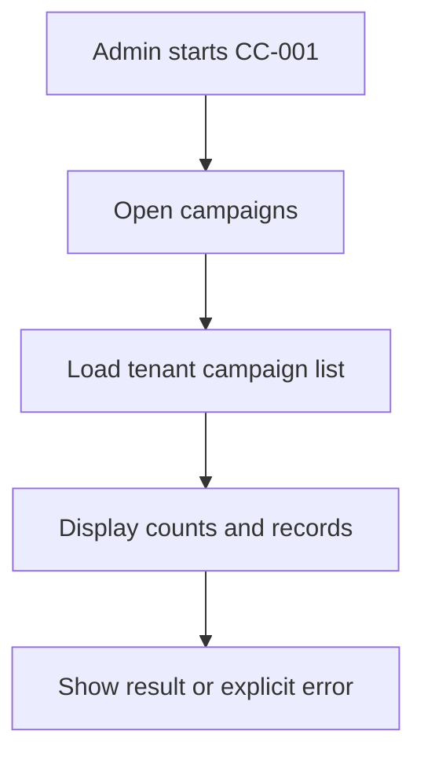


**Related workflow:** See [CC-001 in Workflow](Campaigns_Communications_BRD_Workflow.md).

## CC-002 — Campaign search, filters and statuses

**Module:** Campaigns  
**Scope:** As-Is  
**Priority:** Retain / verify

### User story

As an **AiXPurpose Admin**, I want to **search campaign rows and use status and advanced filters, including campaign type, date and goal ranges**, so that I can perform my fundraising and communication work clearly and safely in the standalone application.

### Functional requirements

- **FR-CC-002-01:** Search campaign rows and use status and advanced filters, including campaign type, date and goal ranges.
- **FR-CC-002-02:** Existing search, filters, navigation and tenant constraints must remain consistent with the relevant screen.
- **FR-CC-002-03:** Provide a clear success, validation, empty or failure state for the user action.

### Business logic

- **BL-CC-002-01:** Filters combine with the common record-source dropdown once implemented; prevent duplicate/confusing status controls where already addressed in enhancement baseline.
- **BL-CC-002-02:** This feature must not alter imported-source records through Admin-side mutation; tenant boundaries remain enforced.
- **BL-CC-002-03:** This feature does not introduce a new role hierarchy; all signed-in accounts are currently Admins.

### Acceptance criteria

1. **Given** an Admin opens the feature, **when** the expected flow is followed, **then** search locates matching campaigns; filter selection limits records; Reset restores default filters.
2. **Given** a required input or data dependency is missing, **when** the Admin performs the action, **then** show an explicit validation, unavailable or error state rather than fabricate an outcome.
3. **Given** a record originates from an external integration, **when** an Admin attempts an unsupported update, **then** both UI and API prevent manual modification.
4. **Given** the same action is attempted within another tenant, **when** record access is evaluated, **then** no data from an unrelated tenant is exposed.

### Feature workflow (Mermaid)

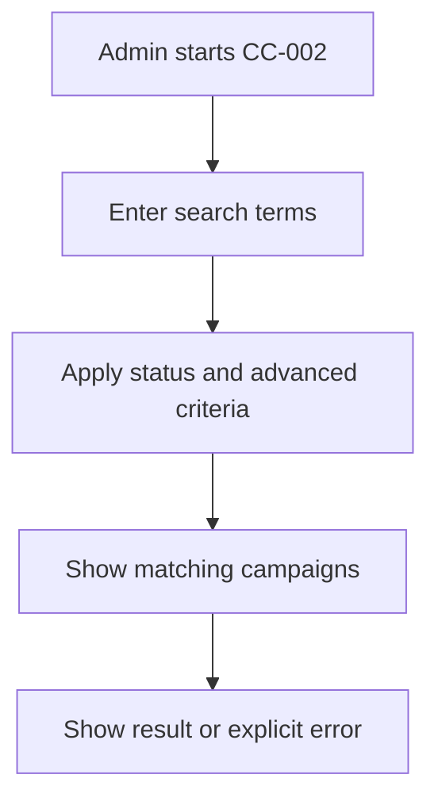


**Related workflow:** See [CC-002 in Workflow](Campaigns_Communications_BRD_Workflow.md).

## CC-003 — Four-step native campaign creation

**Module:** Campaigns  
**Scope:** As-Is  
**Priority:** Retain / verify

### User story

As an **AiXPurpose Admin**, I want to **admin completes Basic Information, AI Generator step, Select Audience and Review & Save to create a native campaign**, so that I can perform my fundraising and communication work clearly and safely in the standalone application.

### Functional requirements

- **FR-CC-003-01:** Admin completes Basic Information, AI Generator step, Select Audience and Review & Save to create a native campaign.
- **FR-CC-003-02:** Existing search, filters, navigation and tenant constraints must remain consistent with the relevant screen.
- **FR-CC-003-03:** Provide a clear success, validation, empty or failure state for the user action.

### Business logic

- **BL-CC-003-01:** Four-step navigation works; AI generation inside step 2 is currently not operational and is not described as an available result; do not block manual completion solely due to AI.
- **BL-CC-003-02:** This feature must not alter imported-source records through Admin-side mutation; tenant boundaries remain enforced.
- **BL-CC-003-03:** This feature does not introduce a new role hierarchy; all signed-in accounts are currently Admins.

### Acceptance criteria

1. **Given** an Admin opens the feature, **when** the expected flow is followed, **then** admin completes non-AI fields and saves; validation prevents missing mandatory inputs; created campaign is tagged AiXPurpose.
2. **Given** a required input or data dependency is missing, **when** the Admin performs the action, **then** show an explicit validation, unavailable or error state rather than fabricate an outcome.
3. **Given** a record originates from an external integration, **when** an Admin attempts an unsupported update, **then** both UI and API prevent manual modification.
4. **Given** the same action is attempted within another tenant, **when** record access is evaluated, **then** no data from an unrelated tenant is exposed.

### Feature workflow (Mermaid)

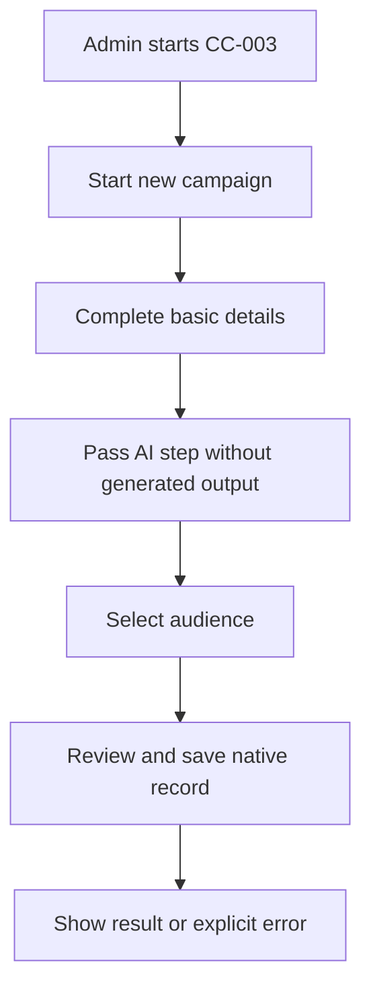


**Related workflow:** See [CC-003 in Workflow](Campaigns_Communications_BRD_Workflow.md).

## CC-004 — AI Campaign Generator control and fallback

**Module:** Campaigns  
**Scope:** Existing UI gap / decision pending  
**Priority:** Retain / verify

### User story

As an **AiXPurpose Admin**, I want to **retain the AI Generator step as pictured, but identify its generate action as nonfunctional pending an approved disposition**, so that I can perform my fundraising and communication work clearly and safely in the standalone application.

### Functional requirements

- **FR-CC-004-01:** Retain the AI Generator step as pictured, but identify its generate action as nonfunctional pending an approved disposition.
- **FR-CC-004-02:** Existing search, filters, navigation and tenant constraints must remain consistent with the relevant screen.
- **FR-CC-004-03:** Provide a clear success, validation, empty or failure state for the user action.

### Business logic

- **BL-CC-004-01:** No claim of successful AI-generated campaign content; no fabricated model or prompt behavior; manual campaign workflow remains available.
- **BL-CC-004-02:** This feature must not alter imported-source records through Admin-side mutation; tenant boundaries remain enforced.
- **BL-CC-004-03:** This feature does not introduce a new role hierarchy; all signed-in accounts are currently Admins.

### Acceptance criteria

1. **Given** an Admin opens the feature, **when** the expected flow is followed, **then** aI action is not presented as production-ready; QA records observed behavior; disposition is open.
2. **Given** a required input or data dependency is missing, **when** the Admin performs the action, **then** show an explicit validation, unavailable or error state rather than fabricate an outcome.
3. **Given** a record originates from an external integration, **when** an Admin attempts an unsupported update, **then** both UI and API prevent manual modification.
4. **Given** the same action is attempted within another tenant, **when** record access is evaluated, **then** no data from an unrelated tenant is exposed.

### Feature workflow (Mermaid)

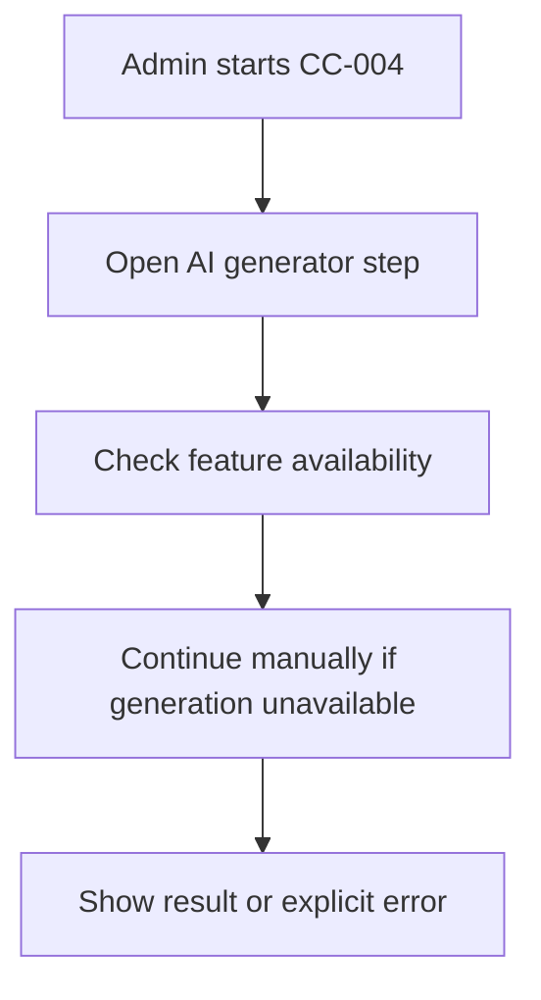


**Related workflow:** See [CC-004 in Workflow](Campaigns_Communications_BRD_Workflow.md).

## CC-005 — Campaign detail tabs

**Module:** Campaigns  
**Scope:** As-Is  
**Priority:** Retain / verify

### User story

As an **AiXPurpose Admin**, I want to **open Overview, Donations, Communication and Performance tabs from a campaign row**, so that I can perform my fundraising and communication work clearly and safely in the standalone application.

### Functional requirements

- **FR-CC-005-01:** Open Overview, Donations, Communication and Performance tabs from a campaign row.
- **FR-CC-005-02:** Existing search, filters, navigation and tenant constraints must remain consistent with the relevant screen.
- **FR-CC-005-03:** Provide a clear success, validation, empty or failure state for the user action.

### Business logic

- **BL-CC-005-01:** Each tab is scoped to the selected campaign; integrated campaign data is read-only.
- **BL-CC-005-02:** This feature must not alter imported-source records through Admin-side mutation; tenant boundaries remain enforced.
- **BL-CC-005-03:** This feature does not introduce a new role hierarchy; all signed-in accounts are currently Admins.

### Acceptance criteria

1. **Given** an Admin opens the feature, **when** the expected flow is followed, **then** opening a row navigates to the matching campaign; tabs display only associated data; empty/error states are visible.
2. **Given** a required input or data dependency is missing, **when** the Admin performs the action, **then** show an explicit validation, unavailable or error state rather than fabricate an outcome.
3. **Given** a record originates from an external integration, **when** an Admin attempts an unsupported update, **then** both UI and API prevent manual modification.
4. **Given** the same action is attempted within another tenant, **when** record access is evaluated, **then** no data from an unrelated tenant is exposed.

### Feature workflow (Mermaid)

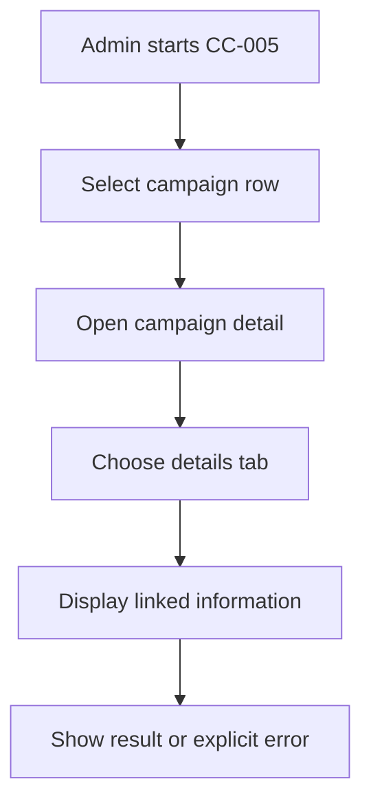


**Related workflow:** See [CC-005 in Workflow](Campaigns_Communications_BRD_Workflow.md).

## CC-006 — Campaign editing and source protection

**Module:** Campaigns  
**Scope:** As-Is business rule / To-Be enforcement  
**Priority:** High

### User story

As an **AiXPurpose Admin**, I want to **show Edit Campaign for records created in AiXPurpose; provide view-only detail for externally integrated campaigns**, so that I can perform my fundraising and communication work clearly and safely in the standalone application.

### Functional requirements

- **FR-CC-006-01:** Show Edit Campaign for records created in AiXPurpose; provide view-only detail for externally integrated campaigns.
- **FR-CC-006-02:** Existing search, filters, navigation and tenant constraints must remain consistent with the relevant screen.
- **FR-CC-006-03:** Provide a clear success, validation, empty or failure state for the user action.

### Business logic

- **BL-CC-006-01:** All signed-in users are Admins with native editing access; integrated record edits blocked in UI and API; external sync updates remain permitted.
- **BL-CC-006-02:** This feature must not alter imported-source records through Admin-side mutation; tenant boundaries remain enforced.
- **BL-CC-006-03:** This feature does not introduce a new role hierarchy; all signed-in accounts are currently Admins.

### Acceptance criteria

1. **Given** an Admin opens the feature, **when** the expected flow is followed, **then** admin edits native campaign; external campaign shows no edit action; direct update call for external ID is rejected.
2. **Given** a required input or data dependency is missing, **when** the Admin performs the action, **then** show an explicit validation, unavailable or error state rather than fabricate an outcome.
3. **Given** a record originates from an external integration, **when** an Admin attempts an unsupported update, **then** both UI and API prevent manual modification.
4. **Given** the same action is attempted within another tenant, **when** record access is evaluated, **then** no data from an unrelated tenant is exposed.

### Feature workflow (Mermaid)

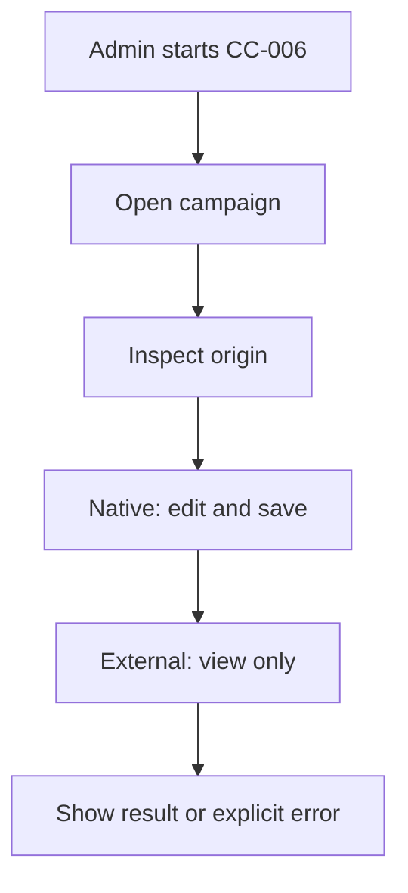


**Related workflow:** See [CC-006 in Workflow](Campaigns_Communications_BRD_Workflow.md).

## CC-007 — Campaign donations and donor linkage

**Module:** Campaigns  
**Scope:** Standalone baseline enhancement – QA verification  
**Priority:** High

### User story

As an **AiXPurpose Admin**, I want to **show donation records and associated donors linked to the selected campaign; do not show unrelated donors**, so that I can perform my fundraising and communication work clearly and safely in the standalone application.

### Functional requirements

- **FR-CC-007-01:** Show donation records and associated donors linked to the selected campaign; do not show unrelated donors.
- **FR-CC-007-02:** Existing search, filters, navigation and tenant constraints must remain consistent with the relevant screen.
- **FR-CC-007-03:** Provide a clear success, validation, empty or failure state for the user action.

### Business logic

- **BL-CC-007-01:** Use validated campaign-to-donation and constituent mapping; synced gift records remain read-only; ambiguity is surfaced rather than guessed.
- **BL-CC-007-02:** This feature must not alter imported-source records through Admin-side mutation; tenant boundaries remain enforced.
- **BL-CC-007-03:** This feature does not introduce a new role hierarchy; all signed-in accounts are currently Admins.

### Acceptance criteria

1. **Given** an Admin opens the feature, **when** the expected flow is followed, **then** only correctly linked donation rows appear; donor navigation resolves correctly; missing mapping does not invent relationships.
2. **Given** a required input or data dependency is missing, **when** the Admin performs the action, **then** show an explicit validation, unavailable or error state rather than fabricate an outcome.
3. **Given** a record originates from an external integration, **when** an Admin attempts an unsupported update, **then** both UI and API prevent manual modification.
4. **Given** the same action is attempted within another tenant, **when** record access is evaluated, **then** no data from an unrelated tenant is exposed.

### Feature workflow (Mermaid)

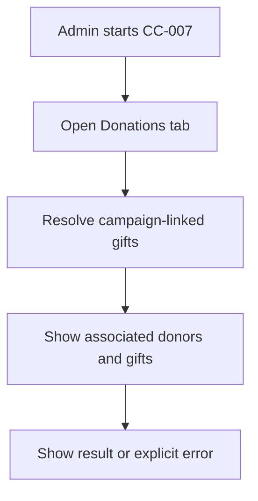


**Related workflow:** See [CC-007 in Workflow](Campaigns_Communications_BRD_Workflow.md).

## CC-008 — Campaign audience communication

**Module:** Campaigns  
**Scope:** Standalone baseline enhancement – QA verification  
**Priority:** High

### User story

As an **AiXPurpose Admin**, I want to **send or schedule campaign emails to All Campaign Members or Campaign Donors Only using the existing communication journey**, so that I can perform my fundraising and communication work clearly and safely in the standalone application.

### Functional requirements

- **FR-CC-008-01:** Send or schedule campaign emails to All Campaign Members or Campaign Donors Only using the existing communication journey.
- **FR-CC-008-02:** Existing search, filters, navigation and tenant constraints must remain consistent with the relevant screen.
- **FR-CC-008-03:** Provide a clear success, validation, empty or failure state for the user action.

### Business logic

- **BL-CC-008-01:** Audience membership and donor linkage must be mapped; member/donor mapping does not imply unrelated profiles; email channel is operational.
- **BL-CC-008-02:** This feature must not alter imported-source records through Admin-side mutation; tenant boundaries remain enforced.
- **BL-CC-008-03:** This feature does not introduce a new role hierarchy; all signed-in accounts are currently Admins.

### Acceptance criteria

1. **Given** an Admin opens the feature, **when** the expected flow is followed, **then** admin selects one of two valid campaign audiences; recipients match chosen scope; Send/Schedule opens existing workflow.
2. **Given** a required input or data dependency is missing, **when** the Admin performs the action, **then** show an explicit validation, unavailable or error state rather than fabricate an outcome.
3. **Given** a record originates from an external integration, **when** an Admin attempts an unsupported update, **then** both UI and API prevent manual modification.
4. **Given** the same action is attempted within another tenant, **when** record access is evaluated, **then** no data from an unrelated tenant is exposed.

### Feature workflow (Mermaid)

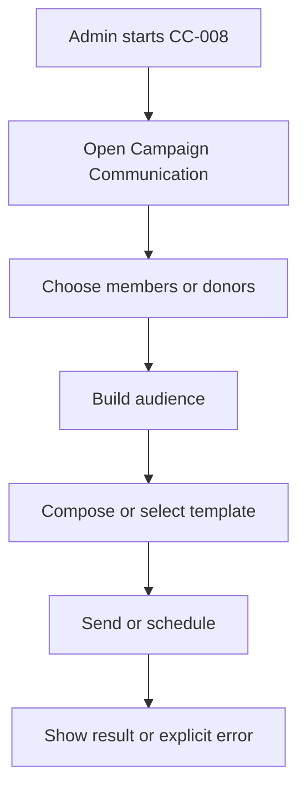


**Related workflow:** See [CC-008 in Workflow](Campaigns_Communications_BRD_Workflow.md).

## CC-009 — Campaign performance and calculation integrity

**Module:** Campaigns  
**Scope:** As-Is UI / open calculation decision  
**Priority:** Retain / verify

### User story

As an **AiXPurpose Admin**, I want to **display existing campaign performance KPI and charts while keeping unresolved metrics explicitly pending formula validation**, so that I can perform my fundraising and communication work clearly and safely in the standalone application.

### Functional requirements

- **FR-CC-009-01:** Display existing campaign performance KPI and charts while keeping unresolved metrics explicitly pending formula validation.
- **FR-CC-009-02:** Existing search, filters, navigation and tenant constraints must remain consistent with the relevant screen.
- **FR-CC-009-03:** Provide a clear success, validation, empty or failure state for the user action.

### Business logic

- **BL-CC-009-01:** Audience, conversion, goal/achieved, goal progress and donation attribution require approved definitions; do not infer counts from unverified sources.
- **BL-CC-009-02:** This feature must not alter imported-source records through Admin-side mutation; tenant boundaries remain enforced.
- **BL-CC-009-03:** This feature does not introduce a new role hierarchy; all signed-in accounts are currently Admins.

### Acceptance criteria

1. **Given** an Admin opens the feature, **when** the expected flow is followed, **then** uI retained; calculations flagged for confirmation; QA tests reconciled formulas once approved.
2. **Given** a required input or data dependency is missing, **when** the Admin performs the action, **then** show an explicit validation, unavailable or error state rather than fabricate an outcome.
3. **Given** a record originates from an external integration, **when** an Admin attempts an unsupported update, **then** both UI and API prevent manual modification.
4. **Given** the same action is attempted within another tenant, **when** record access is evaluated, **then** no data from an unrelated tenant is exposed.

### Feature workflow (Mermaid)

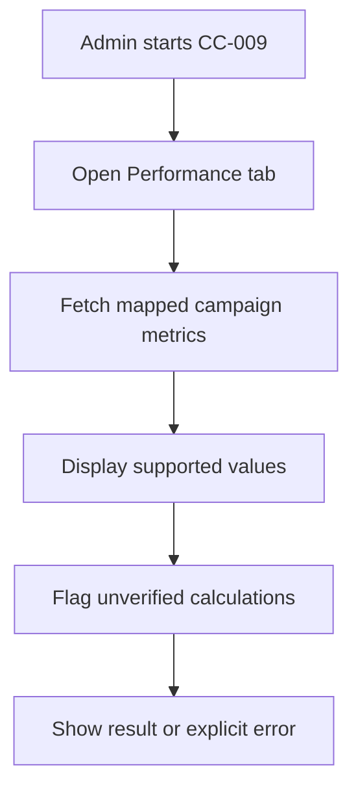


**Related workflow:** See [CC-009 in Workflow](Campaigns_Communications_BRD_Workflow.md).

## CC-010 — Communication KPIs and list

**Module:** Communications  
**Scope:** As-Is  
**Priority:** Retain / verify

### User story

As an **AiXPurpose Admin**, I want to **display communication listing and volume/reach/engagement KPI cards**, so that I can perform my fundraising and communication work clearly and safely in the standalone application.

### Functional requirements

- **FR-CC-010-01:** Display communication listing and volume/reach/engagement KPI cards.
- **FR-CC-010-02:** Existing search, filters, navigation and tenant constraints must remain consistent with the relevant screen.
- **FR-CC-010-03:** Provide a clear success, validation, empty or failure state for the user action.

### Business logic

- **BL-CC-010-01:** Display only tenant data; counts depend on verified communication and provider events.
- **BL-CC-010-02:** This feature must not alter imported-source records through Admin-side mutation; tenant boundaries remain enforced.
- **BL-CC-010-03:** This feature does not introduce a new role hierarchy; all signed-in accounts are currently Admins.

### Acceptance criteria

1. **Given** an Admin opens the feature, **when** the expected flow is followed, **then** communication rows and KPIs load; empty state works; figures are not invented.
2. **Given** a required input or data dependency is missing, **when** the Admin performs the action, **then** show an explicit validation, unavailable or error state rather than fabricate an outcome.
3. **Given** a record originates from an external integration, **when** an Admin attempts an unsupported update, **then** both UI and API prevent manual modification.
4. **Given** the same action is attempted within another tenant, **when** record access is evaluated, **then** no data from an unrelated tenant is exposed.

### Feature workflow (Mermaid)

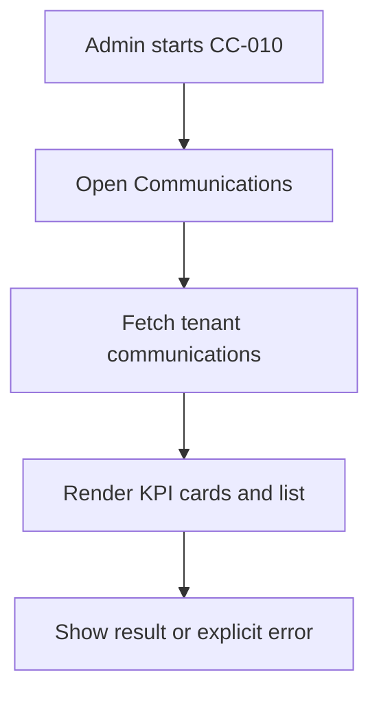


**Related workflow:** See [CC-010 in Workflow](Campaigns_Communications_BRD_Workflow.md).

## CC-011 — Communication list search and filtering

**Module:** Communications  
**Scope:** As-Is  
**Priority:** Retain / verify

### User story

As an **AiXPurpose Admin**, I want to **search, filter and navigate communication records**, so that I can perform my fundraising and communication work clearly and safely in the standalone application.

### Functional requirements

- **FR-CC-011-01:** Search, filter and navigate communication records.
- **FR-CC-011-02:** Existing search, filters, navigation and tenant constraints must remain consistent with the relevant screen.
- **FR-CC-011-03:** Provide a clear success, validation, empty or failure state for the user action.

### Business logic

- **BL-CC-011-01:** Scope all searches and filters to the current tenant and page; display no unauthorized cross-tenant records.
- **BL-CC-011-02:** This feature must not alter imported-source records through Admin-side mutation; tenant boundaries remain enforced.
- **BL-CC-011-03:** This feature does not introduce a new role hierarchy; all signed-in accounts are currently Admins.

### Acceptance criteria

1. **Given** an Admin opens the feature, **when** the expected flow is followed, **then** search returns matching communication rows; filters combine correctly; records open the correct details.
2. **Given** a required input or data dependency is missing, **when** the Admin performs the action, **then** show an explicit validation, unavailable or error state rather than fabricate an outcome.
3. **Given** a record originates from an external integration, **when** an Admin attempts an unsupported update, **then** both UI and API prevent manual modification.
4. **Given** the same action is attempted within another tenant, **when** record access is evaluated, **then** no data from an unrelated tenant is exposed.

### Feature workflow (Mermaid)

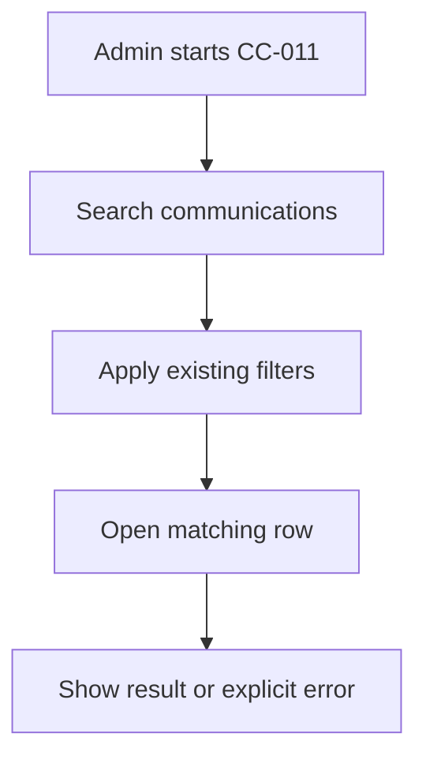


**Related workflow:** See [CC-011 in Workflow](Campaigns_Communications_BRD_Workflow.md).

## CC-012 — Four-step communication creation

**Module:** Communications  
**Scope:** As-Is  
**Priority:** Retain / verify

### User story

As an **AiXPurpose Admin**, I want to **complete Audience, Content, Preview, and Send/Schedule steps**, so that I can perform my fundraising and communication work clearly and safely in the standalone application.

### Functional requirements

- **FR-CC-012-01:** Complete Audience, Content, Preview, and Send/Schedule steps.
- **FR-CC-012-02:** Existing search, filters, navigation and tenant constraints must remain consistent with the relevant screen.
- **FR-CC-012-03:** Provide a clear success, validation, empty or failure state for the user action.

### Business logic

- **BL-CC-012-01:** Audience can be selected from campaign/segment; supported templates can populate content; preview displays intended message.
- **BL-CC-012-02:** This feature must not alter imported-source records through Admin-side mutation; tenant boundaries remain enforced.
- **BL-CC-012-03:** This feature does not introduce a new role hierarchy; all signed-in accounts are currently Admins.

### Acceptance criteria

1. **Given** an Admin opens the feature, **when** the expected flow is followed, **then** admin can navigate steps, validate recipients/content, preview and complete supported email communication.
2. **Given** a required input or data dependency is missing, **when** the Admin performs the action, **then** show an explicit validation, unavailable or error state rather than fabricate an outcome.
3. **Given** a record originates from an external integration, **when** an Admin attempts an unsupported update, **then** both UI and API prevent manual modification.
4. **Given** the same action is attempted within another tenant, **when** record access is evaluated, **then** no data from an unrelated tenant is exposed.

### Feature workflow (Mermaid)

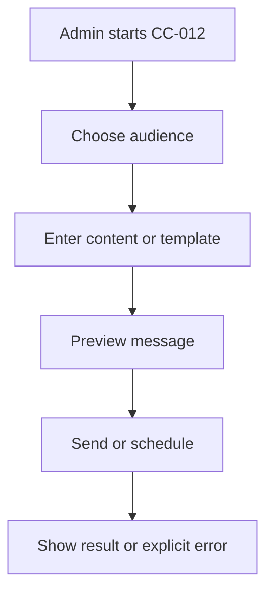


**Related workflow:** See [CC-012 in Workflow](Campaigns_Communications_BRD_Workflow.md).

## CC-013 — Email Send Now

**Module:** Communications  
**Scope:** As-Is confirmed functional  
**Priority:** Retain / verify

### User story

As an **AiXPurpose Admin**, I want to **send an email communication immediately using configured mail delivery**, so that I can perform my fundraising and communication work clearly and safely in the standalone application.

### Functional requirements

- **FR-CC-013-01:** Send an email communication immediately using configured mail delivery.
- **FR-CC-013-02:** Existing search, filters, navigation and tenant constraints must remain consistent with the relevant screen.
- **FR-CC-013-03:** Provide a clear success, validation, empty or failure state for the user action.

### Business logic

- **BL-CC-013-01:** Email channel already operational; sending status cannot be edited after dispatch; delivery events reflect provider feedback when available.
- **BL-CC-013-02:** This feature must not alter imported-source records through Admin-side mutation; tenant boundaries remain enforced.
- **BL-CC-013-03:** This feature does not introduce a new role hierarchy; all signed-in accounts are currently Admins.

### Acceptance criteria

1. **Given** an Admin opens the feature, **when** the expected flow is followed, **then** admin sends valid email; success/failure state shown; sent content becomes read-only.
2. **Given** a required input or data dependency is missing, **when** the Admin performs the action, **then** show an explicit validation, unavailable or error state rather than fabricate an outcome.
3. **Given** a record originates from an external integration, **when** an Admin attempts an unsupported update, **then** both UI and API prevent manual modification.
4. **Given** the same action is attempted within another tenant, **when** record access is evaluated, **then** no data from an unrelated tenant is exposed.

### Feature workflow (Mermaid)

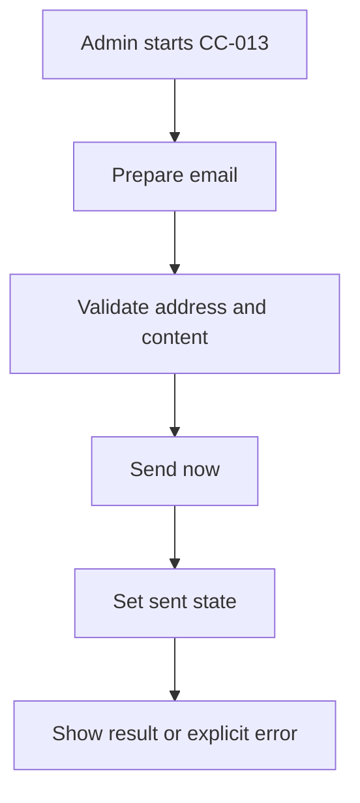


**Related workflow:** See [CC-013 in Workflow](Campaigns_Communications_BRD_Workflow.md).

## CC-014 — Email schedule and schedule management

**Module:** Communications  
**Scope:** As-Is confirmed functional  
**Priority:** Retain / verify

### User story

As an **AiXPurpose Admin**, I want to **schedule email communication and view/manage upcoming scheduled items in existing scheduling tools**, so that I can perform my fundraising and communication work clearly and safely in the standalone application.

### Functional requirements

- **FR-CC-014-01:** Schedule email communication and view/manage upcoming scheduled items in existing scheduling tools.
- **FR-CC-014-02:** Existing search, filters, navigation and tenant constraints must remain consistent with the relevant screen.
- **FR-CC-014-03:** Provide a clear success, validation, empty or failure state for the user action.

### Business logic

- **BL-CC-014-01:** Scheduled communications remain editable before dispatch; once sent, content is locked; existing enhanced scheduling management is As-Is, not Future.
- **BL-CC-014-02:** This feature must not alter imported-source records through Admin-side mutation; tenant boundaries remain enforced.
- **BL-CC-014-03:** This feature does not introduce a new role hierarchy; all signed-in accounts are currently Admins.

### Acceptance criteria

1. **Given** an Admin opens the feature, **when** the expected flow is followed, **then** admin schedules message; can view and edit pending schedule; cannot modify sent content.
2. **Given** a required input or data dependency is missing, **when** the Admin performs the action, **then** show an explicit validation, unavailable or error state rather than fabricate an outcome.
3. **Given** a record originates from an external integration, **when** an Admin attempts an unsupported update, **then** both UI and API prevent manual modification.
4. **Given** the same action is attempted within another tenant, **when** record access is evaluated, **then** no data from an unrelated tenant is exposed.

### Feature workflow (Mermaid)

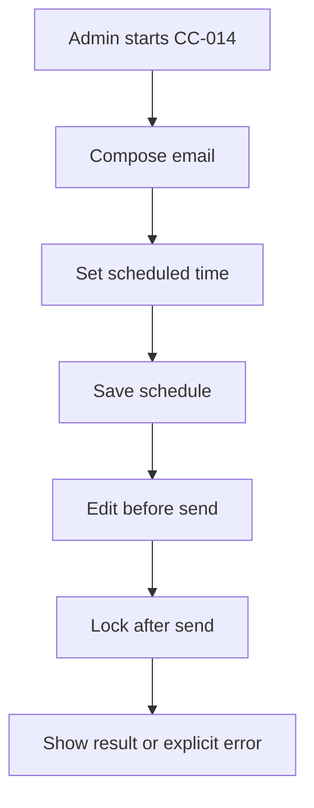


**Related workflow:** See [CC-014 in Workflow](Campaigns_Communications_BRD_Workflow.md).

## CC-015 — Communication details overview and delivery KPIs

**Module:** Communications  
**Scope:** As-Is / QA verification  
**Priority:** Retain / verify

### User story

As an **AiXPurpose Admin**, I want to **show Overview with Audience, Sent, Delivered, Failed, Open Rate and Click Rate and other existing detail tabs**, so that I can perform my fundraising and communication work clearly and safely in the standalone application.

### Functional requirements

- **FR-CC-015-01:** Show Overview with Audience, Sent, Delivered, Failed, Open Rate and Click Rate and other existing detail tabs.
- **FR-CC-015-02:** Existing search, filters, navigation and tenant constraints must remain consistent with the relevant screen.
- **FR-CC-015-03:** Provide a clear success, validation, empty or failure state for the user action.

### Business logic

- **BL-CC-015-01:** Provider delivery, open and click events must substantiate figures; unsupported statuses remain pending verification.
- **BL-CC-015-02:** This feature must not alter imported-source records through Admin-side mutation; tenant boundaries remain enforced.
- **BL-CC-015-03:** This feature does not introduce a new role hierarchy; all signed-in accounts are currently Admins.

### Acceptance criteria

1. **Given** an Admin opens the feature, **when** the expected flow is followed, **then** existing tabs and cards render; reconciled event totals only; no fabricated analytics values.
2. **Given** a required input or data dependency is missing, **when** the Admin performs the action, **then** show an explicit validation, unavailable or error state rather than fabricate an outcome.
3. **Given** a record originates from an external integration, **when** an Admin attempts an unsupported update, **then** both UI and API prevent manual modification.
4. **Given** the same action is attempted within another tenant, **when** record access is evaluated, **then** no data from an unrelated tenant is exposed.

### Feature workflow (Mermaid)

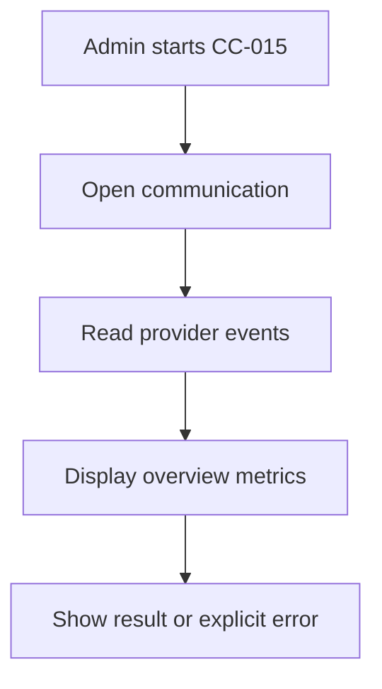


**Related workflow:** See [CC-015 in Workflow](Campaigns_Communications_BRD_Workflow.md).

## CC-016 — Recipient audience status list and export

**Module:** Communications  
**Scope:** As-Is / QA verification  
**Priority:** Retain / verify

### User story

As an **AiXPurpose Admin**, I want to **display recipient list with All, Delivered, Pending and Failed status filters, row selection, pagination and Export List**, so that I can perform my fundraising and communication work clearly and safely in the standalone application.

### Functional requirements

- **FR-CC-016-01:** Display recipient list with All, Delivered, Pending and Failed status filters, row selection, pagination and Export List.
- **FR-CC-016-02:** Existing search, filters, navigation and tenant constraints must remain consistent with the relevant screen.
- **FR-CC-016-03:** Provide a clear success, validation, empty or failure state for the user action.

### Business logic

- **BL-CC-016-01:** Recipients must be from selected audience; export includes only selected tenant/communication and observed status data.
- **BL-CC-016-02:** This feature must not alter imported-source records through Admin-side mutation; tenant boundaries remain enforced.
- **BL-CC-016-03:** This feature does not introduce a new role hierarchy; all signed-in accounts are currently Admins.

### Acceptance criteria

1. **Given** an Admin opens the feature, **when** the expected flow is followed, **then** status tabs filter recipients; pagination works; Export List downloads correct scoped rows when supported.
2. **Given** a required input or data dependency is missing, **when** the Admin performs the action, **then** show an explicit validation, unavailable or error state rather than fabricate an outcome.
3. **Given** a record originates from an external integration, **when** an Admin attempts an unsupported update, **then** both UI and API prevent manual modification.
4. **Given** the same action is attempted within another tenant, **when** record access is evaluated, **then** no data from an unrelated tenant is exposed.

### Feature workflow (Mermaid)

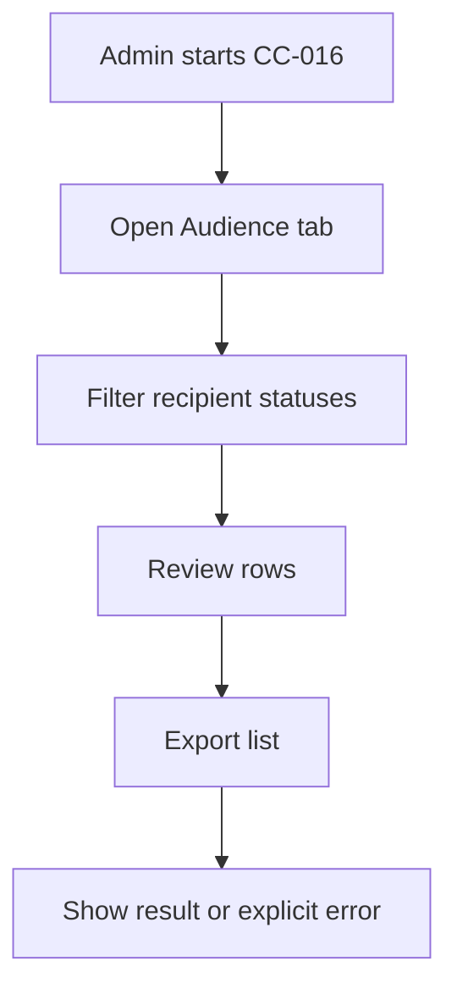


**Related workflow:** See [CC-016 in Workflow](Campaigns_Communications_BRD_Workflow.md).

## CC-017 — Message preview and code view

**Module:** Communications  
**Scope:** As-Is  
**Priority:** Retain / verify

### User story

As an **AiXPurpose Admin**, I want to **show message subject, rendered content preview and code representation on Messages tab**, so that I can perform my fundraising and communication work clearly and safely in the standalone application.

### Functional requirements

- **FR-CC-017-01:** Show message subject, rendered content preview and code representation on Messages tab.
- **FR-CC-017-02:** Existing search, filters, navigation and tenant constraints must remain consistent with the relevant screen.
- **FR-CC-017-03:** Provide a clear success, validation, empty or failure state for the user action.

### Business logic

- **BL-CC-017-01:** Preview and HTML/code view are read-only for sent communication; scheduled content may be edited through existing edit flow.
- **BL-CC-017-02:** This feature must not alter imported-source records through Admin-side mutation; tenant boundaries remain enforced.
- **BL-CC-017-03:** This feature does not introduce a new role hierarchy; all signed-in accounts are currently Admins.

### Acceptance criteria

1. **Given** an Admin opens the feature, **when** the expected flow is followed, **then** message subject, preview and code display; sent content cannot be updated.
2. **Given** a required input or data dependency is missing, **when** the Admin performs the action, **then** show an explicit validation, unavailable or error state rather than fabricate an outcome.
3. **Given** a record originates from an external integration, **when** an Admin attempts an unsupported update, **then** both UI and API prevent manual modification.
4. **Given** the same action is attempted within another tenant, **when** record access is evaluated, **then** no data from an unrelated tenant is exposed.

### Feature workflow (Mermaid)

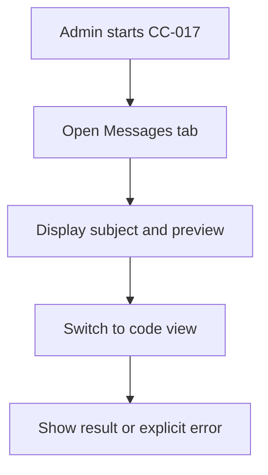


**Related workflow:** See [CC-017 in Workflow](Campaigns_Communications_BRD_Workflow.md).

## CC-018 — Communication content editing lifecycle

**Module:** Communications  
**Scope:** As-Is rule / QA verification  
**Priority:** Retain / verify

### User story

As an **AiXPurpose Admin**, I want to **allow Admin to modify a draft or scheduled communication before sending and prevent edits after sending**, so that I can perform my fundraising and communication work clearly and safely in the standalone application.

### Functional requirements

- **FR-CC-018-01:** Allow Admin to modify a draft or scheduled communication before sending and prevent edits after sending.
- **FR-CC-018-02:** Existing search, filters, navigation and tenant constraints must remain consistent with the relevant screen.
- **FR-CC-018-03:** Provide a clear success, validation, empty or failure state for the user action.

### Business logic

- **BL-CC-018-01:** Only Admin accounts exist; no extra permission matrix; status validation required server-side.
- **BL-CC-018-02:** This feature must not alter imported-source records through Admin-side mutation; tenant boundaries remain enforced.
- **BL-CC-018-03:** This feature does not introduce a new role hierarchy; all signed-in accounts are currently Admins.

### Acceptance criteria

1. **Given** an Admin opens the feature, **when** the expected flow is followed, **then** draft and scheduled edits save before dispatch; sent record edit action absent and write endpoint rejects modification.
2. **Given** a required input or data dependency is missing, **when** the Admin performs the action, **then** show an explicit validation, unavailable or error state rather than fabricate an outcome.
3. **Given** a record originates from an external integration, **when** an Admin attempts an unsupported update, **then** both UI and API prevent manual modification.
4. **Given** the same action is attempted within another tenant, **when** record access is evaluated, **then** no data from an unrelated tenant is exposed.

### Feature workflow (Mermaid)

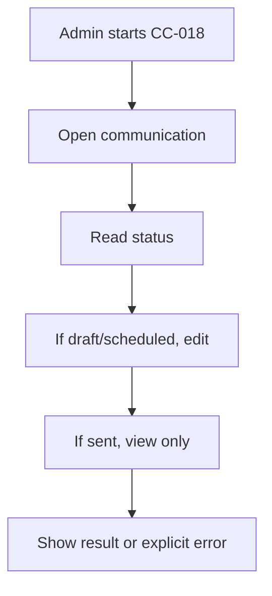


**Related workflow:** See [CC-018 in Workflow](Campaigns_Communications_BRD_Workflow.md).

## CC-019 — SMS operational delivery

**Module:** Communications  
**Scope:** To-Be  
**Priority:** High

### User story

As an **AiXPurpose Admin**, I want to **activate SMS sending through the tenant-configured messaging provider within the existing communication flow**, so that I can perform my fundraising and communication work clearly and safely in the standalone application.

### Functional requirements

- **FR-CC-019-01:** Activate SMS sending through the tenant-configured messaging provider within the existing communication flow.
- **FR-CC-019-02:** Existing search, filters, navigation and tenant constraints must remain consistent with the relevant screen.
- **FR-CC-019-03:** Provide a clear success, validation, empty or failure state for the user action.

### Business logic

- **BL-CC-019-01:** Do not assume provider, costs, templates or status callbacks without Development validation; hide/block Send when provider unconfigured.
- **BL-CC-019-02:** This feature must not alter imported-source records through Admin-side mutation; tenant boundaries remain enforced.
- **BL-CC-019-03:** This feature does not introduce a new role hierarchy; all signed-in accounts are currently Admins.

### Acceptance criteria

1. **Given** an Admin opens the feature, **when** the expected flow is followed, **then** configured tenant sends SMS; validation handles missing number/provider; delivery failures surface without false success.
2. **Given** a required input or data dependency is missing, **when** the Admin performs the action, **then** show an explicit validation, unavailable or error state rather than fabricate an outcome.
3. **Given** a record originates from an external integration, **when** an Admin attempts an unsupported update, **then** both UI and API prevent manual modification.
4. **Given** the same action is attempted within another tenant, **when** record access is evaluated, **then** no data from an unrelated tenant is exposed.

### Feature workflow (Mermaid)

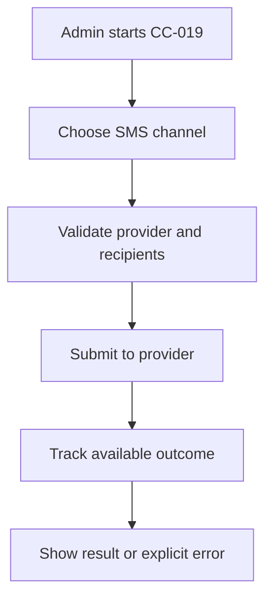


**Related workflow:** See [CC-019 in Workflow](Campaigns_Communications_BRD_Workflow.md).

## CC-020 — WhatsApp operational delivery

**Module:** Communications  
**Scope:** To-Be  
**Priority:** High

### User story

As an **AiXPurpose Admin**, I want to **activate WhatsApp sending through the tenant-configured provider within the existing communication flow**, so that I can perform my fundraising and communication work clearly and safely in the standalone application.

### Functional requirements

- **FR-CC-020-01:** Activate WhatsApp sending through the tenant-configured provider within the existing communication flow.
- **FR-CC-020-02:** Existing search, filters, navigation and tenant constraints must remain consistent with the relevant screen.
- **FR-CC-020-03:** Provide a clear success, validation, empty or failure state for the user action.

### Business logic

- **BL-CC-020-01:** Respect provider-specific template/opt-in requirements when verified; do not invent supported message formats or callbacks.
- **BL-CC-020-02:** This feature must not alter imported-source records through Admin-side mutation; tenant boundaries remain enforced.
- **BL-CC-020-03:** This feature does not introduce a new role hierarchy; all signed-in accounts are currently Admins.

### Acceptance criteria

1. **Given** an Admin opens the feature, **when** the expected flow is followed, **then** configured channel dispatches supported message; invalid/unconfigured delivery blocked; show reliable status.
2. **Given** a required input or data dependency is missing, **when** the Admin performs the action, **then** show an explicit validation, unavailable or error state rather than fabricate an outcome.
3. **Given** a record originates from an external integration, **when** an Admin attempts an unsupported update, **then** both UI and API prevent manual modification.
4. **Given** the same action is attempted within another tenant, **when** record access is evaluated, **then** no data from an unrelated tenant is exposed.

### Feature workflow (Mermaid)

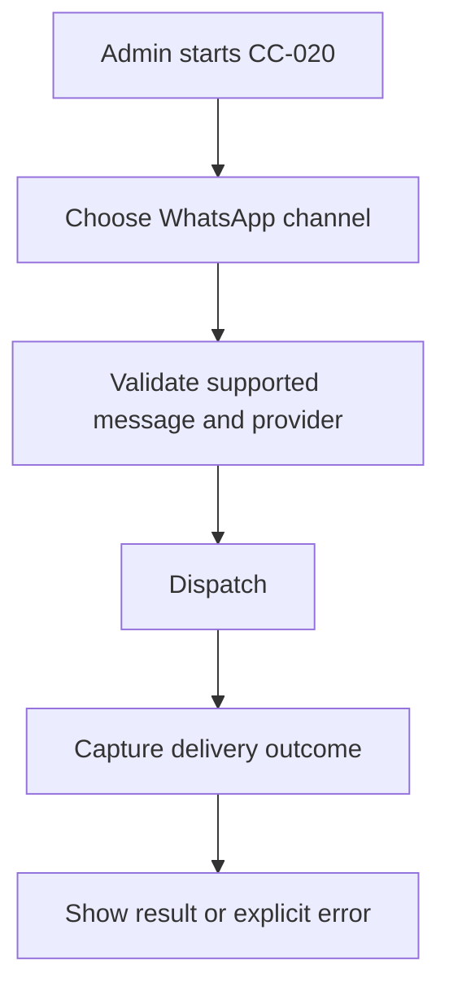


**Related workflow:** See [CC-020 in Workflow](Campaigns_Communications_BRD_Workflow.md).

## CC-021 — Audience resolution and tenant consistency

**Module:** Communications  
**Scope:** To-Be shared rule  
**Priority:** High

### User story

As an **AiXPurpose Admin**, I want to **resolve campaign or segment audience into intended recipients before dispatch**, so that I can perform my fundraising and communication work clearly and safely in the standalone application.

### Functional requirements

- **FR-CC-021-01:** Resolve campaign or segment audience into intended recipients before dispatch.
- **FR-CC-021-02:** Existing search, filters, navigation and tenant constraints must remain consistent with the relevant screen.
- **FR-CC-021-03:** Provide a clear success, validation, empty or failure state for the user action.

### Business logic

- **BL-CC-021-01:** Deduplication/consent rules require verified mappings; do not treat duplicate source records as automatically unique humans; never cross tenant.
- **BL-CC-021-02:** This feature must not alter imported-source records through Admin-side mutation; tenant boundaries remain enforced.
- **BL-CC-021-03:** This feature does not introduce a new role hierarchy; all signed-in accounts are currently Admins.

### Acceptance criteria

1. **Given** an Admin opens the feature, **when** the expected flow is followed, **then** preview audience counts based on valid linkage; only current tenant recipients included; invalid/empty groups handled clearly.
2. **Given** a required input or data dependency is missing, **when** the Admin performs the action, **then** show an explicit validation, unavailable or error state rather than fabricate an outcome.
3. **Given** a record originates from an external integration, **when** an Admin attempts an unsupported update, **then** both UI and API prevent manual modification.
4. **Given** the same action is attempted within another tenant, **when** record access is evaluated, **then** no data from an unrelated tenant is exposed.

### Feature workflow (Mermaid)

```mermaid
flowchart TD
    A["Admin starts CC-021"]
    S1["Select campaign or segment"]
    A --> S1
    S2["Resolve mapped recipients"]
    S1 --> S2
    S3["Validate tenant and channel"]
    S2 --> S3
    S4["Prepare audience"]
    S3 --> S4
    S4 --> Z["Show result or explicit error"]
```


**Related workflow:** See [CC-021 in Workflow](Campaigns_Communications_BRD_Workflow.md).

## CC-022 — Template list, search and type filters

**Module:** Templates  
**Scope:** As-Is  
**Priority:** Retain / verify

### User story

As an **AiXPurpose Admin**, I want to **list existing Email, SMS and WhatsApp templates and filter/search by available metadata**, so that I can perform my fundraising and communication work clearly and safely in the standalone application.

### Functional requirements

- **FR-CC-022-01:** List existing Email, SMS and WhatsApp templates and filter/search by available metadata.
- **FR-CC-022-02:** Existing search, filters, navigation and tenant constraints must remain consistent with the relevant screen.
- **FR-CC-022-03:** Provide a clear success, validation, empty or failure state for the user action.

### Business logic

- **BL-CC-022-01:** Templates are tenant-scoped; do not imply operational SMS/WhatsApp dispatch merely because a template exists.
- **BL-CC-022-02:** This feature must not alter imported-source records through Admin-side mutation; tenant boundaries remain enforced.
- **BL-CC-022-03:** This feature does not introduce a new role hierarchy; all signed-in accounts are currently Admins.

### Acceptance criteria

1. **Given** an Admin opens the feature, **when** the expected flow is followed, **then** admin searches templates, applies type filters and opens the correct template.
2. **Given** a required input or data dependency is missing, **when** the Admin performs the action, **then** show an explicit validation, unavailable or error state rather than fabricate an outcome.
3. **Given** a record originates from an external integration, **when** an Admin attempts an unsupported update, **then** both UI and API prevent manual modification.
4. **Given** the same action is attempted within another tenant, **when** record access is evaluated, **then** no data from an unrelated tenant is exposed.

### Feature workflow (Mermaid)

```mermaid
flowchart TD
    A["Admin starts CC-022"]
    S1["Open Templates"]
    A --> S1
    S2["Search or filter by channel"]
    S1 --> S2
    S3["Open template"]
    S2 --> S3
    S3 --> Z["Show result or explicit error"]
```


**Related workflow:** See [CC-022 in Workflow](Campaigns_Communications_BRD_Workflow.md).

## CC-023 — Native template creation and editing

**Module:** Templates  
**Scope:** As-Is  
**Priority:** Retain / verify

### User story

As an **AiXPurpose Admin**, I want to **admin creates or edits native templates with supported subject/content/variables and timestamps**, so that I can perform my fundraising and communication work clearly and safely in the standalone application.

### Functional requirements

- **FR-CC-023-01:** Admin creates or edits native templates with supported subject/content/variables and timestamps.
- **FR-CC-023-02:** Existing search, filters, navigation and tenant constraints must remain consistent with the relevant screen.
- **FR-CC-023-03:** Provide a clear success, validation, empty or failure state for the user action.

### Business logic

- **BL-CC-023-01:** All Admins may edit native templates; any externally sourced template remains read-only if such records exist.
- **BL-CC-023-02:** This feature must not alter imported-source records through Admin-side mutation; tenant boundaries remain enforced.
- **BL-CC-023-03:** This feature does not introduce a new role hierarchy; all signed-in accounts are currently Admins.

### Acceptance criteria

1. **Given** an Admin opens the feature, **when** the expected flow is followed, **then** new template saves; native content updates persist; invalid required content blocked.
2. **Given** a required input or data dependency is missing, **when** the Admin performs the action, **then** show an explicit validation, unavailable or error state rather than fabricate an outcome.
3. **Given** a record originates from an external integration, **when** an Admin attempts an unsupported update, **then** both UI and API prevent manual modification.
4. **Given** the same action is attempted within another tenant, **when** record access is evaluated, **then** no data from an unrelated tenant is exposed.

### Feature workflow (Mermaid)

```mermaid
flowchart TD
    A["Admin starts CC-023"]
    S1["Create or open template"]
    A --> S1
    S2["Enter subject and content"]
    S1 --> S2
    S3["Insert supported variables"]
    S2 --> S3
    S4["Save native template"]
    S3 --> S4
    S4 --> Z["Show result or explicit error"]
```


**Related workflow:** See [CC-023 in Workflow](Campaigns_Communications_BRD_Workflow.md).

## CC-024 — Variables and Use in Communication

**Module:** Templates  
**Scope:** As-Is / QA verification  
**Priority:** Retain / verify

### User story

As an **AiXPurpose Admin**, I want to **view template variables and launch a communication using the selected template**, so that I can perform my fundraising and communication work clearly and safely in the standalone application.

### Functional requirements

- **FR-CC-024-01:** View template variables and launch a communication using the selected template.
- **FR-CC-024-02:** Existing search, filters, navigation and tenant constraints must remain consistent with the relevant screen.
- **FR-CC-024-03:** Provide a clear success, validation, empty or failure state for the user action.

### Business logic

- **BL-CC-024-01:** Only mapped variables may resolve; missing recipient/donation fields must not be invented; successful substitution subject to QA.
- **BL-CC-024-02:** This feature must not alter imported-source records through Admin-side mutation; tenant boundaries remain enforced.
- **BL-CC-024-03:** This feature does not introduce a new role hierarchy; all signed-in accounts are currently Admins.

### Acceptance criteria

1. **Given** an Admin opens the feature, **when** the expected flow is followed, **then** existing template transfers to communication; supported variables substitute; missing data handled safely.
2. **Given** a required input or data dependency is missing, **when** the Admin performs the action, **then** show an explicit validation, unavailable or error state rather than fabricate an outcome.
3. **Given** a record originates from an external integration, **when** an Admin attempts an unsupported update, **then** both UI and API prevent manual modification.
4. **Given** the same action is attempted within another tenant, **when** record access is evaluated, **then** no data from an unrelated tenant is exposed.

### Feature workflow (Mermaid)

```mermaid
flowchart TD
    A["Admin starts CC-024"]
    S1["Select template"]
    A --> S1
    S2["Use in Communication"]
    S1 --> S2
    S3["Resolve supported variables"]
    S2 --> S3
    S4["Preview before send"]
    S3 --> S4
    S4 --> Z["Show result or explicit error"]
```


**Related workflow:** See [CC-024 in Workflow](Campaigns_Communications_BRD_Workflow.md).

## CC-025 — Document upload to editable email template

**Module:** Templates  
**Scope:** To-Be approved  
**Priority:** High

### User story

As an **AiXPurpose Admin**, I want to **provide Admin a document upload entry point that generates an editable email template draft for review and manual correction**, so that I can perform my fundraising and communication work clearly and safely in the standalone application.

### Functional requirements

- **FR-CC-025-01:** Provide Admin a document upload entry point that generates an editable email template draft for review and manual correction.
- **FR-CC-025-02:** Existing search, filters, navigation and tenant constraints must remain consistent with the relevant screen.
- **FR-CC-025-03:** Provide a clear success, validation, empty or failure state for the user action.

### Business logic

- **BL-CC-025-01:** Supported document types, parsing, conversion method, assets handling and limits pending Development approval; no AI conversion assumed.
- **BL-CC-025-02:** This feature must not alter imported-source records through Admin-side mutation; tenant boundaries remain enforced.
- **BL-CC-025-03:** This feature does not introduce a new role hierarchy; all signed-in accounts are currently Admins.

### Acceptance criteria

1. **Given** an Admin opens the feature, **when** the expected flow is followed, **then** admin uploads supported document, previews generated draft, edits subject/body, and explicitly saves a native email template; validation/errors visible.
2. **Given** a required input or data dependency is missing, **when** the Admin performs the action, **then** show an explicit validation, unavailable or error state rather than fabricate an outcome.
3. **Given** a record originates from an external integration, **when** an Admin attempts an unsupported update, **then** both UI and API prevent manual modification.
4. **Given** the same action is attempted within another tenant, **when** record access is evaluated, **then** no data from an unrelated tenant is exposed.

### Feature workflow (Mermaid)

```mermaid
flowchart TD
    A["Admin starts CC-025"]
    S1["Upload document"]
    A --> S1
    S2["Validate accepted file"]
    S1 --> S2
    S3["Convert to draft template"]
    S2 --> S3
    S4["Review and edit"]
    S3 --> S4
    S5["Save template"]
    S4 --> S5
    S5 --> Z["Show result or explicit error"]
```


**Related workflow:** See [CC-025 in Workflow](Campaigns_Communications_BRD_Workflow.md).

## CC-026 — Automation listing and builder

**Module:** Automations & Drips  
**Scope:** As-Is UI  
**Priority:** Retain / verify

### User story

As an **AiXPurpose Admin**, I want to **display automations and allow configuration of name, trigger, Wait, Email and SMS steps as shown**, so that I can perform my fundraising and communication work clearly and safely in the standalone application.

### Functional requirements

- **FR-CC-026-01:** Display automations and allow configuration of name, trigger, Wait, Email and SMS steps as shown.
- **FR-CC-026-02:** Existing search, filters, navigation and tenant constraints must remain consistent with the relevant screen.
- **FR-CC-026-03:** Provide a clear success, validation, empty or failure state for the user action.

### Business logic

- **BL-CC-026-01:** Current UI does not establish successful runtime execution; separate builder from execution functionality.
- **BL-CC-026-02:** This feature must not alter imported-source records through Admin-side mutation; tenant boundaries remain enforced.
- **BL-CC-026-03:** This feature does not introduce a new role hierarchy; all signed-in accounts are currently Admins.

### Acceptance criteria

1. **Given** an Admin opens the feature, **when** the expected flow is followed, **then** admin opens automation list; configures supported steps; saves valid workflow definition.
2. **Given** a required input or data dependency is missing, **when** the Admin performs the action, **then** show an explicit validation, unavailable or error state rather than fabricate an outcome.
3. **Given** a record originates from an external integration, **when** an Admin attempts an unsupported update, **then** both UI and API prevent manual modification.
4. **Given** the same action is attempted within another tenant, **when** record access is evaluated, **then** no data from an unrelated tenant is exposed.

### Feature workflow (Mermaid)

```mermaid
flowchart TD
    A["Admin starts CC-026"]
    S1["Open automation list"]
    A --> S1
    S2["Create automation"]
    S1 --> S2
    S3["Define trigger and steps"]
    S2 --> S3
    S4["Save definition"]
    S3 --> S4
    S4 --> Z["Show result or explicit error"]
```


**Related workflow:** See [CC-026 in Workflow](Campaigns_Communications_BRD_Workflow.md).

## CC-027 — Basic automation execution

**Module:** Automations & Drips  
**Scope:** To-Be approved  
**Priority:** High

### User story

As an **AiXPurpose Admin**, I want to **execute saved supported trigger → Wait → Email/SMS steps in correct order**, so that I can perform my fundraising and communication work clearly and safely in the standalone application.

### Functional requirements

- **FR-CC-027-01:** Execute saved supported trigger → Wait → Email/SMS steps in correct order.
- **FR-CC-027-02:** Existing search, filters, navigation and tenant constraints must remain consistent with the relevant screen.
- **FR-CC-027-03:** Provide a clear success, validation, empty or failure state for the user action.

### Business logic

- **BL-CC-027-01:** Only verified triggers are eligible; Email is currently operational; SMS execution depends on To-Be provider; execution timing, retry/error and idempotency rules require Development confirmation.
- **BL-CC-027-02:** This feature must not alter imported-source records through Admin-side mutation; tenant boundaries remain enforced.
- **BL-CC-027-03:** This feature does not introduce a new role hierarchy; all signed-in accounts are currently Admins.

### Acceptance criteria

1. **Given** an Admin opens the feature, **when** the expected flow is followed, **then** matching approved trigger starts workflow; wait delays following step; configured email sends; errors are not silently lost; SMS guarded until operational.
2. **Given** a required input or data dependency is missing, **when** the Admin performs the action, **then** show an explicit validation, unavailable or error state rather than fabricate an outcome.
3. **Given** a record originates from an external integration, **when** an Admin attempts an unsupported update, **then** both UI and API prevent manual modification.
4. **Given** the same action is attempted within another tenant, **when** record access is evaluated, **then** no data from an unrelated tenant is exposed.

### Feature workflow (Mermaid)

```mermaid
flowchart TD
    A["Admin starts CC-027"]
    S1["Receive approved trigger"]
    A --> S1
    S2["Find applicable automation"]
    S1 --> S2
    S3["Execute wait step"]
    S2 --> S3
    S4["Send configured message"]
    S3 --> S4
    S5["Record outcome per approved design"]
    S4 --> S5
    S5 --> Z["Show result or explicit error"]
```


**Related workflow:** See [CC-027 in Workflow](Campaigns_Communications_BRD_Workflow.md).

## CC-028 — Source dropdown and origin-aware record listing

**Module:** Shared  
**Scope:** To-Be approved shared enhancement  
**Priority:** High

### User story

As an **AiXPurpose Admin**, I want to **add a reusable Source filter to eligible listing-page existing Filters: All Sources / AiXPurpose / External Sources (All) / individual tenant integrations**, so that I can perform my fundraising and communication work clearly and safely in the standalone application.

### Functional requirements

- **FR-CC-028-01:** Add a reusable Source filter to eligible listing-page existing Filters: All Sources / AiXPurpose / External Sources (All) / individual tenant integrations.
- **FR-CC-028-02:** Existing search, filters, navigation and tenant constraints must remain consistent with the relevant screen.
- **FR-CC-028-03:** Provide a clear success, validation, empty or failure state for the user action.

### Business logic

- **BL-CC-028-01:** Default All Sources per page; no app-wide hidden setting; filter scoped to page; combined with search, pagination and existing filters; source metadata immutable through UI; no effect on financial KPI calculations unless separately approved.
- **BL-CC-028-02:** This feature must not alter imported-source records through Admin-side mutation; tenant boundaries remain enforced.
- **BL-CC-028-03:** This feature does not introduce a new role hierarchy; all signed-in accounts are currently Admins.

### Acceptance criteria

1. **Given** an Admin opens the feature, **when** the expected flow is followed, **then** each source option returns expected tenant records; filter does not mutate data; source is visible in list/detail; native Edit and external View-only enforced in backend.
2. **Given** a required input or data dependency is missing, **when** the Admin performs the action, **then** show an explicit validation, unavailable or error state rather than fabricate an outcome.
3. **Given** a record originates from an external integration, **when** an Admin attempts an unsupported update, **then** both UI and API prevent manual modification.
4. **Given** the same action is attempted within another tenant, **when** record access is evaluated, **then** no data from an unrelated tenant is exposed.

### Feature workflow (Mermaid)

```mermaid
flowchart TD
    A["Admin starts CC-028"]
    S1["Open eligible records list"]
    A --> S1
    S2["Select source dropdown"]
    S1 --> S2
    S3["Apply search and filters"]
    S2 --> S3
    S4["Show matching records"]
    S3 --> S4
    S5["Check origin before edit"]
    S4 --> S5
    S5 --> Z["Show result or explicit error"]
```


**Related workflow:** See [CC-028 in Workflow](Campaigns_Communications_BRD_Workflow.md).

## CC-029 — Tenant isolation and source ownership

**Module:** Shared  
**Scope:** To-Be standalone rule / verification  
**Priority:** High

### User story

As an **AiXPurpose Admin**, I want to **enforce tenant record isolation and editability by record origin across relevant Campaigns & Communications data flows**, so that I can perform my fundraising and communication work clearly and safely in the standalone application.

### Functional requirements

- **FR-CC-029-01:** Enforce tenant record isolation and editability by record origin across relevant Campaigns & Communications data flows.
- **FR-CC-029-02:** Existing search, filters, navigation and tenant constraints must remain consistent with the relevant screen.
- **FR-CC-029-03:** Provide a clear success, validation, empty or failure state for the user action.

### Business logic

- **BL-CC-029-01:** Admin-only application; native records editable; integrated records immutable to Admin updates; external API synchronization may legitimately update source records.
- **BL-CC-029-02:** This feature must not alter imported-source records through Admin-side mutation; tenant boundaries remain enforced.
- **BL-CC-029-03:** This feature does not introduce a new role hierarchy; all signed-in accounts are currently Admins.

### Acceptance criteria

1. **Given** an Admin opens the feature, **when** the expected flow is followed, **then** no cross-tenant retrieval; native campaign edit succeeds; integrated update fails at API and UI; audit behavior as implemented is verified.
2. **Given** a required input or data dependency is missing, **when** the Admin performs the action, **then** show an explicit validation, unavailable or error state rather than fabricate an outcome.
3. **Given** a record originates from an external integration, **when** an Admin attempts an unsupported update, **then** both UI and API prevent manual modification.
4. **Given** the same action is attempted within another tenant, **when** record access is evaluated, **then** no data from an unrelated tenant is exposed.

### Feature workflow (Mermaid)

```mermaid
flowchart TD
    A["Admin starts CC-029"]
    S1["Load tenant context"]
    A --> S1
    S2["Query tenant record"]
    S1 --> S2
    S3["Inspect origin"]
    S2 --> S3
    S4["Allow native edit or restrict integrated view"]
    S3 --> S4
    S4 --> Z["Show result or explicit error"]
```


**Related workflow:** See [CC-029 in Workflow](Campaigns_Communications_BRD_Workflow.md).

## CC-030 — Export behavior consistency

**Module:** Shared  
**Scope:** Standalone baseline enhancement – QA verification  
**Priority:** High

### User story

As an **AiXPurpose Admin**, I want to **use Export label and functional output on supported list pages; hide unavailable exports rather than disabled dead-end controls**, so that I can perform my fundraising and communication work clearly and safely in the standalone application.

### Functional requirements

- **FR-CC-030-01:** Use Export label and functional output on supported list pages; hide unavailable exports rather than disabled dead-end controls.
- **FR-CC-030-02:** Existing search, filters, navigation and tenant constraints must remain consistent with the relevant screen.
- **FR-CC-030-03:** Provide a clear success, validation, empty or failure state for the user action.

### Business logic

- **BL-CC-030-01:** CSV direct download if only supported format; show only actually available formats otherwise; respect active filters and source scope.
- **BL-CC-030-02:** This feature must not alter imported-source records through Admin-side mutation; tenant boundaries remain enforced.
- **BL-CC-030-03:** This feature does not introduce a new role hierarchy; all signed-in accounts are currently Admins.

### Acceptance criteria

1. **Given** an Admin opens the feature, **when** the expected flow is followed, **then** export gives correct scoped rows, failures show errors, unavailable functionality does not show a dead button.
2. **Given** a required input or data dependency is missing, **when** the Admin performs the action, **then** show an explicit validation, unavailable or error state rather than fabricate an outcome.
3. **Given** a record originates from an external integration, **when** an Admin attempts an unsupported update, **then** both UI and API prevent manual modification.
4. **Given** the same action is attempted within another tenant, **when** record access is evaluated, **then** no data from an unrelated tenant is exposed.

### Feature workflow (Mermaid)

```mermaid
flowchart TD
    A["Admin starts CC-030"]
    S1["Open export-capable list"]
    A --> S1
    S2["Check available formats"]
    S1 --> S2
    S3["Generate scoped export"]
    S2 --> S3
    S4["Download or show error"]
    S3 --> S4
    S4 --> Z["Show result or explicit error"]
```


**Related workflow:** See [CC-030 in Workflow](Campaigns_Communications_BRD_Workflow.md).

## 2. Candidate future features — intentionally not Jira-approved

| ID | Candidate | Description |
| --- | --- | --- |
| CC-F01 | Advanced audience targeting | Optional audience-rule expansion beyond current campaign/segment selection. |
| CC-F03 | Advanced automation triggers | Additional event triggers beyond the verified existing set. |
| CC-F07 | AI-assisted template creation | AI-assisted template authoring or conversion beyond approved non-AI document upload. |

No implementation ticket should be created for these candidates until Product/BA approval. CC-F04 and CC-F05 were explicitly removed; enhanced scheduling management is already As-Is.

## 3. Pending decisions and QA checklist

| ID | Area | Open item |
| --- | --- | --- |
| OD-01 | AI Campaign Generator disposition | Existing UI is nonfunctional. Decide repair as To-Be, hide action, or defer; not silently approved. |
| OD-02 | Campaign performance formulas | Audience, conversion, goal progress, donation attribution and source of goals need Product/Development approval. |
| OD-03 | Template document upload | Confirm permitted document formats, limits, attachments/assets treatment, sanitisation and conversion engine. |
| OD-04 | Automation execution rules | Confirm triggers, wait timing, error/retry/idempotency and schedule semantics. |
| OD-05 | SMS and WhatsApp integrations | Confirm enabled providers, supported message/template requirements, recipient consent and delivery events. |
| OD-06 | Template variables and communications analytics | QA validate variable mappings, audience statuses, opens, clicks and exports. |
| OD-07 | Existing standalone change requests | Confirm release/QA status of campaign-specific donor/audience, global export and navigation enhancements. |
| OD-08 | Source dropdown eligible pages | Confirm supported record lists and handling of composite unified constituent profiles; native origin must not unlock integrated fields. |
| OD-09 | Future selection | CC-F01, CC-F03 and CC-F07 remain unapproved candidates pending explicit user selection. |


## Source materials and screenshots

1. `campaign and comunication.docx`, supplied Campaigns & Communications module, screenshots and summary spanning 20 pages; original embedded images are preserved in [`screenshots/`](screenshots/).
2. Three additional Communication Details screenshots supplied in the conversation: [Overview](screenshots/communication_detail_01.png), [Audience](screenshots/communication_detail_02.png), [Messages](screenshots/communication_detail_03.png).
3. `AiXPurpose_changes.docx`, particularly campaign status, campaign-linked donations and communication enhancements, and cross-module export / messaging work.
4. Approved Q1–Q8 answers and subsequent corrections: Admin-only, AI Generator not working, email send/schedule functional, SMS/WhatsApp To-Be, scheduled editable but sent immutable, document-to-template To-Be, automation execution To-Be, scheduling management already As-Is.

Screenshots document reference UI, not validated runtime behavior.


## UPDATED v1.1 — Additional Jira feature inventory

| Feature ID | Module | Feature | Scope |
|---|---|---|---|
| CC-031 | Campaigns | Bulk Campaign template import, native matching and upsert | To-Be |
| CC-032 | Communication Templates | Bulk template import for Email/SMS/WhatsApp records | To-Be |
| CC-033 | Shared | Import preview, native-only match/update, error handling and refresh | To-Be |

**Difference from CC-025:** CC-025 converts an uploaded document into a single editable email template; CC-032 is structured, multi-row bulk import. New Template (CC-023) is the individual creation action already shown in source screenshots; the bulk Import button is proposed, not verified As-Is.


## CC-031 — Bulk Campaign template import, native match and update

**Module:** Campaigns  
**Scope:** To-Be approved — UPDATED v1.1  
**Actor:** AiXPurpose Admin only  
**Priority:** High  
**Linked workflow:** WF-31  

### User story

As an **AiXPurpose Admin**, I want to bulk campaign template import, native match and update, so that I can load multiple records efficiently without losing native-versus-integrated ownership or incorrectly overwriting client data.

### Functional requirements

- **FR-CC-031-01:** Display Import on Campaign listing and allow Admin to download a Campaign-specific structured template.
- **FR-CC-031-02:** Accept populated upload only after schema, tenant, identity, required field, status and duplicate-file-row validation.
- **FR-CC-031-03:** Match existing native campaign records using authoritative tenant-scoped keys, independently detecting collisions with integrated records.
- **FR-CC-031-04:** Preview native updates with before/after values; preview eligible new native campaigns; classify invalid, ambiguous and read-only integration rows.
- **FR-CC-031-05:** After Admin confirms, apply native-only create/update and refresh Campaign listing, source dropdown and relevant detail pages.
- **FR-CC-031-06:** Provide row-level created, updated, skipped, rejected and failed counts with reasons.

### Business logic

- **BL-CC-031-01:** Imported template rows are AiXPurpose-native upon safe creation; third-party integration campaign records remain read-only.
- **BL-CC-031-02:** A campaign name/title alone is insufficient proof of identity. Do not create campaign gifts, sent messages or synthetic KPI values.
- **BL-CC-031-03:** Editable field limits and campaign relationship validation are Development decisions.

### Acceptance criteria (Jira-copyable)

1. **Given** an Admin opens Campaigns, **when** they choose Import, **then** a supported Campaign template can be downloaded.
2. **Given** an Admin uploads valid new campaign rows, **when** validation succeeds and Admin confirms, **then** native campaigns are created and visible under AiXPurpose source.
3. **Given** an uploaded row matches an existing native campaign, **when** Admin confirms before/after change preview, **then** only permitted native fields are updated.
4. **Given** the row refers only to an integration-sourced campaign, **when** an update is attempted, **then** no mutation occurs and the row reports a read-only conflict.
5. **Given** the upload contains ambiguous identifiers or duplicate rows, **when** validation runs, **then** affected rows are flagged and not silently overwritten.
6. **Given** a batch includes successes and failures, **when** commit ends, **then** the Admin receives row-level results and lists refresh.

### Mermaid flowchart

```mermaid
flowchart TD
 A[Download Campaign import template] --> B[Upload populated Campaign rows]
 B --> C[Validate and match tenant native keys]
 C --> D{Outcome}
 D -->|Native match| E[Preview permitted update]
 D -->|New eligible| F[Preview create]
 D -->|External or invalid| G[Report conflict or error]
 E --> H[Admin confirms]
 F --> H
 H --> I[Native-only save]
 I --> J[Results and refreshed Campaign list]
 G --> J
```


## CC-032 — Bulk Email SMS and WhatsApp template import

**Module:** Communication Templates  
**Scope:** To-Be approved — UPDATED v1.1  
**Actor:** AiXPurpose Admin only  
**Priority:** High  
**Linked workflow:** WF-32  

### User story

As an **AiXPurpose Admin**, I want to bulk email sms and whatsapp template import, so that I can load multiple records efficiently without losing native-versus-integrated ownership or incorrectly overwriting client data.

### Functional requirements

- **FR-CC-032-01:** Keep existing New Template individual creation; introduce a separate Import Templates action and downloadable structured multi-row template.
- **FR-CC-032-02:** Allow Admin to supply multiple template records with explicit Email, SMS or WhatsApp type, required title/content and applicable variables.
- **FR-CC-032-03:** Validate channel-specific fields, content, duplicate rows and permitted placeholders before import; verify provider-dependent constraints.
- **FR-CC-032-04:** Match against native tenant templates with reliable identifiers and preview create/update results, including external source collisions.
- **FR-CC-032-05:** Confirm and persist eligible native templates; refresh Template list so they are available for Use in Communication.
- **FR-CC-032-06:** Provide import result counts and detailed actionable failures; do not send communications as a side effect.

### Business logic

- **BL-CC-032-01:** CC-032 imports multiple structured template records; CC-025 document-to-email conversion is separate and remains approved To-Be.
- **BL-CC-032-02:** Native templates imported by Admin are editable, while source-synchronised templates if any remain read-only.
- **BL-CC-032-03:** WhatsApp external provider template approval and allowed format are open integration-dependent decisions; do not assume importing means approved for sending.

### Acceptance criteria (Jira-copyable)

1. **Given** the Templates page displays New Template, **when** Admin needs multiple templates, **then** Import Templates is available as a distinct action.
2. **Given** the Admin uploads valid Email and SMS rows, **when** Admin confirms, **then** multiple editable AiXPurpose templates are saved.
3. **Given** an uploaded template matches native template identity, **when** the Admin reviews changed fields, **then** only permitted native template values update.
4. **Given** an imported row is invalid or externally owned, **when** validation runs, **then** it is rejected or flagged without modifying existing source data.
5. **Given** a batch is processed, **when** Admin views results, **then** created/updated/skipped/failed counts and row explanations appear.
6. **Given** an imported template is saved, **when** the Admin opens communication creation, **then** usable approved templates are available without any message being sent automatically.

### Mermaid flowchart

```mermaid
flowchart TD
 A[Download bulk Template format] --> B[Upload Email SMS WhatsApp rows]
 B --> C[Validate content, channel, tenant and duplicates]
 C --> D{Eligible native match or create?}
 D -->|Native match| E[Preview update]
 D -->|New valid| F[Preview creation]
 D -->|Invalid or external| G[Reject with reasons]
 E --> H[Admin confirms]
 F --> H
 H --> I[Save native templates only]
 I --> J[Refresh list and show import results]
 G --> J
```


## CC-033 — Shared import preview, conflict reporting and refresh

**Module:** Campaigns and Communication Templates  
**Scope:** To-Be approved — UPDATED v1.1  
**Actor:** AiXPurpose Admin only  
**Priority:** High  
**Linked workflow:** WF-33  

### User story

As an **AiXPurpose Admin**, I want to shared import preview, conflict reporting and refresh, so that I can load multiple records efficiently without losing native-versus-integrated ownership or incorrectly overwriting client data.

### Functional requirements

- **FR-CC-033-01:** Share matching and update safeguards between approved Campaign and Template import flows.
- **FR-CC-033-02:** Show explicit categories: Matched Native—Update, New Native—Create, Unchanged—Skip, External Read-only Conflict, Ambiguous/Invalid—Reject or Review.
- **FR-CC-033-03:** Prevent false native matches through weak fields; validate tenant ownership and forbidden field overwrites at backend.
- **FR-CC-033-04:** Display per-row reasons and before/after update previews; require Admin confirmation before writes.
- **FR-CC-033-05:** Ensure retries are idempotent and no external API writeback occurs; do not send or schedule communication as side effect.
- **FR-CC-033-06:** Refresh applicable record listings, filters and native template/campaign references after import.

### Business logic

- **BL-CC-033-01:** Uploaded native records and API-synced external records are differentiated by acquisition path, not by which person they refer to.
- **BL-CC-033-02:** An imported row matching an integrated source cannot be used to mutate or convert the integrated record to native.
- **BL-CC-033-03:** Matching keys, file format, duplicate rules, blank clearing and bulk commit semantics require Development decisions.

### Acceptance criteria (Jira-copyable)

1. **Given** a template file is uploaded, **when** classification completes, **then** each row has a clear proposed outcome.
2. **Given** a row references an external source record, **when** Admin requests update, **then** backend refuses the write and reports a conflict.
3. **Given** a row has an unambiguous native match, **when** Admin confirms, **then** permitted fields update without creating a duplicate.
4. **Given** an import is retried, **when** same rows are submitted again, **then** no duplicate native records result.
5. **Given** a batch partially fails, **when** processing ends, **then** results show per-row reasons and unaffected records stay unchanged.
6. **Given** a batch succeeds, **when** the Admin revisits the page, **then** refreshed native rows appear under AiXPurpose while external rows remain read-only.

### Mermaid flowchart

```mermaid
flowchart TD
 A[Admin uploads structured file] --> B[Validate tenant schema and row identity]
 B --> C{Classify each row}
 C -->|Native verified match| D[Preview update]
 C -->|New eligible| E[Preview create]
 C -->|External conflict or invalid| F[Report why blocked]
 D --> G[Confirm safe changes]
 E --> G
 G --> H[Idempotent native-only commit]
 H --> I[Show row outcomes and refresh pages]
 F --> I
```
