# AiXPurpose Standalone — Campaigns & Communications — BRD Workflow

> **Document ID:** AIXP-CC-WF  
> **Version:** UPDATED 1.1 — 28 October 2026  
> **Status:** Working baseline for Product / BA / Development / QA review; open decisions are not approved features  
> **Application users:** Admin only; all Admins have access to native functionality  
> **Document set:** [Goals](Campaigns_Communications_BRD_Goals.md) · [Workflow](Campaigns_Communications_BRD_Workflow.md) · [Feature Catalogue](Campaigns_Communications_BRD_Feature_Catalogue.md)

## Scope and classification conventions

- **As-Is:** functionality confirmed by the Admin or visible in the provided references. Screenshots establish UI presence, not necessarily backend execution.
- **Standalone baseline enhancement — QA verification:** provided change requirements intended for the standalone baseline; implementation remains to be confirmed and must not be asserted as working As-Is without verification.
- **To-Be:** approved work for the standalone implementation.
- **Future candidate:** discussion only, not approved for implementation.
- **Open decision:** formula, technical handoff, provider or feature behavior not decided; do not invent details.
- **Source ownership:** all externally synchronized business records are read-only to Admin users within AiXPurpose; externally initiated API synchronisation may refresh them. Native AiXPurpose records are editable by Admins. There is currently no differentiated native role-permission model.
- **Source filter:** a per-page dropdown within the existing Filters area, not a global Settings switch. Its choices are All Sources (default), AiXPurpose, External Sources (All), plus applicable tenant-connected source applications. It changes *listing visibility*, not record origins, stored data or reporting formulas.

## 1. End-to-end workflow register

Each workflow below includes feature-specific logic and an original Mermaid diagram. Screenshots cover Campaigns, Communications, Templates and Automations; runtime confirmations come from the Admin clarifications.

### WF-01 — Campaign list and four KPI cards (CC-001)

**Category:** Campaigns  
**Classification:** As-Is

**Workflow:** Display campaigns with Total Campaigns, Active, Completed and Average Conversion summary cards.

**Critical rule:** Status counts use stored campaign states; average conversion formula is not approved and must be marked for validation.

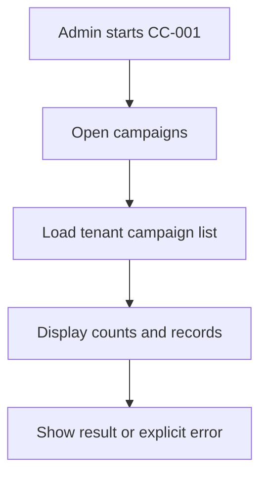


**End condition:** Campaign listing and four cards display; card values are tenant-scoped; undefined conversion calculation is recorded as an open decision.

### WF-02 — Campaign search, filters and statuses (CC-002)

**Category:** Campaigns  
**Classification:** As-Is

**Workflow:** Search campaign rows and use status and advanced filters, including campaign type, date and goal ranges.

**Critical rule:** Filters combine with the common record-source dropdown once implemented; prevent duplicate/confusing status controls where already addressed in enhancement baseline.

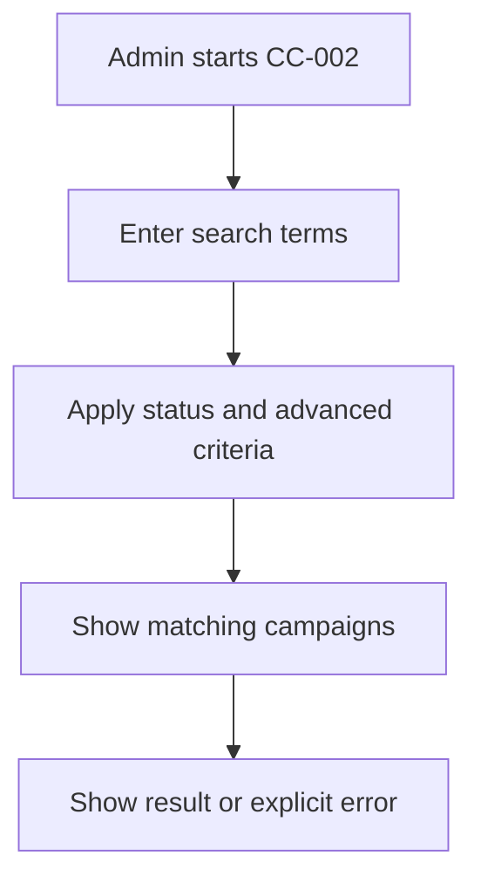


**End condition:** Search locates matching campaigns; filter selection limits records; Reset restores default filters.

### WF-03 — Four-step native campaign creation (CC-003)

**Category:** Campaigns  
**Classification:** As-Is

**Workflow:** Admin completes Basic Information, AI Generator step, Select Audience and Review & Save to create a native campaign.

**Critical rule:** Four-step navigation works; AI generation inside step 2 is currently not operational and is not described as an available result; do not block manual completion solely due to AI.

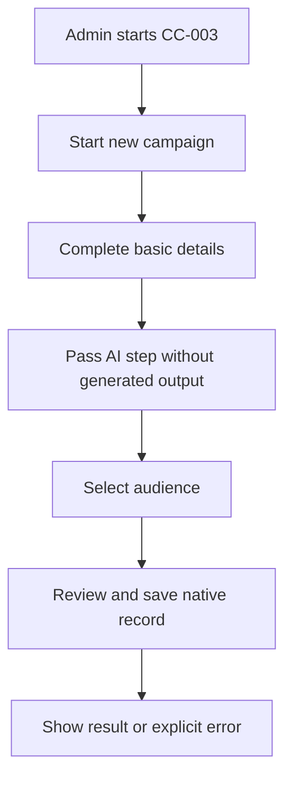


**End condition:** Admin completes non-AI fields and saves; validation prevents missing mandatory inputs; created campaign is tagged AiXPurpose.

### WF-04 — AI Campaign Generator control and fallback (CC-004)

**Category:** Campaigns  
**Classification:** Existing UI gap / decision pending

**Workflow:** Retain the AI Generator step as pictured, but identify its generate action as nonfunctional pending an approved disposition.

**Critical rule:** No claim of successful AI-generated campaign content; no fabricated model or prompt behavior; manual campaign workflow remains available.

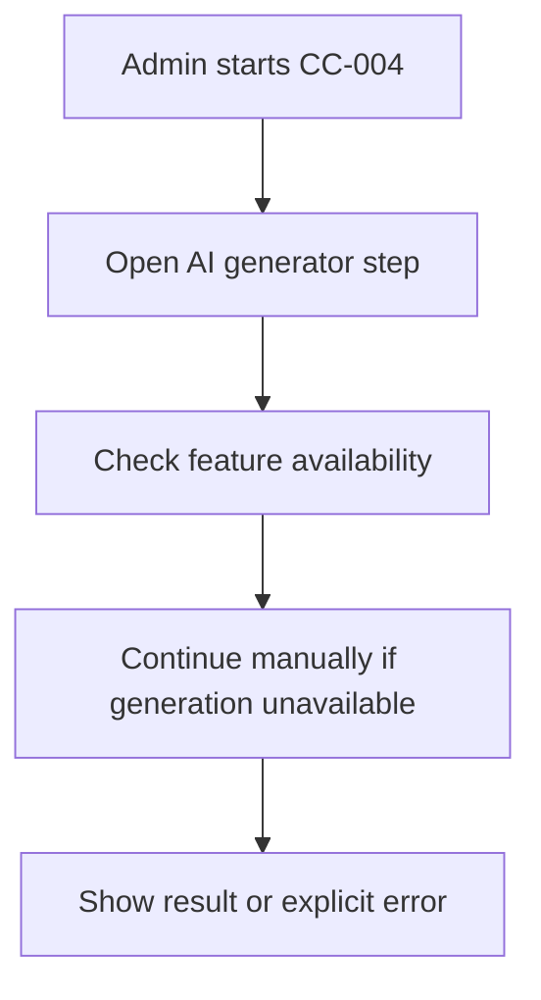


**End condition:** AI action is not presented as production-ready; QA records observed behavior; disposition is open.

### WF-05 — Campaign detail tabs (CC-005)

**Category:** Campaigns  
**Classification:** As-Is

**Workflow:** Open Overview, Donations, Communication and Performance tabs from a campaign row.

**Critical rule:** Each tab is scoped to the selected campaign; integrated campaign data is read-only.

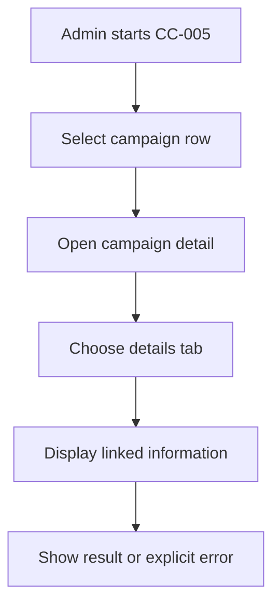


**End condition:** Opening a row navigates to the matching campaign; tabs display only associated data; empty/error states are visible.

### WF-06 — Campaign editing and source protection (CC-006)

**Category:** Campaigns  
**Classification:** As-Is business rule / To-Be enforcement

**Workflow:** Show Edit Campaign for records created in AiXPurpose; provide view-only detail for externally integrated campaigns.

**Critical rule:** All signed-in users are Admins with native editing access; integrated record edits blocked in UI and API; external sync updates remain permitted.

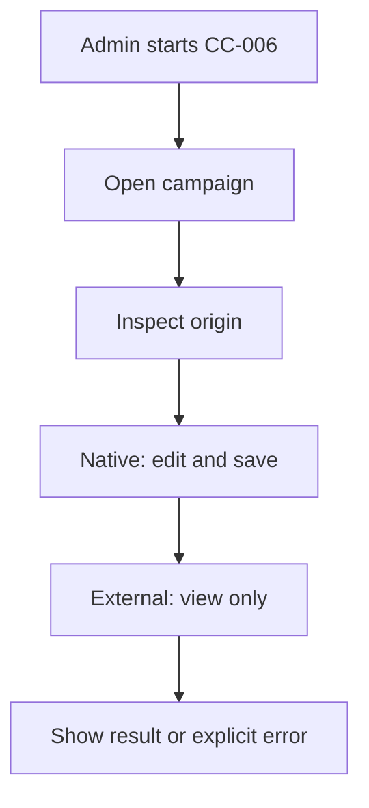


**End condition:** Admin edits native campaign; external campaign shows no edit action; direct update call for external ID is rejected.

### WF-07 — Campaign donations and donor linkage (CC-007)

**Category:** Campaigns  
**Classification:** Standalone baseline enhancement – QA verification

**Workflow:** Show donation records and associated donors linked to the selected campaign; do not show unrelated donors.

**Critical rule:** Use validated campaign-to-donation and constituent mapping; synced gift records remain read-only; ambiguity is surfaced rather than guessed.

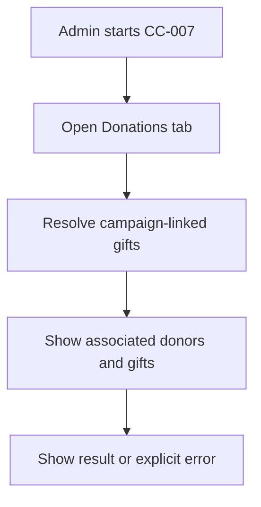


**End condition:** Only correctly linked donation rows appear; donor navigation resolves correctly; missing mapping does not invent relationships.

### WF-08 — Campaign audience communication (CC-008)

**Category:** Campaigns  
**Classification:** Standalone baseline enhancement – QA verification

**Workflow:** Send or schedule campaign emails to All Campaign Members or Campaign Donors Only using the existing communication journey.

**Critical rule:** Audience membership and donor linkage must be mapped; member/donor mapping does not imply unrelated profiles; email channel is operational.

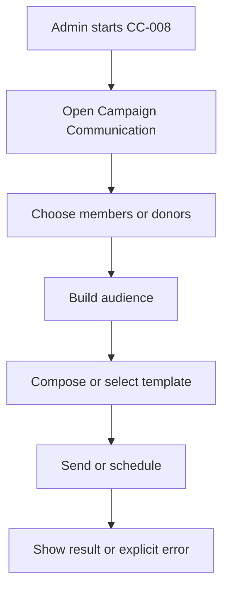


**End condition:** Admin selects one of two valid campaign audiences; recipients match chosen scope; Send/Schedule opens existing workflow.

### WF-09 — Campaign performance and calculation integrity (CC-009)

**Category:** Campaigns  
**Classification:** As-Is UI / open calculation decision

**Workflow:** Display existing campaign performance KPI and charts while keeping unresolved metrics explicitly pending formula validation.

**Critical rule:** Audience, conversion, goal/achieved, goal progress and donation attribution require approved definitions; do not infer counts from unverified sources.

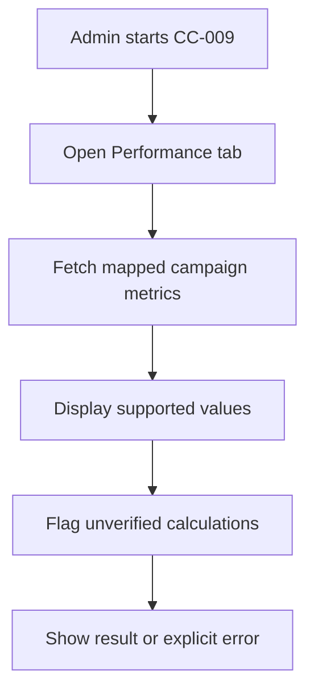


**End condition:** UI retained; calculations flagged for confirmation; QA tests reconciled formulas once approved.

### WF-10 — Communication KPIs and list (CC-010)

**Category:** Communications  
**Classification:** As-Is

**Workflow:** Display communication listing and volume/reach/engagement KPI cards.

**Critical rule:** Display only tenant data; counts depend on verified communication and provider events.

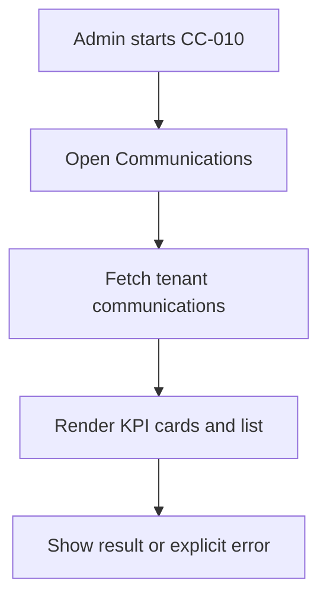


**End condition:** Communication rows and KPIs load; empty state works; figures are not invented.

### WF-11 — Communication list search and filtering (CC-011)

**Category:** Communications  
**Classification:** As-Is

**Workflow:** Search, filter and navigate communication records.

**Critical rule:** Scope all searches and filters to the current tenant and page; display no unauthorized cross-tenant records.

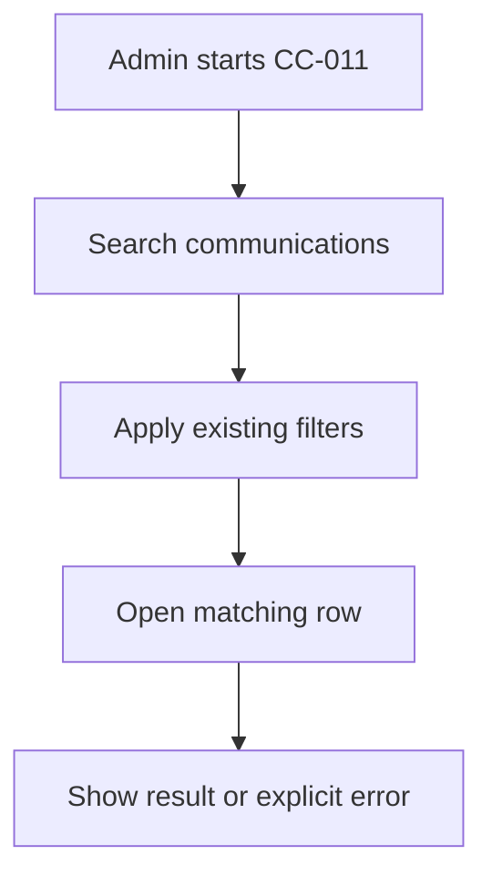


**End condition:** Search returns matching communication rows; filters combine correctly; records open the correct details.

### WF-12 — Four-step communication creation (CC-012)

**Category:** Communications  
**Classification:** As-Is

**Workflow:** Complete Audience, Content, Preview, and Send/Schedule steps.

**Critical rule:** Audience can be selected from campaign/segment; supported templates can populate content; preview displays intended message.

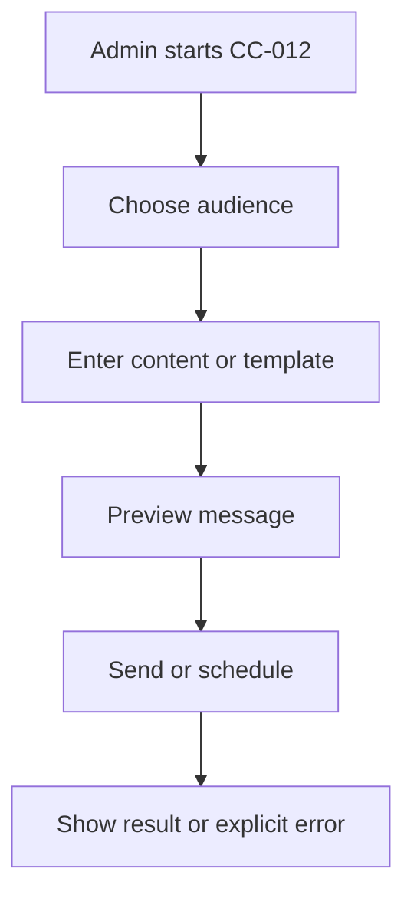


**End condition:** Admin can navigate steps, validate recipients/content, preview and complete supported email communication.

### WF-13 — Email Send Now (CC-013)

**Category:** Communications  
**Classification:** As-Is confirmed functional

**Workflow:** Send an email communication immediately using configured mail delivery.

**Critical rule:** Email channel already operational; sending status cannot be edited after dispatch; delivery events reflect provider feedback when available.

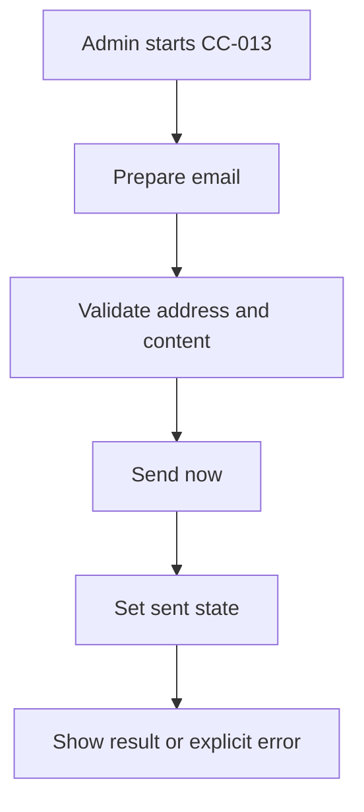


**End condition:** Admin sends valid email; success/failure state shown; sent content becomes read-only.

### WF-14 — Email schedule and schedule management (CC-014)

**Category:** Communications  
**Classification:** As-Is confirmed functional

**Workflow:** Schedule email communication and view/manage upcoming scheduled items in existing scheduling tools.

**Critical rule:** Scheduled communications remain editable before dispatch; once sent, content is locked; existing enhanced scheduling management is As-Is, not Future.

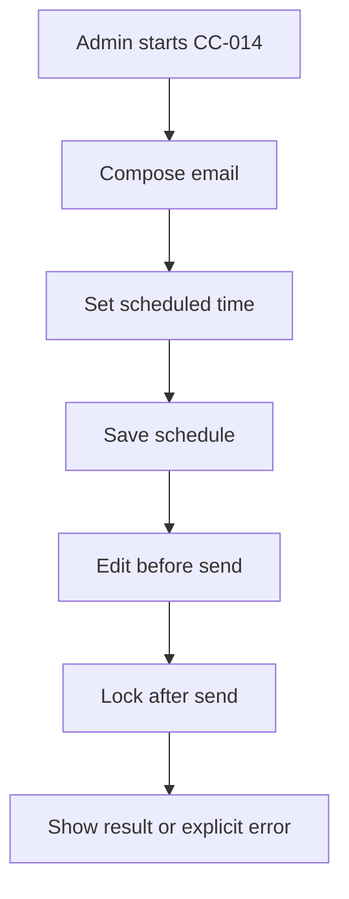


**End condition:** Admin schedules message; can view and edit pending schedule; cannot modify sent content.

### WF-15 — Communication details overview and delivery KPIs (CC-015)

**Category:** Communications  
**Classification:** As-Is / QA verification

**Workflow:** Show Overview with Audience, Sent, Delivered, Failed, Open Rate and Click Rate and other existing detail tabs.

**Critical rule:** Provider delivery, open and click events must substantiate figures; unsupported statuses remain pending verification.

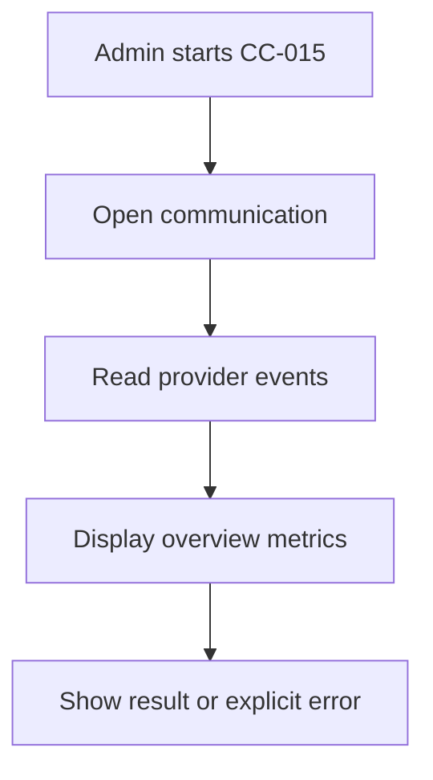


**End condition:** Existing tabs and cards render; reconciled event totals only; no fabricated analytics values.

### WF-16 — Recipient audience status list and export (CC-016)

**Category:** Communications  
**Classification:** As-Is / QA verification

**Workflow:** Display recipient list with All, Delivered, Pending and Failed status filters, row selection, pagination and Export List.

**Critical rule:** Recipients must be from selected audience; export includes only selected tenant/communication and observed status data.

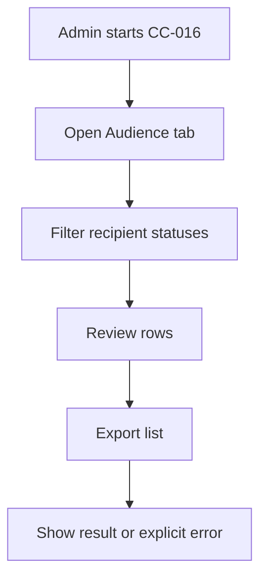


**End condition:** Status tabs filter recipients; pagination works; Export List downloads correct scoped rows when supported.

### WF-17 — Message preview and code view (CC-017)

**Category:** Communications  
**Classification:** As-Is

**Workflow:** Show message subject, rendered content preview and code representation on Messages tab.

**Critical rule:** Preview and HTML/code view are read-only for sent communication; scheduled content may be edited through existing edit flow.

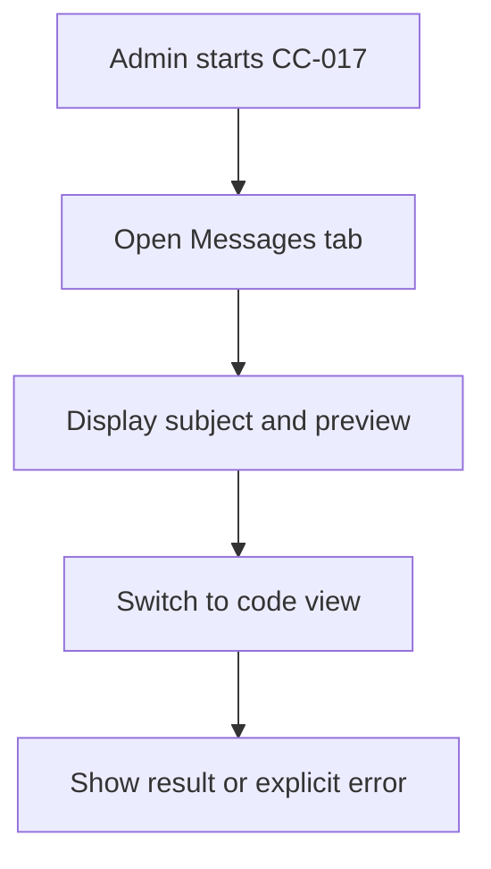


**End condition:** Message subject, preview and code display; sent content cannot be updated.

### WF-18 — Communication content editing lifecycle (CC-018)

**Category:** Communications  
**Classification:** As-Is rule / QA verification

**Workflow:** Allow Admin to modify a draft or scheduled communication before sending and prevent edits after sending.

**Critical rule:** Only Admin accounts exist; no extra permission matrix; status validation required server-side.

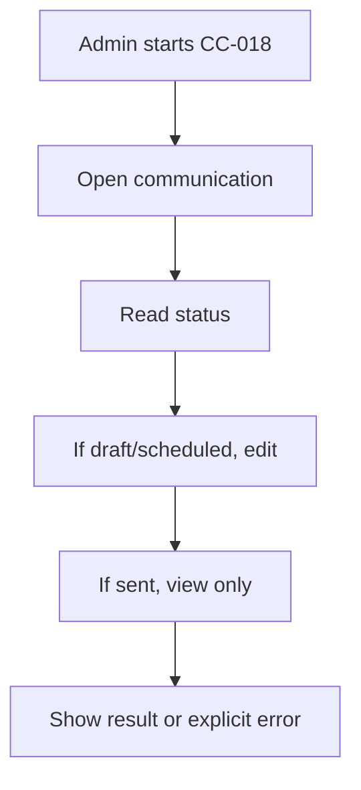


**End condition:** Draft and scheduled edits save before dispatch; sent record edit action absent and write endpoint rejects modification.

### WF-19 — SMS operational delivery (CC-019)

**Category:** Communications  
**Classification:** To-Be

**Workflow:** Activate SMS sending through the tenant-configured messaging provider within the existing communication flow.

**Critical rule:** Do not assume provider, costs, templates or status callbacks without Development validation; hide/block Send when provider unconfigured.

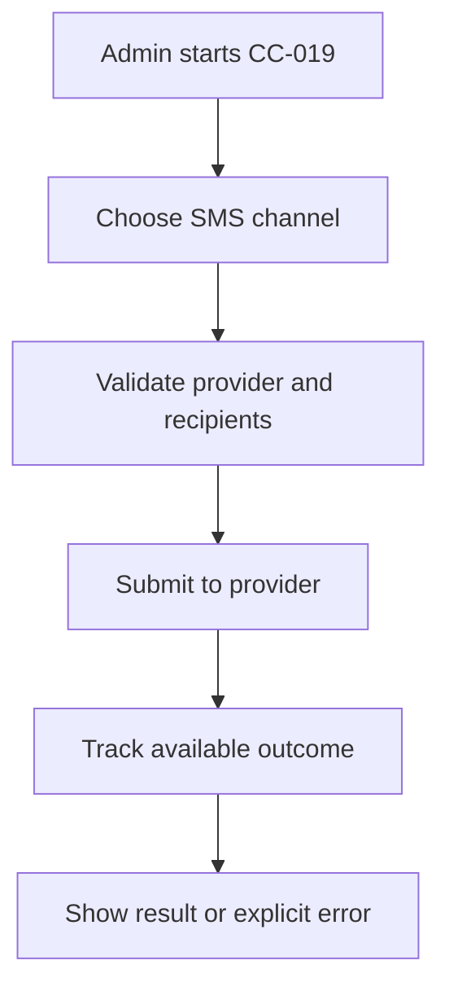


**End condition:** Configured tenant sends SMS; validation handles missing number/provider; delivery failures surface without false success.

### WF-20 — WhatsApp operational delivery (CC-020)

**Category:** Communications  
**Classification:** To-Be

**Workflow:** Activate WhatsApp sending through the tenant-configured provider within the existing communication flow.

**Critical rule:** Respect provider-specific template/opt-in requirements when verified; do not invent supported message formats or callbacks.

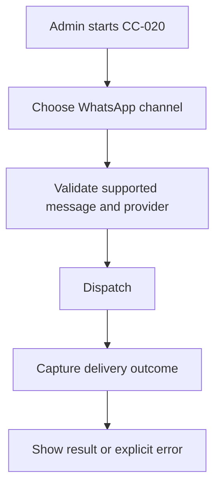


**End condition:** Configured channel dispatches supported message; invalid/unconfigured delivery blocked; show reliable status.

### WF-21 — Audience resolution and tenant consistency (CC-021)

**Category:** Communications  
**Classification:** To-Be shared rule

**Workflow:** Resolve campaign or segment audience into intended recipients before dispatch.

**Critical rule:** Deduplication/consent rules require verified mappings; do not treat duplicate source records as automatically unique humans; never cross tenant.

```mermaid
flowchart TD
    A["Admin starts CC-021"]
    S1["Select campaign or segment"]
    A --> S1
    S2["Resolve mapped recipients"]
    S1 --> S2
    S3["Validate tenant and channel"]
    S2 --> S3
    S4["Prepare audience"]
    S3 --> S4
    S4 --> Z["Show result or explicit error"]
```


**End condition:** Preview audience counts based on valid linkage; only current tenant recipients included; invalid/empty groups handled clearly.

### WF-22 — Template list, search and type filters (CC-022)

**Category:** Templates  
**Classification:** As-Is

**Workflow:** List existing Email, SMS and WhatsApp templates and filter/search by available metadata.

**Critical rule:** Templates are tenant-scoped; do not imply operational SMS/WhatsApp dispatch merely because a template exists.

```mermaid
flowchart TD
    A["Admin starts CC-022"]
    S1["Open Templates"]
    A --> S1
    S2["Search or filter by channel"]
    S1 --> S2
    S3["Open template"]
    S2 --> S3
    S3 --> Z["Show result or explicit error"]
```


**End condition:** Admin searches templates, applies type filters and opens the correct template.

### WF-23 — Native template creation and editing (CC-023)

**Category:** Templates  
**Classification:** As-Is

**Workflow:** Admin creates or edits native templates with supported subject/content/variables and timestamps.

**Critical rule:** All Admins may edit native templates; any externally sourced template remains read-only if such records exist.

```mermaid
flowchart TD
    A["Admin starts CC-023"]
    S1["Create or open template"]
    A --> S1
    S2["Enter subject and content"]
    S1 --> S2
    S3["Insert supported variables"]
    S2 --> S3
    S4["Save native template"]
    S3 --> S4
    S4 --> Z["Show result or explicit error"]
```


**End condition:** New template saves; native content updates persist; invalid required content blocked.

### WF-24 — Variables and Use in Communication (CC-024)

**Category:** Templates  
**Classification:** As-Is / QA verification

**Workflow:** View template variables and launch a communication using the selected template.

**Critical rule:** Only mapped variables may resolve; missing recipient/donation fields must not be invented; successful substitution subject to QA.

```mermaid
flowchart TD
    A["Admin starts CC-024"]
    S1["Select template"]
    A --> S1
    S2["Use in Communication"]
    S1 --> S2
    S3["Resolve supported variables"]
    S2 --> S3
    S4["Preview before send"]
    S3 --> S4
    S4 --> Z["Show result or explicit error"]
```


**End condition:** Existing template transfers to communication; supported variables substitute; missing data handled safely.

### WF-25 — Document upload to editable email template (CC-025)

**Category:** Templates  
**Classification:** To-Be approved

**Workflow:** Provide Admin a document upload entry point that generates an editable email template draft for review and manual correction.

**Critical rule:** Supported document types, parsing, conversion method, assets handling and limits pending Development approval; no AI conversion assumed.

```mermaid
flowchart TD
    A["Admin starts CC-025"]
    S1["Upload document"]
    A --> S1
    S2["Validate accepted file"]
    S1 --> S2
    S3["Convert to draft template"]
    S2 --> S3
    S4["Review and edit"]
    S3 --> S4
    S5["Save template"]
    S4 --> S5
    S5 --> Z["Show result or explicit error"]
```


**End condition:** Admin uploads supported document, previews generated draft, edits subject/body, and explicitly saves a native email template; validation/errors visible.

### WF-26 — Automation listing and builder (CC-026)

**Category:** Automations & Drips  
**Classification:** As-Is UI

**Workflow:** Display automations and allow configuration of name, trigger, Wait, Email and SMS steps as shown.

**Critical rule:** Current UI does not establish successful runtime execution; separate builder from execution functionality.

```mermaid
flowchart TD
    A["Admin starts CC-026"]
    S1["Open automation list"]
    A --> S1
    S2["Create automation"]
    S1 --> S2
    S3["Define trigger and steps"]
    S2 --> S3
    S4["Save definition"]
    S3 --> S4
    S4 --> Z["Show result or explicit error"]
```


**End condition:** Admin opens automation list; configures supported steps; saves valid workflow definition.

### WF-27 — Basic automation execution (CC-027)

**Category:** Automations & Drips  
**Classification:** To-Be approved

**Workflow:** Execute saved supported trigger → Wait → Email/SMS steps in correct order.

**Critical rule:** Only verified triggers are eligible; Email is currently operational; SMS execution depends on To-Be provider; execution timing, retry/error and idempotency rules require Development confirmation.

```mermaid
flowchart TD
    A["Admin starts CC-027"]
    S1["Receive approved trigger"]
    A --> S1
    S2["Find applicable automation"]
    S1 --> S2
    S3["Execute wait step"]
    S2 --> S3
    S4["Send configured message"]
    S3 --> S4
    S5["Record outcome per approved design"]
    S4 --> S5
    S5 --> Z["Show result or explicit error"]
```


**End condition:** Matching approved trigger starts workflow; wait delays following step; configured email sends; errors are not silently lost; SMS guarded until operational.

### WF-28 — Source dropdown and origin-aware record listing (CC-028)

**Category:** Shared  
**Classification:** To-Be approved shared enhancement

**Workflow:** Add a reusable Source filter to eligible listing-page existing Filters: All Sources / AiXPurpose / External Sources (All) / individual tenant integrations.

**Critical rule:** Default All Sources per page; no app-wide hidden setting; filter scoped to page; combined with search, pagination and existing filters; source metadata immutable through UI; no effect on financial KPI calculations unless separately approved.

```mermaid
flowchart TD
    A["Admin starts CC-028"]
    S1["Open eligible records list"]
    A --> S1
    S2["Select source dropdown"]
    S1 --> S2
    S3["Apply search and filters"]
    S2 --> S3
    S4["Show matching records"]
    S3 --> S4
    S5["Check origin before edit"]
    S4 --> S5
    S5 --> Z["Show result or explicit error"]
```


**End condition:** Each source option returns expected tenant records; filter does not mutate data; source is visible in list/detail; native Edit and external View-only enforced in backend.

### WF-29 — Tenant isolation and source ownership (CC-029)

**Category:** Shared  
**Classification:** To-Be standalone rule / verification

**Workflow:** Enforce tenant record isolation and editability by record origin across relevant Campaigns & Communications data flows.

**Critical rule:** Admin-only application; native records editable; integrated records immutable to Admin updates; external API synchronization may legitimately update source records.

```mermaid
flowchart TD
    A["Admin starts CC-029"]
    S1["Load tenant context"]
    A --> S1
    S2["Query tenant record"]
    S1 --> S2
    S3["Inspect origin"]
    S2 --> S3
    S4["Allow native edit or restrict integrated view"]
    S3 --> S4
    S4 --> Z["Show result or explicit error"]
```


**End condition:** No cross-tenant retrieval; native campaign edit succeeds; integrated update fails at API and UI; audit behavior as implemented is verified.

### WF-30 — Export behavior consistency (CC-030)

**Category:** Shared  
**Classification:** Standalone baseline enhancement – QA verification

**Workflow:** Use Export label and functional output on supported list pages; hide unavailable exports rather than disabled dead-end controls.

**Critical rule:** CSV direct download if only supported format; show only actually available formats otherwise; respect active filters and source scope.

```mermaid
flowchart TD
    A["Admin starts CC-030"]
    S1["Open export-capable list"]
    A --> S1
    S2["Check available formats"]
    S1 --> S2
    S3["Generate scoped export"]
    S2 --> S3
    S4["Download or show error"]
    S3 --> S4
    S4 --> Z["Show result or explicit error"]
```


**End condition:** Export gives correct scoped rows, failures show errors, unavailable functionality does not show a dead button.

## 2. Workflow exception matrix

| Condition | Expected outcome |
| --- | --- |
| Integrated campaign edit request | No edit UI; reject mutation on backend; allow fresh API sync |
| Sent communication edit request | Read-only detail; reject changes |
| Scheduled communication edit request | Permit edit only before dispatch; preserve scheduled workflow |
| Unconfigured SMS/WhatsApp channel | Block delivery; show useful setup/validation state |
| Unresolved audience mapping | Do not send to guessed recipients |
| Unverified campaign KPI | Retain UI but do not assert unapproved derived formula |
| Unsupported uploaded document | Reject with format/size guidance once supported types defined |
| Unknown automation trigger or failed step | Do not assume retries; surface error using approved runtime design |
| Source dropdown selected | Update current list and combined filters, not cross-module state |

## 3. Source screenshot references

See [original screenshot folder](screenshots/) for the 25 embedded source images; supplemental [Overview](screenshots/communication_detail_01.png), [Audience](screenshots/communication_detail_02.png), and [Messages](screenshots/communication_detail_03.png) screens verify the tab elements referenced in WF-15, WF-16 and WF-17.

## Source materials and screenshots

1. `campaign and comunication.docx`, supplied Campaigns & Communications module, screenshots and summary spanning 20 pages; original embedded images are preserved in [`screenshots/`](screenshots/).
2. Three additional Communication Details screenshots supplied in the conversation: [Overview](screenshots/communication_detail_01.png), [Audience](screenshots/communication_detail_02.png), [Messages](screenshots/communication_detail_03.png).
3. `AiXPurpose_changes.docx`, particularly campaign status, campaign-linked donations and communication enhancements, and cross-module export / messaging work.
4. Approved Q1–Q8 answers and subsequent corrections: Admin-only, AI Generator not working, email send/schedule functional, SMS/WhatsApp To-Be, scheduled editable but sent immutable, document-to-template To-Be, automation execution To-Be, scheduling management already As-Is.

Screenshots document reference UI, not validated runtime behavior.


## UPDATED v1.1 — Native structured import workflows (To-Be)

### WF-31 — Campaign import, create or update (CC-031)

**Entry:** Admin on existing Campaigns page selects newly added Import, downloads Campaign import template, populates and uploads it. **Not the current Create Campaign form.**

```mermaid
flowchart TD
 A[Admin opens Campaigns Import] --> B[Download approved Campaign template]
 B --> C[Upload filled campaign file]
 C --> D[Validate tenant, fields, statuses and file duplicates]
 D --> E[Check native campaign matching keys and external collisions]
 E --> F{Row outcome}
 F -->|Verified native match| G[Show before-after update preview]
 F -->|Eligible new campaign| H[Show proposed native campaign creation]
 F -->|External record / ambiguous / invalid| I[Flag and explain why row cannot update]
 G --> J[Admin reviews and confirms eligible rows]
 H --> J
 J --> K[Safely create or update native campaigns]
 K --> L[Show row counts and errors]
 I --> L
 L --> M[Refresh Campaign list and filters]
```

**Rules:** Never overwrite imported third-party campaigns or invent donations, campaign conversion, or audience membership. Exact matching keys and updatable fields remain Development decisions.

### WF-32 — Bulk Email/SMS/WhatsApp template import (CC-032)

**Entry:** Admin opens Communication Templates and selects Import Templates separately from New Template and Upload Document to Create Email Template.

```mermaid
flowchart TD
 A[Open Communication Templates] --> B[Download approved bulk template file]
 B --> C[Upload multiple template rows]
 C --> D[Validate names, channel types, content, variables and duplicates]
 D --> E{Match native template identity?}
 E -->|Yes| F[Preview update to existing native template]
 E -->|No| G{Eligible new native template?}
 G -->|Yes| H[Preview new template creation]
 G -->|No| I[Report invalid or source-origin conflict]
 F --> J[Admin confirms permitted changes]
 H --> J
 J --> K[Save native templates without sending messages]
 K --> L[Show created, updated and failed rows]
 I --> L
 L --> M[Refresh template list and Use in Communication]
```

**Rules:** Importing many structured template records is distinct from converting an uploaded document into one editable email template. Channel/provider approval and supported variable syntax require Development validation.

### WF-33 — Shared native match/update and import outcome reporting (CC-033)

```mermaid
flowchart TD
 A[Uploaded Campaign or Template rows] --> B[Validate tenant and file schema]
 B --> C[Classify native match, external collision, new, invalid]
 C --> D{Record can be safely written?}
 D -->|Native update| E[Preview field changes]
 D -->|New native| F[Preview creation]
 D -->|No| G[Report row-level errors or external read-only conflicts]
 E --> H[Admin confirms]
 F --> H
 H --> I[Idempotent native-only commit]
 I --> J[Return row results and refresh lists]
 G --> J
```

**End:** Clear created/updated/skipped/rejected/failed outcomes, original integration data unchanged, correct Source filter counts.
