# AiXPurpose Standalone — Donations & Finance — BRD Feature Catalogue

> **Document ID:** AIXP-DF-FEATURE-CATALOGUE  
> **Version:** 1.1 — UPDATED | 28 October 2026  
> **Status:** Approved functional scope baseline; implementation open items explicitly marked  
> **User:** Admin only (all Admins can access all native functionality)  
> **Purpose:** Enhance existing AiXPurpose for additional tenant clients; **not** a new application.  
> **Companion documents:** [Goals](Donations_Finance_BRD_Goals.md) · [Workflow](Donations_Finance_BRD_Workflow.md) · [Feature Catalogue](Donations_Finance_BRD_Feature_Catalogue.md)

Jira-ready specification inventory. Each feature includes its own Admin story, functional requirements, business logic, acceptance criteria and native Mermaid diagram.

## Source-of-truth and classification convention

- **As-Is:** currently visible or user-confirmed working behaviour. Visible controls may be disabled or backend-incomplete.
- **Existing Jira development baseline:** configured Donations and Pledges four-card KPI changes already approved and under development; classify under baseline per Product Owner convention, never claim production readiness without QA.
- **To-Be:** additions/fixes necessary to support native AiXPurpose transaction and pledge creation and multi-tenant operation.
- **Future:** selected or discussed possibilities; not committed to the current delivery.
- **Admin-only:** all signed-in application users are Admins; no additional roles, approvals, or permissions matrix.
- **Origin:** external integrated source records are strictly read-only to Admins; native AiXPurpose records may be edited where financial state and transaction integrity permit. Source synchronisation can refresh imported records.
- **Data:** do not fabricate gateway status, receipt numbers, matched transactions, donor identifiers or campaign allocations not supported by sources.

## 1. Feature inventory

| ID | Area | Feature | Classification |
|---|---|---|---|
| DF-001 | Donations | Donation KPI cards and listing | As-Is UI / KPI Jira baseline |
| DF-002 | Donations | Donation detail and audit history | As-Is UI |
| DF-003 | Donations | Existing Add Donation form | As-Is UI gap |
| DF-004 | Donations | Refund action display | As-Is UI / pending business decision |
| DF-005 | Pledges | Pledge listing and status/detail views | As-Is UI |
| DF-006 | Pledges | Create Pledge, Add Installment, Mark Paid existing interactions | As-Is UI / integration data workflow |
| DF-007 | Pledges | Configurable pledge KPI selection | As-Is Jira development baseline |
| DF-008 | Receipts | Receipt list, individual PDF and email | As-Is confirmed / batch UI gap |
| DF-009 | Donations | Gateway-backed native Add Donation | To-Be |
| DF-010 | Donations | Native editable record lifecycle | To-Be shared |
| DF-011 | Pledges | Native pledge creation, payment and installment mapping | To-Be |
| DF-012 | Receipts | Native receipt issuance and numbering | To-Be |
| DF-013 | Receipts | Batch receipt PDF download | To-Be |
| DF-014 | Receipts | Batch receipt email sending | To-Be |
| DF-015 | Reconciliation | Bank statement import | To-Be limited scope |
| DF-016 | Reconciliation | Transaction review and source filter | To-Be limited scope |
| DF-017 | Reconciliation | Reconciliation KPI representation | To-Be limited scope / legacy UI |
| DF-018 | Shared | Per-page Source dropdown | To-Be shared |
| DF-019 | Shared | Origin visibility and read-only enforcement | To-Be shared |
| DF-020 | Shared | Tenant isolation and source provenance | To-Be cross-module |
| DF-021 | Shared | Existing Donations configurable KPI baseline | As-Is Jira development baseline |
| DF-022 | Future | Automatic bank transaction matching | Future candidate DF-F01 |
| DF-023 | Future | Advanced reconciliation exceptions and matching | Future candidate DF-F02 |
| DF-024 | Future | Source-aware refund processing and synchronization | Future candidate DF-F03 / pending |
| DF-025 | Future | Receipt template customization | Future candidate DF-F04 |
| DF-026 | Future | Pledge payment reminders | Future candidate DF-F05 |
| DF-027 | Future | Financial reconciliation export | Future candidate DF-F06 |
| DF-028 | Future | Multi-donor pledge management | Future candidate DF-F07 / pending |
| DF-029 | Donations | Donation template import and native match/update | To-Be — UPDATED v1.1 |
| DF-030 | Pledges | Pledge template import and native match/update | To-Be — UPDATED v1.1 |
| DF-031 | Shared Imports | Import preview, unmatched resolution and refreshed data | To-Be — UPDATED v1.1 |

## DF-001 — Donation KPI cards and listing

**Area:** Donations  
**Classification:** As-Is UI / KPI Jira baseline  
**Implementation readiness:** Existing UI or established Jira baseline; actual functional status as identified

### User story

As an **AiXPurpose Admin**, I want to **show donation dashboard cards, transaction list, search and status filtering without redesign.**, so that I can perform this finance activity within the existing standalone-enabled AiXPurpose application without losing source integrity.

### Functional requirements

- **FR-DF-001-01:** Show donation dashboard cards, transaction list, search and status filtering without redesign.
- **FR-DF-001-02:** Open Donations; load tenant transactions; show cards and rows.
- **FR-DF-001-03:** Display clear validated, empty, processing, failure and success states as relevant to the workflow; preserve tenant-specific source provenance.
- **FR-DF-001-04:** Use the existing UI and navigation; do not rebuild a working application page.

### Business logic

- **BL-DF-001-01:** Respect previously approved Donations KPI catalog and readiness; unimplemented KPI changes are Jira development baseline, not verified live.
- **BL-DF-001-02:** All signed-in users are Admins, with no additional role distinction; record origin and tenant boundaries are enforced at API and UI layers.
- **BL-DF-001-03:** Changes to externally integrated donation/pledge source values are prohibited; native operations must preserve transaction/receipt auditability.

### Acceptance criteria

1. **Given** an Admin enters this module, **when** the defined action is performed, **then** kPI and table reflect correct tenant and confirmed field status; no unsupported values shown.
2. **Given** the source record belongs to an external integration, **when** a manual update is attempted, **then** the interface and backend do not change its source-owned fields.
3. **Given** an operation has missing required data, unsupported source fields or a failed external dependency, **when** the Admin proceeds, **then** a clear error/unavailable state appears, with no invented payment, receipt or matching result.
4. **Given** another tenant's record identifier, **when** it is queried or submitted, **then** no cross-tenant record is returned or changed.
5. **Given** this feature is existing or Jira-baseline, **when** it is planned for release, **then** its implementation and QA status is recorded accurately rather than inferred from the screenshot.

### Feature workflow (native Mermaid)


**Traceability:** [Goals](Donations_Finance_BRD_Goals.md) · [Related workflows](Donations_Finance_BRD_Workflow.md).

## DF-002 — Donation detail and audit history

**Area:** Donations  
**Classification:** As-Is UI  
**Implementation readiness:** Existing UI or established Jira baseline; actual functional status as identified

### User story

As an **AiXPurpose Admin**, I want to **open a donation row to review transaction, donor, campaign, payment, receipt and visible audit-history sections.**, so that I can perform this finance activity within the existing standalone-enabled AiXPurpose application without losing source integrity.

### Functional requirements

- **FR-DF-002-01:** Open a donation row to review transaction, donor, campaign, payment, receipt and visible audit-history sections.
- **FR-DF-002-02:** Select donation; fetch source record; render details.
- **FR-DF-002-03:** Display clear validated, empty, processing, failure and success states as relevant to the workflow; preserve tenant-specific source provenance.
- **FR-DF-002-04:** Use the existing UI and navigation; do not rebuild a working application page.

### Business logic

- **BL-DF-002-01:** External donation records are read-only; visible audit history does not prove refund execution.
- **BL-DF-002-02:** All signed-in users are Admins, with no additional role distinction; record origin and tenant boundaries are enforced at API and UI layers.
- **BL-DF-002-03:** Changes to externally integrated donation/pledge source values are prohibited; native operations must preserve transaction/receipt auditability.

### Acceptance criteria

1. **Given** an Admin enters this module, **when** the defined action is performed, **then** detail fields map to the selected record; no edit of external data is possible.
2. **Given** the source record belongs to an external integration, **when** a manual update is attempted, **then** the interface and backend do not change its source-owned fields.
3. **Given** an operation has missing required data, unsupported source fields or a failed external dependency, **when** the Admin proceeds, **then** a clear error/unavailable state appears, with no invented payment, receipt or matching result.
4. **Given** another tenant's record identifier, **when** it is queried or submitted, **then** no cross-tenant record is returned or changed.
5. **Given** this feature is existing or Jira-baseline, **when** it is planned for release, **then** its implementation and QA status is recorded accurately rather than inferred from the screenshot.

### Feature workflow (native Mermaid)

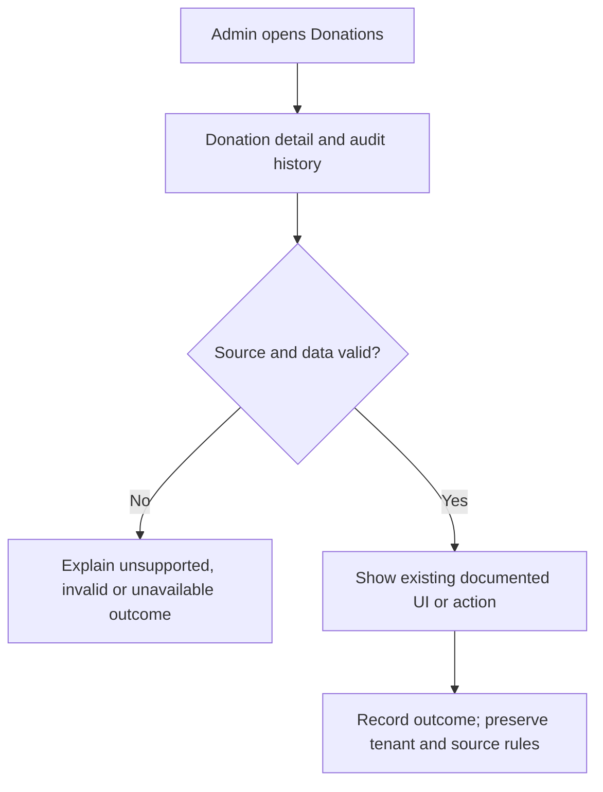

**Traceability:** [Goals](Donations_Finance_BRD_Goals.md) · [Related workflows](Donations_Finance_BRD_Workflow.md).

## DF-003 — Existing Add Donation form

**Area:** Donations  
**Classification:** As-Is UI gap  
**Implementation readiness:** Existing UI or established Jira baseline; actual functional status as identified

### User story

As an **AiXPurpose Admin**, I want to **preserve existing Select Donor, Amount, Payment Method and Allocate to Campaign form; Create Transaction currently does not establish working native creation.**, so that I can perform this finance activity within the existing standalone-enabled AiXPurpose application without losing source integrity.

### Functional requirements

- **FR-DF-003-01:** Preserve existing Select Donor, Amount, Payment Method and Allocate to Campaign form; Create Transaction currently does not establish working native creation.
- **FR-DF-003-02:** Open Add Donation; enter details; submit disabled or unimplemented action.
- **FR-DF-003-03:** Display clear validated, empty, processing, failure and success states as relevant to the workflow; preserve tenant-specific source provenance.
- **FR-DF-003-04:** Use the existing UI and navigation; do not rebuild a working application page.

### Business logic

- **BL-DF-003-01:** Do not label visible action as operational; To-Be implementation appears in DF-009.
- **BL-DF-003-02:** All signed-in users are Admins, with no additional role distinction; record origin and tenant boundaries are enforced at API and UI layers.
- **BL-DF-003-03:** Changes to externally integrated donation/pledge source values are prohibited; native operations must preserve transaction/receipt auditability.

### Acceptance criteria

1. **Given** an Admin enters this module, **when** the defined action is performed, **then** existing control and fields are documented and not mistaken for completed payment collection.
2. **Given** the source record belongs to an external integration, **when** a manual update is attempted, **then** the interface and backend do not change its source-owned fields.
3. **Given** an operation has missing required data, unsupported source fields or a failed external dependency, **when** the Admin proceeds, **then** a clear error/unavailable state appears, with no invented payment, receipt or matching result.
4. **Given** another tenant's record identifier, **when** it is queried or submitted, **then** no cross-tenant record is returned or changed.
5. **Given** this feature is existing or Jira-baseline, **when** it is planned for release, **then** its implementation and QA status is recorded accurately rather than inferred from the screenshot.

### Feature workflow (native Mermaid)

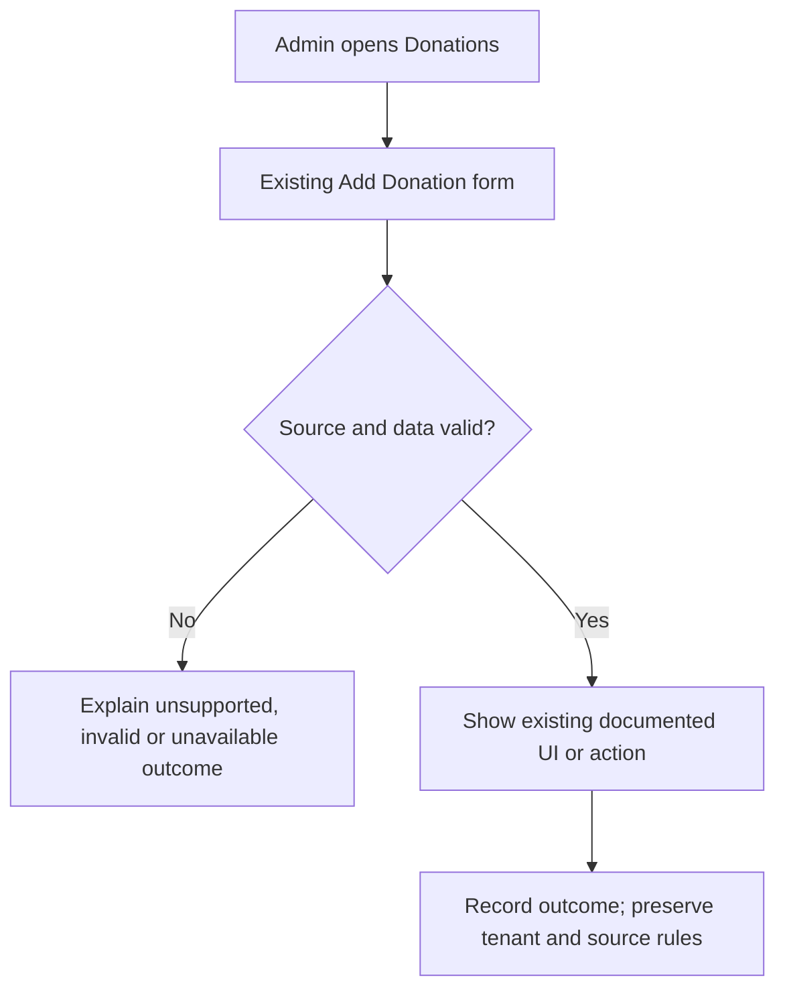

**Traceability:** [Goals](Donations_Finance_BRD_Goals.md) · [Related workflows](Donations_Finance_BRD_Workflow.md).

## DF-004 — Refund action display

**Area:** Donations  
**Classification:** As-Is UI / pending business decision  
**Implementation readiness:** Existing UI or established Jira baseline; actual functional status as identified

### User story

As an **AiXPurpose Admin**, I want to **document existing Process Refund control, without assuming provider support or working action.**, so that I can perform this finance activity within the existing standalone-enabled AiXPurpose application without losing source integrity.

### Functional requirements

- **FR-DF-004-01:** Document existing Process Refund control, without assuming provider support or working action.
- **FR-DF-004-02:** Open transaction; view Process Refund control; retain pending state.
- **FR-DF-004-03:** Display clear validated, empty, processing, failure and success states as relevant to the workflow; preserve tenant-specific source provenance.
- **FR-DF-004-04:** Use the existing UI and navigation; do not rebuild a working application page.

### Business logic

- **BL-DF-004-01:** Refund processing is not approved To-Be; externally sourced transactions stay read-only.
- **BL-DF-004-02:** All signed-in users are Admins, with no additional role distinction; record origin and tenant boundaries are enforced at API and UI layers.
- **BL-DF-004-03:** Changes to externally integrated donation/pledge source values are prohibited; native operations must preserve transaction/receipt auditability.

### Acceptance criteria

1. **Given** an Admin enters this module, **when** the defined action is performed, **then** unverified refund action does not issue a payment reversal in the documented standalone scope.
2. **Given** the source record belongs to an external integration, **when** a manual update is attempted, **then** the interface and backend do not change its source-owned fields.
3. **Given** an operation has missing required data, unsupported source fields or a failed external dependency, **when** the Admin proceeds, **then** a clear error/unavailable state appears, with no invented payment, receipt or matching result.
4. **Given** another tenant's record identifier, **when** it is queried or submitted, **then** no cross-tenant record is returned or changed.
5. **Given** this feature is existing or Jira-baseline, **when** it is planned for release, **then** its implementation and QA status is recorded accurately rather than inferred from the screenshot.

### Feature workflow (native Mermaid)

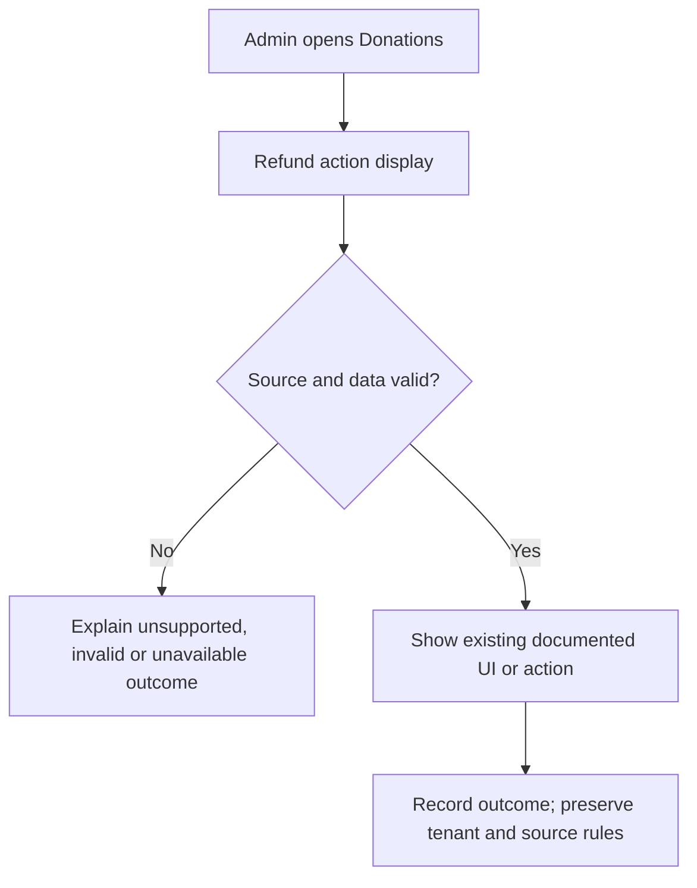

**Traceability:** [Goals](Donations_Finance_BRD_Goals.md) · [Related workflows](Donations_Finance_BRD_Workflow.md).

## DF-005 — Pledge listing and status/detail views

**Area:** Pledges  
**Classification:** As-Is UI  
**Implementation readiness:** Existing UI or established Jira baseline; actual functional status as identified

### User story

As an **AiXPurpose Admin**, I want to **retain pledge table, search, status filters, detail panels, progress and installments.**, so that I can perform this finance activity within the existing standalone-enabled AiXPurpose application without losing source integrity.

### Functional requirements

- **FR-DF-005-01:** Retain pledge table, search, status filters, detail panels, progress and installments.
- **FR-DF-005-02:** Open Pledges; select a pledge; display schedule.
- **FR-DF-005-03:** Display clear validated, empty, processing, failure and success states as relevant to the workflow; preserve tenant-specific source provenance.
- **FR-DF-005-04:** Use the existing UI and navigation; do not rebuild a working application page.

### Business logic

- **BL-DF-005-01:** Visible existing operations on integrated data do not authorize Admin editing of imported source records.
- **BL-DF-005-02:** All signed-in users are Admins, with no additional role distinction; record origin and tenant boundaries are enforced at API and UI layers.
- **BL-DF-005-03:** Changes to externally integrated donation/pledge source values are prohibited; native operations must preserve transaction/receipt auditability.

### Acceptance criteria

1. **Given** an Admin enters this module, **when** the defined action is performed, **then** pledge status and dates render as supplied; integrated source values remain unchanged.
2. **Given** the source record belongs to an external integration, **when** a manual update is attempted, **then** the interface and backend do not change its source-owned fields.
3. **Given** an operation has missing required data, unsupported source fields or a failed external dependency, **when** the Admin proceeds, **then** a clear error/unavailable state appears, with no invented payment, receipt or matching result.
4. **Given** another tenant's record identifier, **when** it is queried or submitted, **then** no cross-tenant record is returned or changed.
5. **Given** this feature is existing or Jira-baseline, **when** it is planned for release, **then** its implementation and QA status is recorded accurately rather than inferred from the screenshot.

### Feature workflow (native Mermaid)

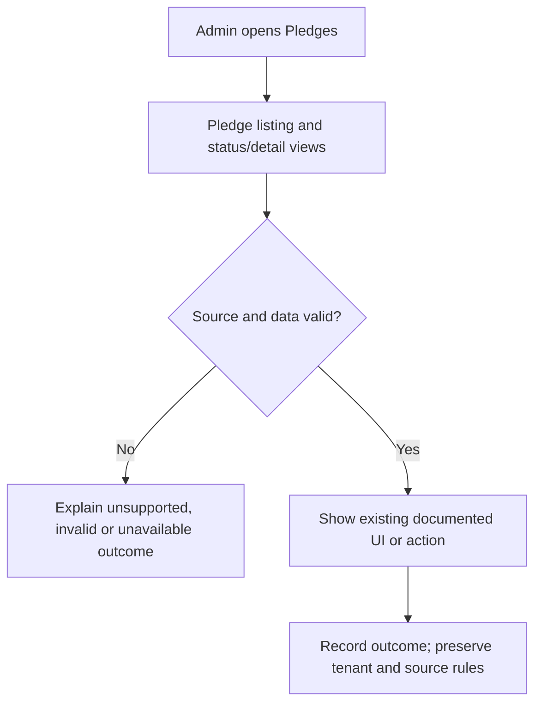

**Traceability:** [Goals](Donations_Finance_BRD_Goals.md) · [Related workflows](Donations_Finance_BRD_Workflow.md).

## DF-006 — Create Pledge, Add Installment, Mark Paid existing interactions

**Area:** Pledges  
**Classification:** As-Is UI / integration data workflow  
**Implementation readiness:** Existing UI or established Jira baseline; actual functional status as identified

### User story

As an **AiXPurpose Admin**, I want to **retain current forms and interactions reported as working for existing integrated-data views; native creation and mapping are a separate To-Be requirement.**, so that I can perform this finance activity within the existing standalone-enabled AiXPurpose application without losing source integrity.

### Functional requirements

- **FR-DF-006-01:** Retain current forms and interactions reported as working for existing integrated-data views; native creation and mapping are a separate To-Be requirement.
- **FR-DF-006-02:** Open existing pledge; review installment action; show updated representation.
- **FR-DF-006-03:** Display clear validated, empty, processing, failure and success states as relevant to the workflow; preserve tenant-specific source provenance.
- **FR-DF-006-04:** Use the existing UI and navigation; do not rebuild a working application page.

### Business logic

- **BL-DF-006-01:** Distinguish currently functioning interaction from unverified native persistence; no mutating external integration source records.
- **BL-DF-006-02:** All signed-in users are Admins, with no additional role distinction; record origin and tenant boundaries are enforced at API and UI layers.
- **BL-DF-006-03:** Changes to externally integrated donation/pledge source values are prohibited; native operations must preserve transaction/receipt auditability.

### Acceptance criteria

1. **Given** an Admin enters this module, **when** the defined action is performed, **then** existing integrated-based displays continue working; native write capability is tested against DF-011.
2. **Given** the source record belongs to an external integration, **when** a manual update is attempted, **then** the interface and backend do not change its source-owned fields.
3. **Given** an operation has missing required data, unsupported source fields or a failed external dependency, **when** the Admin proceeds, **then** a clear error/unavailable state appears, with no invented payment, receipt or matching result.
4. **Given** another tenant's record identifier, **when** it is queried or submitted, **then** no cross-tenant record is returned or changed.
5. **Given** this feature is existing or Jira-baseline, **when** it is planned for release, **then** its implementation and QA status is recorded accurately rather than inferred from the screenshot.

### Feature workflow (native Mermaid)

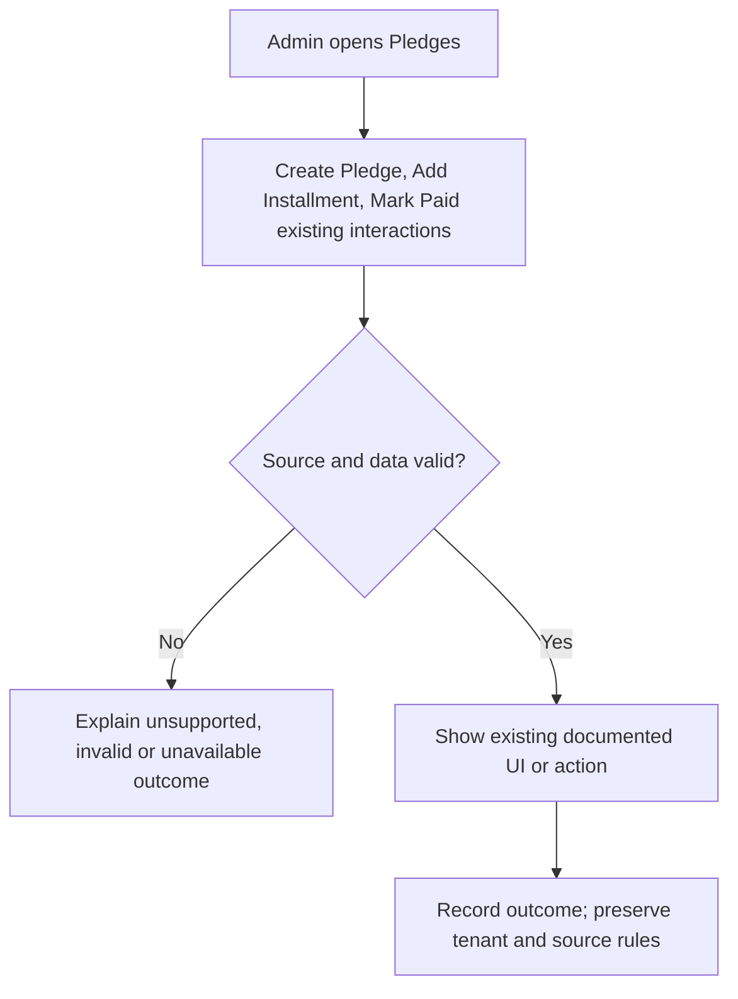

**Traceability:** [Goals](Donations_Finance_BRD_Goals.md) · [Related workflows](Donations_Finance_BRD_Workflow.md).

## DF-007 — Configurable pledge KPI selection

**Area:** Pledges  
**Classification:** As-Is Jira development baseline  
**Implementation readiness:** Existing UI or established Jira baseline; actual functional status as identified

### User story

As an **AiXPurpose Admin**, I want to **maintain exactly four cards and independent Pledges KPI catalog from already-approved Jira document.**, so that I can perform this finance activity within the existing standalone-enabled AiXPurpose application without losing source integrity.

### Functional requirements

- **FR-DF-007-01:** Maintain exactly four cards and independent Pledges KPI catalog from already-approved Jira document.
- **FR-DF-007-02:** Load Pledges; apply saved KPI selection; render cards.
- **FR-DF-007-03:** Display clear validated, empty, processing, failure and success states as relevant to the workflow; preserve tenant-specific source provenance.
- **FR-DF-007-04:** Use the existing UI and navigation; do not rebuild a working application page.

### Business logic

- **BL-DF-007-01:** Prior approved specifications supersede guesswork; readiness and actual QA completion must be indicated.
- **BL-DF-007-02:** All signed-in users are Admins, with no additional role distinction; record origin and tenant boundaries are enforced at API and UI layers.
- **BL-DF-007-03:** Changes to externally integrated donation/pledge source values are prohibited; native operations must preserve transaction/receipt auditability.

### Acceptance criteria

1. **Given** an Admin enters this module, **when** the defined action is performed, **then** selection, defaults and calculations conform to the previously approved Pledges KPI requirements.
2. **Given** the source record belongs to an external integration, **when** a manual update is attempted, **then** the interface and backend do not change its source-owned fields.
3. **Given** an operation has missing required data, unsupported source fields or a failed external dependency, **when** the Admin proceeds, **then** a clear error/unavailable state appears, with no invented payment, receipt or matching result.
4. **Given** another tenant's record identifier, **when** it is queried or submitted, **then** no cross-tenant record is returned or changed.
5. **Given** this feature is existing or Jira-baseline, **when** it is planned for release, **then** its implementation and QA status is recorded accurately rather than inferred from the screenshot.

### Feature workflow (native Mermaid)

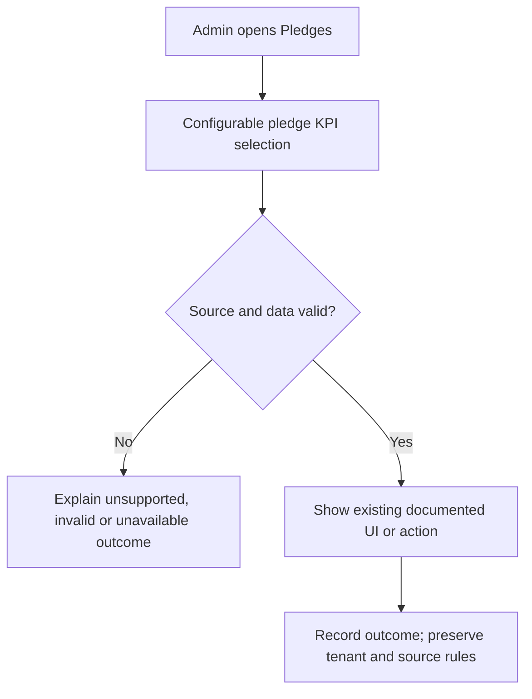

**Traceability:** [Goals](Donations_Finance_BRD_Goals.md) · [Related workflows](Donations_Finance_BRD_Workflow.md).

## DF-008 — Receipt list, individual PDF and email

**Area:** Receipts  
**Classification:** As-Is confirmed / batch UI gap  
**Implementation readiness:** Existing UI or established Jira baseline; actual functional status as identified

### User story

As an **AiXPurpose Admin**, I want to **keep receipt listing, All/Pending/Sent and individual PDF download/email, confirmed working; existing Batch Print button nonfunctional.**, so that I can perform this finance activity within the existing standalone-enabled AiXPurpose application without losing source integrity.

### Functional requirements

- **FR-DF-008-01:** Keep receipt listing, All/Pending/Sent and individual PDF download/email, confirmed working; existing Batch Print button nonfunctional.
- **FR-DF-008-02:** Open Receipt Management; select receipt; download or email individual receipt.
- **FR-DF-008-03:** Display clear validated, empty, processing, failure and success states as relevant to the workflow; preserve tenant-specific source provenance.
- **FR-DF-008-04:** Use the existing UI and navigation; do not rebuild a working application page.

### Business logic

- **BL-DF-008-01:** Imported records may have no source receipt number; do not manufacture one.
- **BL-DF-008-02:** All signed-in users are Admins, with no additional role distinction; record origin and tenant boundaries are enforced at API and UI layers.
- **BL-DF-008-03:** Changes to externally integrated donation/pledge source values are prohibited; native operations must preserve transaction/receipt auditability.

### Acceptance criteria

1. **Given** an Admin enters this module, **when** the defined action is performed, **then** individual receipt works as reported; batch remains a To-Be item.
2. **Given** the source record belongs to an external integration, **when** a manual update is attempted, **then** the interface and backend do not change its source-owned fields.
3. **Given** an operation has missing required data, unsupported source fields or a failed external dependency, **when** the Admin proceeds, **then** a clear error/unavailable state appears, with no invented payment, receipt or matching result.
4. **Given** another tenant's record identifier, **when** it is queried or submitted, **then** no cross-tenant record is returned or changed.
5. **Given** this feature is existing or Jira-baseline, **when** it is planned for release, **then** its implementation and QA status is recorded accurately rather than inferred from the screenshot.

### Feature workflow (native Mermaid)

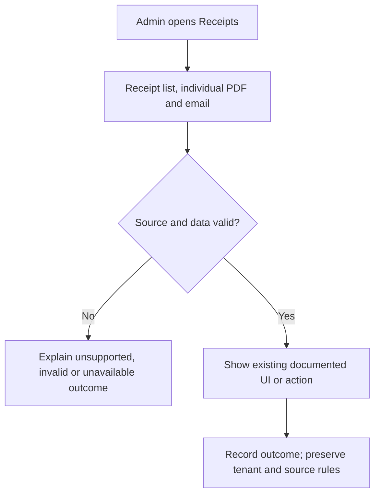

**Traceability:** [Goals](Donations_Finance_BRD_Goals.md) · [Related workflows](Donations_Finance_BRD_Workflow.md).

## DF-009 — Gateway-backed native Add Donation

**Area:** Donations  
**Classification:** To-Be  
**Implementation readiness:** Approved standalone requirement; requires implementation and QA

### User story

As an **AiXPurpose Admin**, I want to **enable existing Add Donation to initiate and collect payment via configured gateway, then create confirmed native donation transaction.**, so that I can perform this finance activity within the existing standalone-enabled AiXPurpose application without losing source integrity.

### Functional requirements

- **FR-DF-009-01:** Enable existing Add Donation to initiate and collect payment via configured gateway, then create confirmed native donation transaction.
- **FR-DF-009-02:** Admin completes form; validate; initiate payment; receive verified gateway result; create native record.
- **FR-DF-009-03:** Display clear validated, empty, processing, failure and success states as relevant to the workflow; preserve tenant-specific source provenance.
- **FR-DF-009-04:** Use the existing UI and navigation; do not rebuild a working application page.

### Business logic

- **BL-DF-009-01:** Payment success must be verified server-side; idempotent gateway confirmation prevents duplicates; failed/cancelled payment does not become completed donation.
- **BL-DF-009-02:** All signed-in users are Admins, with no additional role distinction; record origin and tenant boundaries are enforced at API and UI layers.
- **BL-DF-009-03:** Changes to externally integrated donation/pledge source values are prohibited; native operations must preserve transaction/receipt auditability.

### Acceptance criteria

1. **Given** an Admin enters this module, **when** the defined action is performed, **then** successful gateway confirmation creates one native donation; failures display accurate state; no changes to external records.
2. **Given** the source record belongs to an external integration, **when** a manual update is attempted, **then** the interface and backend do not change its source-owned fields.
3. **Given** an operation has missing required data, unsupported source fields or a failed external dependency, **when** the Admin proceeds, **then** a clear error/unavailable state appears, with no invented payment, receipt or matching result.
4. **Given** another tenant's record identifier, **when** it is queried or submitted, **then** no cross-tenant record is returned or changed.
5. **Given** this feature is To-Be, **when** it is planned for release, **then** its implementation and QA status is recorded accurately rather than inferred from the screenshot.

### Feature workflow (native Mermaid)


**Traceability:** [Goals](Donations_Finance_BRD_Goals.md) · [Related workflows](Donations_Finance_BRD_Workflow.md).

## DF-010 — Native editable record lifecycle

**Area:** Donations  
**Classification:** To-Be shared  
**Implementation readiness:** Approved standalone requirement; requires implementation and QA

### User story

As an **AiXPurpose Admin**, I want to **enable native Add/Create/Edit controls as applicable, without allowing manual changes to completed financial facts or integrated records.**, so that I can perform this finance activity within the existing standalone-enabled AiXPurpose application without losing source integrity.

### Functional requirements

- **FR-DF-010-01:** Enable native Add/Create/Edit controls as applicable, without allowing manual changes to completed financial facts or integrated records.
- **FR-DF-010-02:** Admin opens record; evaluate origin and transaction state; edit eligible native fields; save.
- **FR-DF-010-03:** Display clear validated, empty, processing, failure and success states as relevant to the workflow; preserve tenant-specific source provenance.
- **FR-DF-010-04:** Use the existing UI and navigation; do not rebuild a working application page.

### Business logic

- **BL-DF-010-01:** All users are Admins; no extra role hierarchy. Post-payment correction boundaries require technical/business validation and audit.
- **BL-DF-010-02:** All signed-in users are Admins, with no additional role distinction; record origin and tenant boundaries are enforced at API and UI layers.
- **BL-DF-010-03:** Changes to externally integrated donation/pledge source values are prohibited; native operations must preserve transaction/receipt auditability.

### Acceptance criteria

1. **Given** an Admin enters this module, **when** the defined action is performed, **then** native eligible fields save; external records cannot be changed via UI or API; immutable payment facts protected.
2. **Given** the source record belongs to an external integration, **when** a manual update is attempted, **then** the interface and backend do not change its source-owned fields.
3. **Given** an operation has missing required data, unsupported source fields or a failed external dependency, **when** the Admin proceeds, **then** a clear error/unavailable state appears, with no invented payment, receipt or matching result.
4. **Given** another tenant's record identifier, **when** it is queried or submitted, **then** no cross-tenant record is returned or changed.
5. **Given** this feature is To-Be, **when** it is planned for release, **then** its implementation and QA status is recorded accurately rather than inferred from the screenshot.

### Feature workflow (native Mermaid)

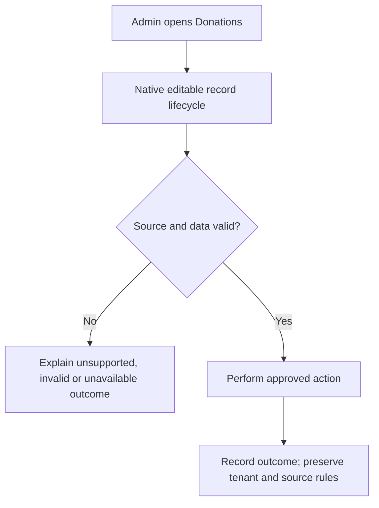

**Traceability:** [Goals](Donations_Finance_BRD_Goals.md) · [Related workflows](Donations_Finance_BRD_Workflow.md).

## DF-011 — Native pledge creation, payment and installment mapping

**Area:** Pledges  
**Classification:** To-Be  
**Implementation readiness:** Approved standalone requirement; requires implementation and QA

### User story

As an **AiXPurpose Admin**, I want to **enable native pledge creation and ensure Add Installment, Mark Paid and schedule records map into existing detail pages and approved KPI data.**, so that I can perform this finance activity within the existing standalone-enabled AiXPurpose application without losing source integrity.

### Functional requirements

- **FR-DF-011-01:** Enable native pledge creation and ensure Add Installment, Mark Paid and schedule records map into existing detail pages and approved KPI data.
- **FR-DF-011-02:** Create native pledge; save; open detail; add installment or mark paid; refresh views.
- **FR-DF-011-03:** Display clear validated, empty, processing, failure and success states as relevant to the workflow; preserve tenant-specific source provenance.
- **FR-DF-011-04:** Use the existing UI and navigation; do not rebuild a working application page.

### Business logic

- **BL-DF-011-01:** Avoid double-counting pledge commitment and received donations; native schema and transaction linkage require Development mapping.
- **BL-DF-011-02:** All signed-in users are Admins, with no additional role distinction; record origin and tenant boundaries are enforced at API and UI layers.
- **BL-DF-011-03:** Changes to externally integrated donation/pledge source values are prohibited; native operations must preserve transaction/receipt auditability.

### Acceptance criteria

1. **Given** an Admin enters this module, **when** the defined action is performed, **then** native pledge and installments persist and display correctly in existing UI; no externally synced record overwritten.
2. **Given** the source record belongs to an external integration, **when** a manual update is attempted, **then** the interface and backend do not change its source-owned fields.
3. **Given** an operation has missing required data, unsupported source fields or a failed external dependency, **when** the Admin proceeds, **then** a clear error/unavailable state appears, with no invented payment, receipt or matching result.
4. **Given** another tenant's record identifier, **when** it is queried or submitted, **then** no cross-tenant record is returned or changed.
5. **Given** this feature is To-Be, **when** it is planned for release, **then** its implementation and QA status is recorded accurately rather than inferred from the screenshot.

### Feature workflow (native Mermaid)

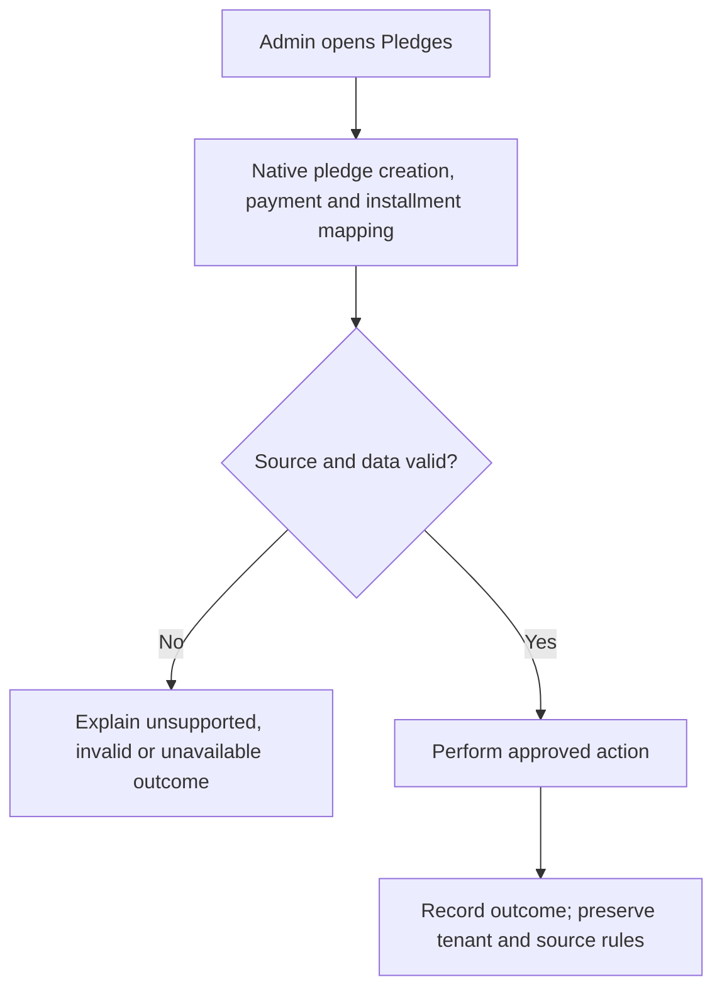

**Traceability:** [Goals](Donations_Finance_BRD_Goals.md) · [Related workflows](Donations_Finance_BRD_Workflow.md).

## DF-012 — Native receipt issuance and numbering

**Area:** Receipts  
**Classification:** To-Be  
**Implementation readiness:** Approved standalone requirement; requires implementation and QA

### User story

As an **AiXPurpose Admin**, I want to **define and implement receipt format, required fields and unique tenant-aware receipt number for confirmed native donation payments.**, so that I can perform this finance activity within the existing standalone-enabled AiXPurpose application without losing source integrity.

### Functional requirements

- **FR-DF-012-01:** Define and implement receipt format, required fields and unique tenant-aware receipt number for confirmed native donation payments.
- **FR-DF-012-02:** Confirmed native donation; check receipt eligibility; issue identifier; render PDF.
- **FR-DF-012-03:** Display clear validated, empty, processing, failure and success states as relevant to the workflow; preserve tenant-specific source provenance.
- **FR-DF-012-04:** Use the existing UI and navigation; do not rebuild a working application page.

### Business logic

- **BL-DF-012-01:** One canonical receipt identity per eligible donation; required organisation, donor, transaction and amount fields use verified sources. Receipt series specifics await Development/Finance approval.
- **BL-DF-012-02:** All signed-in users are Admins, with no additional role distinction; record origin and tenant boundaries are enforced at API and UI layers.
- **BL-DF-012-03:** Changes to externally integrated donation/pledge source values are prohibited; native operations must preserve transaction/receipt auditability.

### Acceptance criteria

1. **Given** an Admin enters this module, **when** the defined action is performed, **then** native receipt is traceable and consistently rendered; retry does not mint duplicate receipt number.
2. **Given** the source record belongs to an external integration, **when** a manual update is attempted, **then** the interface and backend do not change its source-owned fields.
3. **Given** an operation has missing required data, unsupported source fields or a failed external dependency, **when** the Admin proceeds, **then** a clear error/unavailable state appears, with no invented payment, receipt or matching result.
4. **Given** another tenant's record identifier, **when** it is queried or submitted, **then** no cross-tenant record is returned or changed.
5. **Given** this feature is To-Be, **when** it is planned for release, **then** its implementation and QA status is recorded accurately rather than inferred from the screenshot.

### Feature workflow (native Mermaid)


**Traceability:** [Goals](Donations_Finance_BRD_Goals.md) · [Related workflows](Donations_Finance_BRD_Workflow.md).

## DF-013 — Batch receipt PDF download

**Area:** Receipts  
**Classification:** To-Be  
**Implementation readiness:** Approved standalone requirement; requires implementation and QA

### User story

As an **AiXPurpose Admin**, I want to **enable existing batch/print control for selected eligible receipts and optional selection of all eligible results.**, so that I can perform this finance activity within the existing standalone-enabled AiXPurpose application without losing source integrity.

### Functional requirements

- **FR-DF-013-01:** Enable existing batch/print control for selected eligible receipts and optional selection of all eligible results.
- **FR-DF-013-02:** Choose eligible rows or all eligible results; validate; generate; download batch PDFs.
- **FR-DF-013-03:** Display clear validated, empty, processing, failure and success states as relevant to the workflow; preserve tenant-specific source provenance.
- **FR-DF-013-04:** Use the existing UI and navigation; do not rebuild a working application page.

### Business logic

- **BL-DF-013-01:** No invented external receipt numbers; failures and skipped records clearly reported.
- **BL-DF-013-02:** All signed-in users are Admins, with no additional role distinction; record origin and tenant boundaries are enforced at API and UI layers.
- **BL-DF-013-03:** Changes to externally integrated donation/pledge source values are prohibited; native operations must preserve transaction/receipt auditability.

### Acceptance criteria

1. **Given** an Admin enters this module, **when** the defined action is performed, **then** admin receives batch PDF output with accurate per-record details and explicit skipped/failed outcome.
2. **Given** the source record belongs to an external integration, **when** a manual update is attempted, **then** the interface and backend do not change its source-owned fields.
3. **Given** an operation has missing required data, unsupported source fields or a failed external dependency, **when** the Admin proceeds, **then** a clear error/unavailable state appears, with no invented payment, receipt or matching result.
4. **Given** another tenant's record identifier, **when** it is queried or submitted, **then** no cross-tenant record is returned or changed.
5. **Given** this feature is To-Be, **when** it is planned for release, **then** its implementation and QA status is recorded accurately rather than inferred from the screenshot.

### Feature workflow (native Mermaid)


**Traceability:** [Goals](Donations_Finance_BRD_Goals.md) · [Related workflows](Donations_Finance_BRD_Workflow.md).

## DF-014 — Batch receipt email sending

**Area:** Receipts  
**Classification:** To-Be  
**Implementation readiness:** Approved standalone requirement; requires implementation and QA

### User story

As an **AiXPurpose Admin**, I want to **enable batch sending of eligible receipt PDFs to recipients through existing functional email delivery.**, so that I can perform this finance activity within the existing standalone-enabled AiXPurpose application without losing source integrity.

### Functional requirements

- **FR-DF-014-01:** Enable batch sending of eligible receipt PDFs to recipients through existing functional email delivery.
- **FR-DF-014-02:** Choose eligible receipts; verify address and receipt; send batch; review per-item result.
- **FR-DF-014-03:** Display clear validated, empty, processing, failure and success states as relevant to the workflow; preserve tenant-specific source provenance.
- **FR-DF-014-04:** Use the existing UI and navigation; do not rebuild a working application page.

### Business logic

- **BL-DF-014-01:** Do not silently resend on retries; sending failures isolated and recorded.
- **BL-DF-014-02:** All signed-in users are Admins, with no additional role distinction; record origin and tenant boundaries are enforced at API and UI layers.
- **BL-DF-014-03:** Changes to externally integrated donation/pledge source values are prohibited; native operations must preserve transaction/receipt auditability.

### Acceptance criteria

1. **Given** an Admin enters this module, **when** the defined action is performed, **then** eligible recipients get correct receipt; missing email and failed delivery are reported without duplicating successful sends.
2. **Given** the source record belongs to an external integration, **when** a manual update is attempted, **then** the interface and backend do not change its source-owned fields.
3. **Given** an operation has missing required data, unsupported source fields or a failed external dependency, **when** the Admin proceeds, **then** a clear error/unavailable state appears, with no invented payment, receipt or matching result.
4. **Given** another tenant's record identifier, **when** it is queried or submitted, **then** no cross-tenant record is returned or changed.
5. **Given** this feature is To-Be, **when** it is planned for release, **then** its implementation and QA status is recorded accurately rather than inferred from the screenshot.

### Feature workflow (native Mermaid)

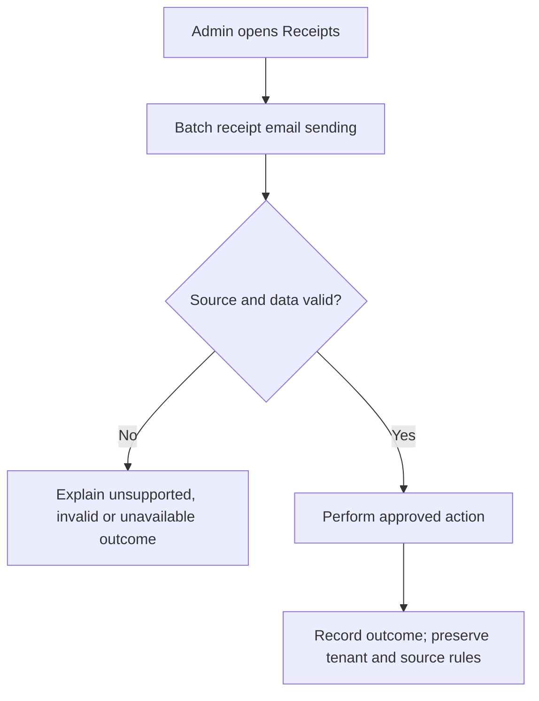

**Traceability:** [Goals](Donations_Finance_BRD_Goals.md) · [Related workflows](Donations_Finance_BRD_Workflow.md).

## DF-015 — Bank statement import

**Area:** Reconciliation  
**Classification:** To-Be limited scope  
**Implementation readiness:** Approved standalone requirement; requires implementation and QA

### User story

As an **AiXPurpose Admin**, I want to **enable existing Import Bank Data control and display imported bank statement transactions.**, so that I can perform this finance activity within the existing standalone-enabled AiXPurpose application without losing source integrity.

### Functional requirements

- **FR-DF-015-01:** Enable existing Import Bank Data control and display imported bank statement transactions.
- **FR-DF-015-02:** Select file; validate format and required fields; import and list bank lines.
- **FR-DF-015-03:** Display clear validated, empty, processing, failure and success states as relevant to the workflow; preserve tenant-specific source provenance.
- **FR-DF-015-04:** Use the existing UI and navigation; do not rebuild a working application page.

### Business logic

- **BL-DF-015-01:** File formats and exact mapping remain Development decisions; tenant/account isolation; protect against duplicate re-import.
- **BL-DF-015-02:** All signed-in users are Admins, with no additional role distinction; record origin and tenant boundaries are enforced at API and UI layers.
- **BL-DF-015-03:** Changes to externally integrated donation/pledge source values are prohibited; native operations must preserve transaction/receipt auditability.

### Acceptance criteria

1. **Given** an Admin enters this module, **when** the defined action is performed, **then** valid import lists transactions with counts; invalid input clearly identified; no matching performed automatically.
2. **Given** the source record belongs to an external integration, **when** a manual update is attempted, **then** the interface and backend do not change its source-owned fields.
3. **Given** an operation has missing required data, unsupported source fields or a failed external dependency, **when** the Admin proceeds, **then** a clear error/unavailable state appears, with no invented payment, receipt or matching result.
4. **Given** another tenant's record identifier, **when** it is queried or submitted, **then** no cross-tenant record is returned or changed.
5. **Given** this feature is To-Be, **when** it is planned for release, **then** its implementation and QA status is recorded accurately rather than inferred from the screenshot.

### Feature workflow (native Mermaid)

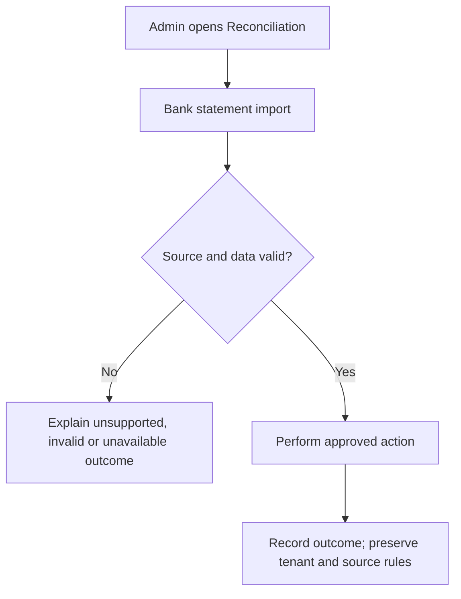

**Traceability:** [Goals](Donations_Finance_BRD_Goals.md) · [Related workflows](Donations_Finance_BRD_Workflow.md).

## DF-016 — Transaction review and source filter

**Area:** Reconciliation  
**Classification:** To-Be limited scope  
**Implementation readiness:** Approved standalone requirement; requires implementation and QA

### User story

As an **AiXPurpose Admin**, I want to **display counts/details of imported bank lines and eligible internal Donations/Pledges from All Sources, AiXPurpose, External Sources (All), and applicable individual integration.**, so that I can perform this finance activity within the existing standalone-enabled AiXPurpose application without losing source integrity.

### Functional requirements

- **FR-DF-016-01:** Display counts/details of imported bank lines and eligible internal Donations/Pledges from All Sources, AiXPurpose, External Sources (All), and applicable individual integration.
- **FR-DF-016-02:** Open reconciliation; load imported bank lines and internal transactions; choose source filter; review.
- **FR-DF-016-03:** Display clear validated, empty, processing, failure and success states as relevant to the workflow; preserve tenant-specific source provenance.
- **FR-DF-016-04:** Use the existing UI and navigation; do not rebuild a working application page.

### Business logic

- **BL-DF-016-01:** Source filter applies to internal financial records, not origin of bank statement. Only transaction-bearing integrations appear. Matching remains Future Scope.
- **BL-DF-016-02:** All signed-in users are Admins, with no additional role distinction; record origin and tenant boundaries are enforced at API and UI layers.
- **BL-DF-016-03:** Changes to externally integrated donation/pledge source values are prohibited; native operations must preserve transaction/receipt auditability.

### Acceptance criteria

1. **Given** an Admin enters this module, **when** the defined action is performed, **then** all/native/external selections show correct tenant records; importing and browsing do not alter source transactions.
2. **Given** the source record belongs to an external integration, **when** a manual update is attempted, **then** the interface and backend do not change its source-owned fields.
3. **Given** an operation has missing required data, unsupported source fields or a failed external dependency, **when** the Admin proceeds, **then** a clear error/unavailable state appears, with no invented payment, receipt or matching result.
4. **Given** another tenant's record identifier, **when** it is queried or submitted, **then** no cross-tenant record is returned or changed.
5. **Given** this feature is To-Be, **when** it is planned for release, **then** its implementation and QA status is recorded accurately rather than inferred from the screenshot.

### Feature workflow (native Mermaid)

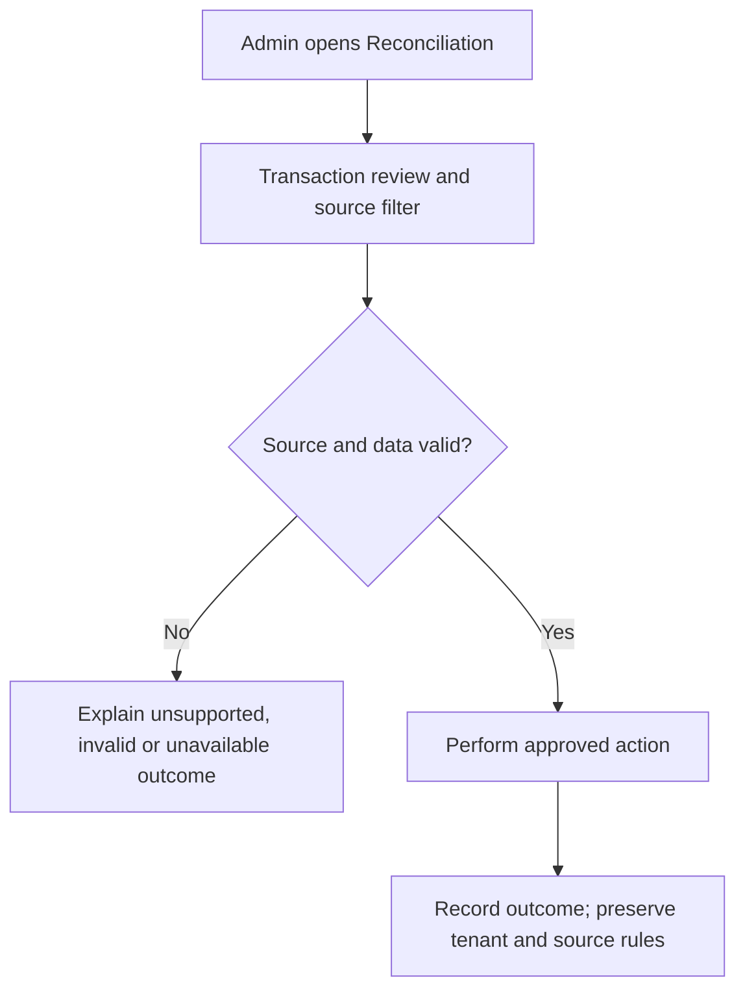

**Traceability:** [Goals](Donations_Finance_BRD_Goals.md) · [Related workflows](Donations_Finance_BRD_Workflow.md).

## DF-017 — Reconciliation KPI representation

**Area:** Reconciliation  
**Classification:** To-Be limited scope / legacy UI  
**Implementation readiness:** Approved standalone requirement; requires implementation and QA

### User story

As an **AiXPurpose Admin**, I want to **retain visible total and transaction details; do not claim Matched/Unmatched/Match Rate are newly computed without approved matching workflow.**, so that I can perform this finance activity within the existing standalone-enabled AiXPurpose application without losing source integrity.

### Functional requirements

- **FR-DF-017-01:** Retain visible total and transaction details; do not claim Matched/Unmatched/Match Rate are newly computed without approved matching workflow.
- **FR-DF-017-02:** Open reconciliation; display bank import count and available transaction details; qualify legacy matching indicators.
- **FR-DF-017-03:** Display clear validated, empty, processing, failure and success states as relevant to the workflow; preserve tenant-specific source provenance.
- **FR-DF-017-04:** Use the existing UI and navigation; do not rebuild a working application page.

### Business logic

- **BL-DF-017-01:** The existing matching UI may be displayed as existing but automatic or manual final matching is NOT To-Be; unsupported metrics marked unavailable pending Future implementation.
- **BL-DF-017-02:** All signed-in users are Admins, with no additional role distinction; record origin and tenant boundaries are enforced at API and UI layers.
- **BL-DF-017-03:** Changes to externally integrated donation/pledge source values are prohibited; native operations must preserve transaction/receipt auditability.

### Acceptance criteria

1. **Given** an Admin enters this module, **when** the defined action is performed, **then** new import totals reconcile to imported rows; unsupported matching status is not fabricated.
2. **Given** the source record belongs to an external integration, **when** a manual update is attempted, **then** the interface and backend do not change its source-owned fields.
3. **Given** an operation has missing required data, unsupported source fields or a failed external dependency, **when** the Admin proceeds, **then** a clear error/unavailable state appears, with no invented payment, receipt or matching result.
4. **Given** another tenant's record identifier, **when** it is queried or submitted, **then** no cross-tenant record is returned or changed.
5. **Given** this feature is To-Be, **when** it is planned for release, **then** its implementation and QA status is recorded accurately rather than inferred from the screenshot.

### Feature workflow (native Mermaid)

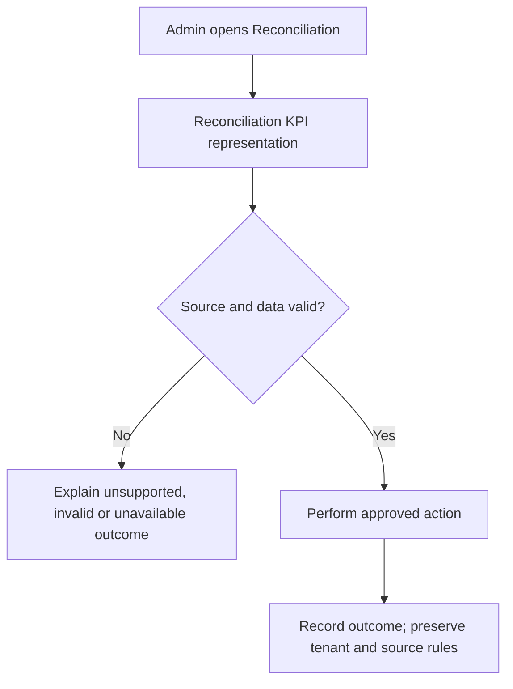

**Traceability:** [Goals](Donations_Finance_BRD_Goals.md) · [Related workflows](Donations_Finance_BRD_Workflow.md).

## DF-018 — Per-page Source dropdown

**Area:** Shared  
**Classification:** To-Be shared  
**Implementation readiness:** Approved standalone requirement; requires implementation and QA

### User story

As an **AiXPurpose Admin**, I want to **reuse existing Filters area for All Sources default, AiXPurpose, External Sources (All), and tenant-connected source applications.**, so that I can perform this finance activity within the existing standalone-enabled AiXPurpose application without losing source integrity.

### Functional requirements

- **FR-DF-018-01:** Reuse existing Filters area for All Sources default, AiXPurpose, External Sources (All), and tenant-connected source applications.
- **FR-DF-018-02:** Open list; choose source option; refresh scoped records; reset to All Sources.
- **FR-DF-018-03:** Display clear validated, empty, processing, failure and success states as relevant to the workflow; preserve tenant-specific source provenance.
- **FR-DF-018-04:** Use the existing UI and navigation; do not rebuild a working application page.

### Business logic

- **BL-DF-018-01:** Source filter is page-local; not a global Settings switch; search and pagination respect selected source; tenant isolation maintained.
- **BL-DF-018-02:** All signed-in users are Admins, with no additional role distinction; record origin and tenant boundaries are enforced at API and UI layers.
- **BL-DF-018-03:** Changes to externally integrated donation/pledge source values are prohibited; native operations must preserve transaction/receipt auditability.

### Acceptance criteria

1. **Given** an Admin enters this module, **when** the defined action is performed, **then** native/external/all results are correctly filtered; no source is deleted or disconnected.
2. **Given** the source record belongs to an external integration, **when** a manual update is attempted, **then** the interface and backend do not change its source-owned fields.
3. **Given** an operation has missing required data, unsupported source fields or a failed external dependency, **when** the Admin proceeds, **then** a clear error/unavailable state appears, with no invented payment, receipt or matching result.
4. **Given** another tenant's record identifier, **when** it is queried or submitted, **then** no cross-tenant record is returned or changed.
5. **Given** this feature is To-Be, **when** it is planned for release, **then** its implementation and QA status is recorded accurately rather than inferred from the screenshot.

### Feature workflow (native Mermaid)

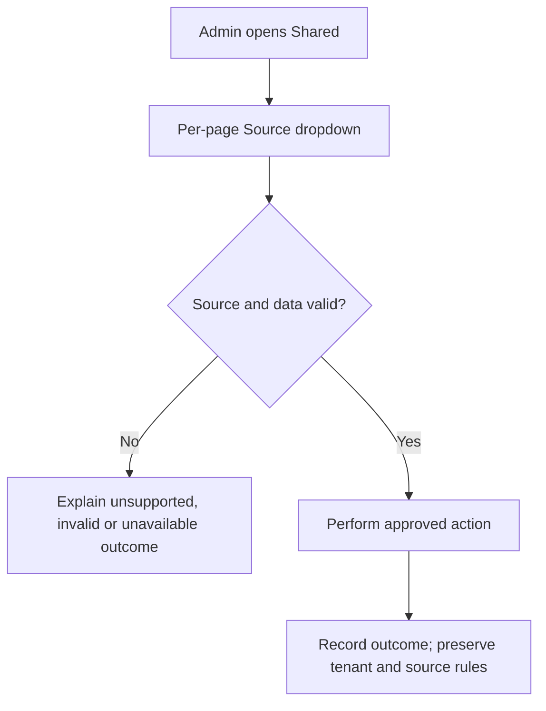

**Traceability:** [Goals](Donations_Finance_BRD_Goals.md) · [Related workflows](Donations_Finance_BRD_Workflow.md).

## DF-019 — Origin visibility and read-only enforcement

**Area:** Shared  
**Classification:** To-Be shared  
**Implementation readiness:** Approved standalone requirement; requires implementation and QA

### User story

As an **AiXPurpose Admin**, I want to **identify source for each record, enable editing of eligible native data, and ensure imported data is read-only at both interface and API layers.**, so that I can perform this finance activity within the existing standalone-enabled AiXPurpose application without losing source integrity.

### Functional requirements

- **FR-DF-019-01:** Identify source for each record, enable editing of eligible native data, and ensure imported data is read-only at both interface and API layers.
- **FR-DF-019-02:** Open native or external row; render source and actions; attempt update.
- **FR-DF-019-03:** Display clear validated, empty, processing, failure and success states as relevant to the workflow; preserve tenant-specific source provenance.
- **FR-DF-019-04:** Use the existing UI and navigation; do not rebuild a working application page.

### Business logic

- **BL-DF-019-01:** No role-based differentiation among Admins; read-only integrated record values may still refresh by source sync.
- **BL-DF-019-02:** All signed-in users are Admins, with no additional role distinction; record origin and tenant boundaries are enforced at API and UI layers.
- **BL-DF-019-03:** Changes to externally integrated donation/pledge source values are prohibited; native operations must preserve transaction/receipt auditability.

### Acceptance criteria

1. **Given** an Admin enters this module, **when** the defined action is performed, **then** external update attempts fail safely; native eligible actions work; source remains visible in details.
2. **Given** the source record belongs to an external integration, **when** a manual update is attempted, **then** the interface and backend do not change its source-owned fields.
3. **Given** an operation has missing required data, unsupported source fields or a failed external dependency, **when** the Admin proceeds, **then** a clear error/unavailable state appears, with no invented payment, receipt or matching result.
4. **Given** another tenant's record identifier, **when** it is queried or submitted, **then** no cross-tenant record is returned or changed.
5. **Given** this feature is To-Be, **when** it is planned for release, **then** its implementation and QA status is recorded accurately rather than inferred from the screenshot.

### Feature workflow (native Mermaid)

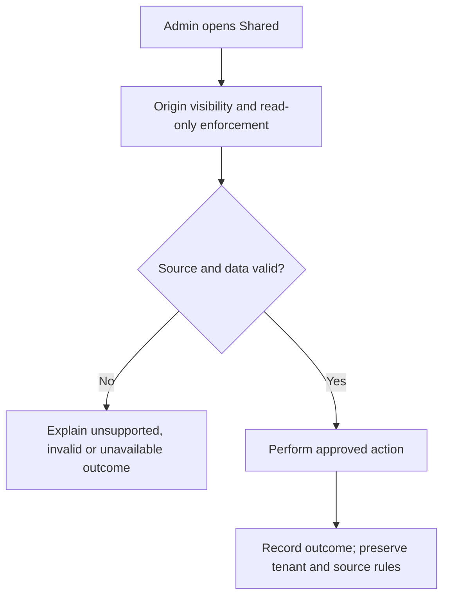

**Traceability:** [Goals](Donations_Finance_BRD_Goals.md) · [Related workflows](Donations_Finance_BRD_Workflow.md).

## DF-020 — Tenant isolation and source provenance

**Area:** Shared  
**Classification:** To-Be cross-module  
**Implementation readiness:** Approved standalone requirement; requires implementation and QA

### User story

As an **AiXPurpose Admin**, I want to **keep donations, pledges, receipts, imports, payment gateway configurations and record sources isolated across tenants.**, so that I can perform this finance activity within the existing standalone-enabled AiXPurpose application without losing source integrity.

### Functional requirements

- **FR-DF-020-01:** Keep donations, pledges, receipts, imports, payment gateway configurations and record sources isolated across tenants.
- **FR-DF-020-02:** Admin enters tenant context; load data; operate only on tenant-owned resources.
- **FR-DF-020-03:** Display clear validated, empty, processing, failure and success states as relevant to the workflow; preserve tenant-specific source provenance.
- **FR-DF-020-04:** Use the existing UI and navigation; do not rebuild a working application page.

### Business logic

- **BL-DF-020-01:** Use server enforced isolation and source IDs; no cross-tenant record leakage through export, lookup, batch actions or API.
- **BL-DF-020-02:** All signed-in users are Admins, with no additional role distinction; record origin and tenant boundaries are enforced at API and UI layers.
- **BL-DF-020-03:** Changes to externally integrated donation/pledge source values are prohibited; native operations must preserve transaction/receipt auditability.

### Acceptance criteria

1. **Given** an Admin enters this module, **when** the defined action is performed, **then** cross-tenant identifiers fail access check; source and transaction IDs remain traceable.
2. **Given** the source record belongs to an external integration, **when** a manual update is attempted, **then** the interface and backend do not change its source-owned fields.
3. **Given** an operation has missing required data, unsupported source fields or a failed external dependency, **when** the Admin proceeds, **then** a clear error/unavailable state appears, with no invented payment, receipt or matching result.
4. **Given** another tenant's record identifier, **when** it is queried or submitted, **then** no cross-tenant record is returned or changed.
5. **Given** this feature is To-Be, **when** it is planned for release, **then** its implementation and QA status is recorded accurately rather than inferred from the screenshot.

### Feature workflow (native Mermaid)

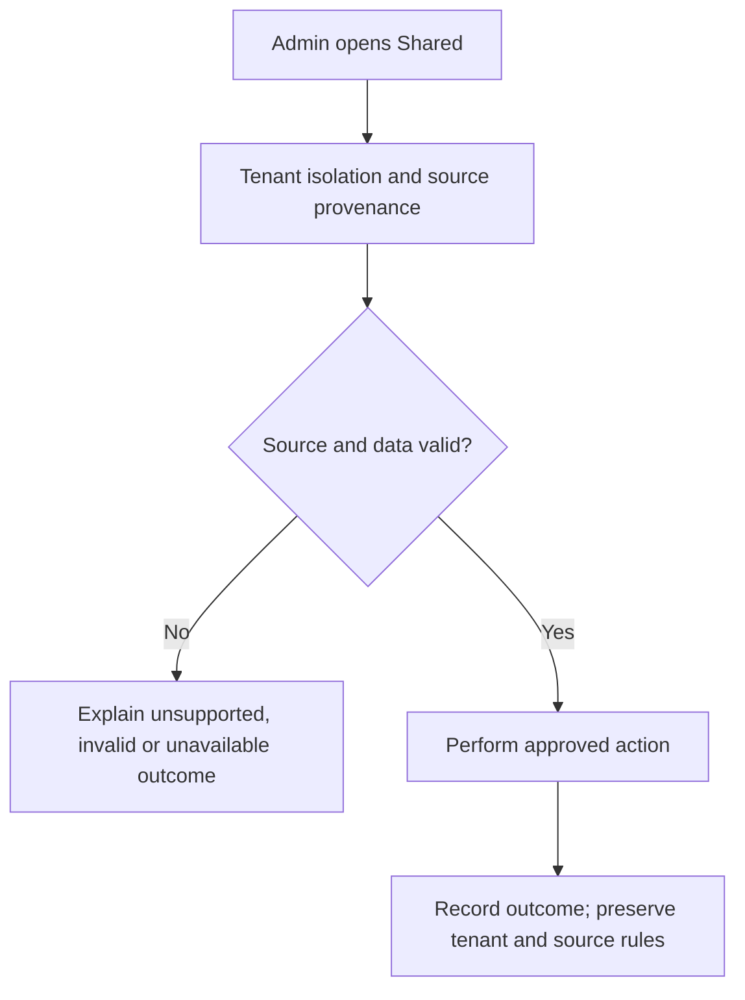

**Traceability:** [Goals](Donations_Finance_BRD_Goals.md) · [Related workflows](Donations_Finance_BRD_Workflow.md).

## DF-021 — Existing Donations configurable KPI baseline

**Area:** Shared  
**Classification:** As-Is Jira development baseline  
**Implementation readiness:** Existing UI or established Jira baseline; actual functional status as identified

### User story

As an **AiXPurpose Admin**, I want to **reuse exact approved Donations configurable four-card selection and defined candidate calculations.**, so that I can perform this finance activity within the existing standalone-enabled AiXPurpose application without losing source integrity.

### Functional requirements

- **FR-DF-021-01:** Reuse exact approved Donations configurable four-card selection and defined candidate calculations.
- **FR-DF-021-02:** Open Donations; customize four KPIs; save; render.
- **FR-DF-021-03:** Display clear validated, empty, processing, failure and success states as relevant to the workflow; preserve tenant-specific source provenance.
- **FR-DF-021-04:** Use the existing UI and navigation; do not rebuild a working application page.

### Business logic

- **BL-DF-021-01:** No new KPI catalog; status and field-readiness must match Jira implementation, pending QA.
- **BL-DF-021-02:** All signed-in users are Admins, with no additional role distinction; record origin and tenant boundaries are enforced at API and UI layers.
- **BL-DF-021-03:** Changes to externally integrated donation/pledge source values are prohibited; native operations must preserve transaction/receipt auditability.

### Acceptance criteria

1. **Given** an Admin enters this module, **when** the defined action is performed, **then** four selected cards persist as defined by prior approved work; unverified totals are not treated as confirmed.
2. **Given** the source record belongs to an external integration, **when** a manual update is attempted, **then** the interface and backend do not change its source-owned fields.
3. **Given** an operation has missing required data, unsupported source fields or a failed external dependency, **when** the Admin proceeds, **then** a clear error/unavailable state appears, with no invented payment, receipt or matching result.
4. **Given** another tenant's record identifier, **when** it is queried or submitted, **then** no cross-tenant record is returned or changed.
5. **Given** this feature is existing or Jira-baseline, **when** it is planned for release, **then** its implementation and QA status is recorded accurately rather than inferred from the screenshot.

### Feature workflow (native Mermaid)

```mermaid
flowchart TD
    A["Admin opens Shared"] --> B["Existing Donations configurable KPI baseline"]
    B --> C{"Source and data valid?"}
    C -->|No| D["Explain unsupported, invalid or unavailable outcome"]
    C -->|Yes| E["Show existing documented UI or action"]
    E --> F["Record outcome; preserve tenant and source rules"]
```

**Traceability:** [Goals](Donations_Finance_BRD_Goals.md) · [Related workflows](Donations_Finance_BRD_Workflow.md).

## DF-022 — Automatic bank transaction matching

**Area:** Future  
**Classification:** Future candidate DF-F01  
**Implementation readiness:** Future business discussion; not committed

### User story

As an **AiXPurpose Admin**, I want to **evaluate rule-based identification of eligible bank and internal transactions.**, so that I can perform this finance activity within the existing standalone-enabled AiXPurpose application without losing source integrity.

### Functional requirements

- **FR-DF-022-01:** Evaluate rule-based identification of eligible bank and internal transactions.
- **FR-DF-022-02:** Import statement; apply future match rules; review candidates.
- **FR-DF-022-03:** Display clear validated, empty, processing, failure and success states as relevant to the workflow; preserve tenant-specific source provenance.
- **FR-DF-022-04:** Do not implement until separately approved as Future Scope.

### Business logic

- **BL-DF-022-01:** Not in current To-Be; approvals and identifiers require future definition.
- **BL-DF-022-02:** All signed-in users are Admins, with no additional role distinction; record origin and tenant boundaries are enforced at API and UI layers.
- **BL-DF-022-03:** Changes to externally integrated donation/pledge source values are prohibited; native operations must preserve transaction/receipt auditability.

### Acceptance criteria

1. **Given** an Admin enters this module, **when** the defined action is performed, **then** future proposal only; no current implementation obligation.
2. **Given** the source record belongs to an external integration, **when** a manual update is attempted, **then** the interface and backend do not change its source-owned fields.
3. **Given** an operation has missing required data, unsupported source fields or a failed external dependency, **when** the Admin proceeds, **then** a clear error/unavailable state appears, with no invented payment, receipt or matching result.
4. **Given** another tenant's record identifier, **when** it is queried or submitted, **then** no cross-tenant record is returned or changed.
5. **Given** this feature is Future Scope, **when** it is planned for release, **then** its implementation and QA status is recorded accurately rather than inferred from the screenshot.

### Feature workflow (native Mermaid)

```mermaid
flowchart TD
    A["Admin opens Future"] --> B["Automatic bank transaction matching"]
    B --> C{"Source and data valid?"}
    C -->|No| D["Explain unsupported, invalid or unavailable outcome"]
    C -->|Yes| E["Future approval and design only"]
    E --> F["Record outcome; preserve tenant and source rules"]
```

**Traceability:** [Goals](Donations_Finance_BRD_Goals.md) · [Related workflows](Donations_Finance_BRD_Workflow.md).

## DF-023 — Advanced reconciliation exceptions and matching

**Area:** Future  
**Classification:** Future candidate DF-F02  
**Implementation readiness:** Future business discussion; not committed

### User story

As an **AiXPurpose Admin**, I want to **evaluate manual matching, partial matches, duplicates and exception handling with a full business process.**, so that I can perform this finance activity within the existing standalone-enabled AiXPurpose application without losing source integrity.

### Functional requirements

- **FR-DF-023-01:** Evaluate manual matching, partial matches, duplicates and exception handling with a full business process.
- **FR-DF-023-02:** Identify exception; inspect supporting evidence; resolve under future policy.
- **FR-DF-023-03:** Display clear validated, empty, processing, failure and success states as relevant to the workflow; preserve tenant-specific source provenance.
- **FR-DF-023-04:** Do not implement until separately approved as Future Scope.

### Business logic

- **BL-DF-023-01:** Not in current To-Be; prior final-match decision is superseded by moving matching out of current scope.
- **BL-DF-023-02:** All signed-in users are Admins, with no additional role distinction; record origin and tenant boundaries are enforced at API and UI layers.
- **BL-DF-023-03:** Changes to externally integrated donation/pledge source values are prohibited; native operations must preserve transaction/receipt auditability.

### Acceptance criteria

1. **Given** an Admin enters this module, **when** the defined action is performed, **then** future proposal only; approval needed before design.
2. **Given** the source record belongs to an external integration, **when** a manual update is attempted, **then** the interface and backend do not change its source-owned fields.
3. **Given** an operation has missing required data, unsupported source fields or a failed external dependency, **when** the Admin proceeds, **then** a clear error/unavailable state appears, with no invented payment, receipt or matching result.
4. **Given** another tenant's record identifier, **when** it is queried or submitted, **then** no cross-tenant record is returned or changed.
5. **Given** this feature is Future Scope, **when** it is planned for release, **then** its implementation and QA status is recorded accurately rather than inferred from the screenshot.

### Feature workflow (native Mermaid)

```mermaid
flowchart TD
    A["Admin opens Future"] --> B["Advanced reconciliation exceptions and matching"]
    B --> C{"Source and data valid?"}
    C -->|No| D["Explain unsupported, invalid or unavailable outcome"]
    C -->|Yes| E["Future approval and design only"]
    E --> F["Record outcome; preserve tenant and source rules"]
```

**Traceability:** [Goals](Donations_Finance_BRD_Goals.md) · [Related workflows](Donations_Finance_BRD_Workflow.md).

## DF-024 — Source-aware refund processing and synchronization

**Area:** Future  
**Classification:** Future candidate DF-F03 / pending  
**Implementation readiness:** Future business discussion; not committed

### User story

As an **AiXPurpose Admin**, I want to **evaluate native gateway refunds and read-only synchronisation of refund status/adjustments from integrated payment source systems.**, so that I can perform this finance activity within the existing standalone-enabled AiXPurpose application without losing source integrity.

### Functional requirements

- **FR-DF-024-01:** Evaluate native gateway refunds and read-only synchronisation of refund status/adjustments from integrated payment source systems.
- **FR-DF-024-02:** Select eligible future native refund; verify provider; initiate via source; sync status.
- **FR-DF-024-03:** Display clear validated, empty, processing, failure and success states as relevant to the workflow; preserve tenant-specific source provenance.
- **FR-DF-024-04:** Do not implement until separately approved as Future Scope.

### Business logic

- **BL-DF-024-01:** DonorPerfect may support its own refunds; iWave is not a payment processor. AiXPurpose may not directly edit imported financial records.
- **BL-DF-024-02:** All signed-in users are Admins, with no additional role distinction; record origin and tenant boundaries are enforced at API and UI layers.
- **BL-DF-024-03:** Changes to externally integrated donation/pledge source values are prohibited; native operations must preserve transaction/receipt auditability.

### Acceptance criteria

1. **Given** an Admin enters this module, **when** the defined action is performed, **then** future discussion only; no current refund API or action enabled by this requirement.
2. **Given** the source record belongs to an external integration, **when** a manual update is attempted, **then** the interface and backend do not change its source-owned fields.
3. **Given** an operation has missing required data, unsupported source fields or a failed external dependency, **when** the Admin proceeds, **then** a clear error/unavailable state appears, with no invented payment, receipt or matching result.
4. **Given** another tenant's record identifier, **when** it is queried or submitted, **then** no cross-tenant record is returned or changed.
5. **Given** this feature is Future Scope, **when** it is planned for release, **then** its implementation and QA status is recorded accurately rather than inferred from the screenshot.

### Feature workflow (native Mermaid)

```mermaid
flowchart TD
    A["Admin opens Future"] --> B["Source-aware refund processing and synchronization"]
    B --> C{"Source and data valid?"}
    C -->|No| D["Explain unsupported, invalid or unavailable outcome"]
    C -->|Yes| E["Future approval and design only"]
    E --> F["Record outcome; preserve tenant and source rules"]
```

**Traceability:** [Goals](Donations_Finance_BRD_Goals.md) · [Related workflows](Donations_Finance_BRD_Workflow.md).

## DF-025 — Receipt template customization

**Area:** Future  
**Classification:** Future candidate DF-F04  
**Implementation readiness:** Future business discussion; not committed

### User story

As an **AiXPurpose Admin**, I want to **evaluate tenant-specific branding and receipt layouts without changing receipt identity and legal/finance fields.**, so that I can perform this finance activity within the existing standalone-enabled AiXPurpose application without losing source integrity.

### Functional requirements

- **FR-DF-025-01:** Evaluate tenant-specific branding and receipt layouts without changing receipt identity and legal/finance fields.
- **FR-DF-025-02:** Select future branding settings; preview receipt; save template.
- **FR-DF-025-03:** Display clear validated, empty, processing, failure and success states as relevant to the workflow; preserve tenant-specific source provenance.
- **FR-DF-025-04:** Do not implement until separately approved as Future Scope.

### Business logic

- **BL-DF-025-01:** Financially required receipt fields cannot be suppressed without approval.
- **BL-DF-025-02:** All signed-in users are Admins, with no additional role distinction; record origin and tenant boundaries are enforced at API and UI layers.
- **BL-DF-025-03:** Changes to externally integrated donation/pledge source values are prohibited; native operations must preserve transaction/receipt auditability.

### Acceptance criteria

1. **Given** an Admin enters this module, **when** the defined action is performed, **then** future proposal only.
2. **Given** the source record belongs to an external integration, **when** a manual update is attempted, **then** the interface and backend do not change its source-owned fields.
3. **Given** an operation has missing required data, unsupported source fields or a failed external dependency, **when** the Admin proceeds, **then** a clear error/unavailable state appears, with no invented payment, receipt or matching result.
4. **Given** another tenant's record identifier, **when** it is queried or submitted, **then** no cross-tenant record is returned or changed.
5. **Given** this feature is Future Scope, **when** it is planned for release, **then** its implementation and QA status is recorded accurately rather than inferred from the screenshot.

### Feature workflow (native Mermaid)

```mermaid
flowchart TD
    A["Admin opens Future"] --> B["Receipt template customization"]
    B --> C{"Source and data valid?"}
    C -->|No| D["Explain unsupported, invalid or unavailable outcome"]
    C -->|Yes| E["Future approval and design only"]
    E --> F["Record outcome; preserve tenant and source rules"]
```

**Traceability:** [Goals](Donations_Finance_BRD_Goals.md) · [Related workflows](Donations_Finance_BRD_Workflow.md).

## DF-026 — Pledge payment reminders

**Area:** Future  
**Classification:** Future candidate DF-F05  
**Implementation readiness:** Future business discussion; not committed

### User story

As an **AiXPurpose Admin**, I want to **evaluate reminder triggers tied to installment due dates using existing communications functionality.**, so that I can perform this finance activity within the existing standalone-enabled AiXPurpose application without losing source integrity.

### Functional requirements

- **FR-DF-026-01:** Evaluate reminder triggers tied to installment due dates using existing communications functionality.
- **FR-DF-026-02:** Read future due installments; select reminder template; schedule delivery.
- **FR-DF-026-03:** Display clear validated, empty, processing, failure and success states as relevant to the workflow; preserve tenant-specific source provenance.
- **FR-DF-026-04:** Do not implement until separately approved as Future Scope.

### Business logic

- **BL-DF-026-01:** Requires approved delivery cadence, duplicate prevention and privacy/communication rules.
- **BL-DF-026-02:** All signed-in users are Admins, with no additional role distinction; record origin and tenant boundaries are enforced at API and UI layers.
- **BL-DF-026-03:** Changes to externally integrated donation/pledge source values are prohibited; native operations must preserve transaction/receipt auditability.

### Acceptance criteria

1. **Given** an Admin enters this module, **when** the defined action is performed, **then** future proposal only.
2. **Given** the source record belongs to an external integration, **when** a manual update is attempted, **then** the interface and backend do not change its source-owned fields.
3. **Given** an operation has missing required data, unsupported source fields or a failed external dependency, **when** the Admin proceeds, **then** a clear error/unavailable state appears, with no invented payment, receipt or matching result.
4. **Given** another tenant's record identifier, **when** it is queried or submitted, **then** no cross-tenant record is returned or changed.
5. **Given** this feature is Future Scope, **when** it is planned for release, **then** its implementation and QA status is recorded accurately rather than inferred from the screenshot.

### Feature workflow (native Mermaid)

```mermaid
flowchart TD
    A["Admin opens Future"] --> B["Pledge payment reminders"]
    B --> C{"Source and data valid?"}
    C -->|No| D["Explain unsupported, invalid or unavailable outcome"]
    C -->|Yes| E["Future approval and design only"]
    E --> F["Record outcome; preserve tenant and source rules"]
```

**Traceability:** [Goals](Donations_Finance_BRD_Goals.md) · [Related workflows](Donations_Finance_BRD_Workflow.md).

## DF-027 — Financial reconciliation export

**Area:** Future  
**Classification:** Future candidate DF-F06  
**Implementation readiness:** Future business discussion; not committed

### User story

As an **AiXPurpose Admin**, I want to **evaluate tenant-specific export of imported and reconciled transaction views.**, so that I can perform this finance activity within the existing standalone-enabled AiXPurpose application without losing source integrity.

### Functional requirements

- **FR-DF-027-01:** Evaluate tenant-specific export of imported and reconciled transaction views.
- **FR-DF-027-02:** Select date/source; export authorized data.
- **FR-DF-027-03:** Display clear validated, empty, processing, failure and success states as relevant to the workflow; preserve tenant-specific source provenance.
- **FR-DF-027-04:** Do not implement until separately approved as Future Scope.

### Business logic

- **BL-DF-027-01:** Format, filtering and masking need future approval.
- **BL-DF-027-02:** All signed-in users are Admins, with no additional role distinction; record origin and tenant boundaries are enforced at API and UI layers.
- **BL-DF-027-03:** Changes to externally integrated donation/pledge source values are prohibited; native operations must preserve transaction/receipt auditability.

### Acceptance criteria

1. **Given** an Admin enters this module, **when** the defined action is performed, **then** future proposal only.
2. **Given** the source record belongs to an external integration, **when** a manual update is attempted, **then** the interface and backend do not change its source-owned fields.
3. **Given** an operation has missing required data, unsupported source fields or a failed external dependency, **when** the Admin proceeds, **then** a clear error/unavailable state appears, with no invented payment, receipt or matching result.
4. **Given** another tenant's record identifier, **when** it is queried or submitted, **then** no cross-tenant record is returned or changed.
5. **Given** this feature is Future Scope, **when** it is planned for release, **then** its implementation and QA status is recorded accurately rather than inferred from the screenshot.

### Feature workflow (native Mermaid)

```mermaid
flowchart TD
    A["Admin opens Future"] --> B["Financial reconciliation export"]
    B --> C{"Source and data valid?"}
    C -->|No| D["Explain unsupported, invalid or unavailable outcome"]
    C -->|Yes| E["Future approval and design only"]
    E --> F["Record outcome; preserve tenant and source rules"]
```

**Traceability:** [Goals](Donations_Finance_BRD_Goals.md) · [Related workflows](Donations_Finance_BRD_Workflow.md).

## DF-028 — Multi-donor pledge management

**Area:** Future  
**Classification:** Future candidate DF-F07 / pending  
**Implementation readiness:** Future business discussion; not committed

### User story

As an **AiXPurpose Admin**, I want to **explore contribution ownership and how multiple donors share, allocate and fulfill a pledge.**, so that I can perform this finance activity within the existing standalone-enabled AiXPurpose application without losing source integrity.

### Functional requirements

- **FR-DF-028-01:** Explore contribution ownership and how multiple donors share, allocate and fulfill a pledge.
- **FR-DF-028-02:** Create future multi-donor pledge; define responsibility; track payments.
- **FR-DF-028-03:** Display clear validated, empty, processing, failure and success states as relevant to the workflow; preserve tenant-specific source provenance.
- **FR-DF-028-04:** Do not implement until separately approved as Future Scope.

### Business logic

- **BL-DF-028-01:** No final allocation model approved for this enhancement; previous shared-total observation is not final design.
- **BL-DF-028-02:** All signed-in users are Admins, with no additional role distinction; record origin and tenant boundaries are enforced at API and UI layers.
- **BL-DF-028-03:** Changes to externally integrated donation/pledge source values are prohibited; native operations must preserve transaction/receipt auditability.

### Acceptance criteria

1. **Given** an Admin enters this module, **when** the defined action is performed, **then** future proposal only; no current allocation implementation.
2. **Given** the source record belongs to an external integration, **when** a manual update is attempted, **then** the interface and backend do not change its source-owned fields.
3. **Given** an operation has missing required data, unsupported source fields or a failed external dependency, **when** the Admin proceeds, **then** a clear error/unavailable state appears, with no invented payment, receipt or matching result.
4. **Given** another tenant's record identifier, **when** it is queried or submitted, **then** no cross-tenant record is returned or changed.
5. **Given** this feature is Future Scope, **when** it is planned for release, **then** its implementation and QA status is recorded accurately rather than inferred from the screenshot.

### Feature workflow (native Mermaid)

```mermaid
flowchart TD
    A["Admin opens Future"] --> B["Multi-donor pledge management"]
    B --> C{"Source and data valid?"}
    C -->|No| D["Explain unsupported, invalid or unavailable outcome"]
    C -->|Yes| E["Future approval and design only"]
    E --> F["Record outcome; preserve tenant and source rules"]
```

**Traceability:** [Goals](Donations_Finance_BRD_Goals.md) · [Related workflows](Donations_Finance_BRD_Workflow.md).

## 2. Open decisions and cross-module alignment

| ID | Outstanding matter | Owner |
|---|---|---|
| OD-01 | Payment gateway provider, confirmation/webhook, settlement and failure semantics | Development / Finance |
| OD-02 | Native receipt number pattern, uniqueness boundary, legal/organisation fields | Product / Finance / Development |
| OD-03 | Bank import file format, field mapping, statement-level duplicate detection | Development |
| OD-04 | Exact eligible transaction sources including whether each connector supplies transaction-level donation/pledge data | Development / Data mapping |
| OD-05 | Batch send limits, duplicate-send treatment and recipient error recovery | Development / Product |
| OD-06 | Native pledge and installment schema, payment linkage and no double counting | Development / Finance |
| OD-07 | Refund provider and source-system workflow | Future discussion |
| OD-08 | Multi-donor pledge ownership/allocation/payment responsibility | Future discussion |
| OD-09 | Existing reconciliation matching KPI meaning and whether unsupported cards should be hidden/qualified | Product / Development |
| OD-10 | Existing disabled Create/Edit actions and QA checklist for each Donations & Finance screen | QA / Development |

## Screenshot references — original application captures

The following images are extracted without editing from **donation and finance module.docx**, in document image order. Screenshots establish interface presence, not server-side functionality.

| Figure | Source screenshot |
|---|---|
| 1 | 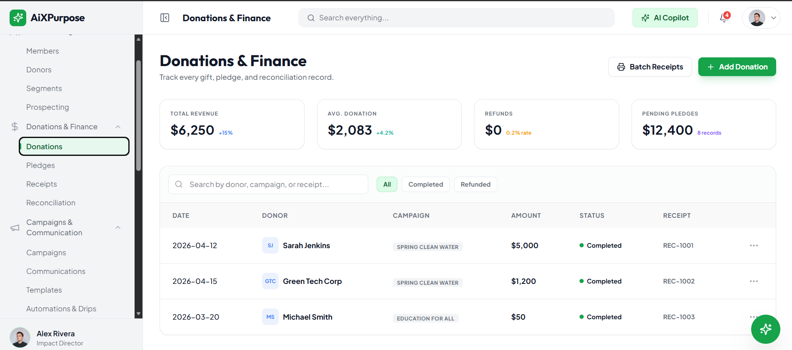 |
| 2 | 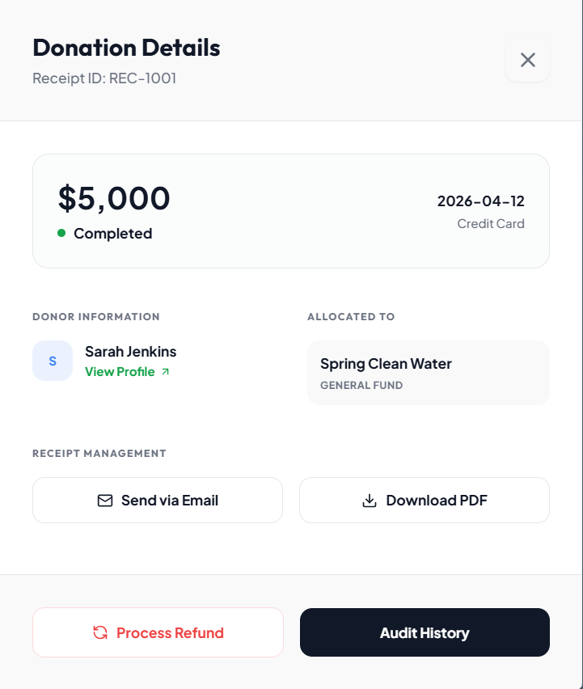 |
| 3 | 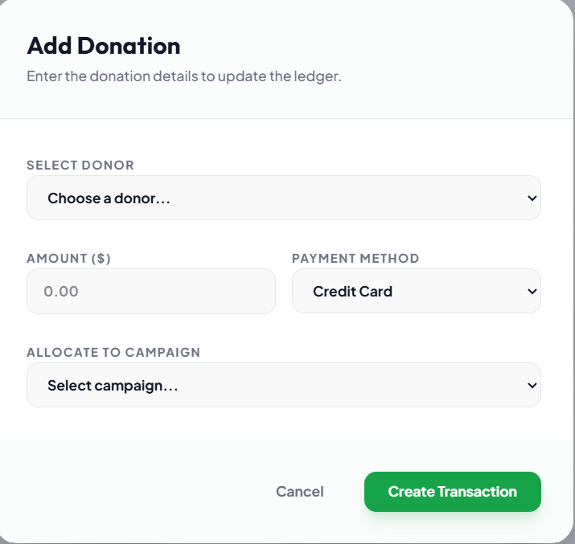 |
| 4 | 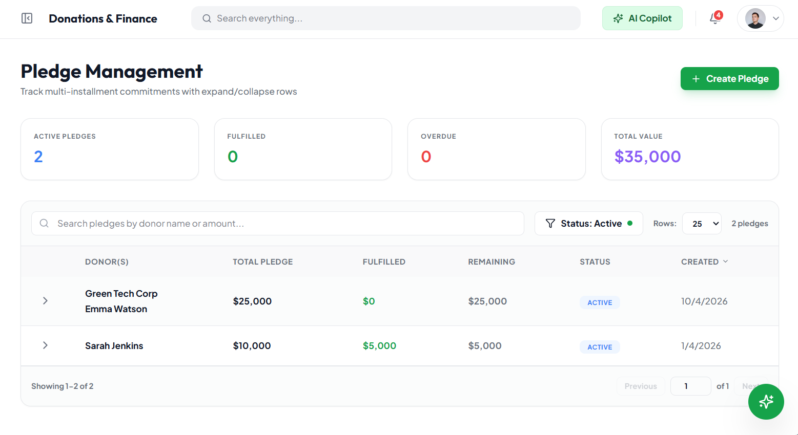 |
| 5 | 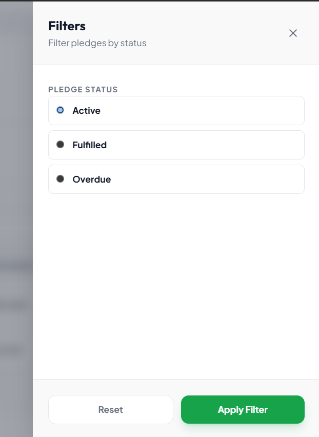 |
| 6 | 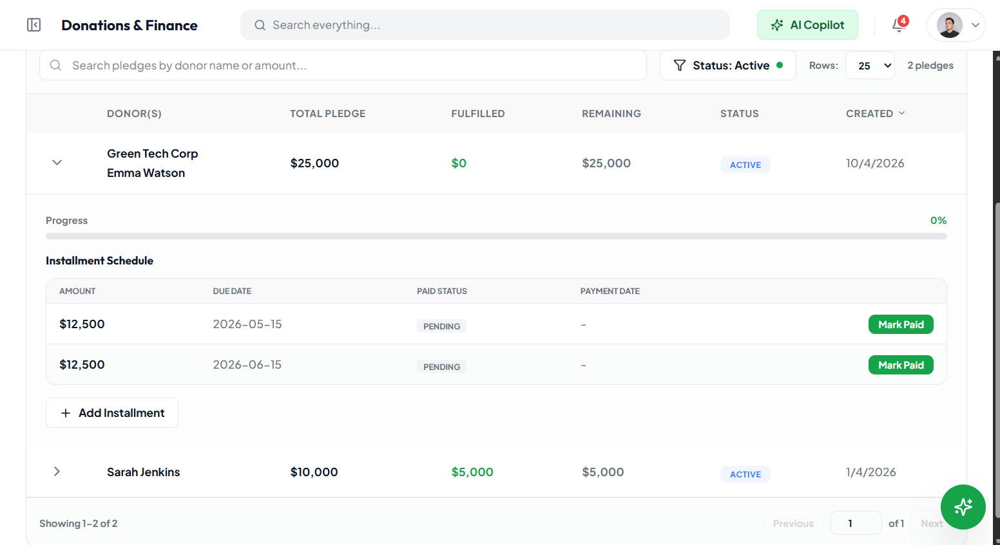 |
| 7 | 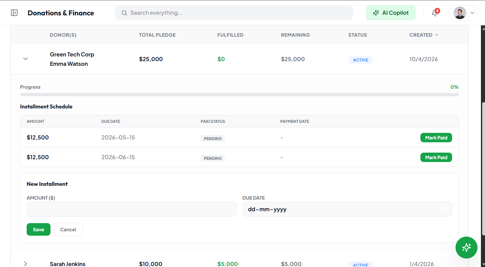 |
| 8 | 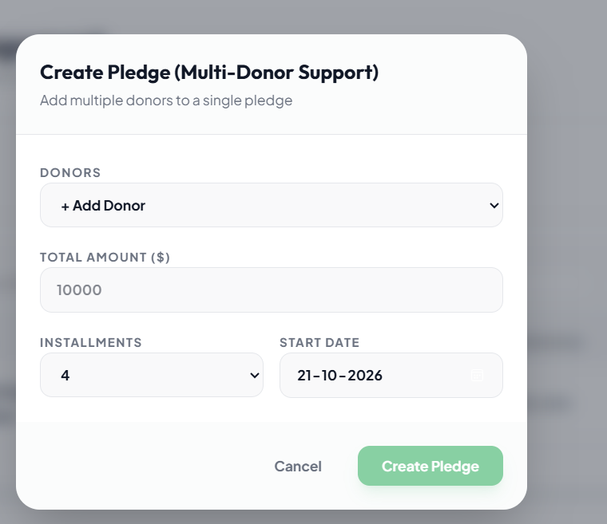 |
| 9 | 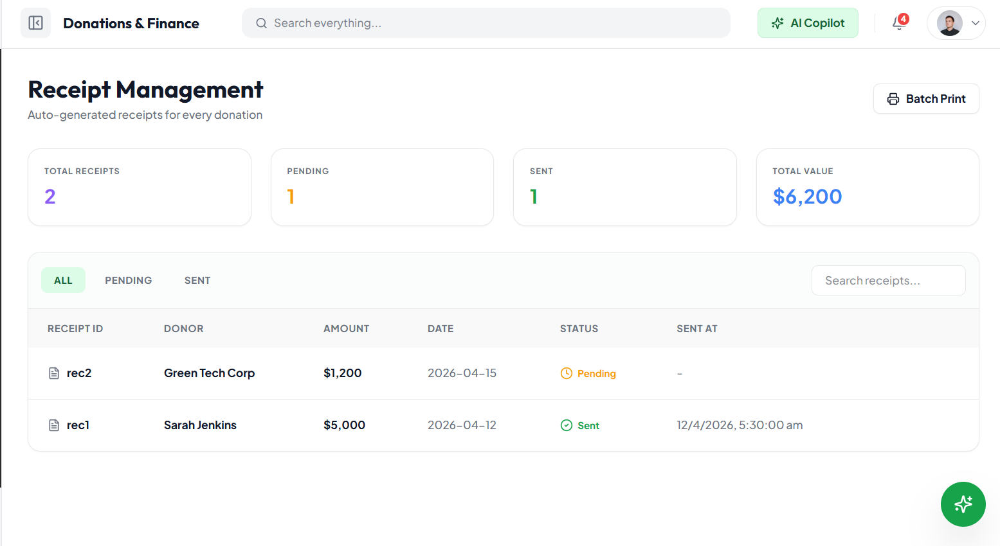 |
| 10 | 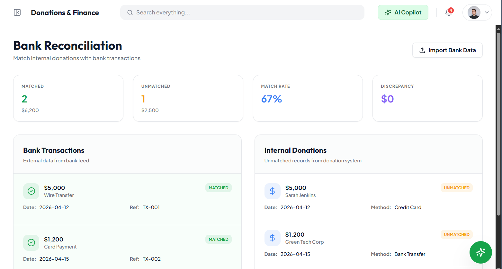 |


## DF-029 — Donation template import and native match/update (UPDATED)

**Classification:** To-Be. **Module:** Donations. **Actor:** Admin (only application user).

**User story:** As an AiXPurpose Admin, I want to download and upload the approved donations import template and check incoming rows against existing AiXPurpose data, so that verified matches update eligible native records and unmatched or conflicting data is explained without changing synchronized source records.

**Functional requirements**

1. Provide the relevant page's Import control with a downloadable, versioned template and upload validation.
2. Validate the tenant, mandatory columns, supported values, linked donor/member, source provenance and duplicate file rows.
3. Match using approved native record identifiers and display a preview of **Native Match — Update**, **New Native — Create**, **Unmatched Reference — Review**, **External Source Collision — Do Not Update**, **Invalid/duplicate — Reject or Review**.
4. Allow Admin confirmation before native create/update; protect immutable finance fields and existing payment/receipt/installment integrity.
5. Show row-level details and created/updated/skipped/rejected/ambiguous counts; allow correcting and re-uploading unsuccessful records.
6. Refresh the current Donations/Pledges page and applicable details, Source dropdown and approved KPI results. Only AiXPurpose-origin records are editable.

**Business logic**

- Donation records must resolve to eligible tenant donor and native transaction identifiers. A valid native match can update only approved non-immutable fields; successful import cannot charge the gateway or invent payment completion, receipts or source history.
- There is **no permission hierarchy** beyond Admin, but backend source-origin checks and financial integrity remain mandatory.
- A template import is **not** the gateway-based Add Donation collection workflow. Confirmed gateway payments retain their authoritative gateway identifiers and state.
- Exact matching keys, updateable attributes, template formats, partial import policy and error thresholds are OPEN for Development confirmation; do not auto-write external records.

**Acceptance criteria**

1. Given a valid imported row uniquely matches a native record, when Admin previews and confirms, then approved native values are updated once and visible after refresh.
2. Given a valid row has no match and qualifies for creation, when confirmed, then one new native record appears under AiXPurpose Source.
3. Given an external-source-only match, when validating, then source data is left unchanged and the Admin receives an explicit collision explanation.
4. Given an invalid, duplicate or unresolved reference, when uploaded, then the row is not silently committed and its reason appears in results.
5. Given the same file is uploaded again, then duplicates are not created and payments are not collected again.
6. Given import completes, when reviewing the results, then created, updated, skipped, rejected and unresolved totals reconcile to the processed rows.

**Mermaid workflow**

```mermaid
flowchart TD
 A[Admin opens Donations Import] --> B[Download template and upload data]
 B --> C[Validate fields, source and tenant]
 C --> D[Match existing native records]
 D --> E{Classification}
 E -->|Native match| F[Preview allowed update]
 E -->|Eligible new| G[Preview native creation]
 E -->|External collision| H[Do not overwrite; report]
 E -->|Unresolved or invalid| I[Show row error]
 F --> J[Admin confirms]
 G --> J
 J --> K[Commit native changes without payment collection]
 K --> L[Show outcomes and refresh]
 H --> L
 I --> L
```


## DF-030 — Pledge template import and native match/update (UPDATED)

**Classification:** To-Be. **Module:** Pledges. **Actor:** Admin (only application user).

**User story:** As an AiXPurpose Admin, I want to download and upload the approved pledges import template and check incoming rows against existing AiXPurpose data, so that verified matches update eligible native records and unmatched or conflicting data is explained without changing synchronized source records.

**Functional requirements**

1. Provide the relevant page's Import control with a downloadable, versioned template and upload validation.
2. Validate the tenant, mandatory columns, supported values, linked donor/member, source provenance and duplicate file rows.
3. Match using approved native record identifiers and display a preview of **Native Match — Update**, **New Native — Create**, **Unmatched Reference — Review**, **External Source Collision — Do Not Update**, **Invalid/duplicate — Reject or Review**.
4. Allow Admin confirmation before native create/update; protect immutable finance fields and existing payment/receipt/installment integrity.
5. Show row-level details and created/updated/skipped/rejected/ambiguous counts; allow correcting and re-uploading unsuccessful records.
6. Refresh the current Donations/Pledges page and applicable details, Source dropdown and approved KPI results. Only AiXPurpose-origin records are editable.

**Business logic**

- Validate native pledge references, linked member/donor records, installment identifiers and financial balances. Avoid duplicate installments or changing paid status without a verified underlying transaction.
- There is **no permission hierarchy** beyond Admin, but backend source-origin checks and financial integrity remain mandatory.
- A template import is **not** the gateway-based Add Donation collection workflow. Confirmed gateway payments retain their authoritative gateway identifiers and state.
- Exact matching keys, updateable attributes, template formats, partial import policy and error thresholds are OPEN for Development confirmation; do not auto-write external records.

**Acceptance criteria**

1. Given a valid imported row uniquely matches a native record, when Admin previews and confirms, then approved native values are updated once and visible after refresh.
2. Given a valid row has no match and qualifies for creation, when confirmed, then one new native record appears under AiXPurpose Source.
3. Given an external-source-only match, when validating, then source data is left unchanged and the Admin receives an explicit collision explanation.
4. Given an invalid, duplicate or unresolved reference, when uploaded, then the row is not silently committed and its reason appears in results.
5. Given the same file is uploaded again, then duplicates are not created and payments are not collected again.
6. Given import completes, when reviewing the results, then created, updated, skipped, rejected and unresolved totals reconcile to the processed rows.

**Mermaid workflow**

```mermaid
flowchart TD
 A[Admin opens Pledges Import] --> B[Download template and upload data]
 B --> C[Validate fields, source and tenant]
 C --> D[Match existing native records]
 D --> E{Classification}
 E -->|Native match| F[Preview allowed update]
 E -->|Eligible new| G[Preview native creation]
 E -->|External collision| H[Do not overwrite; report]
 E -->|Unresolved or invalid| I[Show row error]
 F --> J[Admin confirms]
 G --> J
 J --> K[Commit native changes without payment collection]
 K --> L[Show outcomes and refresh]
 H --> L
 I --> L
```


## DF-031 — Import preview, unmatched resolution and refreshed data (UPDATED)

**Classification:** To-Be. **Module:** Shared Imports. **Actor:** Admin (only application user).

**User story:** As an AiXPurpose Admin, I want to download and upload the approved shared imports import template and check incoming rows against existing AiXPurpose data, so that verified matches update eligible native records and unmatched or conflicting data is explained without changing synchronized source records.

**Functional requirements**

1. Provide the relevant page's Import control with a downloadable, versioned template and upload validation.
2. Validate the tenant, mandatory columns, supported values, linked donor/member, source provenance and duplicate file rows.
3. Match using approved native record identifiers and display a preview of **Native Match — Update**, **New Native — Create**, **Unmatched Reference — Review**, **External Source Collision — Do Not Update**, **Invalid/duplicate — Reject or Review**.
4. Allow Admin confirmation before native create/update; protect immutable finance fields and existing payment/receipt/installment integrity.
5. Show row-level details and created/updated/skipped/rejected/ambiguous counts; allow correcting and re-uploading unsuccessful records.
6. Refresh the current Donations/Pledges page and applicable details, Source dropdown and approved KPI results. Only AiXPurpose-origin records are editable.

**Business logic**

- Classify native matches, external-only collisions, eligible creates, ambiguous/unresolved references and duplicate uploaded rows. Show before/after values, batch results and row errors; refresh Source-filtered listings and approved KPI values. Imported template records are native AiXPurpose records.
- There is **no permission hierarchy** beyond Admin, but backend source-origin checks and financial integrity remain mandatory.
- A template import is **not** the gateway-based Add Donation collection workflow. Confirmed gateway payments retain their authoritative gateway identifiers and state.
- Exact matching keys, updateable attributes, template formats, partial import policy and error thresholds are OPEN for Development confirmation; do not auto-write external records.

**Acceptance criteria**

1. Given a valid imported row uniquely matches a native record, when Admin previews and confirms, then approved native values are updated once and visible after refresh.
2. Given a valid row has no match and qualifies for creation, when confirmed, then one new native record appears under AiXPurpose Source.
3. Given an external-source-only match, when validating, then source data is left unchanged and the Admin receives an explicit collision explanation.
4. Given an invalid, duplicate or unresolved reference, when uploaded, then the row is not silently committed and its reason appears in results.
5. Given the same file is uploaded again, then duplicates are not created and payments are not collected again.
6. Given import completes, when reviewing the results, then created, updated, skipped, rejected and unresolved totals reconcile to the processed rows.

**Mermaid workflow**

```mermaid
flowchart TD
 A[Admin opens Shared Imports Import] --> B[Download template and upload data]
 B --> C[Validate fields, source and tenant]
 C --> D[Match existing native records]
 D --> E{Classification}
 E -->|Native match| F[Preview allowed update]
 E -->|Eligible new| G[Preview native creation]
 E -->|External collision| H[Do not overwrite; report]
 E -->|Unresolved or invalid| I[Show row error]
 F --> J[Admin confirms]
 G --> J
 J --> K[Commit native changes without payment collection]
 K --> L[Show outcomes and refresh]
 H --> L
 I --> L
```
