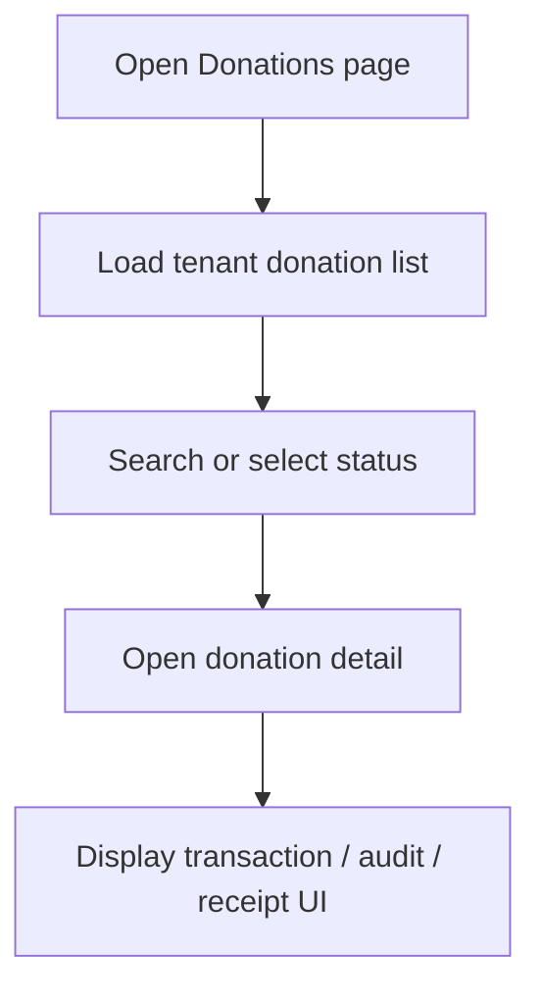
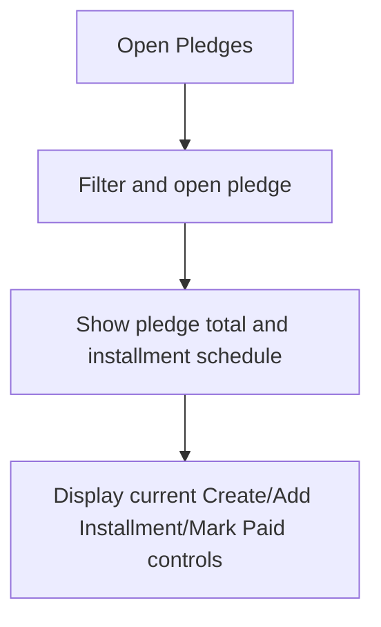
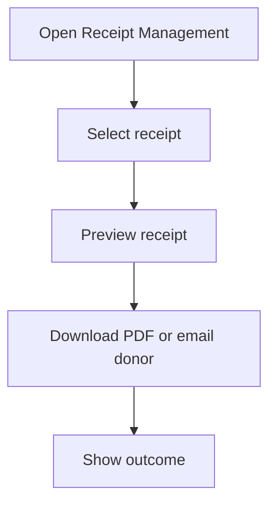
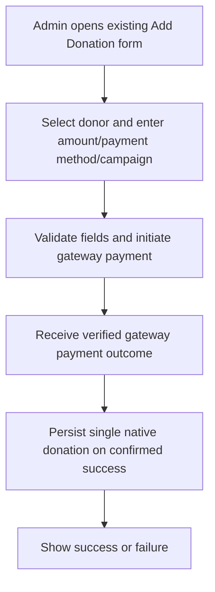
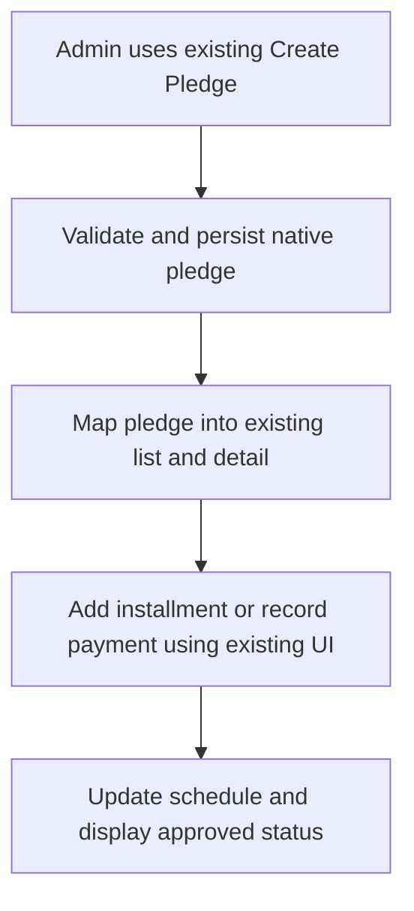
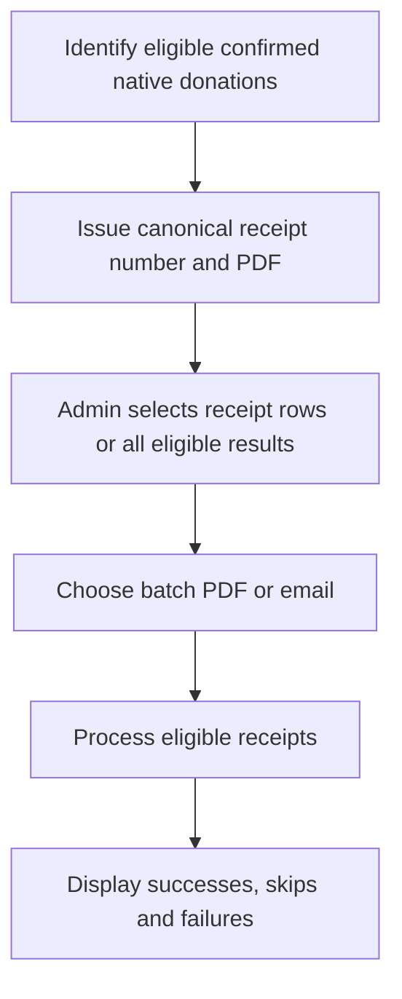
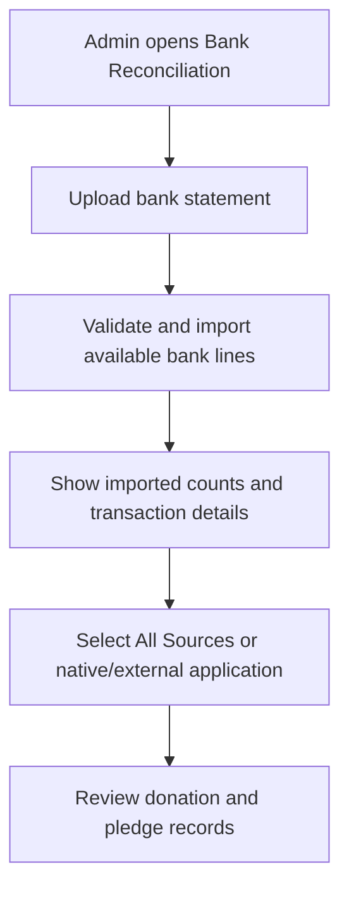
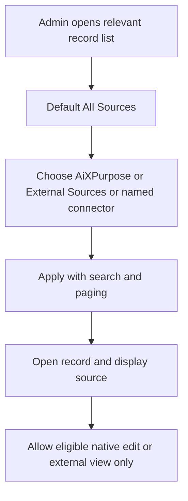
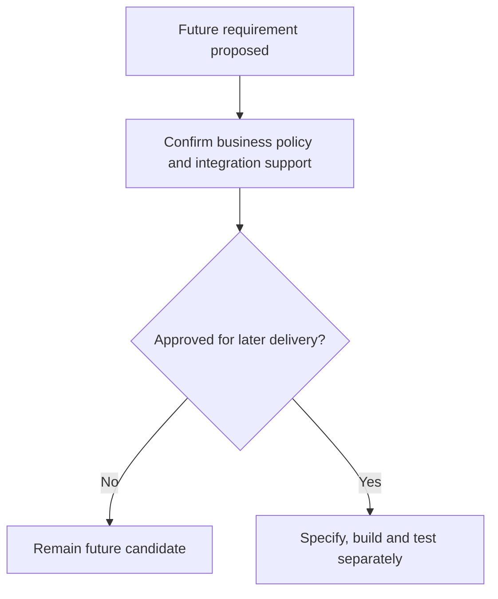
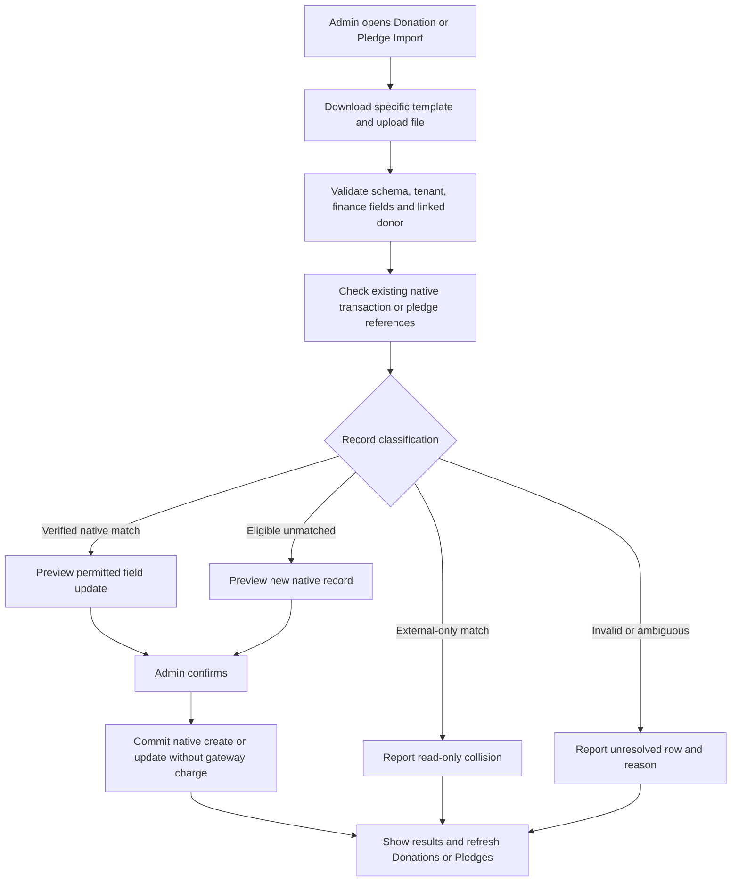

# AiXPurpose Standalone — Donations & Finance — BRD Workflow

> **Document ID:** AIXP-DF-WORKFLOW  
> **Version:** 1.1 — UPDATED | 28 October 2026  
> **Status:** Approved functional scope baseline; implementation open items explicitly marked  
> **User:** Admin only (all Admins can access all native functionality)  
> **Purpose:** Enhance existing AiXPurpose for additional tenant clients; **not** a new application.  
> **Companion documents:** [Goals](Donations_Finance_BRD_Goals.md) · [Workflow](Donations_Finance_BRD_Workflow.md) · [Feature Catalogue](Donations_Finance_BRD_Feature_Catalogue.md)

Operational and conceptual Mermaid flows. All workflows reflect Admin-only access.

## Source-of-truth and classification convention

- **As-Is:** currently visible or user-confirmed working behaviour. Visible controls may be disabled or backend-incomplete.
- **Existing Jira development baseline:** configured Donations and Pledges four-card KPI changes already approved and under development; classify under baseline per Product Owner convention, never claim production readiness without QA.
- **To-Be:** additions/fixes necessary to support native AiXPurpose transaction and pledge creation and multi-tenant operation.
- **Future:** selected or discussed possibilities; not committed to the current delivery.
- **Admin-only:** all signed-in application users are Admins; no additional roles, approvals, or permissions matrix.
- **Origin:** external integrated source records are strictly read-only to Admins; native AiXPurpose records may be edited where financial state and transaction integrity permit. Source synchronisation can refresh imported records.
- **Data:** do not fabricate gateway status, receipt numbers, matched transactions, donor identifiers or campaign allocations not supported by sources.

## 1. Workflow inventory

| Workflow                                                 | Scope           | Feature IDs                            |
| -------------------------------------------------------- | --------------- | -------------------------------------- |
| WF-01 Existing Donations list and details                | As-Is UI        | DF-001, DF-002, DF-003, DF-004, DF-021 |
| WF-02 Existing Pledges list/detail/instalments           | As-Is UI        | DF-005, DF-006, DF-007                 |
| WF-03 Existing individual receipt actions                | As-Is confirmed | DF-008                                 |
| WF-04 Native gateway-backed donation collection          | To-Be           | DF-009, DF-010                         |
| WF-05 Native pledge and installment mapping              | To-Be           | DF-011                                 |
| WF-06 Native receipt issuance and batch processing       | To-Be           | DF-012, DF-013, DF-014                 |
| WF-07 Bank import and read-only source-based review      | To-Be           | DF-015, DF-016, DF-017                 |
| WF-08 Record origin, source filtering, tenant protection | To-Be shared    | DF-018, DF-019, DF-020                 |
| WF-09–15 Future concepts                                 | Future          | DF-022–028                             |

## WF-01 — Donations list/detail and existing disabled controls

**Scope:** As-Is. **Requirement:** Existing Add Donation and Refund buttons do not prove native backend operations.

**Outcome and exception checks:** UI states, tenant boundary, immutable integrated records, missing source fields and failed operations must be handled explicitly.

## WF-02 — Existing pledges and installments

**Scope:** As-Is. **Requirement:** Existing actions are reported working for integrated-data views; native write mapping is separate.

**Outcome and exception checks:** UI states, tenant boundary, immutable integrated records, missing source fields and failed operations must be handled explicitly.

## WF-03 — Individual receipt

**Scope:** As-Is confirmed. **Requirement:** Individual PDF and email confirmed working.

**Outcome and exception checks:** UI states, tenant boundary, immutable integrated records, missing source fields and failed operations must be handled explicitly.

## WF-04 — Native payment collection

**Scope:** To-Be. **Requirement:** Gateway callback idempotency, cancelled payment and failed payment must not create completed donation.

**Outcome and exception checks:** UI states, tenant boundary, immutable integrated records, missing source fields and failed operations must be handled explicitly.

## WF-05 — Native pledge lifecycle

**Scope:** To-Be. **Requirement:** Do not fabricate multi-donor allocation model; double counting avoided.

**Outcome and exception checks:** UI states, tenant boundary, immutable integrated records, missing source fields and failed operations must be handled explicitly.

## WF-06 — Native receipt and batch operations

**Scope:** To-Be. **Requirement:** Existing batch controls are enabled; imported receipts lacking source numbers cannot be assigned fictional source receipt numbers.

**Outcome and exception checks:** UI states, tenant boundary, immutable integrated records, missing source fields and failed operations must be handled explicitly.

## WF-07 — Bank statement import and transaction review

**Scope:** To-Be. **Requirement:** No manual matching or automatic matching in current To-Be.

**Outcome and exception checks:** UI states, tenant boundary, immutable integrated records, missing source fields and failed operations must be handled explicitly.

## WF-08 — Tenant/source filtering and immutable integrations

**Scope:** To-Be. **Requirement:** Server rejects external source updates regardless of UI.

**Outcome and exception checks:** UI states, tenant boundary, immutable integrated records, missing source fields and failed operations must be handled explicitly.

## WF-09 — Automatic bank transaction matching (conceptual only)

**Scope:** Future candidate DF-F01. This is not approved To-Be.

**Open policy:** Not in current To-Be; approvals and identifiers require future definition.

## WF-10 — Advanced reconciliation exceptions and matching (conceptual only)

**Scope:** Future candidate DF-F02. This is not approved To-Be.

**Open policy:** Not in current To-Be; prior final-match decision is superseded by moving matching out of current scope.

## WF-11 — Source-aware refund processing and synchronization (conceptual only)

**Scope:** Future candidate DF-F03 / pending. This is not approved To-Be.

**Open policy:** DonorPerfect may support its own refunds; iWave is not a payment processor. AiXPurpose may not directly edit imported financial records.

## WF-12 — Receipt template customization (conceptual only)

**Scope:** Future candidate DF-F04. This is not approved To-Be.

**Open policy:** Financially required receipt fields cannot be suppressed without approval.

## WF-13 — Pledge payment reminders (conceptual only)

**Scope:** Future candidate DF-F05. This is not approved To-Be.

**Open policy:** Requires approved delivery cadence, duplicate prevention and privacy/communication rules.

## WF-14 — Financial reconciliation export (conceptual only)

**Scope:** Future candidate DF-F06. This is not approved To-Be.

**Open policy:** Format, filtering and masking need future approval.

## WF-15 — Multi-donor pledge management (conceptual only)

**Scope:** Future candidate DF-F07 / pending. This is not approved To-Be.

**Open policy:** No final allocation model approved for this enhancement; previous shared-total observation is not final design.

## 9. Cross-document traceability

Each Workflow row links to its precise Feature ID; the Goals BRD maps those IDs to business goals. No workflow changes the agreed classification.

## Screenshot references — original application captures

The following images are extracted without editing from **donation and finance module.docx**, in document image order. Screenshots establish interface presence, not server-side functionality.

| Figure | Source screenshot                                                                    |
| ------ | ------------------------------------------------------------------------------------ |
| 1      |   |
| 2      |   |
| 3      |   |
| 4      |   |
| 5      |   |
| 6      |   |
| 7      |   |
| 8      |   |
| 9      |   |
| 10     |  |

## UPDATED v1.1 — Donation and Pledge import, match and update

**Workflow DF-W-IMPORT-01 (To-Be):** The existing page gains a Donation or Pledge import action. The source dropdown distinguishes native data from integrated read-only data. Import never initiates a new payment or changes an external integration record.

**Open technical rules:** exact matching IDs and collision priority, file formats/required columns, finance field update restrictions, duplicate payment/receipt prevention, pledge installment linking and import results error handling. Avoid asserting payment success from a template row.
