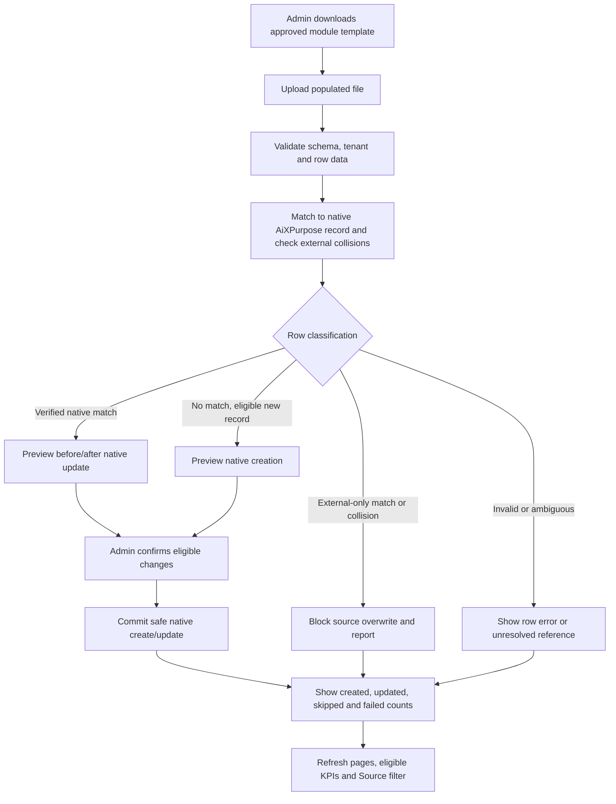

# AiXPurpose Standalone — Shared Native Template Import & Match/Update Standard

> **Version:** UPDATED v2.0 | **Applies to:** record-based modules where a native import is approved. **Actor:** Admin only. **Classification:** To-Be. **Status:** Business requirement approved; precise matching keys and formats pending Development confirmation.

## Non-negotiable origin distinction

| Acquisition path                                                                        | Stored origin         | Admin can edit?                       | May template import overwrite it?                                              |
| --------------------------------------------------------------------------------------- | --------------------- | ------------------------------------- | ------------------------------------------------------------------------------ |
| Created manually in AiXPurpose                                                          | AiXPurpose / native   | Yes, subject to transaction integrity | Yes, on verified native match and confirmed update                             |
| Uploaded using the AiXPurpose-approved template                                         | AiXPurpose / native   | Yes, subject to transaction integrity | Yes, on verified native match and confirmed update                             |
| Received through CORE, DonorPerfect, iWave, Salesforce, SAP or any third-party API sync | Named external source | No                                    | **No** — do not overwrite, convert ownership or modify imported source records |

## Standard Admin workflow

1. Admin opens the **Import** action on an eligible module page, downloads that module's approved **template**, fills the data and uploads it. Template version, required columns, file types and size limits are validated; exact specifications require Development confirmation.
2. Validate tenant context, row values, IDs, relationships, amount/date/status semantics, and field mapping; identify duplicate rows within the file.
3. **Match to existing AiXPurpose data** using a deterministic, tenant-scoped, module-specific identity/record key. A match to _external integration data_ must not grant permission to update the external record. The system must separately report external-only matches/collisions.
4. Produce a row-level preview with clear outcomes: **Matched Native — Update**, **New Native — Create**, **Unmatched/ambiguous reference — Review**, **External record collision — Block update / Report**, **Invalid — Reject**, **Duplicate in file — Review/Reject**. An unmatched record eligible for creation should be clearly shown as _New Native_, not silently discarded; a broken mandatory relationship is _Review_, not automatically created.
5. Admin reviews changes (including before/after values for an update) and confirms. No automatic overwrite based on weak fields such as name alone. No automatic writeback to integrated systems. No unapproved deletion or blank-field overwrite.
6. Commit permitted native creates/updates with idempotency and transaction integrity; ensure retries do not create duplicate donation payments, pledges, members or receipts.
7. Show batch and row-level results (created, updated, unchanged/skipped, rejected, unresolved, integration collision, failed), with reasons and actionable correction/re-upload information.
8. Refresh lists, details, Source filters, eligible KPIs, segment memberships and linked views according to approved calculations. Template-imported content appears as **AiXPurpose** data and is editable by Admin; external integration content stays read-only.

## Module rules

| Module        | Template import treatment                                                                                                                                                                                                                                                                                                                                          |
| ------------- | ------------------------------------------------------------------------------------------------------------------------------------------------------------------------------------------------------------------------------------------------------------------------------------------------------------------------------------------------------------------ |
| Members       | Native Member create/update only on verified native Member match; an external Member match remains read-only and is reported for resolution.                                                                                                                                                                                                                       |
| Donors        | Native Donor create/update requires an existing valid Member relationship; donor identity matching and giving records must not fabricate payment gateway success or duplicate financial transactions.                                                                                                                                                              |
| Segments      | Import native segment definitions or membership mappings **only as approved by template type**; match existing segment/member identifiers; adding an external Member to a native segment changes only the native membership link, never the external Member data. Dynamic-segment manual override precedence remains OPEN.                                         |
| Donations     | Native transaction data import must be distinguished from online payment collection; a file row alone is **not proof of captured payment**. Verified native transaction matches may be updated only for allowed fields/states; payment outcome, posted amount and gateway transaction IDs cannot be rewritten arbitrarily. External transactions remain read-only. |
| Pledges       | Native Pledge and supported installment references may be matched/updated subject to outstanding/fulfilled balance consistency. Never create duplicate installments or mark a pledge paid purely because a file is uploaded.                                                                                                                                       |
| Other modules | Reuse this standard only where native record import has been explicitly approved; no blanket creation of import UI in Settings, Profile, Reports or other non-record pages.                                                                                                                                                                                        |

## Cross-module open decisions / QA gates

- Module-specific matching key precedence and whether matching integrated identities to native records is allowed through a separately approved link relationship.
- Whether blank uploaded values clear existing native fields, permitted updatable donation/pledge fields and financial state transitions.
- Exact Excel/CSV templates, supported formats, error thresholds, partial-commit vs all-or-nothing transactions, bulk limits and retry strategy.
- Whether Segment imports support native segment definitions, membership only, or separate templates for both. Do not silently assume one import does both.
- Validation and audit evidence for create/update; ensure no duplicate charges, receipts, installments, native donors or tenant leaks.

## Mermaid — reusable import and native upsert

