# AiXPurpose Standalone — Donor Management — BRD Feature Catalogue

> **Document control:** Version 1.6 — UPDATED | Status: Scope approved; technical verification open | Product: existing AiXPurpose enhanced for additional clients | Module: Donor Management | User: Admin only | Format: Markdown / GitHub

**Companion documents:** [BRD Goals](Donor_Management_BRD_Goals.md) · [BRD Workflow](Donor_Management_BRD_Workflow.md) · [BRD Feature Catalogue](Donor_Management_BRD_Feature_Catalogue.md)

**Source of truth:** `donor managemt.docx` screenshots; previously approved Members and Donors BRDs; `AiXPurpose_Configurable_KPI.docx`; `AiXPurpose_Members_Donors_Field_Mapping(1).docx`; `AiXPurpose_changes.docx`; decisions agreed in the product discussions. **This is not a rebuild of AiXPurpose.**

## Feature inventory and classification

| Feature ID | Feature                                                    | Scope                                           |
| ---------- | ---------------------------------------------------------- | ----------------------------------------------- |
| DM-A01     | Module navigation and Admin access                         | As-Is                                           |
| DM-A02     | Members listing, search and pagination                     | As-Is                                           |
| DM-A03     | Donors listing, search and pagination                      | As-Is                                           |
| DM-A04     | Members KPI configuration – approved Jira baseline         | Existing Jira baseline (As-Is convention)       |
| DM-A05     | Donors KPI configuration – approved Jira baseline          | Existing Jira baseline (As-Is convention)       |
| DM-A06     | Members advanced column selection – approved Jira baseline | Existing Jira baseline (As-Is convention)       |
| DM-A07     | Donors advanced column selection – approved Jira baseline  | Existing Jira baseline (As-Is convention)       |
| DM-A08     | Unified Constituent Profile – approved Jira baseline       | Existing Jira baseline (As-Is convention)       |
| DM-A09     | Global Search navigation – approved Jira baseline          | Existing Jira baseline (As-Is convention)       |
| DM-A10     | Segment listing and type filters                           | As-Is – working                                 |
| DM-A11     | Create and manage basic segments                           | As-Is – working                                 |
| DM-A12     | Segment email, send communication and export               | As-Is – working                                 |
| DM-A13     | Dynamic/static segment behaviour                           | As-Is – verification pending                    |
| DM-A14     | Prospecting list and categories                            | As-Is – source/logic verification pending       |
| DM-A15     | Prospect to unified profile navigation                     | As-Is                                           |
| DM-T01     | Enable native Member creation                              | To-Be                                           |
| DM-T02     | Enable native Member editing                               | To-Be                                           |
| DM-T03     | Enable native Donor creation linked to Member              | To-Be                                           |
| DM-T04     | Enable native Donor editing                                | To-Be                                           |
| DM-T05     | Shared Source dropdown for eligible lists                  | To-Be                                           |
| DM-T06     | Backend source ownership enforcement                       | To-Be                                           |
| DM-T07     | Multi-tenant isolation across donor management             | To-Be shared invariant                          |
| DM-T08     | Multiple segment conditions and AND/OR                     | To-Be                                           |
| DM-T09     | Manual include/remove members in segments                  | To-Be                                           |
| DM-F06     | Prospect / Donor Strength scoring framework                | Future Scope – separate dedicated specification |

## Approved cross-module rules

- **Admin only:** currently all Admin users can access all product features. Do not introduce distinct roles or additional access-approval steps.
- **Native versus integrated:** native AiXPurpose records may be edited by Admins, while external records (CORE, DonorPerfect, iWave, other connected applications) are strictly read-only via both UI and backend.
- **Source filters:** page-local dropdown (All Sources / AiXPurpose / External Sources (All) / individual eligible apps). This must not silently affect unrelated pages or metrics.
- **Member/donor relationship:** donor maps to member; no separate iWave-only profile. A member may never have donated.
- **Segment definitions:** editable native segment configuration can reference read-only integrated members without modifying source records.
- **Tenant isolation:** records, segment definitions, exports, suggestions, and communications must be scoped to the active client.
- **Existing Jira changes:** KPI catalogs, advanced columns, unified profile and Global Search are included in As-Is baseline _by project convention_, but their delivery and QA status must be verified; avoid creating duplicate Jira stories.
- **Prospecting:** existing source-supplied scores/display retained; native donor scoring model is **Future Scope** and not assumed to exist.

## Detailed Admin user stories and developer-ready acceptance criteria

> **Traceability:** Feature IDs match BRD Goals and Workflow. As-Is and existing Jira-baseline entries are specifications for regression/verification rather than instructions to create duplicate tickets. All records belong to the current tenant.

### DM-A01 — Module navigation and Admin access

**Scope:** As-Is  
**Module:** Donor Management  
**Actor:** Admin (only current application user)  
**User story:** As an AiXPurpose Admin, I want to admin opens Members, Donors, Segments and Prospecting from current navigation. so that I can complete the relevant donor-management operation while preserving source integrity.

**Functional requirements**

- FR-DM-A01-01: Show existing module pages and accessible records to the Admin.
- FR-DM-A01-02: Maintain tenant-scoped data and display the record origin where applicable.
- FR-DM-A01-03: Show appropriate validation, loading, empty-state and error feedback without altering source records.
- FR-DM-A01-04: Preserve navigation to the existing unified constituent profile when opening person records.

**Business logic**

- BL-DM-A01-01: No separate user roles or special permissions introduced.
- BL-DM-A01-02: Admin-only UI; no newly invented role hierarchy or approval chain.
- BL-DM-A01-03: Underlying integrated entity values must not be modified by native actions; backend must enforce write restrictions.

**Acceptance criteria**

1. Given an Admin opens the relevant screen, when they use the stated feature, then admin can navigate to each existing page.
2. Given the current tenant has no eligible records, when the feature is opened, then a clear empty state is displayed without another tenant’s data.
3. Given a record is sourced from an external system, when a direct update is attempted, then the update is rejected and the source record stays unchanged.
4. Given an operation fails or input is invalid, when the Admin submits, then the UI shows a meaningful failure and does not report success.

**Mermaid workflow**

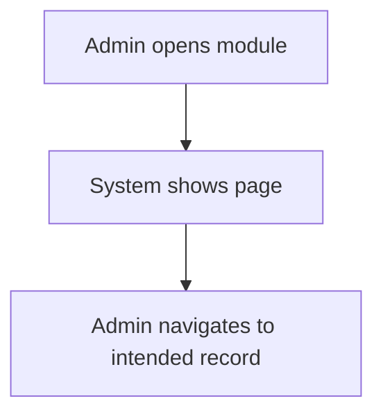

**Source / dependencies:** Uploaded donor management screenshots and approved scope decisions.

### DM-A02 — Members listing, search and pagination

**Scope:** As-Is  
**Module:** Donor Management  
**Actor:** Admin (only current application user)  
**User story:** As an AiXPurpose Admin, I want to admin reviews member list and uses existing page search, sorting and navigation. so that I can complete the relevant donor-management operation while preserving source integrity.

**Functional requirements**

- FR-DM-A02-01: Show tenant scoped mapped membership records and opening actions.
- FR-DM-A02-02: Maintain tenant-scoped data and display the record origin where applicable.
- FR-DM-A02-03: Show appropriate validation, loading, empty-state and error feedback without altering source records.
- FR-DM-A02-04: Preserve navigation to the existing unified constituent profile when opening person records.

**Business logic**

- BL-DM-A02-01: CORE membership fields only for Members table; source origin is preserved.
- BL-DM-A02-02: Admin-only UI; no newly invented role hierarchy or approval chain.
- BL-DM-A02-03: Underlying integrated entity values must not be modified by native actions; backend must enforce write restrictions.

**Acceptance criteria**

1. Given an Admin opens the relevant screen, when they use the stated feature, then member rows and existing search/navigation work on permitted tenant data.
2. Given the current tenant has no eligible records, when the feature is opened, then a clear empty state is displayed without another tenant’s data.
3. Given a record is sourced from an external system, when a direct update is attempted, then the update is rejected and the source record stays unchanged.
4. Given an operation fails or input is invalid, when the Admin submits, then the UI shows a meaningful failure and does not report success.

**Mermaid workflow**

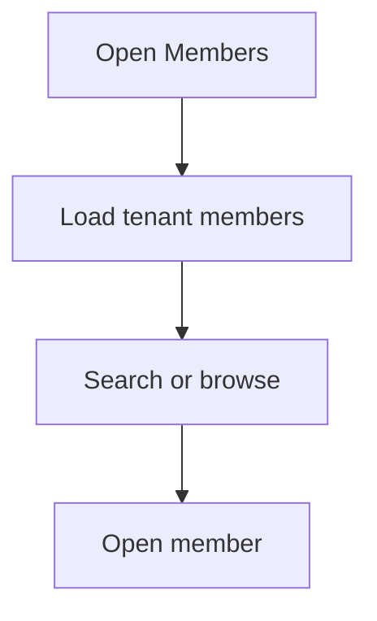

**Source / dependencies:** Uploaded donor management screenshots and approved scope decisions.

### DM-A03 — Donors listing, search and pagination

**Scope:** As-Is  
**Module:** Donor Management  
**Actor:** Admin (only current application user)  
**User story:** As an AiXPurpose Admin, I want to admin reviews donors and opens existing mapped donor details. so that I can complete the relevant donor-management operation while preserving source integrity.

**Functional requirements**

- FR-DM-A03-01: Present linked donor records and existing list controls.
- FR-DM-A03-02: Maintain tenant-scoped data and display the record origin where applicable.
- FR-DM-A03-03: Show appropriate validation, loading, empty-state and error feedback without altering source records.
- FR-DM-A03-04: Preserve navigation to the existing unified constituent profile when opening person records.

**Business logic**

- BL-DM-A03-01: Every donor corresponds to a member; do not create unrelated iWave-only person.
- BL-DM-A03-02: Admin-only UI; no newly invented role hierarchy or approval chain.
- BL-DM-A03-03: Underlying integrated entity values must not be modified by native actions; backend must enforce write restrictions.

**Acceptance criteria**

1. Given an Admin opens the relevant screen, when they use the stated feature, then donor list opens the matching unified constituent profile.
2. Given the current tenant has no eligible records, when the feature is opened, then a clear empty state is displayed without another tenant’s data.
3. Given a record is sourced from an external system, when a direct update is attempted, then the update is rejected and the source record stays unchanged.
4. Given an operation fails or input is invalid, when the Admin submits, then the UI shows a meaningful failure and does not report success.

**Mermaid workflow**

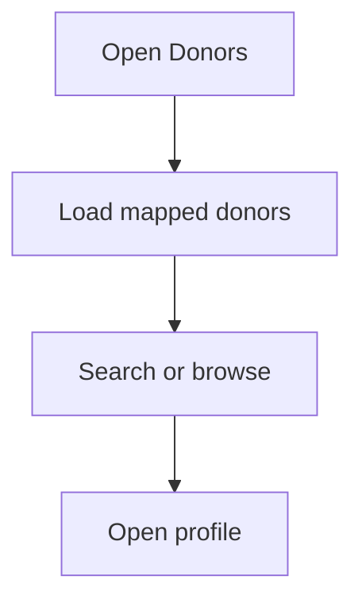

**Source / dependencies:** Uploaded donor management screenshots and approved scope decisions.

### DM-A04 — Members KPI configuration – approved Jira baseline

**Scope:** Existing Jira baseline (As-Is convention)  
**Module:** Donor Management  
**Actor:** Admin (only current application user)  
**User story:** As an AiXPurpose Admin, I want to admin selects four CORE-based Member KPIs from the agreed nine-item catalog. so that I can complete the relevant donor-management operation while preserving source integrity.

**Functional requirements**

- FR-DM-A04-01: Provide exactly four distinct re-orderable cards, Save and Reset, separate from Donors.
- FR-DM-A04-02: Maintain tenant-scoped data and display the record origin where applicable.
- FR-DM-A04-03: Show appropriate validation, loading, empty-state and error feedback without altering source records.
- FR-DM-A04-04: Preserve navigation to the existing unified constituent profile when opening person records.

**Business logic**

- BL-DM-A04-01: Catalog and field calculations must match the approved KPI reference; QA rollout is not presumed.
- BL-DM-A04-02: Admin-only UI; no newly invented role hierarchy or approval chain.
- BL-DM-A04-03: Underlying integrated entity values must not be modified by native actions; backend must enforce write restrictions.

**Acceptance criteria**

1. Given an Admin opens the relevant screen, when they use the stated feature, then only 9 CORE options; exactly four; persistence and reset follow Jira requirements.
2. Given the current tenant has no eligible records, when the feature is opened, then a clear empty state is displayed without another tenant’s data.
3. Given a record is sourced from an external system, when a direct update is attempted, then the update is rejected and the source record stays unchanged.
4. Given an operation fails or input is invalid, when the Admin submits, then the UI shows a meaningful failure and does not report success.

**Mermaid workflow**

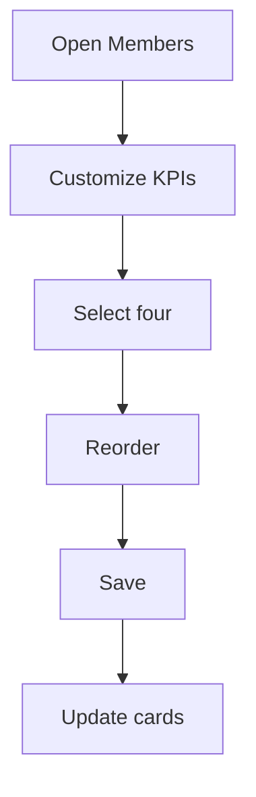

**Source / dependencies:** Existing approved Jira requirements; original reference catalogs reproduced below.

**Original approved KPI reference catalog**

| KPI (UI label)                      | Definition and calculation                                                         | Exact source mapping               | Conditions / validation                                                                   |
| ----------------------------------- | ---------------------------------------------------------------------------------- | ---------------------------------- | ----------------------------------------------------------------------------------------- |
| Total Members                       | COUNT(DISTINCT m_ID) across included CORE member records.                          | CORE: m_ID                         | Count unique IDs; exclude null IDs/duplicate synced rows. DEFAULT                         |
| New Member Records This Month       | Count unique m_ID where m_Created falls in the current calendar month.             | CORE: m_ID, m_Created              | Record-created metric, NOT confirmed membership joins. DEFAULT                            |
| New Member Records This Year        | Count unique m_ID created since Jan 1 of the current year.                         | CORE: m_ID, m_Created              | Record-created metric. Clearly label as new records.                                      |
| Members With Email                  | Count distinct m_ID with usable nonblank mi_Email.                                 | CORE: m_ID, mi_Email               | Ignore empty, null, NONE, and whitespace; no validation/verification claim. DEFAULT       |
| Members With Phone                  | Count distinct m_ID with usable nonblank mi_PrimaryPhone.                          | CORE: m_ID, mi_PrimaryPhone        | Phone present, NOT verified. DEFAULT                                                      |
| Membership-Eligible Members         | Count distinct m_ID where mt_CountsForMembership = Yes (normalize boolean/string). | CORE: m_ID, mt_CountsForMembership | Not an Active Members metric.                                                             |
| Members in Selected Branch          | Count distinct m_ID with u_HomeBranch = administrator-selected existing branch.    | CORE: m_ID, u_HomeBranch           | Requires branch selection parameter; do not create a separate static KPI for each branch. |
| Members in Selected Membership Type | Count distinct m_ID with mt_Name = selected existing membership type.              | CORE: m_ID, mt_Name                | Requires type selection parameter.                                                        |
| Members in Selected State           | Count distinct m_ID where normalized mi_HomeState matches selected state.          | CORE: m_ID, mi_HomeState           | Requires state parameter; distinguish blank from unknown.                                 |

### DM-A05 — Donors KPI configuration – approved Jira baseline

**Scope:** Existing Jira baseline (As-Is convention)  
**Module:** Donor Management  
**Actor:** Admin (only current application user)  
**User story:** As an AiXPurpose Admin, I want to admin selects four Donor KPIs from the agreed ten-item catalog. so that I can complete the relevant donor-management operation while preserving source integrity.

**Functional requirements**

- FR-DM-A05-01: Offer 10 mapped DonorPerfect/iWave options and separate configuration.
- FR-DM-A05-02: Maintain tenant-scoped data and display the record origin where applicable.
- FR-DM-A05-03: Show appropriate validation, loading, empty-state and error feedback without altering source records.
- FR-DM-A05-04: Preserve navigation to the existing unified constituent profile when opening person records.

**Business logic**

- BL-DM-A05-01: Donor identifiers map to CORE members; scores are source intelligence, not cash gifts.
- BL-DM-A05-02: Admin-only UI; no newly invented role hierarchy or approval chain.
- BL-DM-A05-03: Underlying integrated entity values must not be modified by native actions; backend must enforce write restrictions.

**Acceptance criteria**

1. Given an Admin opens the relevant screen, when they use the stated feature, then exactly four saved and displayed; no unverified source calculation shown as certain.
2. Given the current tenant has no eligible records, when the feature is opened, then a clear empty state is displayed without another tenant’s data.
3. Given a record is sourced from an external system, when a direct update is attempted, then the update is rejected and the source record stays unchanged.
4. Given an operation fails or input is invalid, when the Admin submits, then the UI shows a meaningful failure and does not report success.

**Mermaid workflow**

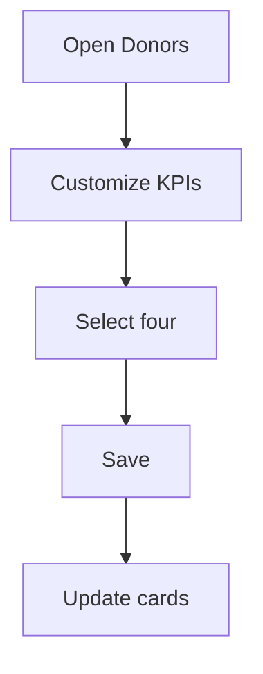

**Source / dependencies:** Existing approved Jira requirements; original reference catalogs reproduced below.

**Original approved KPI reference catalog**

| KPI (UI label)                         | Definition and calculation                                                                                                | Exact source mapping                                                    | Conditions / validation                                                                       |
| -------------------------------------- | ------------------------------------------------------------------------------------------------------------------------- | ----------------------------------------------------------------------- | --------------------------------------------------------------------------------------------- |
| Total Donors                           | Count DISTINCT mapped member IDs with genuine DonorPerfect giving relationship (gifts > 0 or validated gift_total > 0).   | CORE: m_ID; DonorPerfect: donor_id, gifts, gift_total; existing mapping | DEFAULT. Never count duplicate source rows; must be subset of members.                        |
| Active Donors (Trailing 12 Months)     | Count distinct donors whose last_contrib_date is on/after the beginning of the prior 12-month window, through as-of date. | DonorPerfect: donor_id, last_contrib_date; CORE mapping                 | DEFAULT. Proposed business definition, not native donor status. Exclude future/invalid dates. |
| Inactive Donors (No Gift in 12 Months) | Count donors with a known last_contrib_date older than 12 months.                                                         | DonorPerfect: donor_id, last_contrib_date                               | Unknown dates separately categorized, not assumed inactive.                                   |
| Lifetime Giving                        | SUM(gift_total) across distinct linked donors, with canonical source totals.                                              | DonorPerfect: donor_id, gift_total                                      | DEFAULT. Currency unit and refund/adjustment rules should be confirmed.                       |
| Total Gifts                            | SUM(gifts) across distinct linked donors.                                                                                 | DonorPerfect: donor_id, gifts                                           | Count number of gifts, not number of donors.                                                  |
| Average Gift Amount                    | SUM(gift_total) / SUM(gifts) over donor population where denominator > 0.                                                 | DonorPerfect: gift_total, gifts                                         | Weighted across gifts; do NOT AVG(avg_amt). Display N/A when no gifts.                        |
| Donors Who Gave This Calendar Year     | COUNT DISTINCT donor_id where cytd > 0 for currently active reporting calendar.                                           | DonorPerfect: donor_id, cytd                                            | Requires confirmation the cytd field is refreshed for current year.                           |
| Repeat Donors                          | COUNT DISTINCT donor_id where gifts > 1.                                                                                  | DonorPerfect: donor_id, gifts                                           | Two or more gifts historically; not year-over-year retention.                                 |
| High-Capacity Donors                   | Count donors with mapped iWave capacityValue >= admin-set currency threshold.                                             | iWave: mostRecentScore.scoreDetails.capacityValue; existing mapping     | Optional enrichment KPI. Requires threshold, currency harmonization and score freshness.      |
| Donors With iWave Score                | Count distinct donors with a valid mapped mostRecentScore.score.                                                          | iWave: mostRecentScore.score; CORE/DP mapping                           | Counts coverage, not predicted donation likelihood.                                           |

### DM-A06 — Members advanced column selection – approved Jira baseline

**Scope:** Existing Jira baseline (As-Is convention)  
**Module:** Donor Management  
**Actor:** Admin (only current application user)  
**User story:** As an AiXPurpose Admin, I want to admin chooses visible Member table columns. so that I can complete the relevant donor-management operation while preserving source integrity.

**Functional requirements**

- FR-DM-A06-01: Select, reorder and apply only CORE available fields.
- FR-DM-A06-02: Maintain tenant-scoped data and display the record origin where applicable.
- FR-DM-A06-03: Show appropriate validation, loading, empty-state and error feedback without altering source records.
- FR-DM-A06-04: Preserve navigation to the existing unified constituent profile when opening person records.

**Business logic**

- BL-DM-A06-01: The labeled Advanced Filter here is column selection, NOT row filtering.
- BL-DM-A06-02: Admin-only UI; no newly invented role hierarchy or approval chain.
- BL-DM-A06-03: Underlying integrated entity values must not be modified by native actions; backend must enforce write restrictions.

**Acceptance criteria**

1. Given an Admin opens the relevant screen, when they use the stated feature, then only the approved 13 CORE columns offered; saving does not change underlying records.
2. Given the current tenant has no eligible records, when the feature is opened, then a clear empty state is displayed without another tenant’s data.
3. Given a record is sourced from an external system, when a direct update is attempted, then the update is rejected and the source record stays unchanged.
4. Given an operation fails or input is invalid, when the Admin submits, then the UI shows a meaningful failure and does not report success.

**Mermaid workflow**

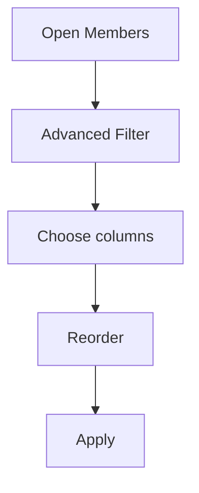

**Source / dependencies:** Existing approved Jira requirements; original reference catalogs reproduced below.

**Original source field inventory (1)**

| UI Label                 | Exact Excel Field / Mapping | Source | Default / Usage & Meaning                                     |
| ------------------------ | --------------------------- | ------ | ------------------------------------------------------------- |
| First Name               | m_FirstName                 | Core   | Default • legal/given name                                    |
| Last Name                | m_LastName                  | Core   | Default • family name                                         |
| Email Address            | mi_Email                    | Core   | Default • contact; NONE/blank → —                             |
| Primary Phone            | mi_PrimaryPhone             | Core   | Default • contact; blank → —                                  |
| Membership Type          | mt_Name                     | Core   | Default • membership category, e.g., Family                   |
| Home Branch              | u_HomeBranch                | Core   | Default • organizational branch                               |
| City                     | mi_HomeCity                 | Core   | Optional • geographic grouping                                |
| State                    | mi_HomeState                | Core   | Optional • location                                           |
| ZIP Code                 | mi_HomeZip                  | Core   | Optional • geography                                          |
| Age                      | m_Age                       | Core   | Optional, restricted • age supplied by CORE; review relevance |
| Member ID                | m_ID                        | Core   | Optional • member identification                              |
| CORE Record Created      | m_Created                   | Core   | Optional • NOT assumed to be join date                        |
| Counts Toward Membership | mt_CountsForMembership      | Core   | Optional • eligibility flag, NOT active-status proof          |

### DM-A07 — Donors advanced column selection – approved Jira baseline

**Scope:** Existing Jira baseline (As-Is convention)  
**Module:** Donor Management  
**Actor:** Admin (only current application user)  
**User story:** As an AiXPurpose Admin, I want to admin configures Donors table fields. so that I can complete the relevant donor-management operation while preserving source integrity.

**Functional requirements**

- FR-DM-A07-01: Use approved CORE + DonorPerfect + iWave field catalogs.
- FR-DM-A07-02: Maintain tenant-scoped data and display the record origin where applicable.
- FR-DM-A07-03: Show appropriate validation, loading, empty-state and error feedback without altering source records.
- FR-DM-A07-04: Preserve navigation to the existing unified constituent profile when opening person records.

**Business logic**

- BL-DM-A07-01: Missing iWave enrichment cannot hide donor rows; field values are source-aware.
- BL-DM-A07-02: Admin-only UI; no newly invented role hierarchy or approval chain.
- BL-DM-A07-03: Underlying integrated entity values must not be modified by native actions; backend must enforce write restrictions.

**Acceptance criteria**

1. Given an Admin opens the relevant screen, when they use the stated feature, then available columns match supplied field mapping and do not alter source data.
2. Given the current tenant has no eligible records, when the feature is opened, then a clear empty state is displayed without another tenant’s data.
3. Given a record is sourced from an external system, when a direct update is attempted, then the update is rejected and the source record stays unchanged.
4. Given an operation fails or input is invalid, when the Admin submits, then the UI shows a meaningful failure and does not report success.

**Mermaid workflow**

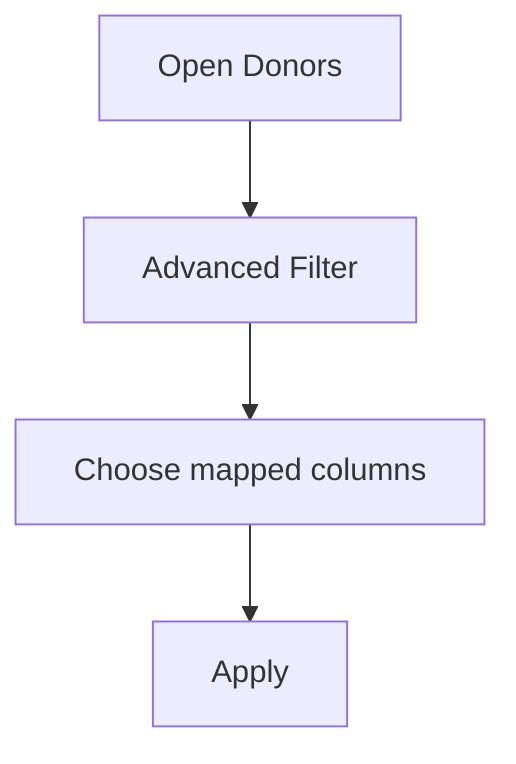

**Source / dependencies:** Existing approved Jira requirements; original reference catalogs reproduced below.

**Original source field inventory (2)**

| UI Label                 | Exact Excel Field / Mapping | Source | Default / Usage & Meaning                                     |
| ------------------------ | --------------------------- | ------ | ------------------------------------------------------------- |
| First Name               | m_FirstName                 | Core   | Default • legal/given name                                    |
| Last Name                | m_LastName                  | Core   | Default • family name                                         |
| Email Address            | mi_Email                    | Core   | Default • contact; NONE/blank → —                             |
| Primary Phone            | mi_PrimaryPhone             | Core   | Default • contact; blank → —                                  |
| Membership Type          | mt_Name                     | Core   | Default • membership category, e.g., Family                   |
| Home Branch              | u_HomeBranch                | Core   | Default • organizational branch                               |
| City                     | mi_HomeCity                 | Core   | Optional • geographic grouping                                |
| State                    | mi_HomeState                | Core   | Optional • location                                           |
| ZIP Code                 | mi_HomeZip                  | Core   | Optional • geography                                          |
| Age                      | m_Age                       | Core   | Optional, restricted • age supplied by CORE; review relevance |
| Member ID                | m_ID                        | Core   | Optional • member identification                              |
| CORE Record Created      | m_Created                   | Core   | Optional • NOT assumed to be join date                        |
| Counts Toward Membership | mt_CountsForMembership      | Core   | Optional • eligibility flag, NOT active-status proof          |

**Original source field inventory (3)**

| UI Label                      | Exact Excel Field / Mapping | Source | Default / Usage & Meaning                |
| ----------------------------- | --------------------------- | ------ | ---------------------------------------- |
| Lifetime Giving               | gift_total                  | Donor  | Default • cumulative contributions       |
| Total Gifts                   | gifts                       | Donor  | Default • count of gifts                 |
| Last Gift Date                | last_contrib_date           | Donor  | Default • recency                        |
| Last Gift Amount              | last_contrib_amt            | Donor  | Default • amount of last contribution    |
| Average Gift                  | avg_amt                     | Donor  | Optional • average contribution value    |
| Largest Gift                  | max_amt                     | Donor  | Optional • highest recorded gift         |
| Largest Gift Date             | max_date                    | Donor  | Optional • date of highest gift          |
| First Gift Date               | initial_gift_date           | Donor  | Optional • initial contribution date     |
| Years Donated                 | yrs_donated                 | Donor  | Optional • number of years with giving   |
| Current Calendar-Year Giving  | cytd                        | Donor  | Optional • current calendar-year giving  |
| Previous Calendar-Year Giving | ly_cytd                     | Donor  | Optional • previous calendar-year giving |

**Original source field inventory (4)**

| UI Label                  | Exact Excel Field / Mapping                    | Source | Default / Usage & Meaning                           |
| ------------------------- | ---------------------------------------------- | ------ | --------------------------------------------------- |
| Overall iWave Score       | mostRecentScore.score                          | iwave  | Optional • sourced composite score                  |
| Affinity Score            | mostRecentScore.scoreDetails.affinityScore     | iwave  | Default • supplied affinity score, not percentage   |
| Propensity Score          | mostRecentScore.scoreDetails.propensityScore   | iwave  | Default • supplied propensity score, not percentage |
| Capacity Score            | mostRecentScore.scoreDetails.capacityScore     | iwave  | Default • rating, distinct from money value         |
| Estimated Giving Capacity | mostRecentScore.scoreDetails.capacityValue     | iwave  | Default • capacity estimate, NOT actual donations   |
| Capacity Range (Low)      | mostRecentScore.scoreDetails.capacityRangeLow  | iwave  | Optional • estimate lower bound                     |
| Capacity Range (High)     | mostRecentScore.scoreDetails.capacityRangeHigh | iwave  | Optional • estimate upper bound                     |
| Planned Giving Score      | mostRecentScore.plannedGivingDetails.score     | iwave  | Optional • planning insight                         |
| Engagement Style          | mostRecentScore.analytics.engagement           | iwave  | Optional • proposed engagement mode                 |
| Cultivation Style         | mostRecentScore.analytics.cultivation          | iwave  | Optional • suggested cultivation approach           |
| Score Updated On          | mostRecentScore.additionalData.scoredAt        | iwave  | Optional • helps interpret stale scores             |

### DM-A08 — Unified Constituent Profile – approved Jira baseline

**Scope:** Existing Jira baseline (As-Is convention)  
**Module:** Donor Management  
**Actor:** Admin (only current application user)  
**User story:** As an AiXPurpose Admin, I want to admin opens the same profile page from Members, Donors or Prospecting. so that I can complete the relevant donor-management operation while preserving source integrity.

**Functional requirements**

- FR-DM-A08-01: Show common member fields, plus mapped giving/iWave fields when available.
- FR-DM-A08-02: Maintain tenant-scoped data and display the record origin where applicable.
- FR-DM-A08-03: Show appropriate validation, loading, empty-state and error feedback without altering source records.
- FR-DM-A08-04: Preserve navigation to the existing unified constituent profile when opening person records.

**Business logic**

- BL-DM-A08-01: Do not invent missing values, infer verified contacts, or equate capacity to donations.
- BL-DM-A08-02: Admin-only UI; no newly invented role hierarchy or approval chain.
- BL-DM-A08-03: Underlying integrated entity values must not be modified by native actions; backend must enforce write restrictions.

**Acceptance criteria**

1. Given an Admin opens the relevant screen, when they use the stated feature, then same underlying person opens the same profile; missing sections handled safely.
2. Given the current tenant has no eligible records, when the feature is opened, then a clear empty state is displayed without another tenant’s data.
3. Given a record is sourced from an external system, when a direct update is attempted, then the update is rejected and the source record stays unchanged.
4. Given an operation fails or input is invalid, when the Admin submits, then the UI shows a meaningful failure and does not report success.

**Mermaid workflow**

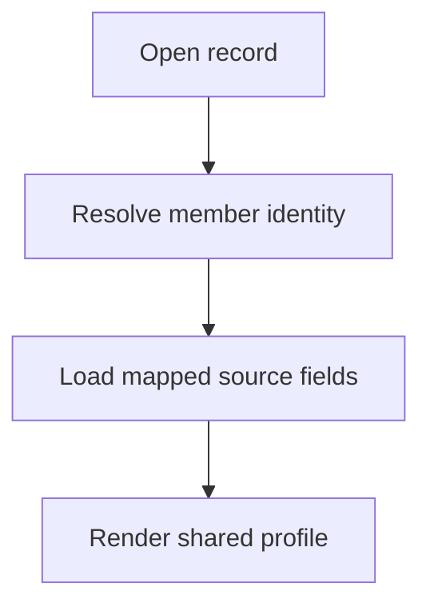

**Source / dependencies:** Existing approved Jira requirements; original reference catalogs reproduced below.

**Approved profile source mapping, reference table 5**

| UI Label        | Exact Excel Field / Mapping | Source | Default / Usage & Meaning              |
| --------------- | --------------------------- | ------ | -------------------------------------- |
| Full Name       | m_FirstName + m_LastName    | Core   | Primary heading; display combined name |
| Membership Type | mt_Name                     | Core   | Compact subtitle/badge                 |
| Email           | mi_Email                    | Core   | Header contact if present              |
| Primary Phone   | mi_PrimaryPhone             | Core   | Header contact if present              |
| City / State    | mi_HomeCity + mi_HomeState  | Core   | Compact header location                |

**Approved profile source mapping, reference table 6**

| UI Label                 | Exact Excel Field / Mapping | Source | Default / Usage & Meaning                       |
| ------------------------ | --------------------------- | ------ | ----------------------------------------------- |
| Member ID                | m_ID                        | Core   | Common membership identifier                    |
| Membership Type          | mt_Name                     | Core   | Actual CORE membership category                 |
| Home Branch              | u_HomeBranch                | Core   | Branch affiliation                              |
| Counts Toward Membership | mt_CountsForMembership      | Core   | Eligibility flag, not current membership status |
| CORE Record Created      | m_Created                   | Core   | Record timestamp; not labeled Member Since      |
| Unit ID                  | m_UnitID                    | Core   | Collapsed system information only               |

**Approved profile source mapping, reference table 7**

| UI Label       | Exact Excel Field / Mapping | Source | Default / Usage & Meaning                  |
| -------------- | --------------------------- | ------ | ------------------------------------------ |
| First Name     | m_FirstName                 | Core   | Personal information                       |
| Last Name      | m_LastName                  | Core   | Personal information                       |
| Age            | m_Age                       | Core   | Optional, access-controlled personal value |
| Date of Birth  | m_Birthdate                 | Core   | Restricted; do not show by default         |
| Email          | mi_Email                    | Core   | Contact                                    |
| Primary Phone  | mi_PrimaryPhone             | Core   | Contact                                    |
| Street Address | mi_HomeAddress              | Core   | Address                                    |
| City           | mi_HomeCity                 | Core   | Address                                    |
| State          | mi_HomeState                | Core   | Address                                    |
| ZIP Code       | mi_HomeZip                  | Core   | Address                                    |

**Approved profile source mapping, reference table 8**

| UI Label            | Exact Excel Field / Mapping | Source | Default / Usage & Meaning                                                  |
| ------------------- | --------------------------- | ------ | -------------------------------------------------------------------------- |
| Full Name           | m_FirstName + m_LastName    | Core   | Same header as member-only profile                                         |
| Membership Type     | mt_Name                     | Core   | Same membership card                                                       |
| Member ID           | m_ID                        | Core   | Same identifier                                                            |
| Home Branch         | u_HomeBranch                | Core   | Same branch detail                                                         |
| CORE Record Created | m_Created                   | Core   | Same record metadata                                                       |
| Email               | mi_Email                    | Core   | Same contact detail; mapped donor email may be available for source review |
| Primary Phone       | mi_PrimaryPhone             | Core   | Same contact detail                                                        |
| Age                 | m_Age                       | Core   | Optional authorized view                                                   |
| Street Address      | mi_HomeAddress              | Core   | Same address section                                                       |
| City                | mi_HomeCity                 | Core   | Same address section                                                       |
| State               | mi_HomeState                | Core   | Same address section                                                       |
| ZIP Code            | mi_HomeZip                  | Core   | Same address section                                                       |

**Approved profile source mapping, reference table 9**

| UI Label                      | Exact Excel Field / Mapping | Source | Default / Usage & Meaning                |
| ----------------------------- | --------------------------- | ------ | ---------------------------------------- |
| Lifetime Giving               | gift_total                  | Donor  | Default • cumulative contributions       |
| Total Gifts                   | gifts                       | Donor  | Default • count of gifts                 |
| Last Gift Date                | last_contrib_date           | Donor  | Default • recency                        |
| Last Gift Amount              | last_contrib_amt            | Donor  | Default • amount of last contribution    |
| Average Gift                  | avg_amt                     | Donor  | Optional • average contribution value    |
| Largest Gift                  | max_amt                     | Donor  | Optional • highest recorded gift         |
| Largest Gift Date             | max_date                    | Donor  | Optional • date of highest gift          |
| First Gift Date               | initial_gift_date           | Donor  | Optional • initial contribution date     |
| Years Donated                 | yrs_donated                 | Donor  | Optional • number of years with giving   |
| Current Calendar-Year Giving  | cytd                        | Donor  | Optional • current calendar-year giving  |
| Previous Calendar-Year Giving | ly_cytd                     | Donor  | Optional • previous calendar-year giving |

**Approved profile source mapping, reference table 10**

| UI Label                  | Exact Excel Field / Mapping                    | Source | Default / Usage & Meaning                           |
| ------------------------- | ---------------------------------------------- | ------ | --------------------------------------------------- |
| Overall iWave Score       | mostRecentScore.score                          | iwave  | Optional • sourced composite score                  |
| Affinity Score            | mostRecentScore.scoreDetails.affinityScore     | iwave  | Default • supplied affinity score, not percentage   |
| Propensity Score          | mostRecentScore.scoreDetails.propensityScore   | iwave  | Default • supplied propensity score, not percentage |
| Capacity Score            | mostRecentScore.scoreDetails.capacityScore     | iwave  | Default • rating, distinct from money value         |
| Estimated Giving Capacity | mostRecentScore.scoreDetails.capacityValue     | iwave  | Default • capacity estimate, NOT actual donations   |
| Capacity Range (Low)      | mostRecentScore.scoreDetails.capacityRangeLow  | iwave  | Optional • estimate lower bound                     |
| Capacity Range (High)     | mostRecentScore.scoreDetails.capacityRangeHigh | iwave  | Optional • estimate upper bound                     |
| Planned Giving Score      | mostRecentScore.plannedGivingDetails.score     | iwave  | Optional • planning insight                         |
| Engagement Style          | mostRecentScore.analytics.engagement           | iwave  | Optional • proposed engagement mode                 |
| Cultivation Style         | mostRecentScore.analytics.cultivation          | iwave  | Optional • suggested cultivation approach           |
| Score Updated On          | mostRecentScore.additionalData.scoredAt        | iwave  | Optional • helps interpret stale scores             |

**Approved profile source mapping, reference table 11**

| UI Label                | Exact Excel Field / Mapping                                                | Source | Default / Usage & Meaning                          |
| ----------------------- | -------------------------------------------------------------------------- | ------ | -------------------------------------------------- |
| Employer / Organization | mostRecentScore.additionalData.companyAffiliation.companyName              | iwave  | Optional research context; verify currency         |
| Professional Title      | mostRecentScore.additionalData.companyAffiliation.corporateTitle           | iwave  | Optional research context                          |
| Foundation Board Flag   | mostRecentScore.additionalData.foundations.public.isFoundationBoardMember  | iwave  | Only if verified / permissioned                    |
| Foundation Name         | mostRecentScore.additionalData.foundations.public.mostRecentFoundationName | iwave  | Source-reported association; not partnership proof |

**Approved profile source mapping, reference table 12**

| UI Label                | Exact Excel Field / Mapping | Source | Default / Usage & Meaning                              |
| ----------------------- | --------------------------- | ------ | ------------------------------------------------------ |
| DonorPerfect Donor ID   | donor_id                    | Donor  | System identification only                             |
| DonorPerfect Email      | email                       | Donor  | Show source value only if needed to reconcile conflict |
| DonorPerfect Mobile     | mobile_phone                | Donor  | Do not mislabel home phone as mobile                   |
| DonorPerfect Home Phone | home_phone                  | Donor  | Source contact fallback when permitted                 |
| Email Opt-Out           | no_email                    | Donor  | Communication preference, not donor status             |
| Mail Opt-Out            | nomail                      | Donor  | Communication preference, not membership status        |
| Last DP Modified        | modified_date               | Donor  | Source metadata; not latest donation timestamp         |

### DM-A09 — Global Search navigation – approved Jira baseline

**Scope:** Existing Jira baseline (As-Is convention)  
**Module:** Donor Management  
**Actor:** Admin (only current application user)  
**User story:** As an AiXPurpose Admin, I want to admin searches names and titles globally and opens appropriate records. so that I can complete the relevant donor-management operation while preserving source integrity.

**Functional requirements**

- FR-DM-A09-01: Support full/partial match across supported modules with suggestions and unique record navigation.
- FR-DM-A09-02: Maintain tenant-scoped data and display the record origin where applicable.
- FR-DM-A09-03: Show appropriate validation, loading, empty-state and error feedback without altering source records.
- FR-DM-A09-04: Preserve navigation to the existing unified constituent profile when opening person records.

**Business logic**

- BL-DM-A09-01: Member and donor representations open one profile; tenant scope mandatory.
- BL-DM-A09-02: Admin-only UI; no newly invented role hierarchy or approval chain.
- BL-DM-A09-03: Underlying integrated entity values must not be modified by native actions; backend must enforce write restrictions.

**Acceptance criteria**

1. Given an Admin opens the relevant screen, when they use the stated feature, then matching suggestions and correct routes work; no cross-tenant information leakage.
2. Given the current tenant has no eligible records, when the feature is opened, then a clear empty state is displayed without another tenant’s data.
3. Given a record is sourced from an external system, when a direct update is attempted, then the update is rejected and the source record stays unchanged.
4. Given an operation fails or input is invalid, when the Admin submits, then the UI shows a meaningful failure and does not report success.

**Mermaid workflow**

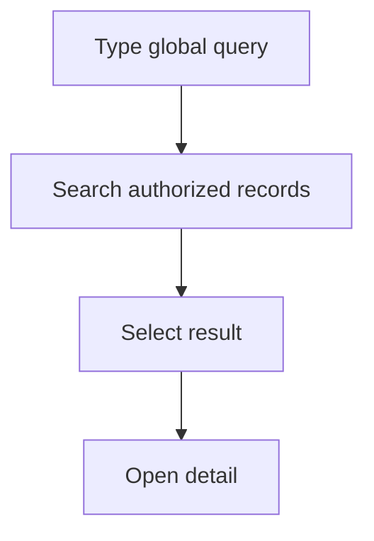

**Source / dependencies:** Existing approved Jira requirements; original reference catalogs reproduced below.

### DM-A10 — Segment listing and type filters

**Scope:** As-Is – working  
**Module:** Donor Management  
**Actor:** Admin (only current application user)  
**User story:** As an AiXPurpose Admin, I want to admin views segments and filters All, Static or Dynamic. so that I can complete the relevant donor-management operation while preserving source integrity.

**Functional requirements**

- FR-DM-A10-01: Keep existing segment cards, donor counts, labels and filtering.
- FR-DM-A10-02: Maintain tenant-scoped data and display the record origin where applicable.
- FR-DM-A10-03: Show appropriate validation, loading, empty-state and error feedback without altering source records.
- FR-DM-A10-04: Preserve navigation to the existing unified constituent profile when opening person records.

**Business logic**

- BL-DM-A10-01: Counts represent currently displayed segment membership under existing implementation.
- BL-DM-A10-02: Admin-only UI; no newly invented role hierarchy or approval chain.
- BL-DM-A10-03: Underlying integrated entity values must not be modified by native actions; backend must enforce write restrictions.

**Acceptance criteria**

1. Given an Admin opens the relevant screen, when they use the stated feature, then existing segment listing and filters remain available.
2. Given the current tenant has no eligible records, when the feature is opened, then a clear empty state is displayed without another tenant’s data.
3. Given a record is sourced from an external system, when a direct update is attempted, then the update is rejected and the source record stays unchanged.
4. Given an operation fails or input is invalid, when the Admin submits, then the UI shows a meaningful failure and does not report success.

**Mermaid workflow**

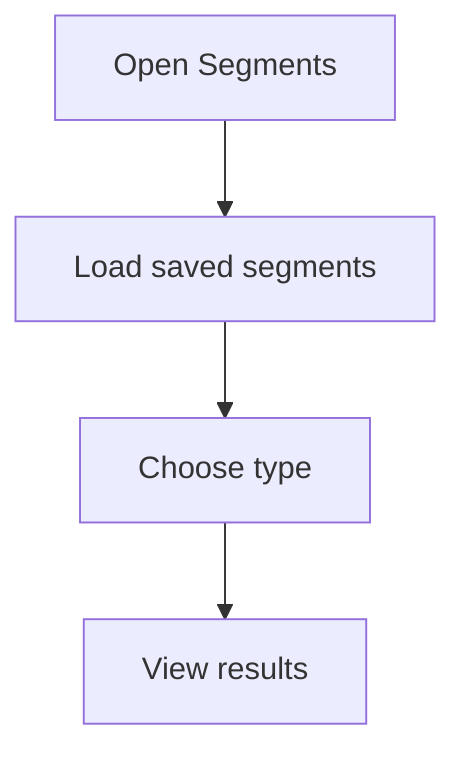

**Source / dependencies:** Uploaded donor management screenshots and approved scope decisions.

### DM-A11 — Create and manage basic segments

**Scope:** As-Is – working  
**Module:** Donor Management  
**Actor:** Admin (only current application user)  
**User story:** As an AiXPurpose Admin, I want to admin creates, views and deletes saved segments using current rule UI. so that I can complete the relevant donor-management operation while preserving source integrity.

**Functional requirements**

- FR-DM-A11-01: Retain current create/view/delete flows and basic fields/operator/value conditions.
- FR-DM-A11-02: Maintain tenant-scoped data and display the record origin where applicable.
- FR-DM-A11-03: Show appropriate validation, loading, empty-state and error feedback without altering source records.
- FR-DM-A11-04: Preserve navigation to the existing unified constituent profile when opening person records.

**Business logic**

- BL-DM-A11-01: Underlying integrated member records remain unchanged when administering segment definitions.
- BL-DM-A11-02: Admin-only UI; no newly invented role hierarchy or approval chain.
- BL-DM-A11-03: Underlying integrated entity values must not be modified by native actions; backend must enforce write restrictions.

**Acceptance criteria**

1. Given an Admin opens the relevant screen, when they use the stated feature, then admin can use current actions without regression.
2. Given the current tenant has no eligible records, when the feature is opened, then a clear empty state is displayed without another tenant’s data.
3. Given a record is sourced from an external system, when a direct update is attempted, then the update is rejected and the source record stays unchanged.
4. Given an operation fails or input is invalid, when the Admin submits, then the UI shows a meaningful failure and does not report success.

**Mermaid workflow**

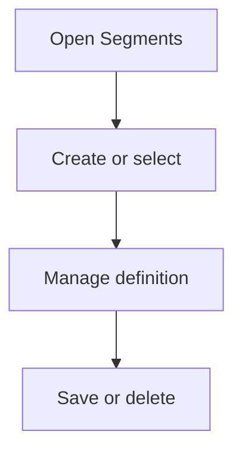

**Source / dependencies:** Uploaded donor management screenshots and approved scope decisions.

### DM-A12 — Segment email, send communication and export

**Scope:** As-Is – working  
**Module:** Donor Management  
**Actor:** Admin (only current application user)  
**User story:** As an AiXPurpose Admin, I want to admin sends email/communication to segment audience and exports list. so that I can complete the relevant donor-management operation while preserving source integrity.

**Functional requirements**

- FR-DM-A12-01: Reuse existing Communications workflow and Export List.
- FR-DM-A12-02: Maintain tenant-scoped data and display the record origin where applicable.
- FR-DM-A12-03: Show appropriate validation, loading, empty-state and error feedback without altering source records.
- FR-DM-A12-04: Preserve navigation to the existing unified constituent profile when opening person records.

**Business logic**

- BL-DM-A12-01: Maintain tenant data scope and segment audience mapping.
- BL-DM-A12-02: Admin-only UI; no newly invented role hierarchy or approval chain.
- BL-DM-A12-03: Underlying integrated entity values must not be modified by native actions; backend must enforce write restrictions.

**Acceptance criteria**

1. Given an Admin opens the relevant screen, when they use the stated feature, then existing actions execute using current communication functionality.
2. Given the current tenant has no eligible records, when the feature is opened, then a clear empty state is displayed without another tenant’s data.
3. Given a record is sourced from an external system, when a direct update is attempted, then the update is rejected and the source record stays unchanged.
4. Given an operation fails or input is invalid, when the Admin submits, then the UI shows a meaningful failure and does not report success.

**Mermaid workflow**

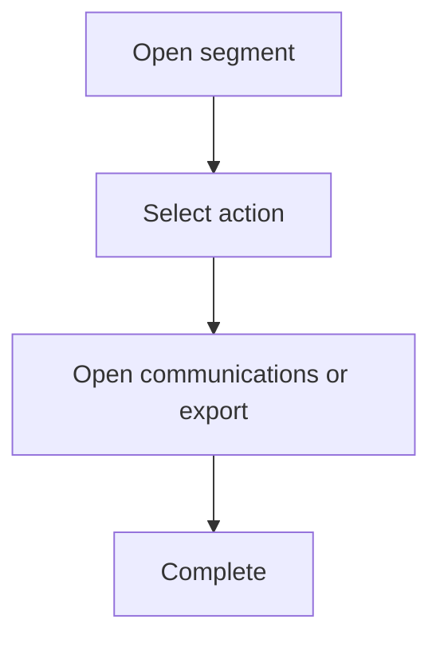

**Source / dependencies:** Uploaded donor management screenshots and approved scope decisions.

### DM-A13 — Dynamic/static segment behaviour

**Scope:** As-Is – verification pending  
**Module:** Donor Management  
**Actor:** Admin (only current application user)  
**User story:** As an AiXPurpose Admin, I want to admin views segments marked Static or Dynamic. so that I can complete the relevant donor-management operation while preserving source integrity.

**Functional requirements**

- FR-DM-A13-01: Retain existing control and labels while behavior is verified.
- FR-DM-A13-02: Maintain tenant-scoped data and display the record origin where applicable.
- FR-DM-A13-03: Show appropriate validation, loading, empty-state and error feedback without altering source records.
- FR-DM-A13-04: Preserve navigation to the existing unified constituent profile when opening person records.

**Business logic**

- BL-DM-A13-01: Dynamic recalculation, static membership semantics and override precedence are OPEN.
- BL-DM-A13-02: Admin-only UI; no newly invented role hierarchy or approval chain.
- BL-DM-A13-03: Underlying integrated entity values must not be modified by native actions; backend must enforce write restrictions.

**Acceptance criteria**

1. Given an Admin opens the relevant screen, when they use the stated feature, then qA/Development provide measured behavior before any new rule is claimed.
2. Given the current tenant has no eligible records, when the feature is opened, then a clear empty state is displayed without another tenant’s data.
3. Given a record is sourced from an external system, when a direct update is attempted, then the update is rejected and the source record stays unchanged.
4. Given an operation fails or input is invalid, when the Admin submits, then the UI shows a meaningful failure and does not report success.

**Mermaid workflow**

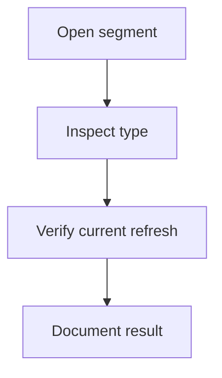

**Source / dependencies:** Uploaded donor management screenshots and approved scope decisions.

### DM-A14 — Prospecting list and categories

**Scope:** As-Is – source/logic verification pending  
**Module:** Donor Management  
**Actor:** Admin (only current application user)  
**User story:** As an AiXPurpose Admin, I want to admin sees Top, Warm, Cold and All prospects with scoring columns and recommended actions. so that I can complete the relevant donor-management operation while preserving source integrity.

**Functional requirements**

- FR-DM-A14-01: Retain current prospect listing and filters.
- FR-DM-A14-02: Maintain tenant-scoped data and display the record origin where applicable.
- FR-DM-A14-03: Show appropriate validation, loading, empty-state and error feedback without altering source records.
- FR-DM-A14-04: Preserve navigation to the existing unified constituent profile when opening person records.

**Business logic**

- BL-DM-A14-01: Use source-supported data; category thresholds and list eligibility remain unverified.
- BL-DM-A14-02: Admin-only UI; no newly invented role hierarchy or approval chain.
- BL-DM-A14-03: Underlying integrated entity values must not be modified by native actions; backend must enforce write restrictions.

**Acceptance criteria**

1. Given an Admin opens the relevant screen, when they use the stated feature, then prospecting renders existing records; no fabricated score for native member/donor.
2. Given the current tenant has no eligible records, when the feature is opened, then a clear empty state is displayed without another tenant’s data.
3. Given a record is sourced from an external system, when a direct update is attempted, then the update is rejected and the source record stays unchanged.
4. Given an operation fails or input is invalid, when the Admin submits, then the UI shows a meaningful failure and does not report success.

**Mermaid workflow**

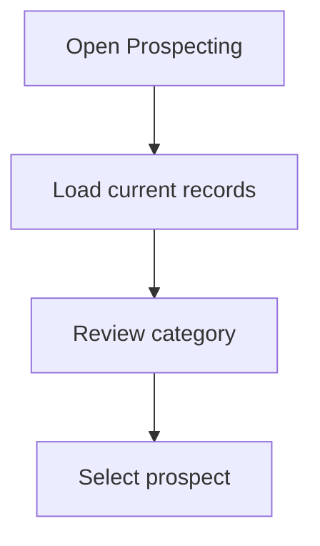

**Source / dependencies:** Uploaded donor management screenshots and approved scope decisions.

### DM-A15 — Prospect to unified profile navigation

**Scope:** As-Is  
**Module:** Donor Management  
**Actor:** Admin (only current application user)  
**User story:** As an AiXPurpose Admin, I want to admin opens a prospect from the list. so that I can complete the relevant donor-management operation while preserving source integrity.

**Functional requirements**

- FR-DM-A15-01: Navigate to same constituent profile used by Members and Donors.
- FR-DM-A15-02: Maintain tenant-scoped data and display the record origin where applicable.
- FR-DM-A15-03: Show appropriate validation, loading, empty-state and error feedback without altering source records.
- FR-DM-A15-04: Preserve navigation to the existing unified constituent profile when opening person records.

**Business logic**

- BL-DM-A15-01: iWave research details do not establish a separate iWave-only profile or new person.
- BL-DM-A15-02: Admin-only UI; no newly invented role hierarchy or approval chain.
- BL-DM-A15-03: Underlying integrated entity values must not be modified by native actions; backend must enforce write restrictions.

**Acceptance criteria**

1. Given an Admin opens the relevant screen, when they use the stated feature, then selected row opens matching profile and available source-backed intelligence.
2. Given the current tenant has no eligible records, when the feature is opened, then a clear empty state is displayed without another tenant’s data.
3. Given a record is sourced from an external system, when a direct update is attempted, then the update is rejected and the source record stays unchanged.
4. Given an operation fails or input is invalid, when the Admin submits, then the UI shows a meaningful failure and does not report success.

**Mermaid workflow**

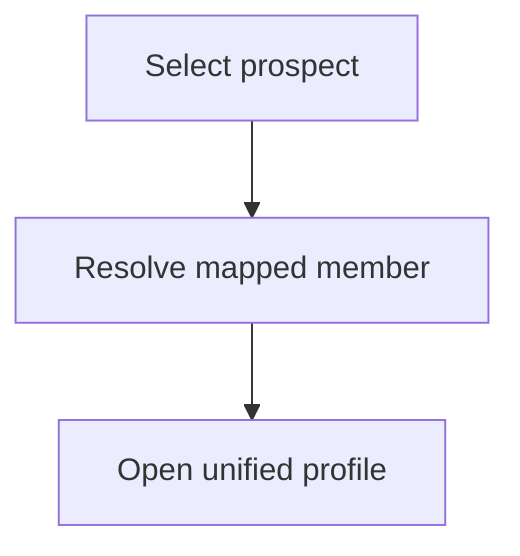

**Source / dependencies:** Uploaded donor management screenshots and approved scope decisions.

### DM-T01 — Enable native Member creation

**Scope:** To-Be  
**Module:** Donor Management  
**Actor:** Admin (only current application user)  
**User story:** As an AiXPurpose Admin, I want to admin adds a Member directly to AiXPurpose using the existing disabled UI control. so that I can complete the relevant donor-management operation while preserving source integrity.

**Functional requirements**

- FR-DM-T01-01: Enable required form, field validation and tenant-native persistence.
- FR-DM-T01-02: Maintain tenant-scoped data and display the record origin where applicable.
- FR-DM-T01-03: Show appropriate validation, loading, empty-state and error feedback without altering source records.
- FR-DM-T01-04: Preserve navigation to the existing unified constituent profile when opening person records.

**Business logic**

- BL-DM-T01-01: Create native-source record, preserve CORE-integrated data read-only; reject invalid/duplicate identifiers under approved rules.
- BL-DM-T01-02: Admin-only UI; no newly invented role hierarchy or approval chain.
- BL-DM-T01-03: Underlying integrated entity values must not be modified by native actions; backend must enforce write restrictions.

**Acceptance criteria**

1. Given an Admin opens the relevant screen, when they use the stated feature, then new native member is persisted and visible in AiXPurpose source-filtered lists.
2. Given the current tenant has no eligible records, when the feature is opened, then a clear empty state is displayed without another tenant’s data.
3. Given a record is sourced from an external system, when a direct update is attempted, then the update is rejected and the source record stays unchanged.
4. Given an operation fails or input is invalid, when the Admin submits, then the UI shows a meaningful failure and does not report success.

**Mermaid workflow**

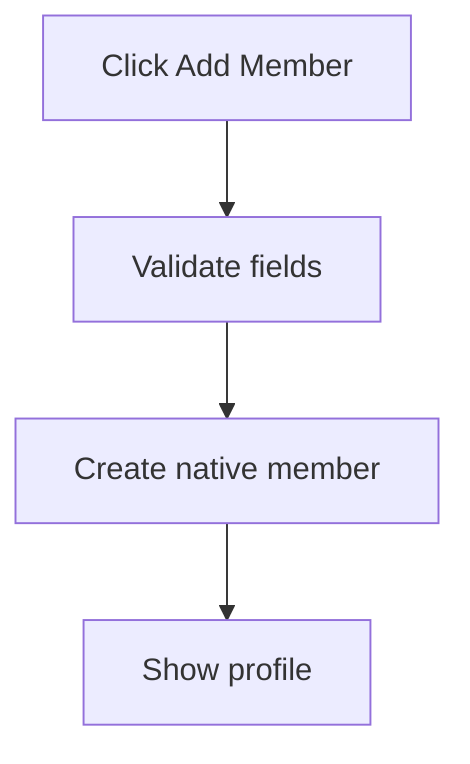

**Source / dependencies:** Uploaded donor management screenshots and approved scope decisions.

### DM-T02 — Enable native Member editing

**Scope:** To-Be  
**Module:** Donor Management  
**Actor:** Admin (only current application user)  
**User story:** As an AiXPurpose Admin, I want to admin edits a Member created in AiXPurpose. so that I can complete the relevant donor-management operation while preserving source integrity.

**Functional requirements**

- FR-DM-T02-01: Enable Edit for native records, with validation and save feedback.
- FR-DM-T02-02: Maintain tenant-scoped data and display the record origin where applicable.
- FR-DM-T02-03: Show appropriate validation, loading, empty-state and error feedback without altering source records.
- FR-DM-T02-04: Preserve navigation to the existing unified constituent profile when opening person records.

**Business logic**

- BL-DM-T02-01: Backend rejects update of integrated source records regardless of UI path.
- BL-DM-T02-02: Admin-only UI; no newly invented role hierarchy or approval chain.
- BL-DM-T02-03: Underlying integrated entity values must not be modified by native actions; backend must enforce write restrictions.

**Acceptance criteria**

1. Given an Admin opens the relevant screen, when they use the stated feature, then native update persists; integrated edit attempt is denied.
2. Given the current tenant has no eligible records, when the feature is opened, then a clear empty state is displayed without another tenant’s data.
3. Given a record is sourced from an external system, when a direct update is attempted, then the update is rejected and the source record stays unchanged.
4. Given an operation fails or input is invalid, when the Admin submits, then the UI shows a meaningful failure and does not report success.

**Mermaid workflow**

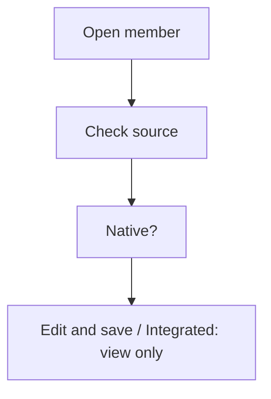

**Source / dependencies:** Uploaded donor management screenshots and approved scope decisions.

### DM-T03 — Enable native Donor creation linked to Member

**Scope:** To-Be  
**Module:** Donor Management  
**Actor:** Admin (only current application user)  
**User story:** As an AiXPurpose Admin, I want to admin enables donor status/record for an existing Member inside AiXPurpose. so that I can complete the relevant donor-management operation while preserving source integrity.

**Functional requirements**

- FR-DM-T03-01: Enable native donor create flow selecting a valid member.
- FR-DM-T03-02: Maintain tenant-scoped data and display the record origin where applicable.
- FR-DM-T03-03: Show appropriate validation, loading, empty-state and error feedback without altering source records.
- FR-DM-T03-04: Preserve navigation to the existing unified constituent profile when opening person records.

**Business logic**

- BL-DM-T03-01: Every donor must link to a member; financial qualification/duplicate rules need Development confirmation; no donor-only person.
- BL-DM-T03-02: Admin-only UI; no newly invented role hierarchy or approval chain.
- BL-DM-T03-03: Underlying integrated entity values must not be modified by native actions; backend must enforce write restrictions.

**Acceptance criteria**

1. Given an Admin opens the relevant screen, when they use the stated feature, then cannot create orphan donor; resulting donor opens same constituent profile.
2. Given the current tenant has no eligible records, when the feature is opened, then a clear empty state is displayed without another tenant’s data.
3. Given a record is sourced from an external system, when a direct update is attempted, then the update is rejected and the source record stays unchanged.
4. Given an operation fails or input is invalid, when the Admin submits, then the UI shows a meaningful failure and does not report success.

**Mermaid workflow**

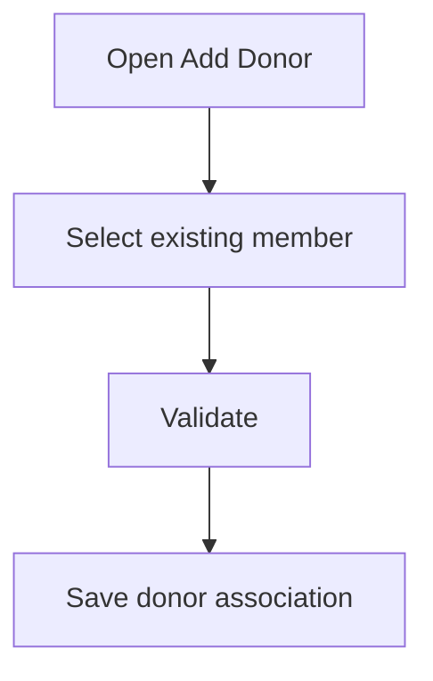

**Source / dependencies:** Uploaded donor management screenshots and approved scope decisions.

### DM-T04 — Enable native Donor editing

**Scope:** To-Be  
**Module:** Donor Management  
**Actor:** Admin (only current application user)  
**User story:** As an AiXPurpose Admin, I want to admin edits eligible native donor data inside AiXPurpose. so that I can complete the relevant donor-management operation while preserving source integrity.

**Functional requirements**

- FR-DM-T04-01: Enable existing Edit control for native donor records.
- FR-DM-T04-02: Maintain tenant-scoped data and display the record origin where applicable.
- FR-DM-T04-03: Show appropriate validation, loading, empty-state and error feedback without altering source records.
- FR-DM-T04-04: Preserve navigation to the existing unified constituent profile when opening person records.

**Business logic**

- BL-DM-T04-01: Integrated DonorPerfect/CORE/iWave fields remain read-only; avoid changing real donations through profile edits.
- BL-DM-T04-02: Admin-only UI; no newly invented role hierarchy or approval chain.
- BL-DM-T04-03: Underlying integrated entity values must not be modified by native actions; backend must enforce write restrictions.

**Acceptance criteria**

1. Given an Admin opens the relevant screen, when they use the stated feature, then native donor changes saved and integrated data protected in UI and backend.
2. Given the current tenant has no eligible records, when the feature is opened, then a clear empty state is displayed without another tenant’s data.
3. Given a record is sourced from an external system, when a direct update is attempted, then the update is rejected and the source record stays unchanged.
4. Given an operation fails or input is invalid, when the Admin submits, then the UI shows a meaningful failure and does not report success.

**Mermaid workflow**

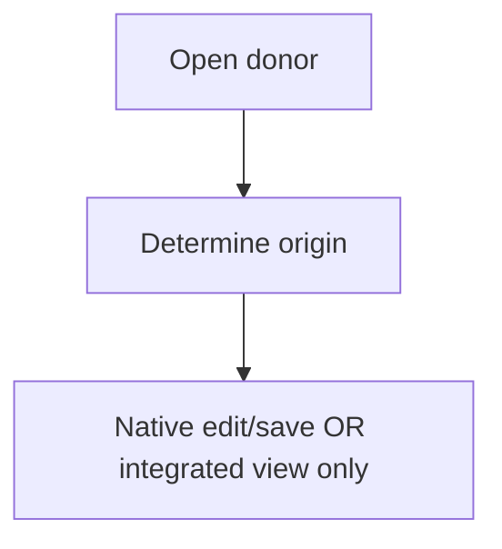

**Source / dependencies:** Uploaded donor management screenshots and approved scope decisions.

### DM-T05 — Shared Source dropdown for eligible lists

**Scope:** To-Be  
**Module:** Donor Management  
**Actor:** Admin (only current application user)  
**User story:** As an AiXPurpose Admin, I want to admin filters Member/Donor lists by source to locate editable records. so that I can complete the relevant donor-management operation while preserving source integrity.

**Functional requirements**

- FR-DM-T05-01: Use existing Filters region with All Sources, AiXPurpose, External Sources (All), individual configured sources.
- FR-DM-T05-02: Maintain tenant-scoped data and display the record origin where applicable.
- FR-DM-T05-03: Show appropriate validation, loading, empty-state and error feedback without altering source records.
- FR-DM-T05-04: Preserve navigation to the existing unified constituent profile when opening person records.

**Business logic**

- BL-DM-T05-01: Dropdown only filters page records, not globally across application; source names shown; options reflect eligible module sources.
- BL-DM-T05-02: Admin-only UI; no newly invented role hierarchy or approval chain.
- BL-DM-T05-03: Underlying integrated entity values must not be modified by native actions; backend must enforce write restrictions.

**Acceptance criteria**

1. Given an Admin opens the relevant screen, when they use the stated feature, then selecting AiXPurpose isolates native records; external options show only matching read-only records.
2. Given the current tenant has no eligible records, when the feature is opened, then a clear empty state is displayed without another tenant’s data.
3. Given a record is sourced from an external system, when a direct update is attempted, then the update is rejected and the source record stays unchanged.
4. Given an operation fails or input is invalid, when the Admin submits, then the UI shows a meaningful failure and does not report success.

**Mermaid workflow**

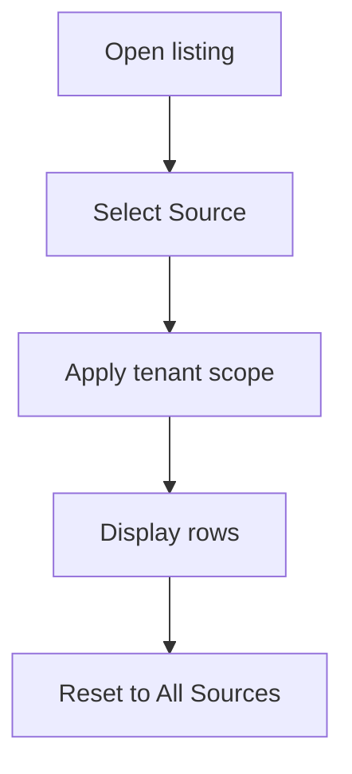

**Source / dependencies:** Uploaded donor management screenshots and approved scope decisions.

### DM-T06 — Backend source ownership enforcement

**Scope:** To-Be  
**Module:** Donor Management  
**Actor:** Admin (only current application user)  
**User story:** As an AiXPurpose Admin, I want to admin identifies editable native records and view-only external records. so that I can complete the relevant donor-management operation while preserving source integrity.

**Functional requirements**

- FR-DM-T06-01: Source provenance stored and exposed; disable integrated Edit and reject backend mutations.
- FR-DM-T06-02: Maintain tenant-scoped data and display the record origin where applicable.
- FR-DM-T06-03: Show appropriate validation, loading, empty-state and error feedback without altering source records.
- FR-DM-T06-04: Preserve navigation to the existing unified constituent profile when opening person records.

**Business logic**

- BL-DM-T06-01: Native segment membership may reference integrated people, without editing those people.
- BL-DM-T06-02: Admin-only UI; no newly invented role hierarchy or approval chain.
- BL-DM-T06-03: Underlying integrated entity values must not be modified by native actions; backend must enforce write restrictions.

**Acceptance criteria**

1. Given an Admin opens the relevant screen, when they use the stated feature, then direct API attempts to update integrated entity are rejected; native edits succeed.
2. Given the current tenant has no eligible records, when the feature is opened, then a clear empty state is displayed without another tenant’s data.
3. Given a record is sourced from an external system, when a direct update is attempted, then the update is rejected and the source record stays unchanged.
4. Given an operation fails or input is invalid, when the Admin submits, then the UI shows a meaningful failure and does not report success.

**Mermaid workflow**

```mermaid
flowchart TD
    A["Open record"]
    A --> N1["Verify origin"]
    N1 --> N2["Native update allowed / External update rejected"]
```

**Source / dependencies:** Uploaded donor management screenshots and approved scope decisions.

### DM-T07 — Multi-tenant isolation across donor management

**Scope:** To-Be shared invariant  
**Module:** Donor Management  
**Actor:** Admin (only current application user)  
**User story:** As an AiXPurpose Admin, I want to admin only sees their client organisation data. so that I can complete the relevant donor-management operation while preserving source integrity.

**Functional requirements**

- FR-DM-T07-01: Apply tenant scoping to search, lists, profiles, segments and prospects.
- FR-DM-T07-02: Maintain tenant-scoped data and display the record origin where applicable.
- FR-DM-T07-03: Show appropriate validation, loading, empty-state and error feedback without altering source records.
- FR-DM-T07-04: Preserve navigation to the existing unified constituent profile when opening person records.

**Business logic**

- BL-DM-T07-01: All record creation and references must belong to same tenant.
- BL-DM-T07-02: Admin-only UI; no newly invented role hierarchy or approval chain.
- BL-DM-T07-03: Underlying integrated entity values must not be modified by native actions; backend must enforce write restrictions.

**Acceptance criteria**

1. Given an Admin opens the relevant screen, when they use the stated feature, then cannot view, search, segment, update or export another tenant’s records.
2. Given the current tenant has no eligible records, when the feature is opened, then a clear empty state is displayed without another tenant’s data.
3. Given a record is sourced from an external system, when a direct update is attempted, then the update is rejected and the source record stays unchanged.
4. Given an operation fails or input is invalid, when the Admin submits, then the UI shows a meaningful failure and does not report success.

**Mermaid workflow**

```mermaid
flowchart TD
    A["Request"]
    A --> N1["Resolve tenant"]
    N1 --> N2["Scope query"]
    N2 --> N3["Authorize membership"]
    N3 --> N4["Return eligible data"]
```

**Source / dependencies:** Uploaded donor management screenshots and approved scope decisions.

### DM-T08 — Multiple segment conditions and AND/OR

**Scope:** To-Be  
**Module:** Donor Management  
**Actor:** Admin (only current application user)  
**User story:** As an AiXPurpose Admin, I want to admin creates a segment matching multiple criteria, e.g. Bengaluru and Local. so that I can complete the relevant donor-management operation while preserving source integrity.

**Functional requirements**

- FR-DM-T08-01: Allow multiple supported field/operator/value conditions and chosen AND/OR logic.
- FR-DM-T08-02: Maintain tenant-scoped data and display the record origin where applicable.
- FR-DM-T08-03: Show appropriate validation, loading, empty-state and error feedback without altering source records.
- FR-DM-T08-04: Preserve navigation to the existing unified constituent profile when opening person records.

**Business logic**

- BL-DM-T08-01: Only mapped, supported data fields; determine supported grouping/field matrix during implementation, no assumed unsupported operator.
- BL-DM-T08-02: Admin-only UI; no newly invented role hierarchy or approval chain.
- BL-DM-T08-03: Underlying integrated entity values must not be modified by native actions; backend must enforce write restrictions.

**Acceptance criteria**

1. Given an Admin opens the relevant screen, when they use the stated feature, then matching uses the selected logic; save/reopen preserves all conditions.
2. Given the current tenant has no eligible records, when the feature is opened, then a clear empty state is displayed without another tenant’s data.
3. Given a record is sourced from an external system, when a direct update is attempted, then the update is rejected and the source record stays unchanged.
4. Given an operation fails or input is invalid, when the Admin submits, then the UI shows a meaningful failure and does not report success.

**Mermaid workflow**

```mermaid
flowchart TD
    A["Create segment"]
    A --> N1["Add conditions"]
    N1 --> N2["Select AND or OR"]
    N2 --> N3["Preview eligible members"]
    N3 --> N4["Save"]
```

**Source / dependencies:** Uploaded donor management screenshots and approved scope decisions.

**Known unresolved point:** Manual override precedence under dynamic recalculation is not agreed. Do NOT build arbitrary persistence or automatic-removal logic without Development/Product review.

### DM-T09 — Manual include/remove members in segments

**Scope:** To-Be  
**Module:** Donor Management  
**Actor:** Admin (only current application user)  
**User story:** As an AiXPurpose Admin, I want to admin directly includes or excludes a specific member from a segment. so that I can complete the relevant donor-management operation while preserving source integrity.

**Functional requirements**

- FR-DM-T09-01: Offer member lookup and explicit Add/Remove in segment membership UI.
- FR-DM-T09-02: Maintain tenant-scoped data and display the record origin where applicable.
- FR-DM-T09-03: Show appropriate validation, loading, empty-state and error feedback without altering source records.
- FR-DM-T09-04: Preserve navigation to the existing unified constituent profile when opening person records.

**Business logic**

- BL-DM-T09-01: Changes affect segment membership, not original integrated member data; precedence on dynamic refresh is OPEN.
- BL-DM-T09-02: Admin-only UI; no newly invented role hierarchy or approval chain.
- BL-DM-T09-03: Underlying integrated entity values must not be modified by native actions; backend must enforce write restrictions.

**Acceptance criteria**

1. Given an Admin opens the relevant screen, when they use the stated feature, then admin can add/remove eligible tenant member; actual recalculation behavior remains unasserted until verified.
2. Given the current tenant has no eligible records, when the feature is opened, then a clear empty state is displayed without another tenant’s data.
3. Given a record is sourced from an external system, when a direct update is attempted, then the update is rejected and the source record stays unchanged.
4. Given an operation fails or input is invalid, when the Admin submits, then the UI shows a meaningful failure and does not report success.

**Mermaid workflow**

```mermaid
flowchart TD
    A["Open segment"]
    A --> N1["Search member"]
    N1 --> N2["Add or Remove"]
    N2 --> N3["Save membership adjustment"]
```

**Source / dependencies:** Uploaded donor management screenshots and approved scope decisions.

**Known unresolved point:** Manual override precedence under dynamic recalculation is not agreed. Do NOT build arbitrary persistence or automatic-removal logic without Development/Product review.

### DM-F06 — Prospect / Donor Strength scoring framework

**Scope:** Future Scope – separate dedicated specification  
**Module:** Donor Management  
**Actor:** Admin (only current application user)  
**User story:** As an AiXPurpose Admin, I want to admin needs understandable score for native and source-enriched donor records. so that I can complete the relevant donor-management operation while preserving source integrity.

**Functional requirements**

- FR-DM-F06-01: Define source provenance, native scoring inputs, eligibility, confidence/unknown handling, thresholds and display in separate iWave/donor-strength discussion.
- FR-DM-F06-02: Maintain tenant-scoped data and display the record origin where applicable.
- FR-DM-F06-03: Show appropriate validation, loading, empty-state and error feedback without altering source records.
- FR-DM-F06-04: Preserve navigation to the existing unified constituent profile when opening person records.

**Business logic**

- BL-DM-F06-01: Never invent iWave scores or treat native score as equivalent without agreed model; no score-history requirement.
- BL-DM-F06-02: Admin-only UI; no newly invented role hierarchy or approval chain.
- BL-DM-F06-03: Underlying integrated entity values must not be modified by native actions; backend must enforce write restrictions.

**Acceptance criteria**

1. Given an Admin opens the relevant screen, when they use the stated feature, then no current-release scoring implementation; future business approval required.
2. Given the current tenant has no eligible records, when the feature is opened, then a clear empty state is displayed without another tenant’s data.
3. Given a record is sourced from an external system, when a direct update is attempted, then the update is rejected and the source record stays unchanged.
4. Given an operation fails or input is invalid, when the Admin submits, then the UI shows a meaningful failure and does not report success.

**Mermaid workflow**

```mermaid
flowchart TD
    A["Identify source"]
    A --> N1["Existing source score?"]
    N1 --> N2["Display mapped value / Native score model pending"]
```

**Source / dependencies:** Uploaded donor management screenshots and approved scope decisions.

**Future-only gate:** A dedicated iWave/donor-strength decision document is required before defining native donor scoring, propensity/affinity/capacity calculations or score categories. Current iWave data remains source-defined.

## Native template-based import — To-Be feature stories

These feature stories consolidate previously approved page-level Member and Donor import requirements (MEM-F-025–032; DON-F-032–034, DON-F-043–050), plus the requested Segment import addition. Importing an AiXPurpose template is not equivalent to integration sync.

### DM-T10 — Native Member template import

**Scope:** To-Be  
**Module:** Donor Management / Member  
**Actor:** Admin (only application user)  
**User story:** As an AiXPurpose Admin, I want to import member data using a supported template, so that uploaded native records or memberships are validated, visible and manageable inside AiXPurpose without editing connected source-system data.

**Functional requirements**

1. Provide an Import entry on the relevant existing page; allow the Admin to download an approved versioned template.
2. Accept supported templates, validate structure, fields, tenant ownership, identifiers and potential duplicates.
3. Show a meaningful preview with eligible, rejected, duplicate and pending rows before confirmation; cancel does not commit changes.
4. Commit only verified, approved native operations; show batch-level and row-level results and correct errors without creating duplicates.
5. Refresh the relevant listing, profile, segment membership or applicable KPIs so successful records become visible, subject to current filters.

**Specific mapping / business logic**

- Admin downloads approved versioned Member Excel/CSV template, populates the required CORE-aligned fields and uploads a file. System validates file structure, member identity, required fields, formats and duplicates, previews results, and commits only eligible records under the current tenant. Imported records are native AiXPurpose records and editable by Admin.
- Create or update eligible native members; do not overwrite an externally sourced CORE record. Record results as created, updated, rejected, skipped or pending review. Refresh Members list and applicable KPI views after commit.
- **Origin enforcement:** Template-uploaded native records are `AiXPurpose`; integration API-synchronised records retain their actual source and stay read-only.
- **Single Admin role:** Do not introduce role/approval workflows. Import effects must be restricted to the current tenant.
- **Source reference:** Original Members BRD: MEM-F-025 to MEM-F-032.

**Acceptance criteria**

1. Given the Admin downloads a template, when uploading a correctly structured eligible file, then the system validates and previews it before committing any rows.
2. Given invalid, ambiguous or duplicate rows, when the file is validated, then errors or pending review are shown; these rows are not falsely counted as committed.
3. Given an import has succeeded, when the Admin refreshes or revisits the relevant page, then the committed native data appears under AiXPurpose / All Sources and can be edited without changing integrated originals.
4. Given a repeated upload, when potential duplicates are detected, then the system follows the approved resolution rules without unintended duplicate records or financial transactions.
5. Given a member/segment reference belongs to a different tenant or is unresolvable, when Admin submits, then it cannot be committed against an unauthorised record.
6. Given an import fails, when results display, then successes, failures, skips and pending review are reported accurately.

**Mermaid workflow**

```mermaid
flowchart TD
    A["Admin opens Member Import"] --> B["Download template"]
    B --> C["Upload populated file"]
    C --> D["Validate and resolve identities"]
    D --> E{"Eligible?"}
    E -->|No| F["Reject or hold rows for review"]
    F --> C
    E -->|Yes| G["Preview and confirm"]
    G --> H["Commit native records or segment membership"]
    H --> I["Report results and refresh view"]
    I --> J["Native content editable by Admin"]
```

### DM-T11 — Native Donor template import and member resolution

**Scope:** To-Be  
**Module:** Donor Management / Donor  
**Actor:** Admin (only application user)  
**User story:** As an AiXPurpose Admin, I want to import donor data using a supported template, so that uploaded native records or memberships are validated, visible and manageable inside AiXPurpose without editing connected source-system data.

**Functional requirements**

1. Provide an Import entry on the relevant existing page; allow the Admin to download an approved versioned template.
2. Accept supported templates, validate structure, fields, tenant ownership, identifiers and potential duplicates.
3. Show a meaningful preview with eligible, rejected, duplicate and pending rows before confirmation; cancel does not commit changes.
4. Commit only verified, approved native operations; show batch-level and row-level results and correct errors without creating duplicates.
5. Refresh the relevant listing, profile, segment membership or applicable KPIs so successful records become visible, subject to current filters.

**Specific mapping / business logic**

- Admin downloads approved versioned Donor Excel/CSV template, uploads donor and giving data, and previews row validation. Each imported donor must resolve to an existing Member using approved identity mappings; ambiguous or unmatched identities remain pending review. Validate donation identifiers and duplicates before commit.
- Committed donor records, where valid, are native AiXPurpose records and editable by Admin; original externally integrated data remains read-only. Importing a historical giving row must not initiate or falsely confirm a new payment-gateway charge. Show created, updated, rejected, skipped and pending counts. Refresh Donors and unified profile/KPIs based on approved metrics.
- **Origin enforcement:** Template-uploaded native records are `AiXPurpose`; integration API-synchronised records retain their actual source and stay read-only.
- **Single Admin role:** Do not introduce role/approval workflows. Import effects must be restricted to the current tenant.
- **Source reference:** Original Donors BRD: DON-F-032 to DON-F-034, DON-F-043 to DON-F-050.

**Acceptance criteria**

1. Given the Admin downloads a template, when uploading a correctly structured eligible file, then the system validates and previews it before committing any rows.
2. Given invalid, ambiguous or duplicate rows, when the file is validated, then errors or pending review are shown; these rows are not falsely counted as committed.
3. Given an import has succeeded, when the Admin refreshes or revisits the relevant page, then the committed native data appears under AiXPurpose / All Sources and can be edited without changing integrated originals.
4. Given a repeated upload, when potential duplicates are detected, then the system follows the approved resolution rules without unintended duplicate records or financial transactions.
5. Given a member/segment reference belongs to a different tenant or is unresolvable, when Admin submits, then it cannot be committed against an unauthorised record.
6. Given an import fails, when results display, then successes, failures, skips and pending review are reported accurately.

**Mermaid workflow**

```mermaid
flowchart TD
    A["Admin opens Donor Import"] --> B["Download template"]
    B --> C["Upload populated file"]
    C --> D["Validate and resolve identities"]
    D --> E{"Eligible?"}
    E -->|No| F["Reject or hold rows for review"]
    F --> C
    E -->|Yes| G["Preview and confirm"]
    G --> H["Commit native records or segment membership"]
    H --> I["Report results and refresh view"]
    I --> J["Native content editable by Admin"]
```

### DM-T12 — Segment membership template import

**Scope:** To-Be  
**Module:** Donor Management / Segment  
**Actor:** Admin (only application user)  
**User story:** As an AiXPurpose Admin, I want to import segment data using a supported template, so that uploaded native records or memberships are validated, visible and manageable inside AiXPurpose without editing connected source-system data.

**Functional requirements**

1. Provide an Import entry on the relevant existing page; allow the Admin to download an approved versioned template.
2. Accept supported templates, validate structure, fields, tenant ownership, identifiers and potential duplicates.
3. Show a meaningful preview with eligible, rejected, duplicate and pending rows before confirmation; cancel does not commit changes.
4. Commit only verified, approved native operations; show batch-level and row-level results and correct errors without creating duplicates.
5. Refresh the relevant listing, profile, segment membership or applicable KPIs so successful records become visible, subject to current filters.

**Specific mapping / business logic**

- Admin can download a supported segment-membership template, identify a target native segment, and upload members to include or exclude using approved constituent identifiers. Preview matched, unmatched, duplicate and ambiguous rows before commit. The segment definition and membership are native AiXPurpose configuration.
- Importing an existing integrated member into a native segment changes only segment membership, not the integrated constituent record. Do not create new member records implicitly from a segment-membership file. Allow Admin to correct and resubmit invalid rows; preserve the existing Segment communication/export workflow. For dynamic segments, import membership versus recalculation precedence remains OPEN for Development verification.
- **Origin enforcement:** Template-uploaded native records are `AiXPurpose`; integration API-synchronised records retain their actual source and stay read-only.
- **Single Admin role:** Do not introduce role/approval workflows. Import effects must be restricted to the current tenant.
- **Source reference:** Additional module-level extension based on user clarification; exact template layout and manual membership override precedence open.

**Acceptance criteria**

1. Given the Admin downloads a template, when uploading a correctly structured eligible file, then the system validates and previews it before committing any rows.
2. Given invalid, ambiguous or duplicate rows, when the file is validated, then errors or pending review are shown; these rows are not falsely counted as committed.
3. Given an import has succeeded, when the Admin refreshes or revisits the relevant page, then the committed native data appears under AiXPurpose / All Sources and can be edited without changing integrated originals.
4. Given a repeated upload, when potential duplicates are detected, then the system follows the approved resolution rules without unintended duplicate records or financial transactions.
5. Given a member/segment reference belongs to a different tenant or is unresolvable, when Admin submits, then it cannot be committed against an unauthorised record.
6. Given an import fails, when results display, then successes, failures, skips and pending review are reported accurately.

**Mermaid workflow**

```mermaid
flowchart TD
    A["Admin opens Segment Import"] --> B["Download template"]
    B --> C["Upload populated file"]
    C --> D["Validate and resolve identities"]
    D --> E{"Eligible?"}
    E -->|No| F["Reject or hold rows for review"]
    F --> C
    E -->|Yes| G["Preview and confirm"]
    G --> H["Commit native records or segment membership"]
    H --> I["Report results and refresh view"]
    I --> J["Native content editable by Admin"]
```

### DM-T13 — Import status, refresh and ownership controls

**Scope:** To-Be  
**Module:** Donor Management / Member, Donor and Segment  
**Actor:** Admin (only application user)  
**User story:** As an AiXPurpose Admin, I want to import member, donor and segment data using a supported template, so that uploaded native records or memberships are validated, visible and manageable inside AiXPurpose without editing connected source-system data.

**Functional requirements**

1. Provide an Import entry on the relevant existing page; allow the Admin to download an approved versioned template.
2. Accept supported templates, validate structure, fields, tenant ownership, identifiers and potential duplicates.
3. Show a meaningful preview with eligible, rejected, duplicate and pending rows before confirmation; cancel does not commit changes.
4. Commit only verified, approved native operations; show batch-level and row-level results and correct errors without creating duplicates.
5. Refresh the relevant listing, profile, segment membership or applicable KPIs so successful records become visible, subject to current filters.

**Specific mapping / business logic**

- For each file import, show an import result summary and actionable row-level errors; committed records or segment memberships become visible after refresh and subsequent navigation. Respect the selected Source filter: newly imported member/donor records appear under AiXPurpose and All Sources, never under a named external integration.
- Prevent duplicate create/update side effects on repeated upload; preserve tenant isolation, import traceability and accurate success/rejected counts. When imported records are corrected later, Admin edits native records only. File import must not update DonorPerfect, CORE, iWave or other connected systems.
- **Origin enforcement:** Template-uploaded native records are `AiXPurpose`; integration API-synchronised records retain their actual source and stay read-only.
- **Single Admin role:** Do not introduce role/approval workflows. Import effects must be restricted to the current tenant.
- **Source reference:** Original Members/Donors import outcome requirements and user ownership clarification.

**Acceptance criteria**

1. Given the Admin downloads a template, when uploading a correctly structured eligible file, then the system validates and previews it before committing any rows.
2. Given invalid, ambiguous or duplicate rows, when the file is validated, then errors or pending review are shown; these rows are not falsely counted as committed.
3. Given an import has succeeded, when the Admin refreshes or revisits the relevant page, then the committed native data appears under AiXPurpose / All Sources and can be edited without changing integrated originals.
4. Given a repeated upload, when potential duplicates are detected, then the system follows the approved resolution rules without unintended duplicate records or financial transactions.
5. Given a member/segment reference belongs to a different tenant or is unresolvable, when Admin submits, then it cannot be committed against an unauthorised record.
6. Given an import fails, when results display, then successes, failures, skips and pending review are reported accurately.

**Mermaid workflow**

```mermaid
flowchart TD
    A["Admin opens Member, Donor and Segment Import"] --> B["Download template"]
    B --> C["Upload populated file"]
    C --> D["Validate and resolve identities"]
    D --> E{"Eligible?"}
    E -->|No| F["Reject or hold rows for review"]
    F --> C
    E -->|Yes| G["Preview and confirm"]
    G --> H["Commit native records or segment membership"]
    H --> I["Report results and refresh view"]
    I --> J["Native content editable by Admin"]
```

## Open decisions and verification checklist

- Verify currently supported Member/Donor import formats and template versions against the earlier page-level BRDs and Development.
- Confirm Segment import target semantics (add, exclude, or both), approved identifier columns and ambiguous/missing-member handling.
- Verify approved duplicate/update/partial-processing rules; imported historical giving must not be misclassified as newly collected gateway payments.
- Confirm refresh/recalculation and unresolved dynamic-segment manual override precedence.

| ID       | Open decision / verification                                                       | Treatment                                                     |
| -------- | ---------------------------------------------------------------------------------- | ------------------------------------------------------------- |
| DM-OD-01 | Dynamic segment refresh and update schedule                                        | Verify with Development; retain observed behavior             |
| DM-OD-02 | Static segment actual membership semantics                                         | QA verification, no presumed algorithm                        |
| DM-OD-03 | Manual additions/exclusions versus dynamic recomputation precedence                | Explicitly OPEN; not assumed persistent or overwritten        |
| DM-OD-04 | Prospect list eligibility, source linkage and category thresholds                  | Development verification; no scoring changes now              |
| DM-OD-05 | iWave propensity/affinity/capacity source fields, quality and freshness            | Source-backed only; new scoring deferred                      |
| DM-OD-06 | Existing Jira deployment and QA status for KPI, columns, profile and Global Search | Track against current tickets                                 |
| DM-OD-07 | Native Donor creation qualification and de-duplication                             | Development confirmation; must link to Member                 |
| DM-OD-08 | Supported segment AND/OR fields, operator matrix and possible nested groups        | Confirm feasible initial builder; do not assume nested groups |

## Original segment and prospecting screenshots

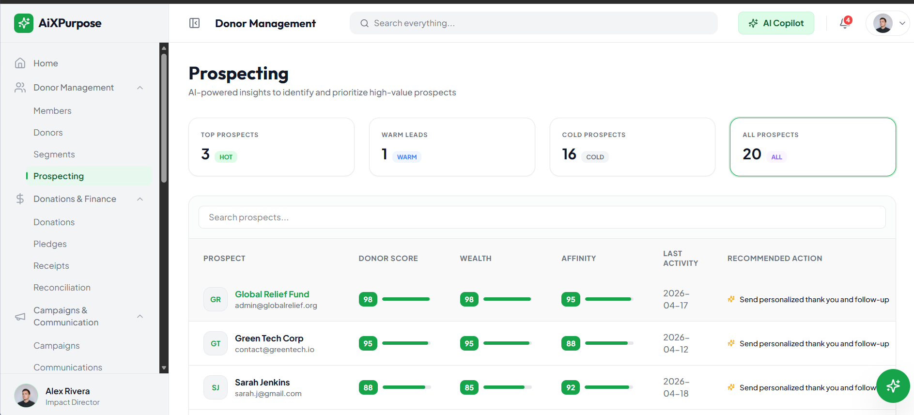
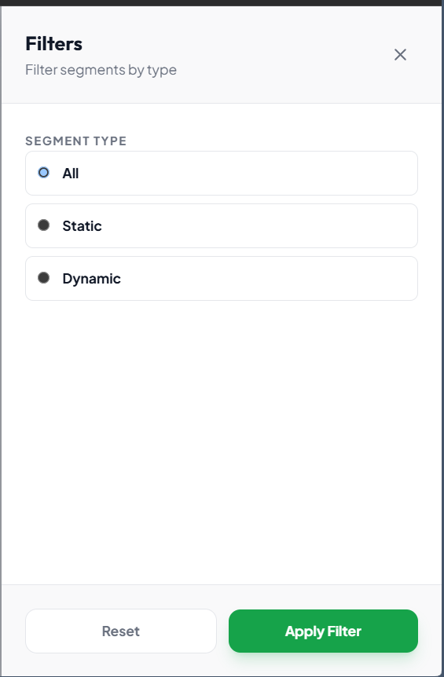
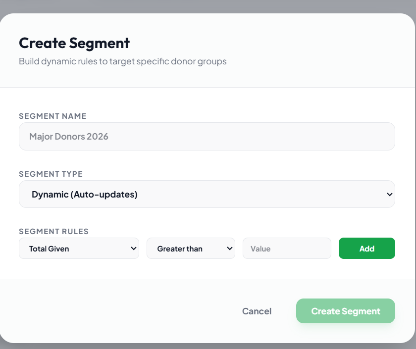
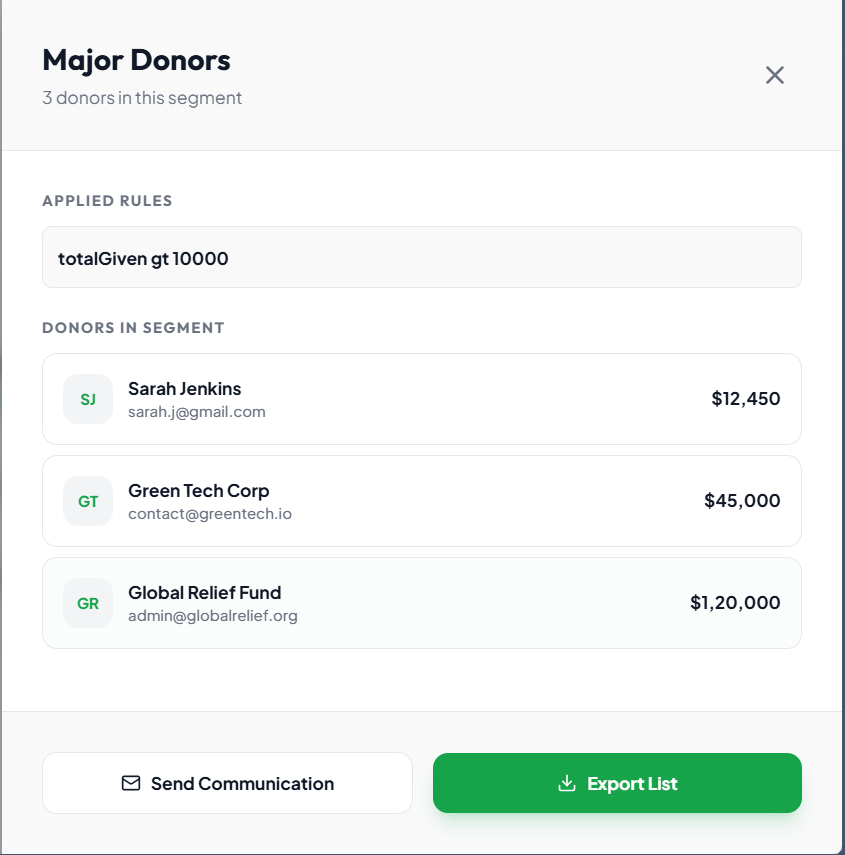
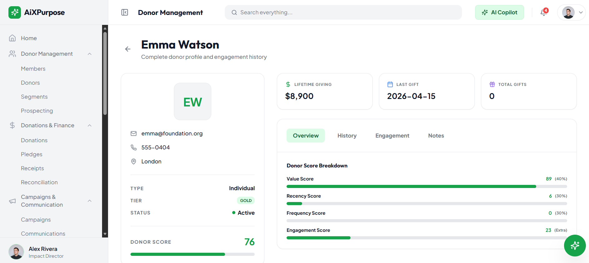
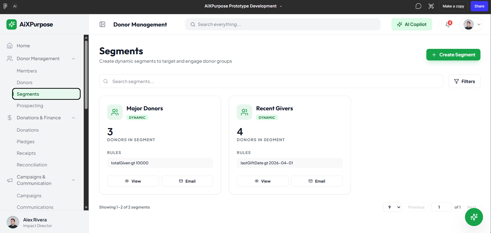
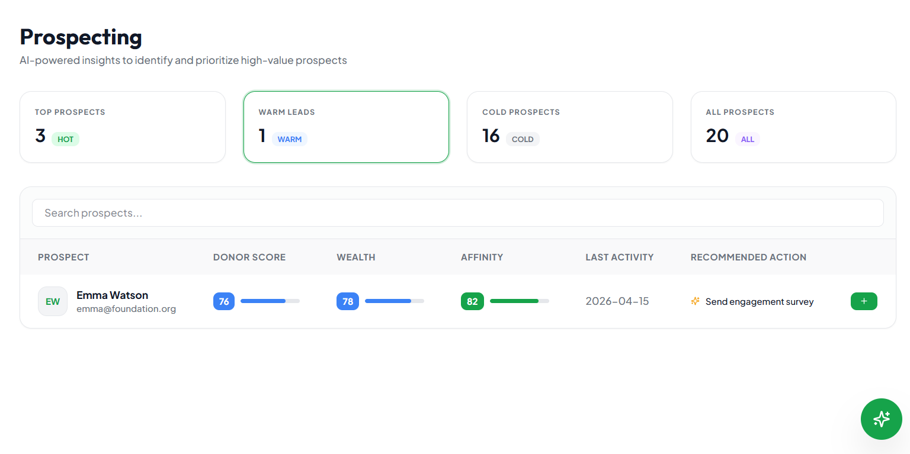

### DM-T14 — Template import native matching, update and unmatched record reporting (UPDATED)

**Classification:** To-Be. **Actor:** Admin only. **Related:** DM-T10, DM-T11, DM-T12, DM-T13 and shared cross-module import standard.

**User story:** As an AiXPurpose Admin, I want my completed Member, Donor or Segment import template to check against existing AiXPurpose data and update verified matching native records, or clearly report missing/unmatched records, so that the application stays current without affecting synchronized third-party records.

**Functional requirements**

1. Download a module-specific template and upload file through the existing relevant page's Import control.
2. Validate structure, required values, tenant, mapped identifiers and relationships, then classify every row as matched-native update, eligible new-native create, unresolved/missing relationship, ambiguous match, external-only collision, invalid or duplicate.
3. Display a preview: matched record identifier, proposed changed fields (before → after), new record preview, and clear row-level reasons for every uncommittable record.
4. On Admin confirmation, update only the confirmed existing **native** records and create only eligible native records; preserve origin and audit identity. Reject or flag attempted external record updates.
5. After successful commit, refresh relevant Members/Donors/Segments lists, unified profiles, source-filtered views and supported KPIs without fabricating transaction/giving values.
6. Return counts and detailed results for created, updated, unchanged, skipped, rejected, unresolved and failed records; allow correction and re-upload.

**Business logic and boundaries**

- Confirmed native identity match is mandatory for UPDATE; matching by name alone is insufficient. No cross-tenant matches or implicit overwrite of synchronized CORE/DonorPerfect/iWave or other external records.
- Donor imports must link to a valid Member; imported giving/history data does not cause payment gateway collection.
- Segment membership import updates only native segment membership; an external Member may be referenced without changing their source record. Dynamic override/recalculation precedence remains open.
- Module matching keys, blank-field update policy, supported template file formats and ambiguous-reference resolution remain Development decisions. These are not permission-role decisions: all users are Admins.

**Acceptance criteria**

1. **Given** an eligible uploaded row matches an existing native Member/Donor/Segment mapping, **when** Admin confirms an update preview, **then** only that native target is updated and visible after refresh.
2. **Given** a valid row is not found but can legally create a native record, **when** Admin confirms, **then** it is created once and appears under AiXPurpose Source.
3. **Given** a row matches an external read-only record or cannot resolve its required Member, **when** the preview loads, **then** it is reported with a precise reason and the external row is unchanged.
4. **Given** duplicate/ambiguous file rows, **when** validated, **then** the system prevents unsafe updates and shows actionable errors.
5. **Given** the file is uploaded again, **when** matching/committing, **then** no duplicate native record, donor link or segment membership is created.
6. **Given** a successful import, **when** the page is refreshed, **then** saved native changes are visible in details and applicable KPIs, under AiXPurpose and All Sources.

**Mermaid workflow**

```mermaid
flowchart TD
 A[Download native import template] --> B[Upload Member, Donor or Segment file]
 B --> C[Validate and match existing AiXPurpose records]
 C --> D{Classify row}
 D -->|Native match| E[Preview native update]
 D -->|Eligible new| F[Preview native create]
 D -->|External source collision| G[Block update; show reason]
 D -->|Invalid or ambiguous| H[Show unmatched or error details]
 E --> I[Admin confirms]
 F --> I
 I --> J[Commit safe native upsert]
 J --> K[Show results; refresh source-filtered UI]
 G --> K
 H --> K
```
