# AiXPurpose Standalone — Donor Management — BRD Workflow

> **Document control:** Version 1.6 — UPDATED | Status: Scope approved; technical verification open | Product: existing AiXPurpose enhanced for additional clients | Module: Donor Management | User: Admin only | Format: Markdown / GitHub

**Companion documents:** [BRD Goals](Donor_Management_BRD_Goals.md) · [BRD Workflow](Donor_Management_BRD_Workflow.md) · [BRD Feature Catalogue](Donor_Management_BRD_Feature_Catalogue.md)

**Source of truth:** `donor managemt.docx` screenshots; previously approved Members and Donors BRDs; `AiXPurpose_Configurable_KPI.docx`; `AiXPurpose_Members_Donors_Field_Mapping(1).docx`; `AiXPurpose_changes.docx`; decisions agreed in the product discussions. **This is not a rebuild of AiXPurpose.**

## Process scope

These are **business-level** process flows, not claims about presently implemented API details. As-Is UI and approved Jira work are separated from new To-Be processes; future scoring remains conceptual.

## Approved cross-module rules

- **Admin only:** currently all Admin users can access all product features. Do not introduce distinct roles or additional access-approval steps.
- **Native versus integrated:** native AiXPurpose records may be edited by Admins, while external records (CORE, DonorPerfect, iWave, other connected applications) are strictly read-only via both UI and backend.
- **Source filters:** page-local dropdown (All Sources / AiXPurpose / External Sources (All) / individual eligible apps). This must not silently affect unrelated pages or metrics.
- **Member/donor relationship:** donor maps to member; no separate iWave-only profile. A member may never have donated.
- **Segment definitions:** editable native segment configuration can reference read-only integrated members without modifying source records.
- **Tenant isolation:** records, segment definitions, exports, suggestions, and communications must be scoped to the active client.
- **Existing Jira changes:** KPI catalogs, advanced columns, unified profile and Global Search are included in As-Is baseline _by project convention_, but their delivery and QA status must be verified; avoid creating duplicate Jira stories.
- **Prospecting:** existing source-supplied scores/display retained; native donor scoring model is **Future Scope** and not assumed to exist.

## End-to-end workflow map

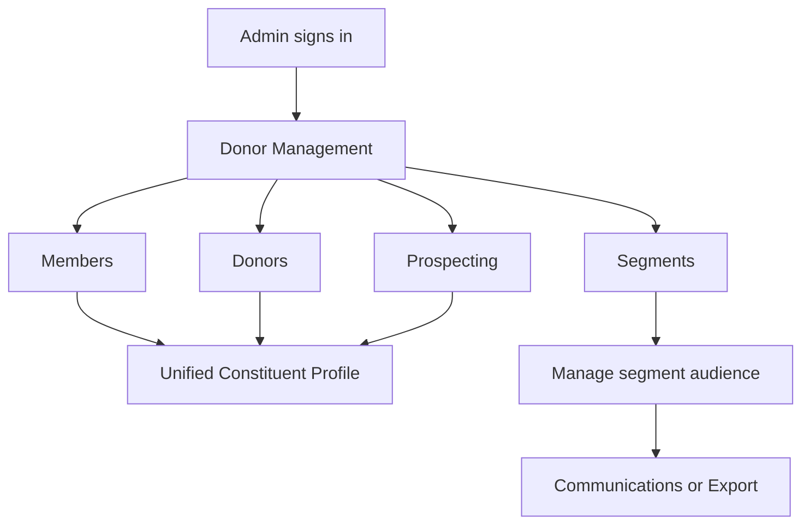

## Individual workflows and references

### DM-A01 — Module navigation and Admin access

**Classification:** As-Is. **Entry:** Admin opens Members, Donors, Segments and Prospecting from current navigation.

**Expected workflow:** Show existing module pages and accessible records to the Admin.

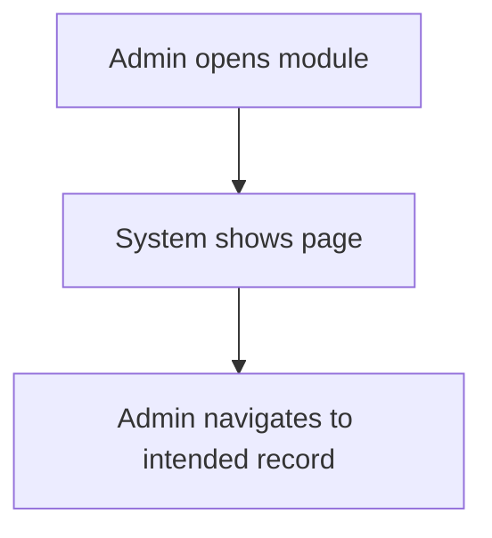

**Business safeguard:** No separate user roles or special permissions introduced.

**Acceptance checkpoint:** Admin can navigate to each existing page.

### DM-A02 — Members listing, search and pagination

**Classification:** As-Is. **Entry:** Admin reviews member list and uses existing page search, sorting and navigation.

**Expected workflow:** Show tenant scoped mapped membership records and opening actions.

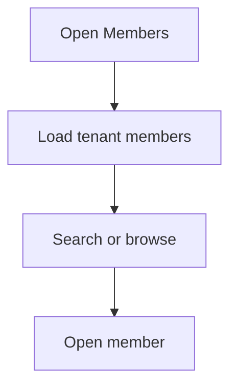

**Business safeguard:** CORE membership fields only for Members table; source origin is preserved.

**Acceptance checkpoint:** Member rows and existing search/navigation work on permitted tenant data.

### DM-A03 — Donors listing, search and pagination

**Classification:** As-Is. **Entry:** Admin reviews donors and opens existing mapped donor details.

**Expected workflow:** Present linked donor records and existing list controls.

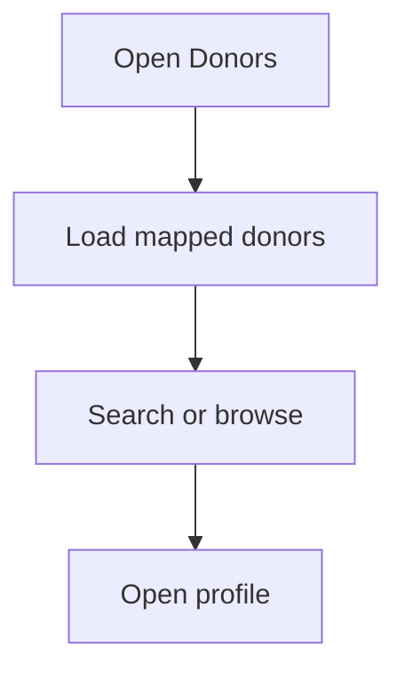

**Business safeguard:** Every donor corresponds to a member; do not create unrelated iWave-only person.

**Acceptance checkpoint:** Donor list opens the matching unified constituent profile.

### DM-A04 — Members KPI configuration – approved Jira baseline

**Classification:** Existing Jira baseline (As-Is convention). **Entry:** Admin selects four CORE-based Member KPIs from the agreed nine-item catalog.

**Expected workflow:** Provide exactly four distinct re-orderable cards, Save and Reset, separate from Donors.

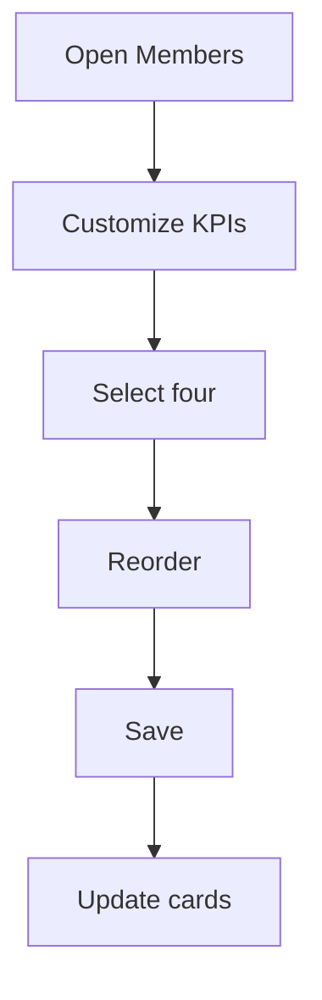

**Business safeguard:** Catalog and field calculations must match the approved KPI reference; QA rollout is not presumed.

**Acceptance checkpoint:** Only 9 CORE options; exactly four; persistence and reset follow Jira requirements.

### DM-A05 — Donors KPI configuration – approved Jira baseline

**Classification:** Existing Jira baseline (As-Is convention). **Entry:** Admin selects four Donor KPIs from the agreed ten-item catalog.

**Expected workflow:** Offer 10 mapped DonorPerfect/iWave options and separate configuration.

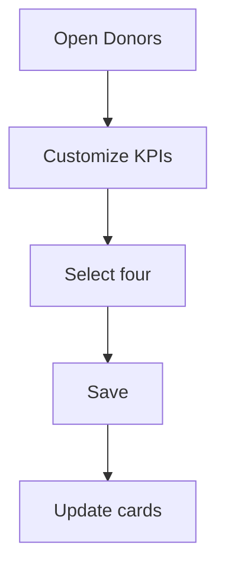

**Business safeguard:** Donor identifiers map to CORE members; scores are source intelligence, not cash gifts.

**Acceptance checkpoint:** Exactly four saved and displayed; no unverified source calculation shown as certain.

### DM-A06 — Members advanced column selection – approved Jira baseline

**Classification:** Existing Jira baseline (As-Is convention). **Entry:** Admin chooses visible Member table columns.

**Expected workflow:** Select, reorder and apply only CORE available fields.

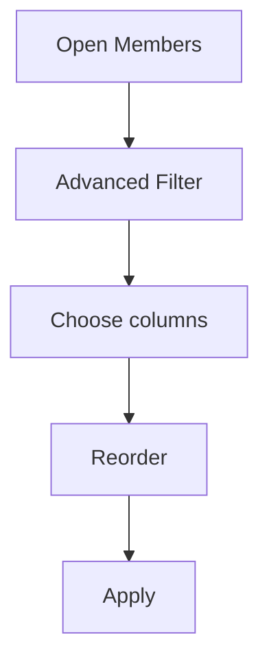

**Business safeguard:** The labeled Advanced Filter here is column selection, NOT row filtering.

**Acceptance checkpoint:** Only the approved 13 CORE columns offered; saving does not change underlying records.

### DM-A07 — Donors advanced column selection – approved Jira baseline

**Classification:** Existing Jira baseline (As-Is convention). **Entry:** Admin configures Donors table fields.

**Expected workflow:** Use approved CORE + DonorPerfect + iWave field catalogs.

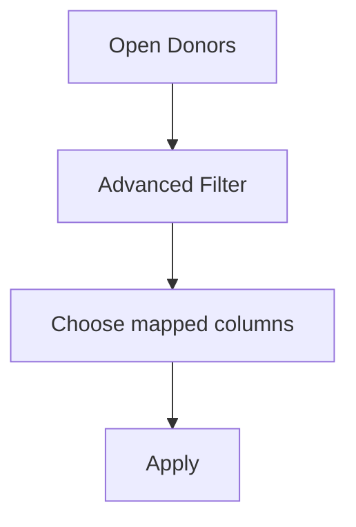

**Business safeguard:** Missing iWave enrichment cannot hide donor rows; field values are source-aware.

**Acceptance checkpoint:** Available columns match supplied field mapping and do not alter source data.

### DM-A08 — Unified Constituent Profile – approved Jira baseline

**Classification:** Existing Jira baseline (As-Is convention). **Entry:** Admin opens the same profile page from Members, Donors or Prospecting.

**Expected workflow:** Show common member fields, plus mapped giving/iWave fields when available.

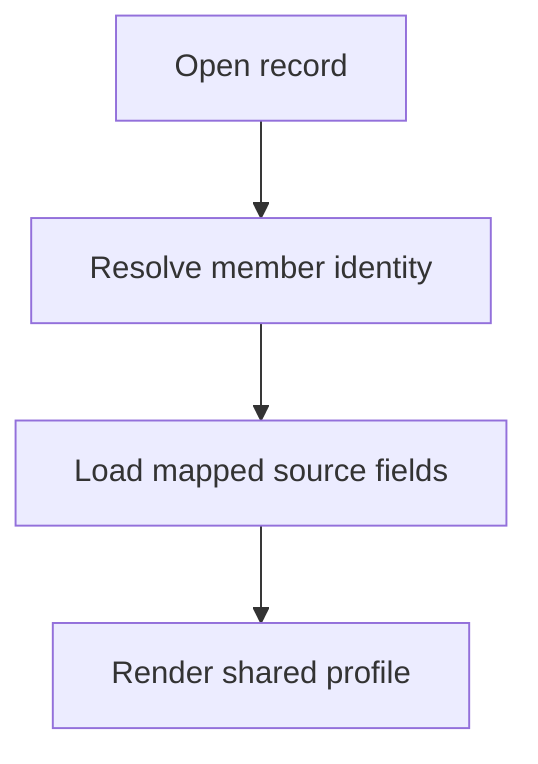

**Business safeguard:** Do not invent missing values, infer verified contacts, or equate capacity to donations.

**Acceptance checkpoint:** Same underlying person opens the same profile; missing sections handled safely.

### DM-A09 — Global Search navigation – approved Jira baseline

**Classification:** Existing Jira baseline (As-Is convention). **Entry:** Admin searches names and titles globally and opens appropriate records.

**Expected workflow:** Support full/partial match across supported modules with suggestions and unique record navigation.

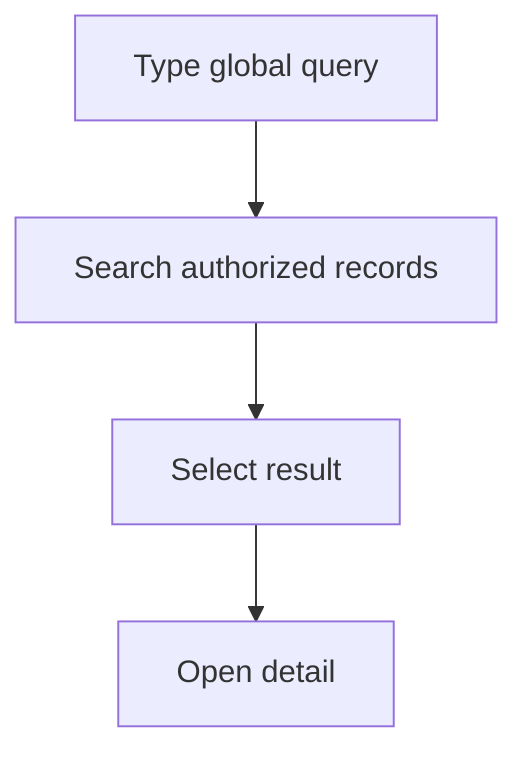

**Business safeguard:** Member and donor representations open one profile; tenant scope mandatory.

**Acceptance checkpoint:** Matching suggestions and correct routes work; no cross-tenant information leakage.

### DM-A10 — Segment listing and type filters

**Classification:** As-Is – working. **Entry:** Admin views segments and filters All, Static or Dynamic.

**Expected workflow:** Keep existing segment cards, donor counts, labels and filtering.

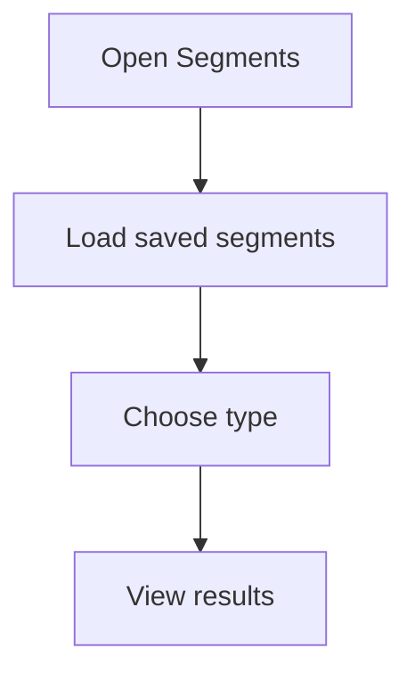

**Business safeguard:** Counts represent currently displayed segment membership under existing implementation.

**Acceptance checkpoint:** Existing segment listing and filters remain available.

### DM-A11 — Create and manage basic segments

**Classification:** As-Is – working. **Entry:** Admin creates, views and deletes saved segments using current rule UI.

**Expected workflow:** Retain current create/view/delete flows and basic fields/operator/value conditions.

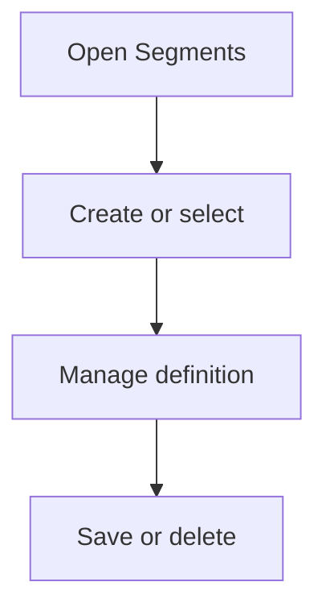

**Business safeguard:** Underlying integrated member records remain unchanged when administering segment definitions.

**Acceptance checkpoint:** Admin can use current actions without regression.

### DM-A12 — Segment email, send communication and export

**Classification:** As-Is – working. **Entry:** Admin sends email/communication to segment audience and exports list.

**Expected workflow:** Reuse existing Communications workflow and Export List.

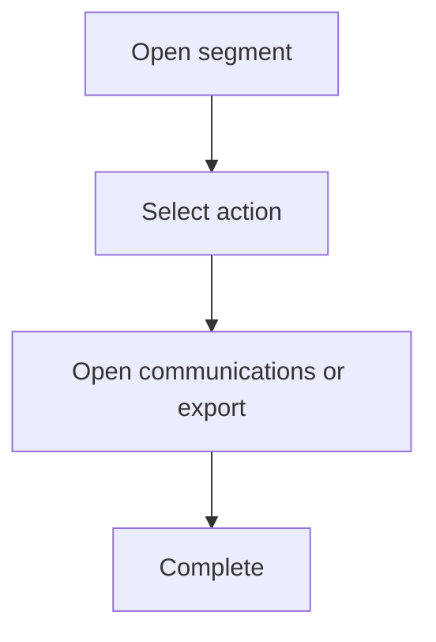

**Business safeguard:** Maintain tenant data scope and segment audience mapping.

**Acceptance checkpoint:** Existing actions execute using current communication functionality.

### DM-A13 — Dynamic/static segment behaviour

**Classification:** As-Is – verification pending. **Entry:** Admin views segments marked Static or Dynamic.

**Expected workflow:** Retain existing control and labels while behavior is verified.

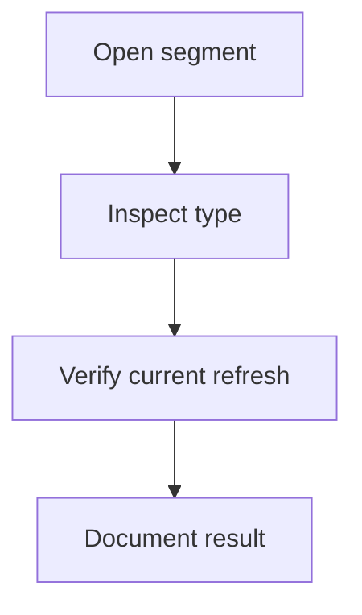

**Business safeguard:** Dynamic recalculation, static membership semantics and override precedence are OPEN.

**Acceptance checkpoint:** QA/Development provide measured behavior before any new rule is claimed.

### DM-A14 — Prospecting list and categories

**Classification:** As-Is – source/logic verification pending. **Entry:** Admin sees Top, Warm, Cold and All prospects with scoring columns and recommended actions.

**Expected workflow:** Retain current prospect listing and filters.

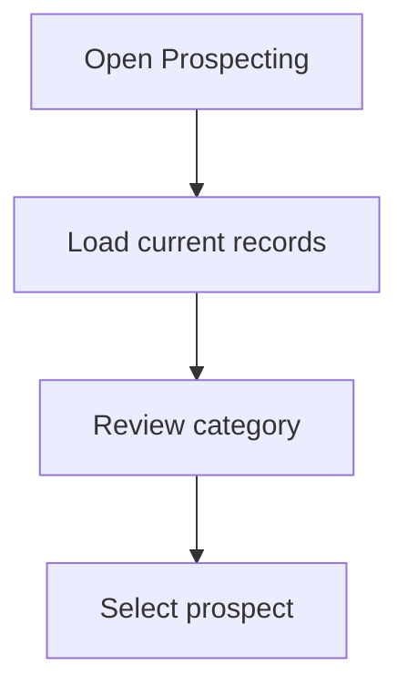

**Business safeguard:** Use source-supported data; category thresholds and list eligibility remain unverified.

**Acceptance checkpoint:** Prospecting renders existing records; no fabricated score for native member/donor.

### DM-A15 — Prospect to unified profile navigation

**Classification:** As-Is. **Entry:** Admin opens a prospect from the list.

**Expected workflow:** Navigate to same constituent profile used by Members and Donors.

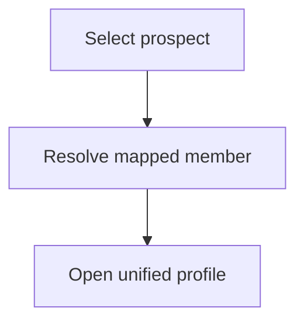

**Business safeguard:** iWave research details do not establish a separate iWave-only profile or new person.

**Acceptance checkpoint:** Selected row opens matching profile and available source-backed intelligence.

### DM-T01 — Enable native Member creation

**Classification:** To-Be. **Entry:** Admin adds a Member directly to AiXPurpose using the existing disabled UI control.

**Expected workflow:** Enable required form, field validation and tenant-native persistence.

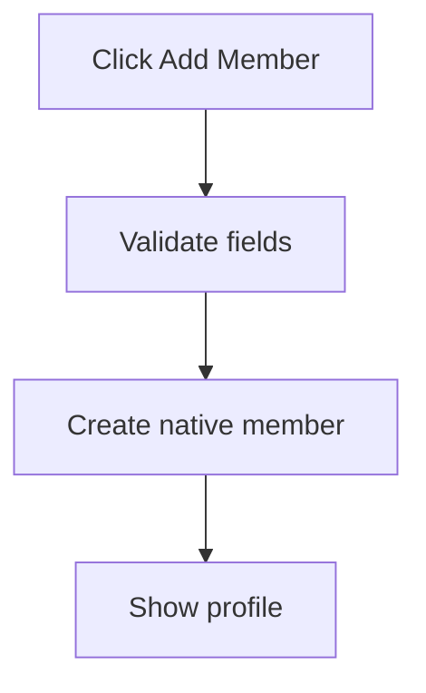

**Business safeguard:** Create native-source record, preserve CORE-integrated data read-only; reject invalid/duplicate identifiers under approved rules.

**Acceptance checkpoint:** New native member is persisted and visible in AiXPurpose source-filtered lists.

### DM-T02 — Enable native Member editing

**Classification:** To-Be. **Entry:** Admin edits a Member created in AiXPurpose.

**Expected workflow:** Enable Edit for native records, with validation and save feedback.

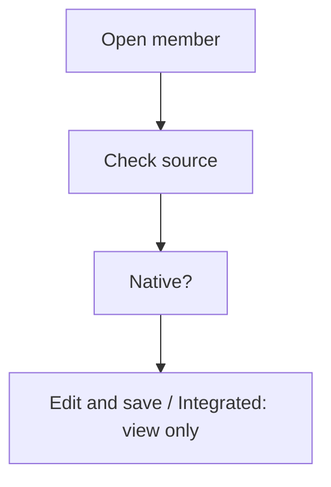

**Business safeguard:** Backend rejects update of integrated source records regardless of UI path.

**Acceptance checkpoint:** Native update persists; integrated edit attempt is denied.

### DM-T03 — Enable native Donor creation linked to Member

**Classification:** To-Be. **Entry:** Admin enables donor status/record for an existing Member inside AiXPurpose.

**Expected workflow:** Enable native donor create flow selecting a valid member.

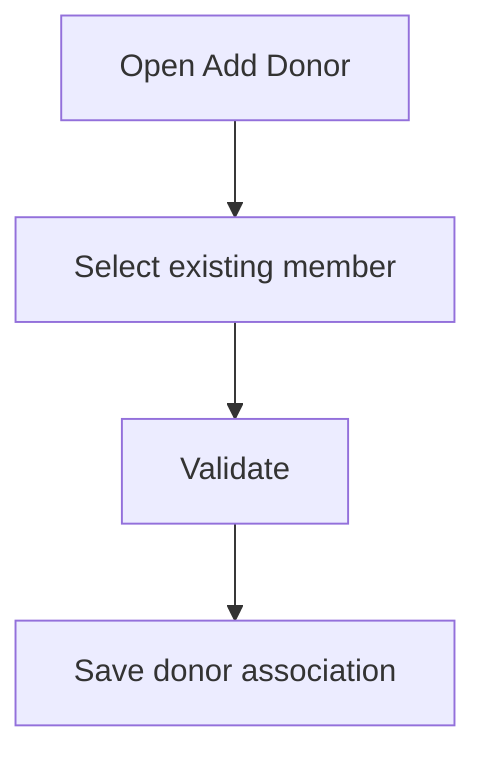

**Business safeguard:** Every donor must link to a member; financial qualification/duplicate rules need Development confirmation; no donor-only person.

**Acceptance checkpoint:** Cannot create orphan donor; resulting donor opens same constituent profile.

### DM-T04 — Enable native Donor editing

**Classification:** To-Be. **Entry:** Admin edits eligible native donor data inside AiXPurpose.

**Expected workflow:** Enable existing Edit control for native donor records.

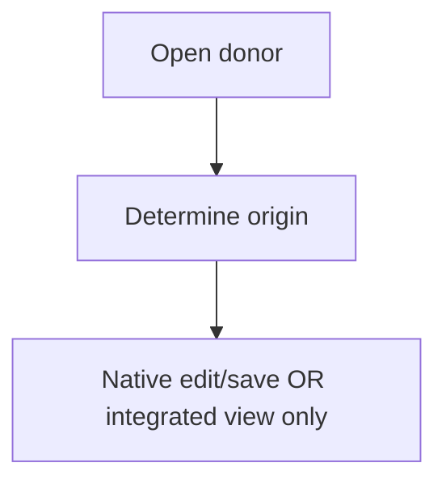

**Business safeguard:** Integrated DonorPerfect/CORE/iWave fields remain read-only; avoid changing real donations through profile edits.

**Acceptance checkpoint:** Native donor changes saved and integrated data protected in UI and backend.

### DM-T05 — Shared Source dropdown for eligible lists

**Classification:** To-Be. **Entry:** Admin filters Member/Donor lists by source to locate editable records.

**Expected workflow:** Use existing Filters region with All Sources, AiXPurpose, External Sources (All), individual configured sources.

```mermaid
flowchart TD
    A["Open listing"]
    A --> N1["Select Source"]
    N1 --> N2["Apply tenant scope"]
    N2 --> N3["Display rows"]
    N3 --> N4["Reset to All Sources"]
```

**Business safeguard:** Dropdown only filters page records, not globally across application; source names shown; options reflect eligible module sources.

**Acceptance checkpoint:** Selecting AiXPurpose isolates native records; external options show only matching read-only records.

### DM-T06 — Backend source ownership enforcement

**Classification:** To-Be. **Entry:** Admin identifies editable native records and view-only external records.

**Expected workflow:** Source provenance stored and exposed; disable integrated Edit and reject backend mutations.

```mermaid
flowchart TD
    A["Open record"]
    A --> N1["Verify origin"]
    N1 --> N2["Native update allowed / External update rejected"]
```

**Business safeguard:** Native segment membership may reference integrated people, without editing those people.

**Acceptance checkpoint:** Direct API attempts to update integrated entity are rejected; native edits succeed.

### DM-T07 — Multi-tenant isolation across donor management

**Classification:** To-Be shared invariant. **Entry:** Admin only sees their client organisation data.

**Expected workflow:** Apply tenant scoping to search, lists, profiles, segments and prospects.

```mermaid
flowchart TD
    A["Request"]
    A --> N1["Resolve tenant"]
    N1 --> N2["Scope query"]
    N2 --> N3["Authorize membership"]
    N3 --> N4["Return eligible data"]
```

**Business safeguard:** All record creation and references must belong to same tenant.

**Acceptance checkpoint:** Cannot view, search, segment, update or export another tenant’s records.

### DM-T08 — Multiple segment conditions and AND/OR

**Classification:** To-Be. **Entry:** Admin creates a segment matching multiple criteria, e.g. Bengaluru and Local.

**Expected workflow:** Allow multiple supported field/operator/value conditions and chosen AND/OR logic.

```mermaid
flowchart TD
    A["Create segment"]
    A --> N1["Add conditions"]
    N1 --> N2["Select AND or OR"]
    N2 --> N3["Preview eligible members"]
    N3 --> N4["Save"]
```

**Business safeguard:** Only mapped, supported data fields; determine supported grouping/field matrix during implementation, no assumed unsupported operator.

**Acceptance checkpoint:** Matching uses the selected logic; save/reopen preserves all conditions.

### DM-T09 — Manual include/remove members in segments

**Classification:** To-Be. **Entry:** Admin directly includes or excludes a specific member from a segment.

**Expected workflow:** Offer member lookup and explicit Add/Remove in segment membership UI.

```mermaid
flowchart TD
    A["Open segment"]
    A --> N1["Search member"]
    N1 --> N2["Add or Remove"]
    N2 --> N3["Save membership adjustment"]
```

**Business safeguard:** Changes affect segment membership, not original integrated member data; precedence on dynamic refresh is OPEN.

**Acceptance checkpoint:** Admin can add/remove eligible tenant member; actual recalculation behavior remains unasserted until verified.

### DM-F06 — Prospect / Donor Strength scoring framework

**Classification:** Future Scope – separate dedicated specification. **Entry:** Admin needs understandable score for native and source-enriched donor records.

**Expected workflow:** Define source provenance, native scoring inputs, eligibility, confidence/unknown handling, thresholds and display in separate iWave/donor-strength discussion.

```mermaid
flowchart TD
    A["Identify source"]
    A --> N1["Existing source score?"]
    N1 --> N2["Display mapped value / Native score model pending"]
```

**Business safeguard:** Never invent iWave scores or treat native score as equivalent without agreed model; no score-history requirement.

**Acceptance checkpoint:** No current-release scoring implementation; future business approval required.

## To-Be import workflows — consolidated original Member/Donor requirements

Native file upload is distinct from external integration sync. The imported records or segment memberships belong to AiXPurpose; integrated source records remain read-only. See matching detailed feature stories in the Feature Catalogue.

### DM-T10 — Native Member template import

**Classification:** To-Be. **Actor:** Admin only. **Origin:** Native template upload (not third-party API sync).

**Flow and validation:** Admin downloads approved versioned Member Excel/CSV template, populates the required CORE-aligned fields and uploads a file. System validates file structure, member identity, required fields, formats and duplicates, previews results, and commits only eligible records under the current tenant. Imported records are native AiXPurpose records and editable by Admin.

```mermaid
flowchart TD
    A["Admin opens Member Import"] --> B["Download approved template"]
    B --> C["Populate and upload data"]
    C --> D["Validate template, identity and duplicates"]
    D --> E{"Eligible for commit?"}
    E -->|No| F["Show row errors or pending review"]
    F --> C
    E -->|Yes| G["Preview and confirm import"]
    G --> H["Commit native records or membership"]
    H --> I["Show result counts and refresh view"]
    I --> J["Admin may edit native data only"]
```

**Business safeguard:** Create or update eligible native members; do not overwrite an externally sourced CORE record. Record results as created, updated, rejected, skipped or pending review. Refresh Members list and applicable KPI views after commit.

**Source / dependencies:** Original Members BRD: MEM-F-025 to MEM-F-032.

### DM-T11 — Native Donor template import and member resolution

**Classification:** To-Be. **Actor:** Admin only. **Origin:** Native template upload (not third-party API sync).

**Flow and validation:** Admin downloads approved versioned Donor Excel/CSV template, uploads donor and giving data, and previews row validation. Each imported donor must resolve to an existing Member using approved identity mappings; ambiguous or unmatched identities remain pending review. Validate donation identifiers and duplicates before commit.

```mermaid
flowchart TD
    A["Admin opens Donor Import"] --> B["Download approved template"]
    B --> C["Populate and upload data"]
    C --> D["Validate template, identity and duplicates"]
    D --> E{"Eligible for commit?"}
    E -->|No| F["Show row errors or pending review"]
    F --> C
    E -->|Yes| G["Preview and confirm import"]
    G --> H["Commit native records or membership"]
    H --> I["Show result counts and refresh view"]
    I --> J["Admin may edit native data only"]
```

**Business safeguard:** Committed donor records, where valid, are native AiXPurpose records and editable by Admin; original externally integrated data remains read-only. Importing a historical giving row must not initiate or falsely confirm a new payment-gateway charge. Show created, updated, rejected, skipped and pending counts. Refresh Donors and unified profile/KPIs based on approved metrics.

**Source / dependencies:** Original Donors BRD: DON-F-032 to DON-F-034, DON-F-043 to DON-F-050.

### DM-T12 — Segment membership template import

**Classification:** To-Be. **Actor:** Admin only. **Origin:** Native template upload (not third-party API sync).

**Flow and validation:** Admin can download a supported segment-membership template, identify a target native segment, and upload members to include or exclude using approved constituent identifiers. Preview matched, unmatched, duplicate and ambiguous rows before commit. The segment definition and membership are native AiXPurpose configuration.

```mermaid
flowchart TD
    A["Admin opens Segment Import"] --> B["Download approved template"]
    B --> C["Populate and upload data"]
    C --> D["Validate template, identity and duplicates"]
    D --> E{"Eligible for commit?"}
    E -->|No| F["Show row errors or pending review"]
    F --> C
    E -->|Yes| G["Preview and confirm import"]
    G --> H["Commit native records or membership"]
    H --> I["Show result counts and refresh view"]
    I --> J["Admin may edit native data only"]
```

**Business safeguard:** Importing an existing integrated member into a native segment changes only segment membership, not the integrated constituent record. Do not create new member records implicitly from a segment-membership file. Allow Admin to correct and resubmit invalid rows; preserve the existing Segment communication/export workflow. For dynamic segments, import membership versus recalculation precedence remains OPEN for Development verification.

**Source / dependencies:** Additional module-level extension based on user clarification; exact template layout and manual membership override precedence open.

### DM-T13 — Import status, refresh and ownership controls

**Classification:** To-Be. **Actor:** Admin only. **Origin:** Native template upload (not third-party API sync).

**Flow and validation:** For each file import, show an import result summary and actionable row-level errors; committed records or segment memberships become visible after refresh and subsequent navigation. Respect the selected Source filter: newly imported member/donor records appear under AiXPurpose and All Sources, never under a named external integration.

```mermaid
flowchart TD
    A["Admin opens Member, Donor and Segment Import"] --> B["Download approved template"]
    B --> C["Populate and upload data"]
    C --> D["Validate template, identity and duplicates"]
    D --> E{"Eligible for commit?"}
    E -->|No| F["Show row errors or pending review"]
    F --> C
    E -->|Yes| G["Preview and confirm import"]
    G --> H["Commit native records or membership"]
    H --> I["Show result counts and refresh view"]
    I --> J["Admin may edit native data only"]
```

**Business safeguard:** Prevent duplicate create/update side effects on repeated upload; preserve tenant isolation, import traceability and accurate success/rejected counts. When imported records are corrected later, Admin edits native records only. File import must not update DonorPerfect, CORE, iWave or other connected systems.

**Source / dependencies:** Original Members/Donors import outcome requirements and user ownership clarification.

## Open workflow decisions

- Confirm Member/Donor import template versions, field validation, update/duplicate-resolution and partial-commit policies per existing page BRDs.
- Confirm Segment membership import schema, identifier matching, absence/ambiguity handling and exact semantics for adding versus excluding a member.
- Dynamic segment manual overrides after recalculation remain an OPEN Development decision; do not specify persistence or rule-only removal.
- Following import, refresh native lists and only eligible KPIs based on the approved definitions; never fabricate a donation payment or write back to external integrations.

| ID       | Open decision / verification                                                       | Treatment                                                     |
| -------- | ---------------------------------------------------------------------------------- | ------------------------------------------------------------- |
| DM-OD-01 | Dynamic segment refresh and update schedule                                        | Verify with Development; retain observed behavior             |
| DM-OD-02 | Static segment actual membership semantics                                         | QA verification, no presumed algorithm                        |
| DM-OD-03 | Manual additions/exclusions versus dynamic recomputation precedence                | Explicitly OPEN; not assumed persistent or overwritten        |
| DM-OD-04 | Prospect list eligibility, source linkage and category thresholds                  | Development verification; no scoring changes now              |
| DM-OD-05 | iWave propensity/affinity/capacity source fields, quality and freshness            | Source-backed only; new scoring deferred                      |
| DM-OD-06 | Existing Jira deployment and QA status for KPI, columns, profile and Global Search | Track against current tickets                                 |
| DM-OD-07 | Native Donor creation qualification and de-duplication                             | Development confirmation; must link to Member                 |
| DM-OD-08 | Supported segment AND/OR fields, operator matrix and possible nested groups        | Confirm feasible initial builder; do not assume nested groups |

## Original screenshots


## UPDATED v1.6 — Match/update template import workflow

**Workflow DM-W-IMP-UPD-01 (To-Be):** Applies to Member, Donor and Segment import controls. Existing DM-T10–DM-T13 workflows remain, with **matched native UPDATE** added as an explicit outcome. Only Admins perform this workflow; no changes to external source records.

```mermaid
flowchart TD
 A[Admin selects Member, Donor or Segment Import] --> B[Download relevant template and upload populated file]
 B --> C[Validate fields, relationships and tenant]
 C --> D[Check for duplicates and match existing native AiXPurpose data]
 D --> E{Result of matching}
 E -->|Native record matched| F[Preview changed fields and confirm native update]
 E -->|Unmatched, eligible create| G[Preview new native record or segment mapping]
 E -->|External-only match| H[Report read-only source conflict; do not overwrite]
 E -->|Invalid, ambiguous or orphan link| I[Report row-level issue and correction guidance]
 F --> J[Commit approved native updates]
 G --> K[Commit approved native creates or memberships]
 J --> L[Import result counts and refresh]
 K --> L
 H --> L
 I --> L
 L --> M[Admin views editable native results in AiXPurpose Source filter]
```

**Exception handling:** No silent overwrite, no cross-tenant match, no duplicate upsert on retry, no automatic donor without valid member. Segment membership may link an external member without editing the external member. Dynamic segment override refresh behaviour remains undecided.
