# BRD Feature Catalogue — Homepage / Analytics Command Center

**Scope:** Existing page enhancement, not a new application. **User:** Admin only. **Baseline:** approved 28 October 2026. **Status:** Requirements for review, not evidence of QA completion.

## Document scope
Concise Jira-ready Admin user stories. **As-Is**, **existing Jira baseline**, **To-Be**, and **Future** are explicitly separated. Implementation and QA outcomes are not inferred from screenshots.

| Feature ID | Category | Feature |
|---|---|---|
| HP-FC-01 | As-Is | Existing Homepage layout and sections |
| HP-FC-02 | As-Is | Date/Campaign/Location filters |
| HP-FC-03 | As-Is | Solicitation Analysis |
| HP-FC-04 | As-Is | General Ledger and Donation Trend |
| HP-FC-05 | As-Is | Donor Segments and Conversion Funnel |
| HP-FC-06 | As-Is | Top Donors existing table |
| HP-FC-07 | As-Is UI only | Homepage AI Insights UI |
| HP-FC-08 | Existing Jira baseline | Configurable four homepage KPIs |
| HP-FC-09 | Existing Jira baseline | Global Search and export removal |
| HP-FC-10 | To-Be HP-TB-01 | Single-select Top Donors metric view |
| HP-FC-11 | To-Be HP-TB-02 | Top Donors-only Source filter |
| HP-FC-12 | Future HP-F01 | Operational AI Insights |

### HP-FC-01 — Existing Homepage layout and sections
**Classification:** As-Is  
**User story:** As an AiXPurpose Admin, I want to view one unified dashboard with the existing analyses.  
**Functional requirement / business logic:** Dashboard renders existing sections without a redesign; AI is clearly not claimed operational.  
**Acceptance criteria:** Navigate to Homepage and observe existing cards/charts; no additional dashboard page is introduced.

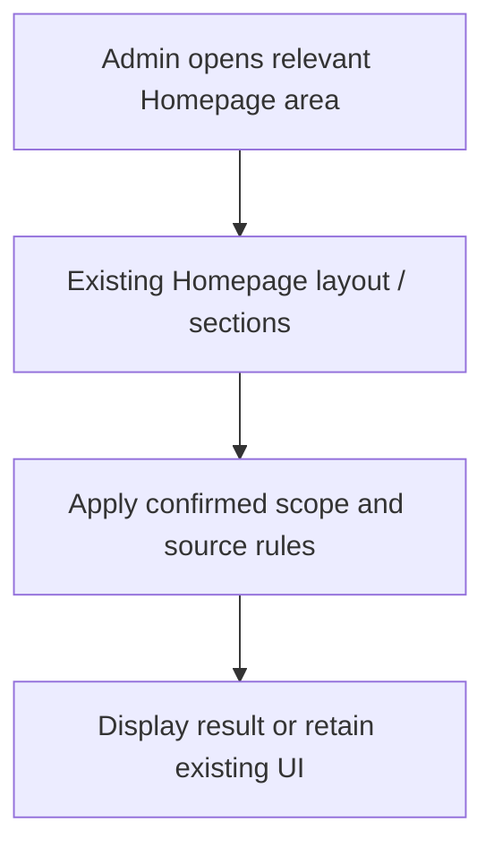

### HP-FC-02 — Date/Campaign/Location filters
**Classification:** As-Is  
**User story:** As an AiXPurpose Admin, I want to use existing filter selectors to explore applicable dashboard data.  
**Functional requirement / business logic:** Keep current controls; exact KPI applicability follows approved source definitions.  
**Acceptance criteria:** The three selectors remain available; changes update only the applicable existing views.

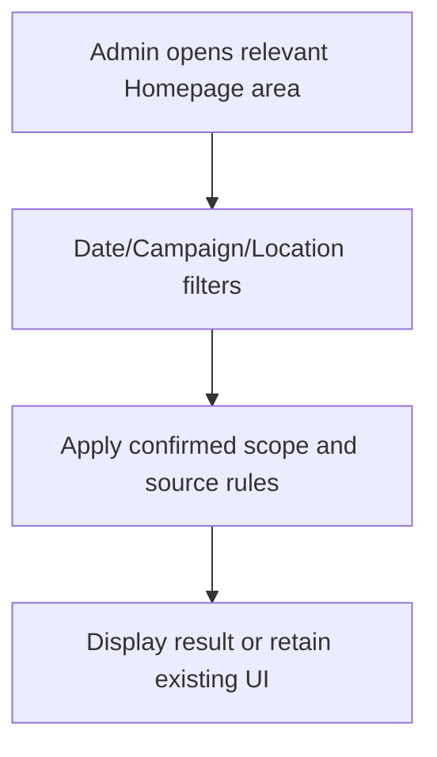

### HP-FC-03 — Solicitation Analysis
**Classification:** As-Is  
**User story:** As an AiXPurpose Admin, I want to review existing solicitation breakdowns.  
**Functional requirement / business logic:** Keep existing horizontal-bar section and View All action shown in UI; data accuracy subject to QA.  
**Acceptance criteria:** The solicitation chart remains visible and follows confirmed existing behaviour.

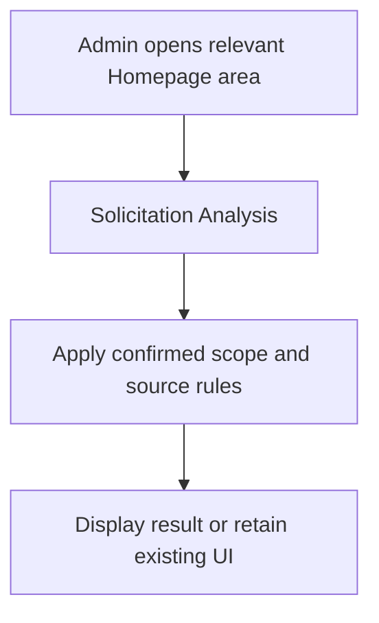

### HP-FC-04 — General Ledger and Donation Trend
**Classification:** As-Is  
**User story:** As an AiXPurpose Admin, I want to review donation accounting distribution and time trends.  
**Functional requirement / business logic:** Retain existing doughnut and donation trend charts; no new sources/formulas invented.  
**Acceptance criteria:** Existing charts remain accessible without adding a new report flow.

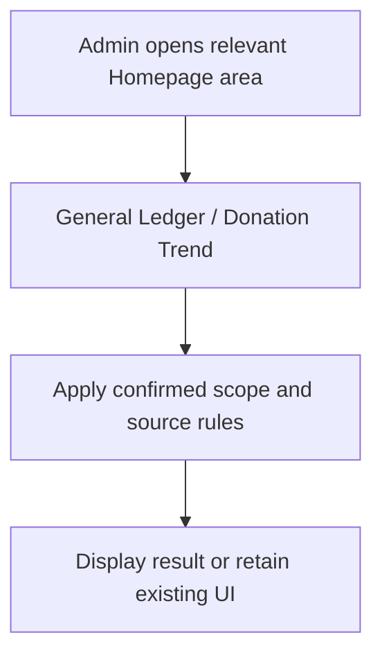

### HP-FC-05 — Donor Segments and Conversion Funnel
**Classification:** As-Is  
**User story:** As an AiXPurpose Admin, I want to view existing distribution and reached/engaged/donated funnel.  
**Functional requirement / business logic:** Preserve charts; conversion and segment figures require validation before being represented as verified.  
**Acceptance criteria:** Both sections render; unresolved metric calculations remain flagged.

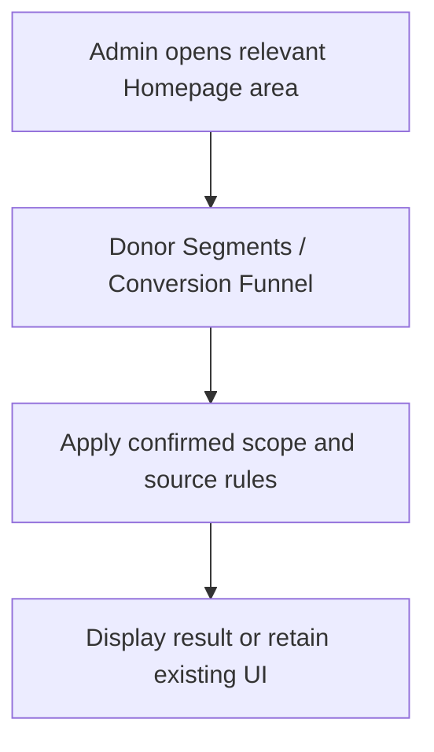

### HP-FC-06 — Top Donors existing table
**Classification:** As-Is  
**User story:** As an AiXPurpose Admin, I want to search, view and open a listed donor.  
**Functional requirement / business logic:** Retain table, donor search and existing row actions; profile navigation uses unified constituent mapping.  
**Acceptance criteria:** Opening a donor routes to its existing profile; table does not enable external record edits.

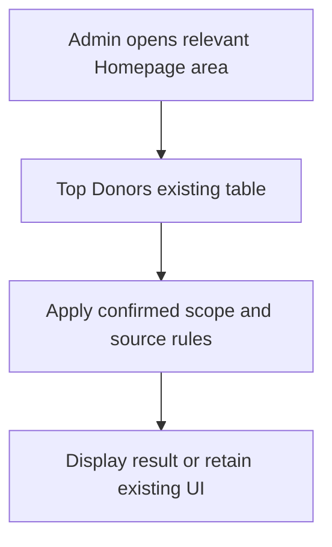

### HP-FC-07 — Homepage AI Insights UI
**Classification:** As-Is UI only  
**User story:** As an AiXPurpose Admin, I want to see the current AI cards without implying functional recommendations.  
**Functional requirement / business logic:** AI generation/actions do not currently work. Future approval required for functionality.  
**Acceptance criteria:** Documentation and QA explicitly mark current capability nonfunctional.

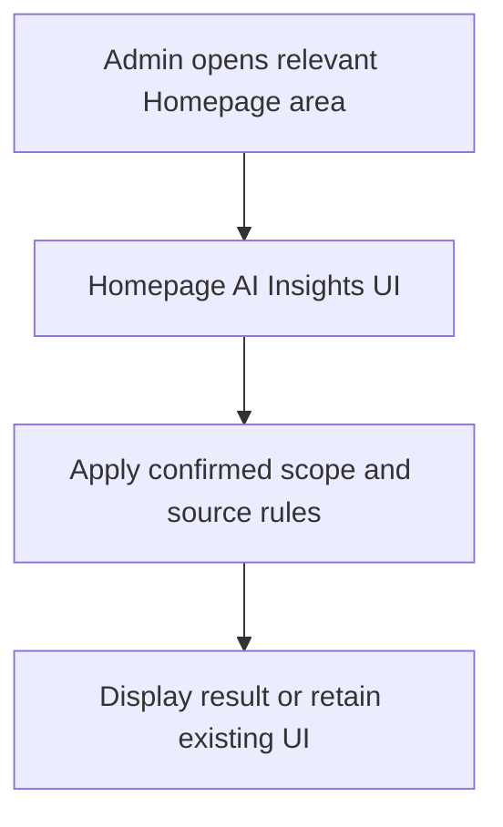

### HP-FC-08 — Configurable four homepage KPIs
**Classification:** Existing Jira baseline  
**User story:** As an AiXPurpose Admin, I want to choose exactly four cards from the approved twelve options and save or reset.  
**Functional requirement / business logic:** Separate Homepage configuration; exact catalog/definitions delegated to source KPI spec.  
**Acceptance criteria:** Exactly four cards render in chosen order; no new KPI options are invented.

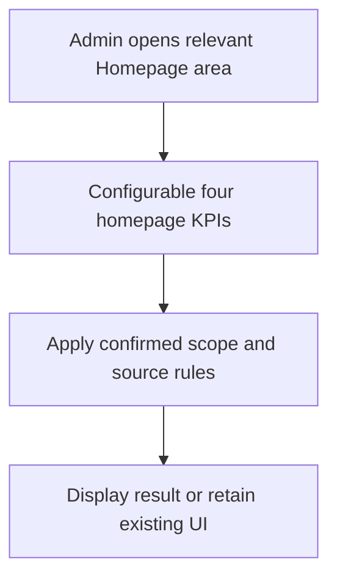

### HP-FC-09 — Global Search and export removal
**Classification:** Existing Jira baseline  
**User story:** As an AiXPurpose Admin, I want to access records using approved global search and view Homepage without export buttons.  
**Functional requirement / business logic:** Reuse the existing Jira requirements; exports elsewhere remain unchanged.  
**Acceptance criteria:** Homepage-only Export CSV/PDF are removed when deployed; Global Search navigates according to existing Jira criteria.

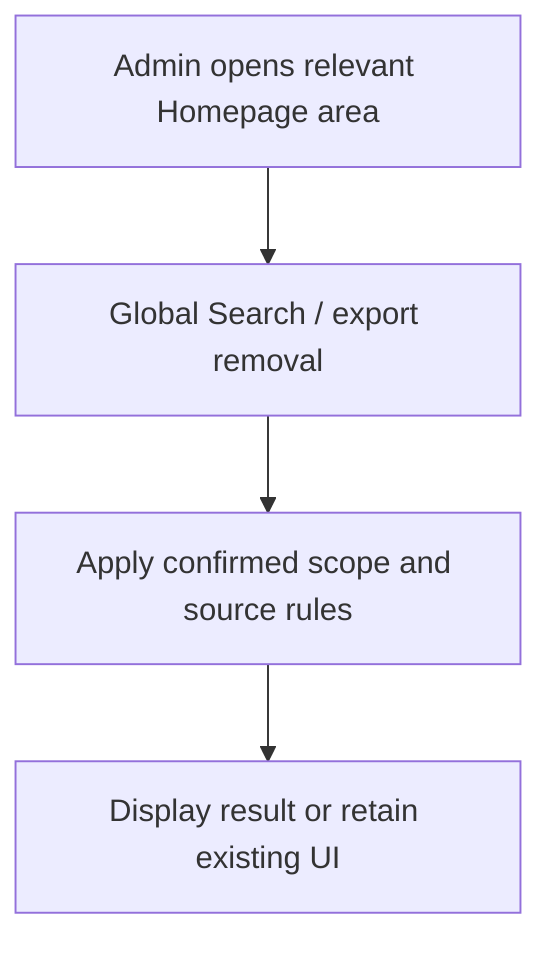

### HP-FC-10 — Single-select Top Donors metric view
**Classification:** To-Be HP-TB-01  
**User story:** As an AiXPurpose Admin, I want to choose one donor ranking metric and see a list ranked by that metric.  
**Functional requirement / business logic:** One active selection: Total Giving, Largest Gift, Last Gift date, iWave Score. Default Total Giving. Show only verified eligible values; nulls not fabricated.  
**Acceptance criteria:** Selecting each choice replaces list/rank order; cannot select more than one; iWave unavailable values are not invented.

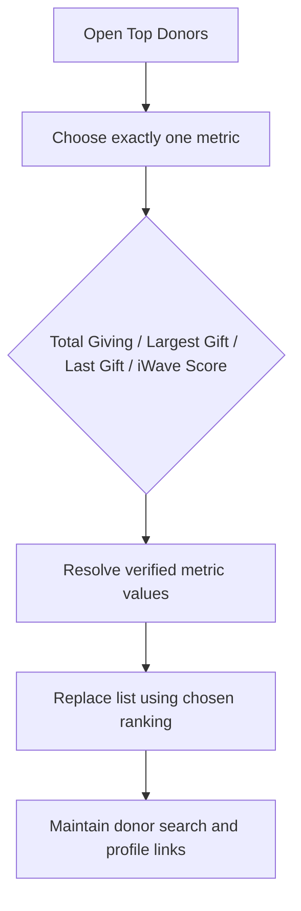

### HP-FC-11 — Top Donors-only Source filter
**Classification:** To-Be HP-TB-02  
**User story:** As an AiXPurpose Admin, I want to restrict the Top Donors view by selected record origin.  
**Functional requirement / business logic:** All Sources default; AiXPurpose; External Sources All; individual eligible integrations. Source changes Top Donors only; tenant isolation and provenance preserved.  
**Acceptance criteria:** Source changes update Top Donors list while KPI cards, other charts and Date/Campaign/Location selections remain unchanged.

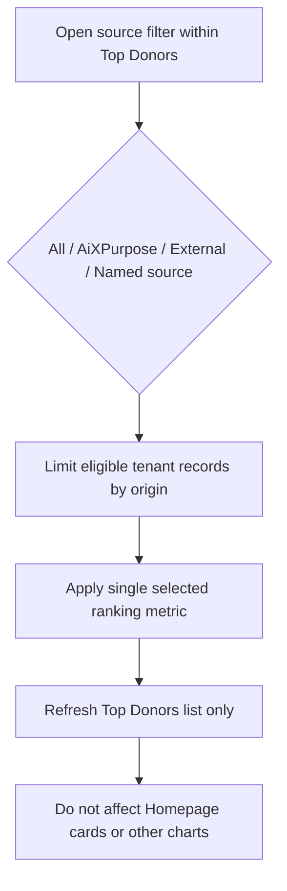

### HP-FC-12 — Operational AI Insights
**Classification:** Future HP-F01  
**User story:** As an AiXPurpose Admin, I want to receive future approved AI insights once functionality is defined and implemented.  
**Functional requirement / business logic:** Requires separate approval of generation, grounding and actions; not currently working or immediate To-Be.  
**Acceptance criteria:** No current release acceptance claim; future criteria defined only following approval.

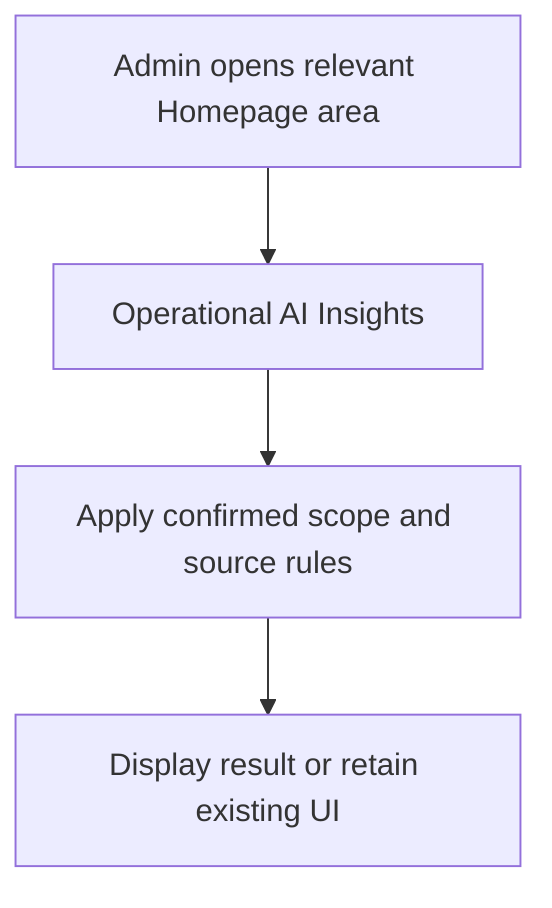

## Cross-document traceability and pending confirmations
- HP-FC-10 ↔ HP-TB-01 ↔ HP-WF-03; HP-FC-11 ↔ HP-TB-02 ↔ HP-WF-04; HP-FC-12 ↔ HP-F01 ↔ HP-WF-05.
- KPI catalogs and definitions: authoritative `AiXPurpose_Homepage_Configurable_KPI.docx`, already in Jira.
- Open QA: blank-data treatment, growth/funnel formulas, score availability/field mapping, eligible source lists, Jira deployment state. These are **not** unapproved To-Be features.

## Source screenshots

- 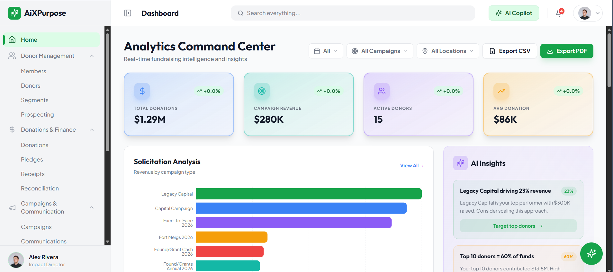
- 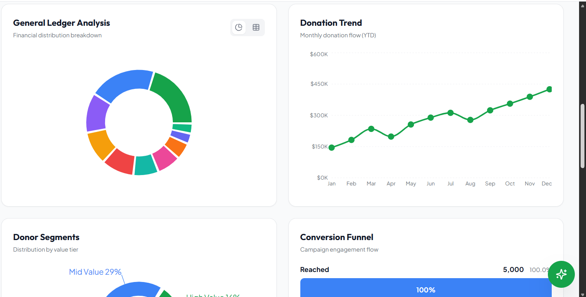
- 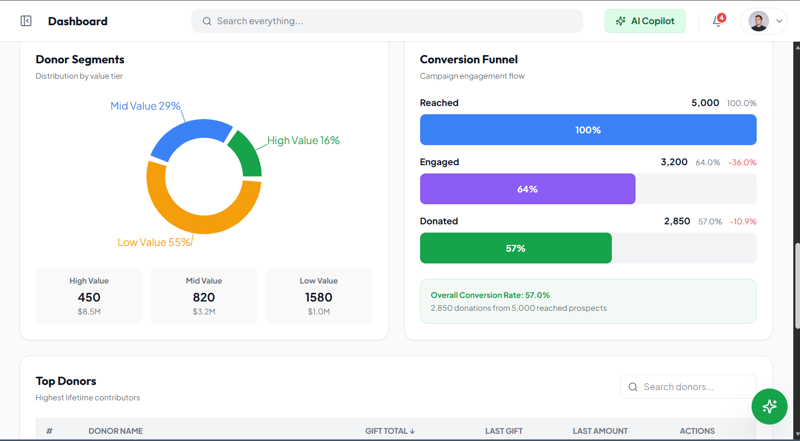
- 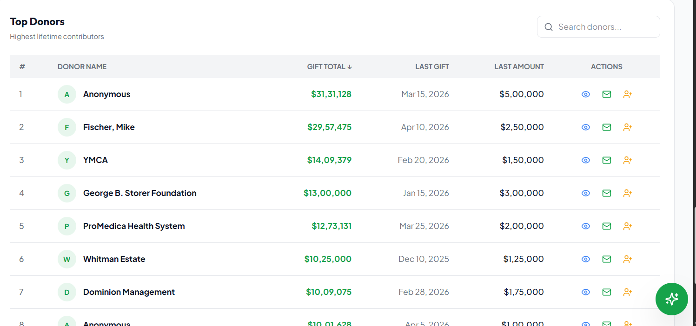

> The images above are extracted unchanged from `homepage.docx`; no proposed UI mockups are presented as original screenshots.
