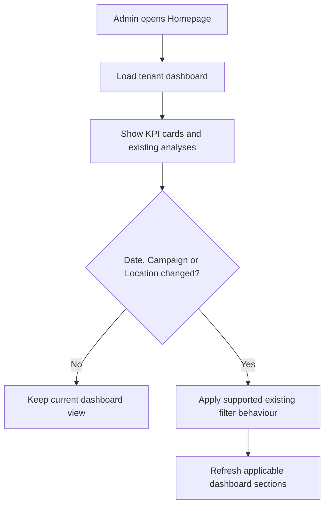
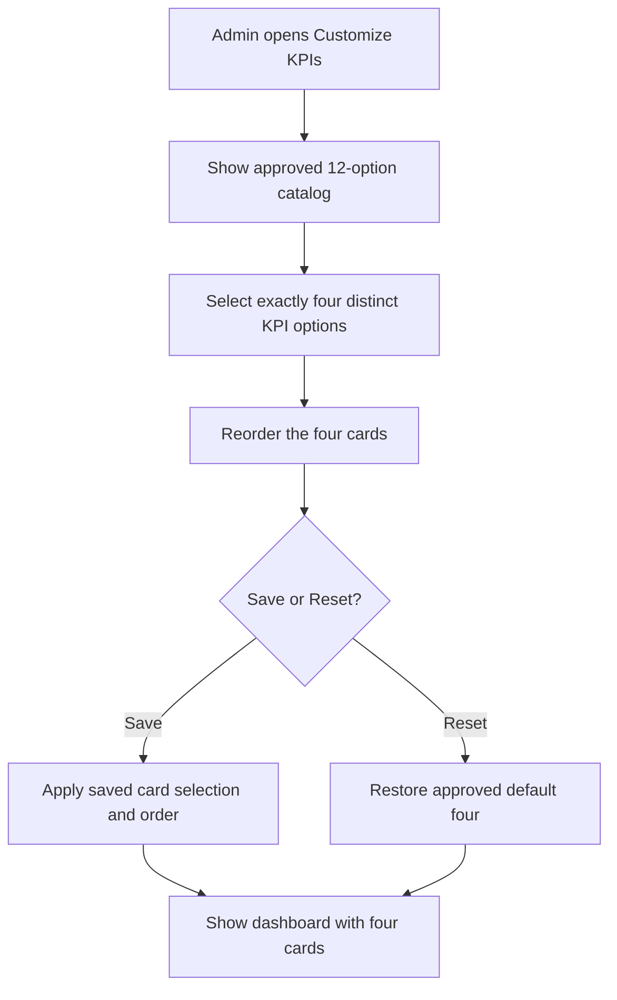
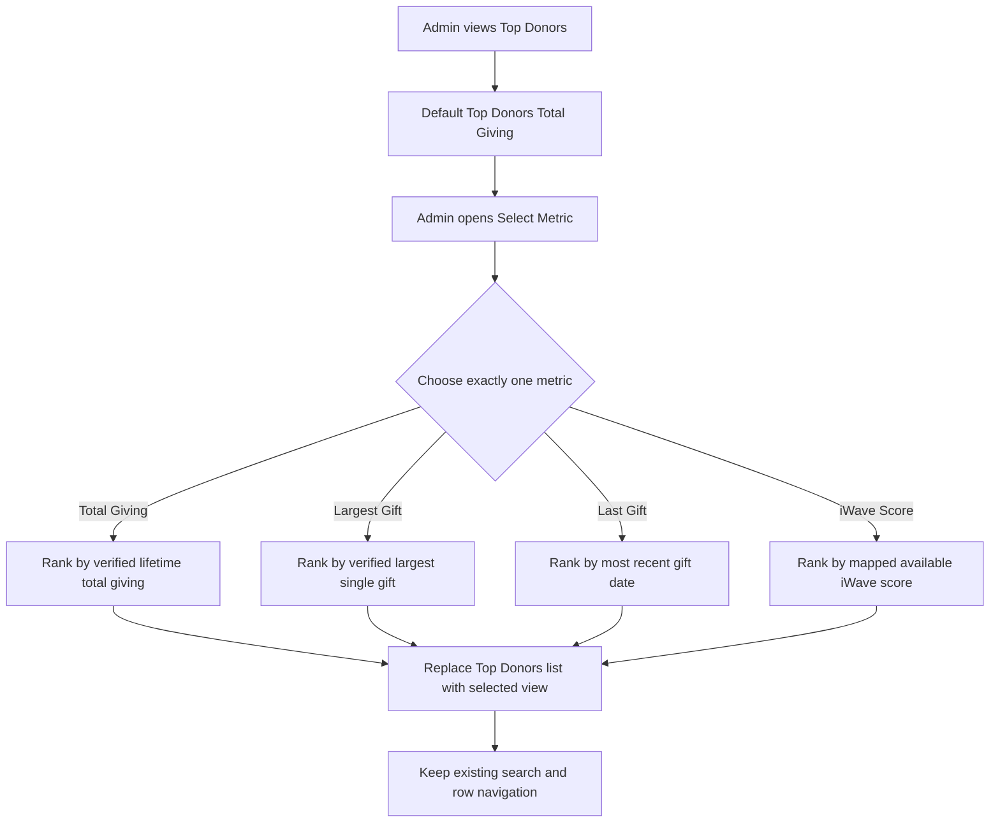
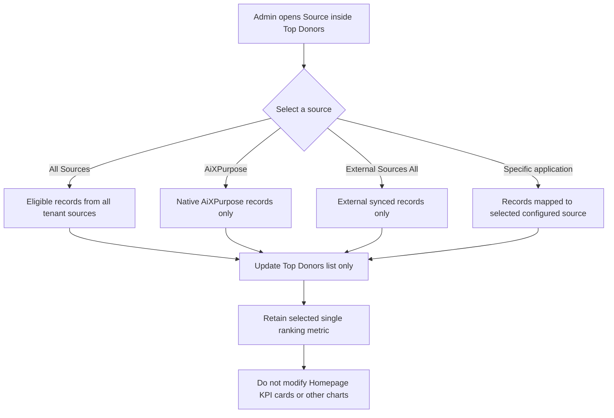
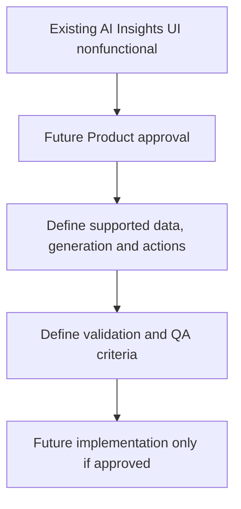

# BRD Workflow — Homepage / Analytics Command Center

**Scope:** Existing page enhancement, not a new application. **User:** Admin only. **Baseline:** approved 28 October 2026. **Status:** Requirements for review, not evidence of QA completion.

## Overview
The page is retained. Mermaid diagrams below are native code for GitHub rendering; they describe approved UI behaviour, not implementation evidence.

### HP-WF-01 — Open Homepage and use existing dashboard filters (As-Is)

**Notes:** Keep Solicitation, General Ledger, Donation Trend, Donor Segments, Conversion Funnel, Top Donors and AI Insights UI; do not claim AI Insights works. Metric eligibility and blank states remain verification items.

### HP-WF-02 — Configurable KPI cards (existing Jira baseline)

**Notes:** Reuse `AiXPurpose_Homepage_Configurable_KPI.docx`; this is previously raised Jira work. Data availability and KPI filter scope remain governed by that specification.

### HP-WF-03 — Top Donors single-select metric (HP-TB-01)

**Notes:** Only one active choice at any moment; do not combine multiple ranking metrics. Missing score/date data is not fabricated.

### HP-WF-04 — Top Donors source filter (HP-TB-02)

**Notes:** Source options only from configured eligible applications. Each source retains its provenance; this is a display filter, not a record edit or integration disconnect.

### HP-WF-05 — AI Insights future candidate (HP-F01)

**Notes:** Conceptual, not a To-Be commitment. Existing UI remains visible per As-Is screenshot.

## Source screenshots

- 
- 
- 
- 

> The images above are extracted unchanged from `homepage.docx`; no proposed UI mockups are presented as original screenshots.
