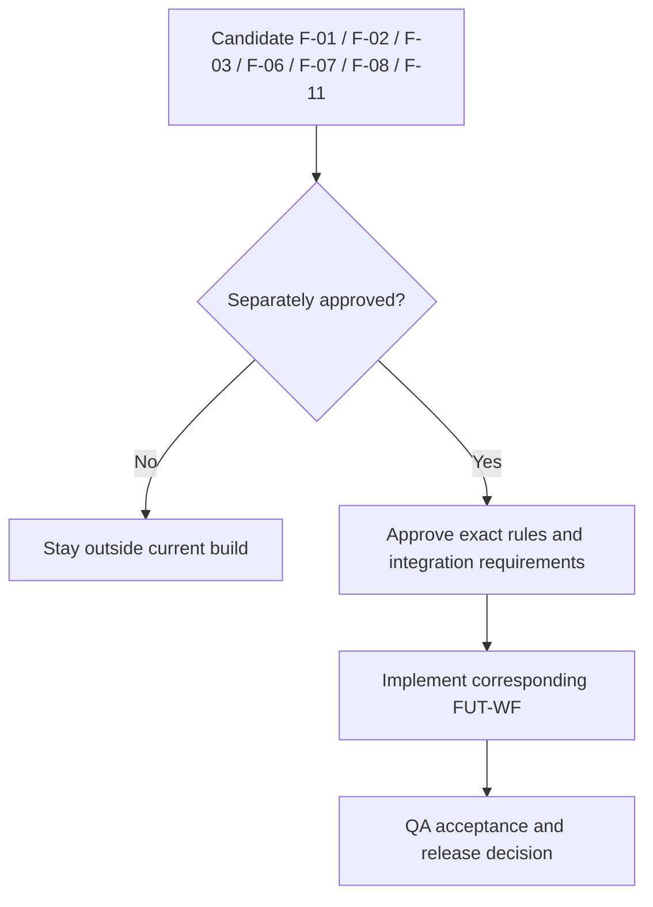
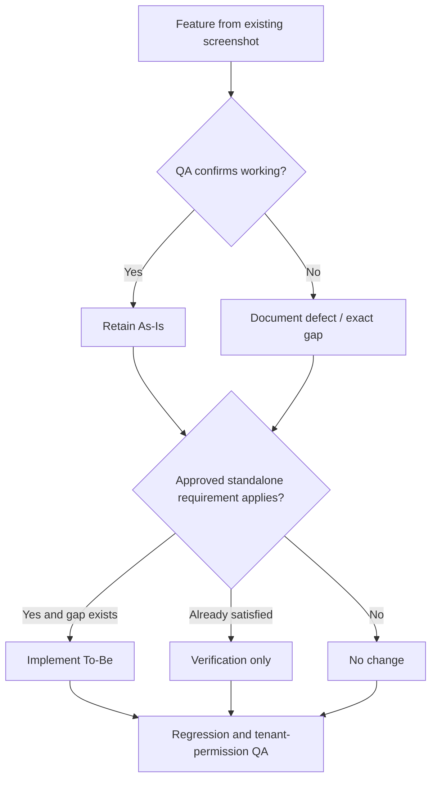

# AiXPurpose – Profile – BRD Feature Catalogue

> **Product:** AiXPurpose Standalone | **Capability:** Profile (Profile, Preferences, Notifications) | **Version:** 1.0 | **Status:** Draft for QA and Business Review  
> **Source of truth:** `profile module.docx` screenshots and description; user-approved clarification decisions (Q1–Q8, C1–C4) and scope exclusions. Reference pattern: existing Members/Donors BRDs.  
> **Evidence rule:** Screenshot visibility proves UI presence, not working behaviour. QA validates As-Is. To-Be requires implementation. Future scope is **not committed**.

## Contents
1. Purpose and Classification
2. As-Is Feature Catalogue (QA Baseline)
3. To-Be Feature Requirements
4. Field and Notification Catalogue
5. Future Scope
6. Validation, Dependencies and QA
7. Traceability
8. Open Decisions
5A. Existing Feature-by-Feature QA Acceptance Matrix
5B. Detailed To-Be Functional Acceptance
5C. Future Feature Catalogue and Workflow Handoff

## 1. Purpose and Classification
Defines *what is in the existing UI*, what QA must validate, and what is **required for standalone**. Labels: **As-Is** = retain and QA verify; **To-Be** = approved target need (implement where absent); **Future** = uncommitted and subject to separate approval.

## 2. As-Is Feature Catalogue (QA Baseline)
| Existing ID | Area / visible feature | QA acceptance check |
|---|---|---|
| PRO-A-01 | Profile: avatar; first/last name, email, phone, role, employee ID, department, designation; Edit Profile | Displays expected authorised data; editing matches actual permissions |
| PRO-A-02 | Account: username, Change Password, 2FA, recent login activity | Verify each displayed action/reading; do not infer unseen backend behaviour |
| PRO-A-03 | Organisation: name, branch, team, assigned role; Save Changes/Cancel | Values and save/cancel behaviour work as implemented |
| PRO-A-04 | Dashboard: landing page, default dashboard, compact/comfortable table density | Save and reopen preserves chosen values |
| PRO-A-05 | Display: light/theme, font size, language, timezone | Existing selection and persistence work; no P-10 expansion |
| PRO-A-06 | Data: Excel/CSV/PDF preference, auto-save drafts, dashboard auto-refresh | Settings persist; consuming modules verified separately |
| PRO-A-07 | Communication: email signature, default sender name, communication preview | Existing save/reset and display work |
| PRO-A-08 | Notifications: Enable, Mute All; in-app/email/SMS channel controls | In-app/email work per owner; SMS not operational |
| PRO-A-09 | Donation triggers: received, high-value, recurring created/failed, receipt, refund, approval pending | Verify enabled existing event types and channel delivery |
| PRO-A-10 | Silver/Gold/Platinum: donate, upgrade, inactive; per-tier channel selections | Retain UI; verify events; Bronze not added without approval |
| PRO-A-11 | Campaign: created, goal achieved, 50%, 80% | Verify existing event linkage |
| PRO-A-12 | Member: added, converted to donor, status changed, updated, duplicate found | Verify existing event linkage |
| PRO-A-13 | Activities: donor added, import/export complete, duplicate found, receipt generated, task/event reminders | Verify existing event linkage |
| PRO-A-14 | Notifications preview and save/reset (as described) | Verify controls and persistence; screenshot coverage incomplete for bottom actions |

## 3. To-Be Feature Requirements
| ID | Requirement / business logic | Acceptance outcome | Goal / workflow |
|---|---|---|---|
| PRO-F-001 | P-01: resolve the signed-in tenant for profile and organisation display; prevent cross-tenant access | Tenant A user cannot view Tenant B's profile/organisation data | GO-001 / WF-01 |
| PRO-F-002 | P-02: allow basic personal plus approved organisation/branch **contact** edits; role/team assignments admin-controlled | Permitted changes persist; prohibited changes never commit | GO-002 / WF-02 |
| PRO-F-003 | P-04: standalone login and optional tenant SSO; do not assume SSO/2FA rule before review | Both configured entry types can authenticate for permitted tenants; specific 2FA acceptance deferred | GO-003 / WF-03 |
| PRO-F-004 | P-05: landing/dashboard choices limited to user's permitted modules | No inaccessible default selectable or applied | GO-004 / WF-04 |
| PRO-F-005 | P-06: present notification options applicable to enabled tenant modules and supported channels | Ineligible events/channels not treated as actionable delivery options | GO-005 / WF-06 |
| PRO-F-006 | P-07: existing enabled event notifications dispatch through supported selected in-app/email channels when authorised | Verified eligible source event produces expected supported-channel outcome; SMS never asserted working | GO-006 / WF-07 |
| PRO-F-007 | P-09: preferred export format applied only where module supports it and user may export | No unsupported export or permission bypass | GO-007 / WF-05 |

**Implementation caveat:** PRO-F-004 through PRO-F-007 require QA to identify whether corresponding behaviour already exists. When already correct, record verification rather than duplicate development.

## 4. Field and Notification Catalogue
### Profile control ownership
| Editable by ordinary user (approved in principle) | Admin-controlled | Requires exact field approval |
|---|---|---|
| Basic personal details | Role, team assignment | Which individual personal fields and organisation/branch contact fields are editable |
| Organisation/branch contact details | Administrative assignments | Department, designation, employee ID, organisation/branch identity/change rules |

### Current supported channel matrix
| Channel | UI shown | Operational as provided | To-Be treatment |
|---|---|---|---|
| In-app | Yes | Yes | Preserve; verify event linkage |
| Email | Yes | Yes | Preserve; verify event linkage |
| SMS | Yes | No | Do not claim delivery; UI state pending decision |

### Existing tier notifications
Silver, Gold and Platinum each show notifications for donor donation, upgrade, inactivity and channel selection. **Bronze is not present in the supplied Profile UI; inclusion remains PRO-OD-002**, notwithstanding its presence in the Donors documentation. No dynamic tier feature (P-11).

## 5. Future Scope
| Candidate | Function | Entry requirement |
|---|---|---|
| F-01 | Enhanced profile-photo management | Separate approval |
| F-02 | Active devices and sessions | Separate approval |
| F-03 | Unusual login/security alerts | Separate approval |
| F-06 | Additional donor-tier notification triggers | Separate approval |
| F-07 | Searchable notification history | Separate approval |
| F-08 | Further accessibility preferences | Separate approval |
| F-11 | Working SMS channel | Approval and provider integration |

**Explicit exclusions:** F-04, F-05, F-09, F-10; no P-10 or P-11 enhancement.

## 5A. Existing Feature-by-Feature QA Acceptance Matrix
All controls below are **required As-Is retention scope**; the owner confirms Preferences persistence, and confirms in-app/email operational but SMS non-operational. The remaining functionality must be established by QA. Do not treat UI appearance as proof of back-end behaviour.

| Ref | Existing controls / functional grouping | QA evidence required |
|---|---|---|
| PRO-A-01 | First name, last name, email, phone; avatar/initials; role, employee ID, department, designation | Field-by-field display and authorised edit test; test save/reopen as applicable |
| PRO-A-02 | Username, password/change-password, 2FA, last and prior login, location | Verify each action and value; document 2FA actual existing outcome; no assumed SSO rule |
| PRO-A-03 | Organisation name, branch, team, assigned role, save/cancel | Verify values, rights, permitted contact edits; admin-only assignments protected |
| PRO-A-04 | Default Landing Page, Default Dashboard View, Compact, Comfortable | Persist selection, apply selected view, restore default; permission filtering target P-05 |
| PRO-A-05 | Theme, Font Size, Language, Timezone | Save/reopen each existing preference; no expanded timezone feature |
| PRO-A-06 | Excel, CSV, PDF; Auto-save Drafts; Auto-refresh Dashboard | Save/reopen; verify consuming modules rather than assuming support of every export format |
| PRO-A-07 | Email Signature, Default Sender Name, Communication Preview Mode | Save/reopen and verify observed preview behaviour |
| PRO-A-08 | Enable Notifications, Mute All, In-App, Email, SMS | Verify global toggle/mute precedence; prove in-app/email delivery; record SMS unsupported |
| PRO-A-09 | Donation Received, High-Value Donation, Recurring Created, Recurring Failed, Receipt Generated, Refunded, Pending Approval | Test every trigger with relevant source event; verify on/off and actual recipient/channel |
| PRO-A-10 | Silver/Gold/Platinum × donor donates, upgrades, becomes inactive; per-tier channel selection | Test 3 tiers × 3 event choices; test channel selection (SMS known unsupported); Bronze remains open |
| PRO-A-11 | Campaign Created, Goal Achieved, Reached 50%, Reached 80% | Test each notification event and suppression when disabled |
| PRO-A-12 | New Member Added, Member Updated, Member Converted to Donor, Duplicate Member Found, Status Changed | Test each event choice and source association |
| PRO-A-13 | Donor Added, Receipt Generated, Import Completed, Export Completed, Duplicate Found, Task Reminder, Event Reminder | Test each event independently, avoid duplicating backend event logic defined elsewhere |
| PRO-A-14 | Example Notifications / Preview; Reset to Default; Save Notification Settings | Verify preview content, save/reopen, reset scope and current bottom-page controls |

## 5B. Detailed To-Be Functional Acceptance
| Feature | Preconditions / rule | Pass criteria | Failure / non-goal |
|---|---|---|---|
| PRO-F-001 | Current logged-in user has tenant context | Only matching tenant profile/organisation information is available | No cross-tenant reads or writes |
| PRO-F-002 | User has edit permission for the specific field | Basic personal and authorised organisation/branch contact edits persist | Self-change of role/team or administrative fields rejected; exact contact list remains PRO-OD-003 |
| PRO-F-003 | Standalone identity configured; SSO optional by organisation | Users enter via allowed login method and resolve correct tenant | 2FA policy/SSO sequencing deferred to Identity/Security, not invented |
| PRO-F-004 | Existing role/module permission is known | Default page and dashboard choices do not allow unauthorised module access | No forced access just because a selection is persisted |
| PRO-F-005 | Tenant/module/channel eligibility established | Applicable event settings are available; unsupported SMS is not represented as functional | Precise SMS visibility UX deferred PRO-OD-004 |
| PRO-F-006 | Source event, eligible recipient, notifications on, eligible event enabled and supported channel selected | In-app/email notification delivered as applicable; disable/mute suppresses | No promise of SMS delivery, retries, queues or provider guarantees absent in source |
| PRO-F-007 | Module export feature exists and user has permission | Supported user-preferred format applied where available | No invented fallback to PDF/CSV/Excel when unsupported |

## 5C. Future Feature Catalogue and Workflow Handoff (Not Approved)
| Candidate | Possible functional steps if approved later | Pending requirement definition |
|---|---|---|
| F-01 | User chooses profile photo edit → uploads/replaces/removes → result appears | Supported media, image handling, permissions |
| F-02 | User opens session list → selects active device/session → revokes it | Session and audit policy |
| F-03 | Security event occurs → alert rule checked → authorised user notified | Event classes, severity, channels |
| F-06 | Extra donor-tier event configured → event observed → selected channel notified | New tier event set, qualification, cross-module alignment |
| F-07 | User opens history → searches/filters → reads permitted prior notification | Retention, access, filters |
| F-08 | User selects approved accessibility settings → previews/applies → preference saved | Controls and compatibility requirements |
| F-11 | SMS service enabled by approval → recipient preference and consent checked → provider sends notification | Consent, vendor, costs, failures |

**Scope exclusion:** no F-04, F-05, F-09, F-10; no P-10 or P-11 enhancement. Existing theme/timezone and Silver/Gold/Platinum tier UI remain in As-Is.

## 6. Validation, Dependencies and QA

- Profile/tenant context: verify current user/tenant identity and access restrictions.
- Editing: verify field editability, prohibited updates, save/cancel, persistence and role restrictions; field list still pending.
- Authentication: test existing password/2FA with Identity team; SSO+2FA logic not finalised.
- Preferences: regression-test confirmed persistence and existing reset actions.
- Notifications: verify real module events, subscriptions, mute controls, correct recipient and working in-app/email delivery. Mark SMS unsupported.
- Dependencies: Identity/Access, Tenant Management, Donors, Members, Campaigns, activity/event sources, notification services, consuming export modules.

## 7. Traceability
| Goal | Workflow | New/target feature | Existing evidence |
|---|---|---|---|
| PRO-GO-001 | PRO-WF-01 | PRO-F-001 | PRO-A-01, PRO-A-03 |
| PRO-GO-002 | PRO-WF-02 | PRO-F-002 | PRO-A-01, PRO-A-03 |
| PRO-GO-003 | PRO-WF-03 | PRO-F-003 | PRO-A-02 |
| PRO-GO-004 | PRO-WF-04 | PRO-F-004 | PRO-A-04 |
| PRO-GO-005 | PRO-WF-06 | PRO-F-005 | PRO-A-08–13 |
| PRO-GO-006 | PRO-WF-07 | PRO-F-006 | PRO-A-09–14 |
| PRO-GO-007 | PRO-WF-05 | PRO-F-007 | PRO-A-06 |

## 8. Open Decisions
Retain `PRO-OD-001`–`PRO-OD-005` as stated in Goals. Do not invent security flow, field rules, SMS behaviour, tier policy, or existing backend evidence before confirmation.

## Screenshot Evidence Register (Existing UI; not Mermaid replacements)
| File | Existing interface evidence |
|---|---|
| `screenshots/01_Profile_Personal.png` | Profile and personal information |
| `screenshots/02_Account_Settings.png` | Username, password, 2FA, login activity |
| `screenshots/03_Organisation_Details.png` | Organisation and role fields |
| `screenshots/04_Dashboard_Preferences.png` | Dashboard landing, view and density |
| `screenshots/05_Display_Data_Preferences.png` | Display and data preferences |
| `screenshots/06_Communication_Preferences.png` | Communication preferences and save/reset |
| `screenshots/07_Notification_General.png` | General notification channel selection |
| `screenshots/08_Donations_Silver_Tier.png` | Donation and Silver tier settings |
| `screenshots/09_Gold_Platinum_Campaign.png` | Gold/Platinum and campaign events |
| `screenshots/10_Member_Activity_Preview.png` | Member/activity notifications and preview |

Screenshots are **evidence of the existing interface only**. All newly authored process diagrams in these documents use editable Mermaid source code.
