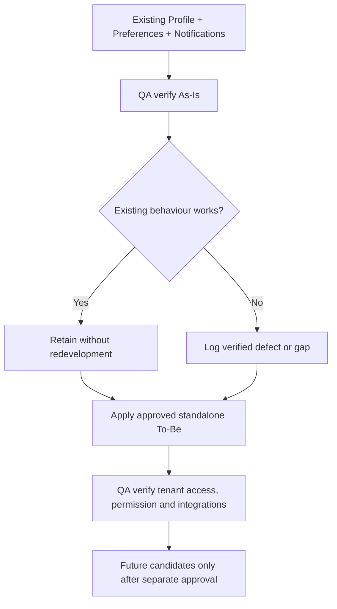
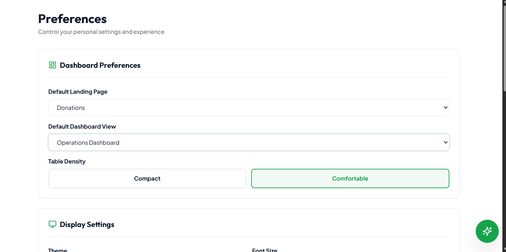
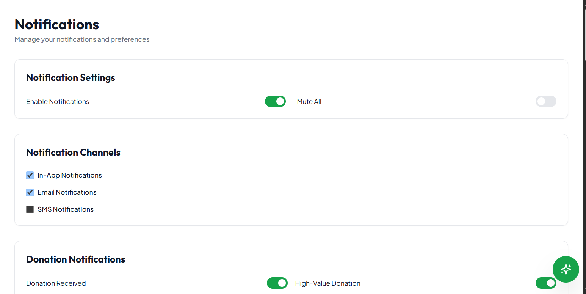
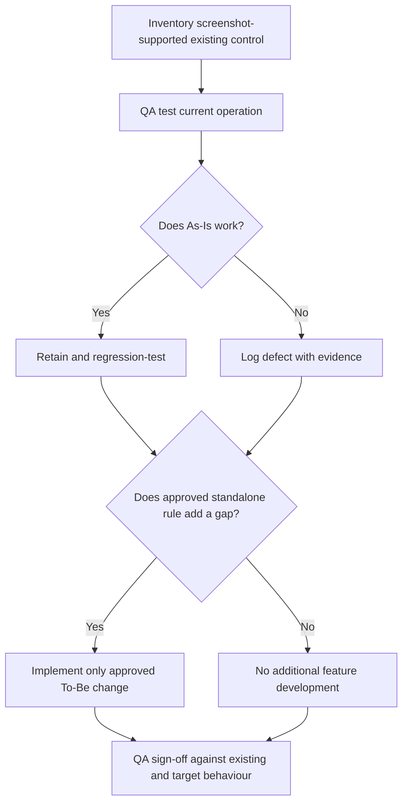

# AiXPurpose – Profile – BRD Goals

> **Product:** AiXPurpose Standalone | **Capability:** Profile (Profile, Preferences, Notifications) | **Version:** 1.0 | **Status:** Draft for QA and Business Review  
> **Source of truth:** `profile module.docx` screenshots and description; user-approved clarification decisions (Q1–Q8, C1–C4) and scope exclusions. Reference pattern: existing Members/Donors BRDs.  
> **Evidence rule:** Screenshot visibility proves UI presence, not working behaviour. QA validates As-Is. To-Be requires implementation. Future scope is **not committed**.

## Contents

1. Purpose and Scope
2. Business Context and Goal
3. As-Is Baseline and QA Handoff
4. To-Be Goals
5. Future Scope
6. Business Rules and Dependencies
7. Success Criteria
8. Open Decisions
9. Traceability and Document Relationships
   6A. Current-State Functional Inventory and Standalone Coverage Matrix
   6B. Future Candidates — Conceptual Flow Only

## 1. Purpose and Scope

Retain the existing three-page Profile capability while adapting user context, authorised editing, login, and notification settings for standalone organisations. **In scope:** Profile, Preferences, Notifications. **Out of scope:** redesign of already adequate controls; detailed identity-provider architecture; implementation of optional future candidates.

## 2. Business Context and Goal

The existing client-specific application already displays profile/account/organisation information, stores preferences, and provides a notification settings UI. Standalone use must keep these capabilities and correctly apply the signed-in user's organisation, permissions, enabled modules and supported notification channels. It must not treat working As-Is functionality as new development.

## 3. As-Is Baseline and QA Handoff

| Area                      | Existing screenshot-supported UI                                                                          | Required disposition                                               |
| ------------------------- | --------------------------------------------------------------------------------------------------------- | ------------------------------------------------------------------ |
| Profile information       | First/last name, email, phone, avatar, role, employee ID, department, designation, Edit Profile           | Retain; QA verify editing, display and persistence                 |
| Account                   | Username, password change, 2FA toggle, login activity                                                     | Retain; QA verify relevant behaviour; SSO/2FA policy open          |
| Organisation              | Organisation name, branch, team, assigned role; Save Changes/Cancel                                       | Retain; QA verify current behaviour                                |
| Dashboard preferences     | Default landing page, dashboard view, table density                                                       | Retain; preference saving confirmed functional                     |
| Display preferences       | Theme, font size, language, timezone                                                                      | Retain; no new timezone enhancement (P-10 excluded)                |
| Data preferences          | Excel/CSV/PDF selection, auto-save drafts, auto-refresh                                                   | Retain; avoid claiming each consuming module supports every format |
| Communication preferences | Email signature, sender name, preview mode                                                                | Retain                                                             |
| Notification settings     | Enable Notifications, Mute All, in-app/email/SMS UI                                                       | Retain UI; in-app/email operational per owner; SMS not operational |
| Notification events       | Donation, Silver/Gold/Platinum tiers, campaigns, members, activities; preview                             | Retain existing triggers/UI; QA verify events and deliveries       |
| Settings actions          | Save Preferences and Reset to Default; notification settings save/reset indicated in supplied description | Retain; QA verify notification save/reset separately               |

**QA principle:** Report confirmed defects separately from enhancements. Working As-Is remains in the target application.

## 4. To-Be Goals

| Goal ID    | Goal                                                                                                                         | Related features |
| ---------- | ---------------------------------------------------------------------------------------------------------------------------- | ---------------- |
| PRO-GO-001 | Show only profile and organisational context of the authenticated tenant (P-01).                                             | PRO-F-001        |
| PRO-GO-002 | Permit basic personal and organisation/branch contact edits while preventing self-edit of roles and team assignments (P-02). | PRO-F-002        |
| PRO-GO-003 | Support standalone login with optional organisation SSO, subject to unresolved SSO/2FA security design (P-04).               | PRO-F-003        |
| PRO-GO-004 | Offer default landing pages/dashboards only when authorised (P-05).                                                          | PRO-F-004        |
| PRO-GO-005 | Show tenant/module/channel-appropriate notification options (P-06).                                                          | PRO-F-005        |
| PRO-GO-006 | Ensure existing notification events reach supported in-app/email channels as applicable (P-07).                              | PRO-F-006        |
| PRO-GO-007 | Respect module export permissions and actually supported formats (P-09).                                                     | PRO-F-007        |

## 5. Future Scope (separate approval needed)

| Candidate | Description                                                   |
| --------- | ------------------------------------------------------------- |
| F-01      | Enhanced profile-photo management                             |
| F-02      | Active device/session management                              |
| F-03      | Unusual login/security alerts                                 |
| F-06      | Additional donor-tier notification triggers                   |
| F-07      | Searchable notification history                               |
| F-08      | Additional accessibility preferences                          |
| F-11      | Operational SMS delivery, subject to approval and integration |

**Excluded:** F-04 notification digests, F-05 quiet hours, F-09 presentation templates, F-10 communication branding. P-10 and P-11 are not standalone enhancements.

## 6. Business Rules and Dependencies

| Rule ID    | Rule                                                                                                                                                                                                    |
| ---------- | ------------------------------------------------------------------------------------------------------------------------------------------------------------------------------------------------------- |
| PRO-BR-001 | Profile, organisation context, and protected operations must use authenticated tenant context.                                                                                                          |
| PRO-BR-002 | Users may edit basic personal details and permitted organisation/branch **contact** fields; administrative role/team assignments remain admin-controlled. The field-level list is pending verification. |
| PRO-BR-003 | Users cannot select landing pages or dashboards for inaccessible modules.                                                                                                                               |
| PRO-BR-004 | In-app and email are current operational notification channels; SMS controls are visible but delivery is not operational.                                                                               |
| PRO-BR-005 | Current Silver, Gold, Platinum notification UI stays unchanged; Bronze coverage is an open decision.                                                                                                    |
| PRO-BR-006 | Existing successful preference persistence and reset must be preserved.                                                                                                                                 |
| PRO-BR-007 | Export format preference never overrides module format support or export permission.                                                                                                                    |

**Dependencies:** shared Identity/Access (login, SSO, 2FA); Tenant Management (organisation context); Donors (tier/events); Members, Campaigns and Activities (event sources); supported notification delivery services. Detailed business logic belongs to its owning module.

## 6A. Current-State Functional Inventory and Standalone Coverage Matrix

The following controls are **As-Is product scope**, not optional future work. QA must test their actual behaviour; a screenshot alone does not confirm implementation. The target application must preserve working controls.

| Page          | Group                | Existing detailed functions / conditions                                                                                                                                | Standalone disposition                                                                    |
| ------------- | -------------------- | ----------------------------------------------------------------------------------------------------------------------------------------------------------------------- | ----------------------------------------------------------------------------------------- |
| Profile       | Personal Information | Avatar/initials; first name, last name, email, phone, role, employee ID, department, designation; Edit Profile                                                          | Preserve; P-01 tenant scope and P-02 authorised editing                                   |
| Profile       | Account Settings     | Username display; masked password, Change Password; 2FA toggle; last/previous login and login location as shown                                                         | Preserve; P-04 standalone login and optional SSO; security-policy details open            |
| Profile       | Organisation Details | Organisation Name, Branch, Team, Assigned Role; Save Changes and Cancel                                                                                                 | Preserve; permit only authorised organisation/branch **contact details**, not assignments |
| Preferences   | Dashboard            | Default Landing Page, Default Dashboard View, Compact/Comfortable Table Density                                                                                         | Preserve; P-05 restrict available landing/dashboard choices to authorised modules         |
| Preferences   | Display              | Theme (Light displayed), Font Size (Medium displayed), Language (English displayed), Timezone (Eastern shown)                                                           | Preserve; no additional P-10 work                                                         |
| Preferences   | Data                 | Default Export Format (Excel, CSV, PDF), Auto-save Drafts, Auto-refresh Dashboard                                                                                       | Preserve; P-09 restrict actual exports to supported formats/permissions                   |
| Preferences   | Communication        | Email Signature, Default Sender Name, Communication Preview Mode                                                                                                        | Preserve without introducing new templates/branding                                       |
| Preferences   | Actions              | Save Preferences, Reset to Default                                                                                                                                      | Persistence confirmed by owner; QA regression-test                                        |
| Notifications | Global / channels    | Enable Notifications, Mute All, In-App, Email, SMS channel selections                                                                                                   | Preserve; in-app/email functional per owner; SMS non-operational                          |
| Notifications | Donation             | Donation Received, High-Value Donation, Recurring Donation Created, Recurring Donation Failed, Donation Receipt Generated, Donation Refunded, Donation Pending Approval | Preserve existing choices and verify source-event delivery                                |
| Notifications | Tier-based           | Silver, Gold, Platinum: donor donates, upgrades, becomes inactive; per-tier In-App/Email/SMS choices                                                                    | Preserve exactly three existing sections; Bronze decision remains open                    |
| Notifications | Campaign             | Campaign Created, Campaign Goal Achieved, Campaign Reached 50%, Campaign Reached 80%                                                                                    | Preserve; verify linkage where existing                                                   |
| Notifications | Member               | New Member Added, Member Updated, Member Converted to Donor, Duplicate Member Found, Member Status Changed                                                              | Preserve; verify linkage where existing                                                   |
| Notifications | Activity             | Donor Added, Receipt Generated, Import Completed, Export Completed, Duplicate Found, Task Reminder, Event Reminder                                                      | Preserve; verify linkage where existing                                                   |
| Notifications | End controls         | Example Notifications / Notification Preview, Reset to Default, Save Notification Settings (latter two from supplied description)                                       | Preserve; verify bottom-page controls and persistence                                     |

### As-Is verification versus To-Be implementation

## 6B. Future Candidates — Conceptual Flow Only

These are **not approved implementation** and must not be shown as currently working. Each requires a separate business decision and detailed design before build.

| Candidate                 | Potential user journey (future only)                                                                             | Decision before implementation                         |
| ------------------------- | ---------------------------------------------------------------------------------------------------------------- | ------------------------------------------------------ |
| F-01 Enhanced photo       | Open profile → choose permitted photo action → provide image → validate/store → display changed avatar           | File rules and permissions unspecified                 |
| F-02 Active sessions      | Open account security → see authorised sessions → select session → revoke → confirm result                       | Session metadata and revocation policy unspecified     |
| F-03 Security alerts      | Security event detected → apply approved alert policy → notify account holder using supported channel            | Trigger definition and security ownership unspecified  |
| F-06 More tier triggers   | Admin approves additional tier event → configure eligible trigger → event occurs → evaluate preference → deliver | Extra event types and tier applicability unspecified   |
| F-07 Notification history | Open notification history → search/filter authorised messages → view relevant record                             | Retention, search fields and permissions unspecified   |
| F-08 Accessibility        | Open display preferences → choose approved accessibility control → preview/apply → persist                       | Specific accessibility functions unspecified           |
| F-11 SMS                  | Tenant/channel approved → provider integration active → user opts in → eligible event → SMS dispatch/status      | Provider, consent, cost and delivery rules unspecified |

## 7. Success Criteria

1. QA verifies and signs off existing functionality or records defects with reproduction evidence.
2. A user cannot view another tenant's Profile context or modify admin-controlled assignments.
3. Default-page and export preferences never bypass existing permissions.
4. Supported in-app/email notification settings align with actual eligible events; SMS is not represented as operational.
5. Existing preference persistence remains functional after standalone changes.

## 8. Open Decisions

| ID         | Required confirmation                                                                                                                  | Owner                  |
| ---------- | -------------------------------------------------------------------------------------------------------------------------------------- | ---------------------- |
| PRO-OD-001 | SSO + 2FA interaction and policy                                                                                                       | Identity/Security team |
| PRO-OD-002 | Bronze tier notifications (retain current UI pending decision)                                                                         | Business/Product       |
| PRO-OD-003 | Exact user-editable organisation/branch contact fields                                                                                 | Product/QA             |
| PRO-OD-004 | SMS setting display/disabled behaviour while delivery unavailable                                                                      | Product/UX             |
| PRO-OD-005 | Whether permission-aware landing/dashboard, notification options/events, and export formats already work; implement only verified gaps | QA/Engineering         |

## 9. Traceability and Document Relationships

Goals (`PRO-GO-###`) define **why**, Workflow (`PRO-WF-##`) defines **how**, Feature Catalogue (`PRO-F-###`) defines **requirements and acceptance**. All three retain the same As-Is / To-Be / Future classification and reference the same screenshots.

## Screenshot Evidence Register (Existing UI; not Mermaid replacements)

| File                                           | Existing interface evidence               |
| ---------------------------------------------- | ----------------------------------------- |
| `screenshots/01_Profile_Personal.png`          | Profile and personal information          |
| `screenshots/02_Account_Settings.png`          | Username, password, 2FA, login activity   |
| `screenshots/03_Organisation_Details.png`      | Organisation and role fields              |
| `screenshots/04_Dashboard_Preferences.png`     | Dashboard landing, view and density       |
| `screenshots/05_Display_Data_Preferences.png`  | Display and data preferences              |
| `screenshots/06_Communication_Preferences.png` | Communication preferences and save/reset  |
| `screenshots/07_Notification_General.png`      | General notification channel selection    |
| `screenshots/08_Donations_Silver_Tier.png`     | Donation and Silver tier settings         |
| `screenshots/09_Gold_Platinum_Campaign.png`    | Gold/Platinum and campaign events         |
| `screenshots/10_Member_Activity_Preview.png`   | Member/activity notifications and preview |

Screenshots are **evidence of the existing interface only**. All newly authored process diagrams in these documents use editable Mermaid source code.
