# AiXPurpose – Profile – BRD Workflow

> **Product:** AiXPurpose Standalone | **Capability:** Profile (Profile, Preferences, Notifications) | **Version:** 1.0 | **Status:** Draft for QA and Business Review  
> **Source of truth:** `profile module.docx` screenshots and description; user-approved clarification decisions (Q1–Q8, C1–C4) and scope exclusions. Reference pattern: existing Members/Donors BRDs.  
> **Evidence rule:** Screenshot visibility proves UI presence, not working behaviour. QA validates As-Is. To-Be requires implementation. Future scope is **not committed**.

## Contents
1. Purpose and Actors
2. End-to-End Flow
3. Workflow Inventory
4. Detailed Workflows
5. Shared Rules and QA
6. Screenshots
7. Traceability
8. Decisions
4A. As-Is Workflows — Detailed QA Baseline
4B. Target-State Workflow Logic — Seven Approved Changes
4C. Future Workflows (Conceptual; Not for Initial Release)

## 1. Purpose and Actors
Describe the three existing pages and approved standalone adjustments, without inventing new screens. **Actors:** signed-in user; authorised administrator; existing system; optional organisation identity provider; notification event source. These are logical actors, not mandated new user roles.

## 2. End-to-End Flow
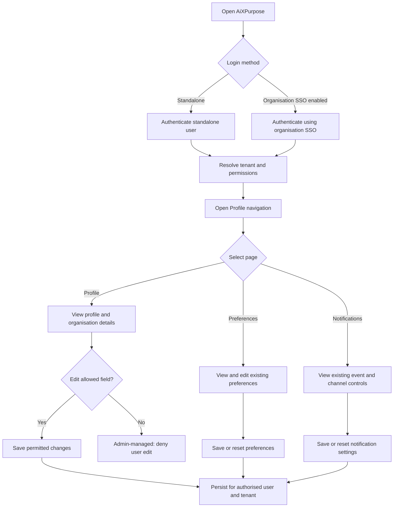
**Note:** 2FA handling in standalone/SSO branches is explicitly **unresolved**, not assumed by this diagram.

## 3. Workflow Inventory
| ID | Workflow | Scope | Goal |
|---|---|---|---|
| PRO-WF-01 | View Profile and organisation details | As-Is + To-Be | PRO-GO-001 |
| PRO-WF-02 | Edit permitted profile/contact fields | As-Is + To-Be | PRO-GO-002 |
| PRO-WF-03 | Account security and authentication entry | As-Is + To-Be | PRO-GO-003 |
| PRO-WF-04 | Update Dashboard and Display preferences | As-Is + To-Be permission check | PRO-GO-004 |
| PRO-WF-05 | Update Data and Communication preferences | As-Is + To-Be export check | PRO-GO-007 |
| PRO-WF-06 | Manage notification controls and channels | As-Is + To-Be | PRO-GO-005 |
| PRO-WF-07 | Process existing notification event | As-Is + To-Be verified gaps | PRO-GO-006 |
| PRO-WF-08 | Review possible future functions | Future only | Separate approval |

## 4. Detailed Workflows
### PRO-WF-01 — View Profile
**As-Is:** Navigate Profile → Profile; view personal, account and organisation information. **To-Be:** Resolve authenticated tenant and display only that tenant's permissible data. **Exception:** unauthorised/cross-tenant access denied. **QA:** verify existing field values, scope, loading and error states.

### PRO-WF-02 — Edit Profile
**As-Is:** Edit Profile; existing organisation detail fields and Save Changes/Cancel visible. **To-Be:** user may modify basic personal and approved organisation/branch *contact* details; administrator maintains roles and team assignments. **Exception:** prohibited edits blocked and not persisted.
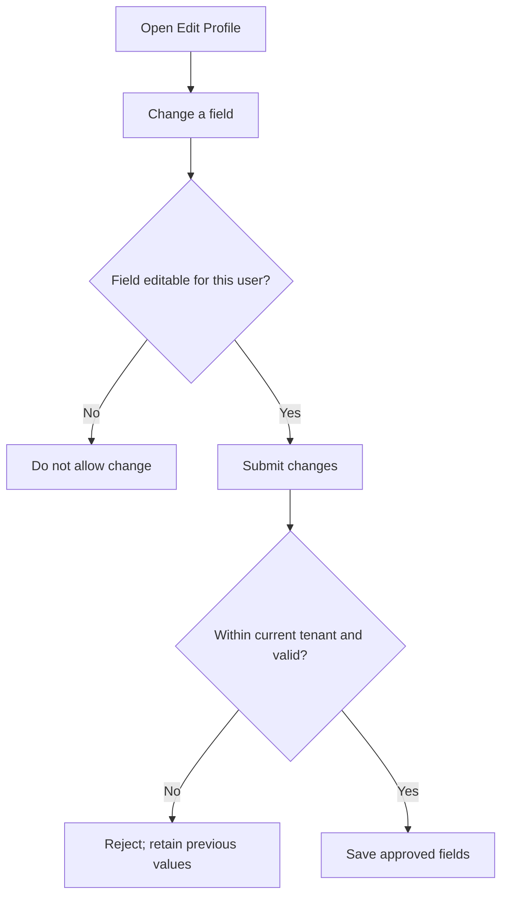
Exact editable contact fields and their validations require confirmation; no unapproved fields are assumed.

### PRO-WF-03 — Account Security
**As-Is:** username, password-change entry, 2FA toggle and login-activity section visible. **To-Be:** standalone login plus optional organisation SSO. **Exception/decision:** SSO/2FA interaction remains with Identity/Security; do not prescribe MFA sequence. **QA:** verify existing password-change, 2FA and login-activity behaviours independently.

### PRO-WF-04 — Dashboard and Display Preferences
**As-Is:** landing page, dashboard, table density, theme, font size, language, timezone; Save Preferences/Reset to Default. Existing preference persistence is confirmed. **To-Be:** landing/dashboard options filtered by access rights; no additional timezone enhancement. **Exception:** inaccessible selections rejected or unavailable.

### PRO-WF-05 — Data and Communication Preferences
**As-Is:** default export Excel/CSV/PDF, auto-save drafts, auto-refresh, email signature, sender name, preview mode. **To-Be:** export preference only used for allowed formats/actions in consuming modules. **QA:** verify unchanged preferences and the actual supported formats in relevant modules. No extra communication features proposed.

### PRO-WF-06 — Notification Settings
**As-Is:** Enable Notifications, Mute All, in-app/email/SMS checkboxes, donation/tier/campaign/member/activity toggles, notification preview, save/reset controls (per supplied description). **To-Be:** tenant/module-aware eligibility; continue in-app and email only as working channels. **Exception:** SMS is not operational, so do not treat its selection as successful delivery.

### PRO-WF-07 — Existing Notification Delivery
**As-Is:** event toggles and delivery channels exist; owner confirms in-app/email operational, SMS not. **To-Be:** ensure eligible existing events and supported channels work consistently with module access. Preserve current Silver/Gold/Platinum notification interface.
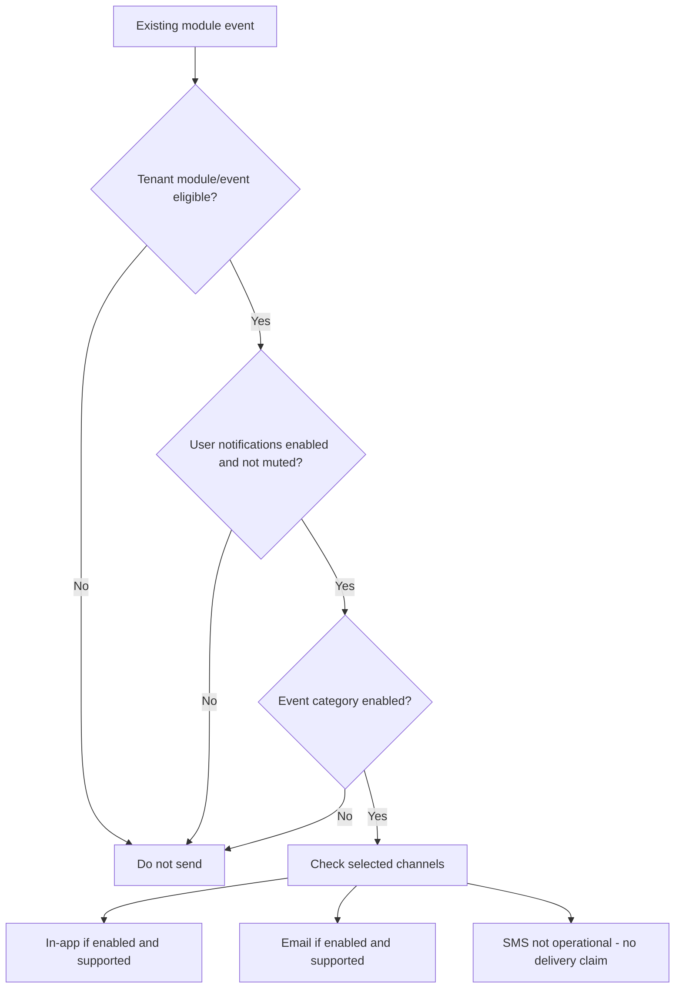
**QA:** verify event-to-recipient mapping, opt-outs and actual in-app/email results; exact notification trigger calculations belong to source modules.

### PRO-WF-08 — Future Candidates
Only after later approval: F-01, F-02, F-03, F-06, F-07, F-08 and F-11. These **are not current workflows**.

## 4A. As-Is Workflows — Detailed QA Baseline
These are **existing UI paths**, not invented new capabilities. Where action effects are not proven by screenshots, QA must establish results.

| Flow | Entry and steps in supplied UI | QA outcome to establish |
|---|---|---|
| A-01 Profile viewing | Profile → Profile → review Personal Information, Account Settings and Organisation Details | Values match authorised user; fields and page load correctly |
| A-02 Edit / save / cancel | Profile → Edit Profile; inspect editable values; Save Changes or Cancel where presented | Approved fields save; Cancel discards; prohibited fields do not change; exact edit form needs confirmation |
| A-03 Account | Profile → Account Settings → inspect username/password, Change Password, 2FA and Login Activity | Password action/2FA behaviour, login metadata and permissions verified, not assumed |
| A-04 Dashboard preferences | Preferences → choose Default Landing Page, Default Dashboard View, Compact/Comfortable → Save Preferences / Reset to Default | Selected values apply and persist; defaults restore |
| A-05 Display preferences | Preferences → choose Theme, Font Size, Language, Timezone → save/reset | Selected controls persist and expected UI display changes occur where supported |
| A-06 Data preferences | Preferences → choose Excel/CSV/PDF; Auto-save Drafts; Auto-refresh Dashboard → save/reset | Settings persist; consuming module behaviour verified separately |
| A-07 Communication | Preferences → Email Signature, Default Sender Name, Communication Preview Mode → save/reset | Values persist and preview setting behaves as existing product permits |
| A-08 General notifications | Notifications → Enable/Mute All and In-App/Email/SMS checkboxes → save/reset | Selections persist; in-app/email tested, SMS marked non-operational |
| A-09 Donation events | Notifications → configure each of seven donation event toggles → save | QA checks event-by-event notification eligibility and actual delivery |
| A-10 Tier notifications | Notifications → Silver/Gold/Platinum → donate/upgrade/inactive toggles and channel choices → save | QA checks each tier-event combination; no Bronze UI inferred |
| A-11 Campaign events | Notifications → configure Created, Goal Achieved, Reached 50%, Reached 80% → save | QA tests actual associated event delivery if supported |
| A-12 Member events | Notifications → configure Added, Updated, Converted, Duplicate Found, Status Changed → save | QA tests source-event mapping and selected delivery |
| A-13 Activity events | Notifications → configure Donor Added, Receipt Generated, Import/Export Completed, Duplicate Found, Task/Event Reminder → save | QA tests configured event types independently |
| A-14 Notification preview | Notifications → inspect Example Notifications/Notification Preview and Reset/Save at bottom | QA checks rendering and button behaviour; screenshots only partly cover bottom controls |

## 4B. Target-State Workflow Logic — Seven Approved Changes

| ID / feature | Entry → business decision → result | Exceptions / QA acceptance |
|---|---|---|
| T-01 / PRO-F-001 | Sign in → establish tenant identity → open Profile → retrieve only that tenant's user/organisation details | Missing/invalid tenant rejects protected access; never leak another tenant's details |
| T-02 / PRO-F-002 | Open editable profile/contact field → check user's permission and field ownership → validate allowed change → save → redisplay value | Role/team/administrative assignments cannot be self-edited; exact contact field list awaits PRO-OD-003; attempted unauthorised updates rejected |
| T-03 / PRO-F-003 | Select standalone login or enabled organisation SSO → appropriate identity authority authenticates → resolve authorised user/tenant → enter Profile | SSO must be optional, not mandatory for all tenants; MFA sequencing **not specified** until PRO-OD-001 |
| T-04 / PRO-F-004 | Open Default Landing Page or Default Dashboard → compute user's allowed modules → present allowed choices → save selection | Previously saved inaccessible option must not grant access; handling of stale selection requires product decision |
| T-05 / PRO-F-005 | Open Notifications → identify enabled tenant modules and supported channels → show applicable events/settings → user saves preferences | Don't imply SMS delivery. Exact hide/disable presentation still open PRO-OD-004 |
| T-06 / PRO-F-006 | Existing source event → confirm tenant/recipient eligibility → respect global mute and event toggle → check subscribed supported channel → dispatch in-app/email | Ineligible event, mute, disabled choice or unsupported SMS must not yield false delivery success; QA verify actual source integrations |
| T-07 / PRO-F-007 | User chooses preferred export format → enters module export → check permission and that module supports format → execute allowed format | No permission bypass; when format unsupported, no unapproved conversion/fallback rule assumed |

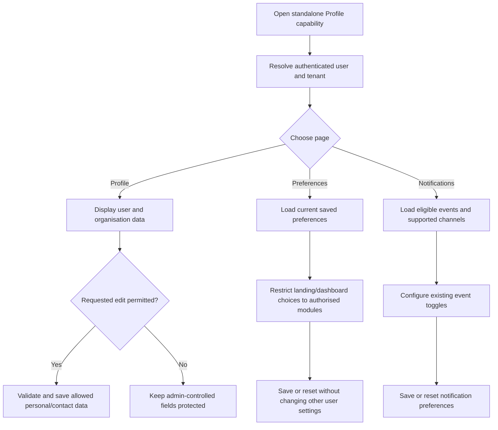

## 4C. Future Workflows (Conceptual; Not for Initial Release)
Each future workflow is a **planning illustration only**; it is not an approved feature or existing behaviour.

| Future ID | Proposed workflow | Approval dependency |
|---|---|---|
| FUT-WF-01 / F-01 | Profile → image management → select upload/replace/remove → validate → update photo | Allowed file types/limits, ownership |
| FUT-WF-02 / F-02 | Account → view current sessions → choose session → revoke → show outcome | Identity/session infrastructure and session policy |
| FUT-WF-03 / F-03 | Approved security trigger → decide alert eligibility → deliver supported-channel security notice | Trigger policy, security sign-off |
| FUT-WF-04 / F-06 | Approved donor-tier event definition → configure notification preference → donor event → evaluate → notify | New triggers defined by Donors business owner |
| FUT-WF-05 / F-07 | Notifications → search/filter historical notices → open permitted notice | Retention period and privacy policy |
| FUT-WF-06 / F-08 | Preferences → choose future accessibility option → apply → store preference | Exact controls to approve |
| FUT-WF-07 / F-11 | Enable approved SMS service → opt-in → eligible event → provider send → status handling | Provider, consent and policy approval |

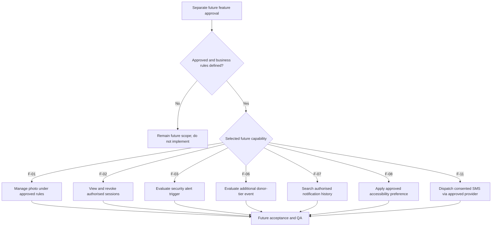

## 5. Shared Rules and QA
Apply `PRO-BR-001` to `PRO-BR-007` from Goals. QA validates all As-Is functions before claiming a gap; implement only approved To-Be requirements not already satisfied. Verify authorised tenant scope, permitted edits, persistence, channel support, and no regression.

## 6. Screenshot References
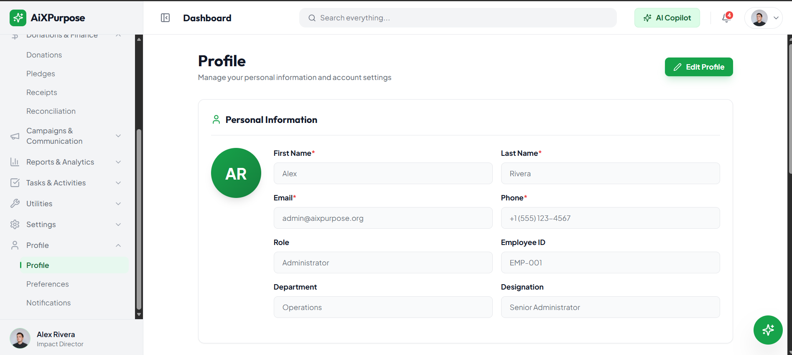
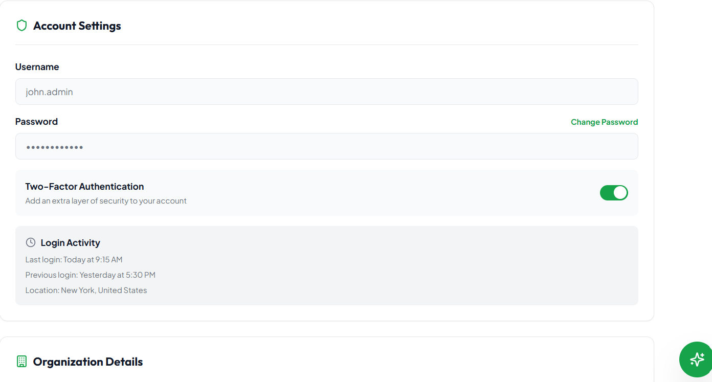
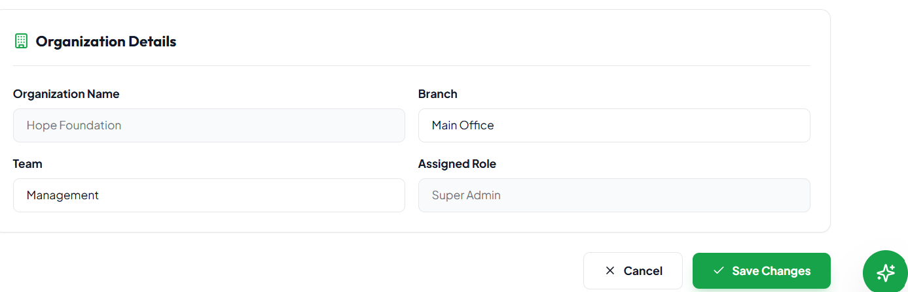
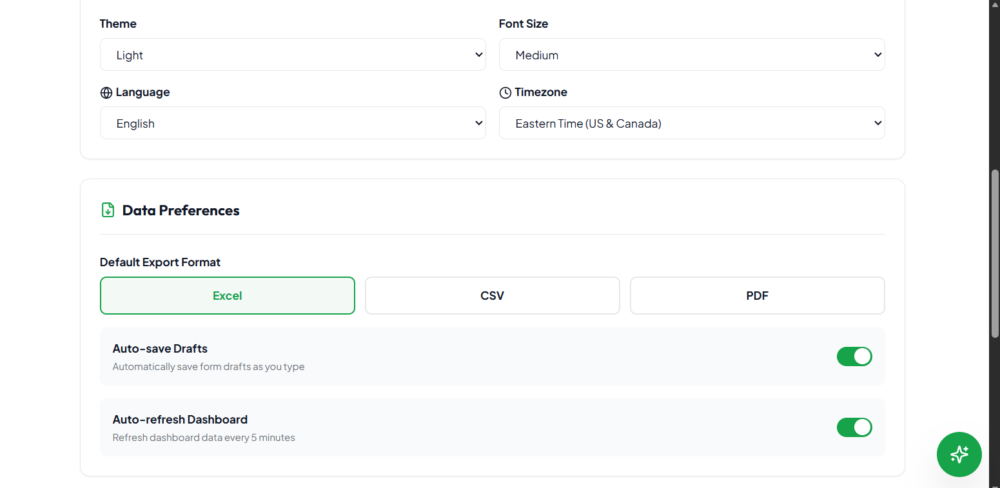
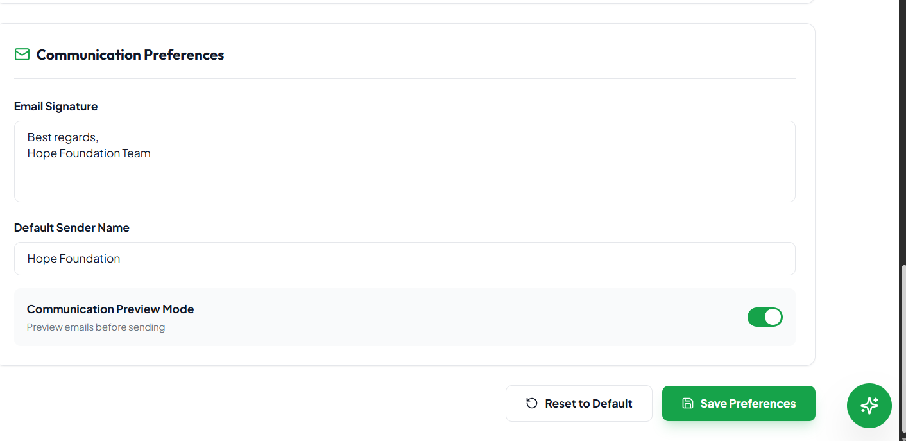
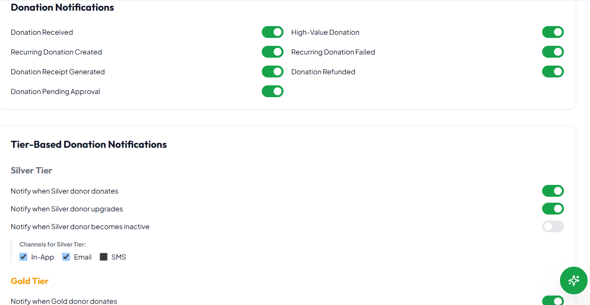
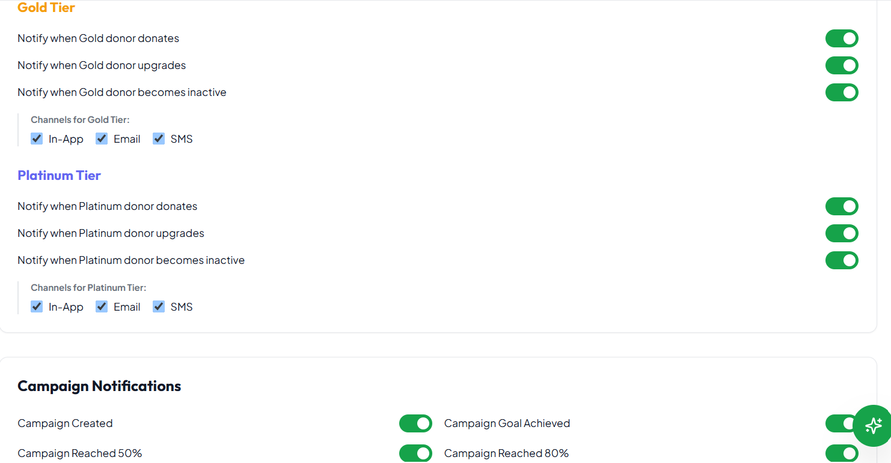
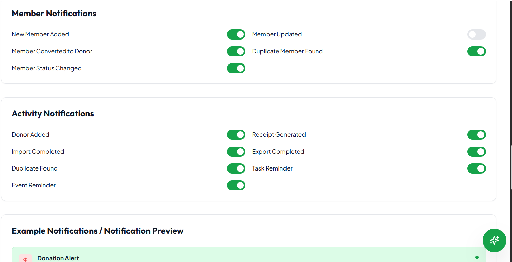

## 7. Traceability
| Goal | Workflow | Feature |
|---|---|---|
| PRO-GO-001 | PRO-WF-01 | PRO-F-001 |
| PRO-GO-002 | PRO-WF-02 | PRO-F-002 |
| PRO-GO-003 | PRO-WF-03 | PRO-F-003 |
| PRO-GO-004 | PRO-WF-04 | PRO-F-004 |
| PRO-GO-005 | PRO-WF-06 | PRO-F-005 |
| PRO-GO-006 | PRO-WF-07 | PRO-F-006 |
| PRO-GO-007 | PRO-WF-05 | PRO-F-007 |

## 8. Decisions
`PRO-OD-001`–`PRO-OD-005` in Goals remain open; no unconfirmed policy is represented as implemented.

## Screenshot Evidence Register (Existing UI; not Mermaid replacements)
| File | Existing interface evidence |
|---|---|
| `screenshots/01_Profile_Personal.png` | Profile and personal information |
| `screenshots/02_Account_Settings.png` | Username, password, 2FA, login activity |
| `screenshots/03_Organisation_Details.png` | Organisation and role fields |
| `screenshots/04_Dashboard_Preferences.png` | Dashboard landing, view and density |
| `screenshots/05_Display_Data_Preferences.png` | Display and data preferences |
| `screenshots/06_Communication_Preferences.png` | Communication preferences and save/reset |
| `screenshots/07_Notification_General.png` | General notification channel selection |
| `screenshots/08_Donations_Silver_Tier.png` | Donation and Silver tier settings |
| `screenshots/09_Gold_Platinum_Campaign.png` | Gold/Platinum and campaign events |
| `screenshots/10_Member_Activity_Preview.png` | Member/activity notifications and preview |

Screenshots are **evidence of the existing interface only**. All newly authored process diagrams in these documents use editable Mermaid source code.
