# AiXPurpose Standalone – Reports & Analytics – Feature Catalogue

> **Document Type:** Business Requirements Document – Feature Catalogue  
> **Product:** AiXPurpose Standalone (multi-tenant)  
> **Module:** Reports & Analytics  
> **Version:** 1.0 | **Status:** Draft for Business and Development Review  
> **Scope:** To-Be only. No As-Is implementation and no Future Scope.

## Document Control

| Field                  | Value                                                                                                                                                     |
| ---------------------- | --------------------------------------------------------------------------------------------------------------------------------------------------------- |
| Source of truth        | Uploaded Reports & Analytics screenshots and description; approved Q1–Q4 decisions; established Members/Donors rules; latest integration read-only policy |
| Related BRDs           | Reports & Analytics Goals, Workflow, Feature Catalogue                                                                                                    |
| Requirement IDs        | RA-GO-###, RA-BR-###, RA-WF-##, RA-F-###, RA-OD-###                                                                                                       |
| Development assumption | Screen is a proposed reference; visible controls do not prove implementation                                                                              |

## Overview

Jira-ready feature specifications based on the five To-Be pages. **No As-Is and no Future Scope.** An explicit open decision never implies approved implementation logic.

## Contents

1. Feature Catalogue Purpose and Conventions
2. Feature Summary
3. Detailed Jira-ready Feature Catalogue
4. Business Rule Register
5. Screenshot Reference Mapping
6. Goals-to-Workflow-to-Feature Traceability
7. Open Business and Development Decisions
8. QA/Product Validation Summary

## 1. Feature Catalogue Purpose and Conventions

- **Feature IDs:** RA-F-001 onward. Each specification has User Story, Classification, Functional Requirements, Business Logic, Acceptance Criteria and Mermaid workflow.
- **Source of truth:** Approved screen set and Q1–Q4 decisions; do not infer formulas, scheduling delivery or AI implementation.
- **Data governance:** Reports can be viewed and report definitions managed. Reporting never enables edits to externally integrated records.

## 2. Feature Summary

| Functional area       | Feature count | IDs               |
| --------------------- | ------------: | ----------------- |
| Overview Dashboard    |             7 | RA-F-001–RA-F-007 |
| Standard Reports      |             4 | RA-F-008–RA-F-011 |
| Custom Report Builder |             5 | RA-F-012–RA-F-016 |
| Saved Reports         |             5 | RA-F-017–RA-F-021 |
| Scheduled Reports     |             2 | RA-F-022–RA-F-023 |
| **Total**             |        **23** |                   |

## 3. Detailed Jira-ready Feature Catalogue

## 3.1 Overview Dashboard

**Screen reference:** `screenshots/01_reference.png`, `screenshots/02_reference.png`, `screenshots/03_reference.png`, `screenshots/04_reference.png`.

### RA-F-001 – KPI summary

**Classification:** To-Be  
**Goal:** RA-GO-001, RA-GO-006  
**Workflow:** RA-WF-01  
**Relevant rules:** RA-BR-001–009

**User Story (Jira)**  
As an authorised AiXPurpose reporting user, I want to display Total Donations, Total Donors, Active Campaigns and Conversion Rate, so that I can complete this reporting task using my organisation's permitted data.

**Functional Requirements**

1. Display Total Donations, Total Donors, Active Campaigns and Conversion Rate.
2. Restrict inputs and output to the authenticated tenant, permissions and approved available sources.
3. Display a validation, no-data or failure state rather than fabricating a result.
4. Do not allow any editing or updating of integration-origin business records through this feature.

**Business Logic**  
System obtains tenant-scoped eligible data and calculates four cards using approved definitions. Each external source record counts separately, and native records count individually. No cross-source identity merge for reporting.

**Acceptance Criteria**

- Four cards show values for permitted records; selecting All Sources counts all eligible source records separately; selecting one source restricts the figures; no cross-tenant totals.
- Unauthorised users and other-tenant records are never accessible.
- Where integration-origin records are shown, manual edit/update is not available and equivalent backend modifications are denied.

**Exceptions / Open Items:** Unspecified calculations, field mapping, icon actions or delivery logic must follow the relevant `RA-OD-###` entries and be confirmed before implementation.

**Mermaid Feature Flow**

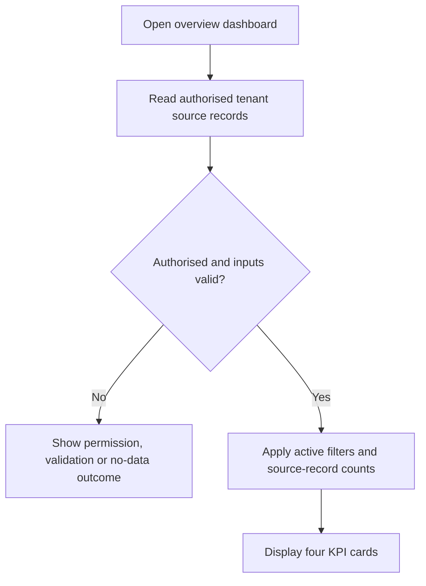

**Screenshot:** 

### RA-F-002 – Global filters

**Classification:** To-Be  
**Goal:** RA-GO-001, RA-GO-006  
**Workflow:** RA-WF-02  
**Relevant rules:** RA-BR-001–009

**User Story (Jira)**  
As an authorised AiXPurpose reporting user, I want to filter dashboard widgets by date range, campaign, channel, segment and donor type, so that I can complete this reporting task using my organisation's permitted data.

**Functional Requirements**

1. Filter dashboard widgets by date range, campaign, channel, segment and donor type.
2. Restrict inputs and output to the authenticated tenant, permissions and approved available sources.
3. Display a validation, no-data or failure state rather than fabricating a result.
4. Do not allow any editing or updating of integration-origin business records through this feature.

**Business Logic**  
Apply affects all eligible dashboard widgets; Reset restores defaults. Source application filter additionally supports All Sources and available connected applications.

**Acceptance Criteria**

- Applying filters refreshes applicable cards and visualisations consistently; Reset removes selected restrictions; users see only tenant-authorised sources.
- Unauthorised users and other-tenant records are never accessible.
- Where integration-origin records are shown, manual edit/update is not available and equivalent backend modifications are denied.

**Exceptions / Open Items:** Unspecified calculations, field mapping, icon actions or delivery logic must follow the relevant `RA-OD-###` entries and be confirmed before implementation.

**Mermaid Feature Flow**

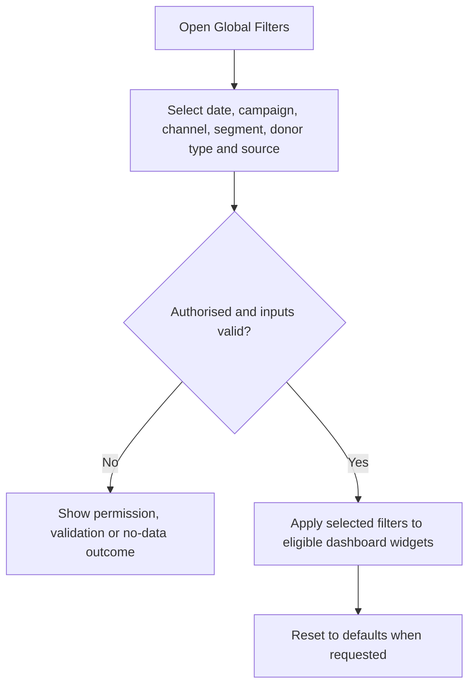

**Screenshot:** 

### RA-F-003 – Donation trend

**Classification:** To-Be  
**Goal:** RA-GO-001, RA-GO-006  
**Workflow:** RA-WF-03  
**Relevant rules:** RA-BR-001–009

**User Story (Jira)**  
As an authorised AiXPurpose reporting user, I want to display donation trends in daily, weekly and monthly views, so that I can complete this reporting task using my organisation's permitted data.

**Functional Requirements**

1. Display donation trends in daily, weekly and monthly views.
2. Restrict inputs and output to the authenticated tenant, permissions and approved available sources.
3. Display a validation, no-data or failure state rather than fabricating a result.
4. Do not allow any editing or updating of integration-origin business records through this feature.

**Business Logic**  
Aggregate eligible donation values by selected period, respecting the currently applied source and global filters.

**Acceptance Criteria**

- Daily, weekly, monthly selections change grouping; data shown matches eligible records; empty data does not fabricate values.
- Unauthorised users and other-tenant records are never accessible.
- Where integration-origin records are shown, manual edit/update is not available and equivalent backend modifications are denied.

**Exceptions / Open Items:** Unspecified calculations, field mapping, icon actions or delivery logic must follow the relevant `RA-OD-###` entries and be confirmed before implementation.

**Mermaid Feature Flow**

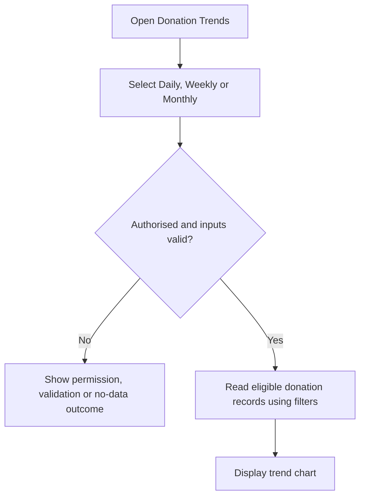

**Screenshot:** 

### RA-F-004 – Channel performance

**Classification:** To-Be  
**Goal:** RA-GO-001, RA-GO-006  
**Workflow:** RA-WF-04  
**Relevant rules:** RA-BR-001–009

**User Story (Jira)**  
As an authorised AiXPurpose reporting user, I want to show Email, SMS and WhatsApp performance panels, so that I can complete this reporting task using my organisation's permitted data.

**Functional Requirements**

1. Show Email, SMS and WhatsApp performance panels.
2. Restrict inputs and output to the authenticated tenant, permissions and approved available sources.
3. Display a validation, no-data or failure state rather than fabricating a result.
4. Do not allow any editing or updating of integration-origin business records through this feature.

**Business Logic**  
For data available from Communications, present channel metrics indicated by the UI (opened, clicked and converted). Exact event definitions and formulas require approval.

**Acceptance Criteria**

- Channels display available, authorised measured data; unsupported or absent channel data is not invented; global/source filters apply where relevant.
- Unauthorised users and other-tenant records are never accessible.
- Where integration-origin records are shown, manual edit/update is not available and equivalent backend modifications are denied.

**Exceptions / Open Items:** Unspecified calculations, field mapping, icon actions or delivery logic must follow the relevant `RA-OD-###` entries and be confirmed before implementation.

**Mermaid Feature Flow**

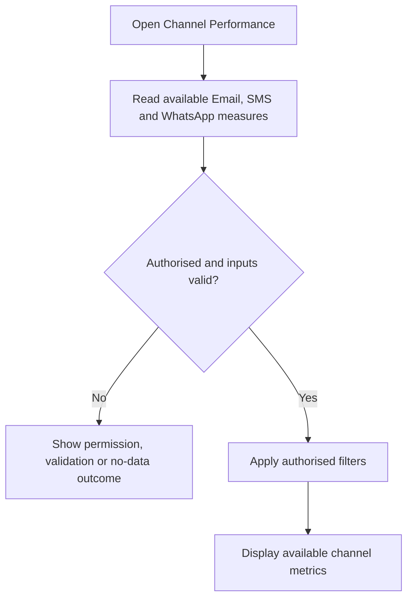

**Screenshot:** 

### RA-F-005 – Segment performance

**Classification:** To-Be  
**Goal:** RA-GO-001, RA-GO-006  
**Workflow:** RA-WF-04  
**Relevant rules:** RA-BR-001–009

**User Story (Jira)**  
As an authorised AiXPurpose reporting user, I want to show High-value, Warm and Cold donor segment performance, so that I can complete this reporting task using my organisation's permitted data.

**Functional Requirements**

1. Show High-value, Warm and Cold donor segment performance.
2. Restrict inputs and output to the authenticated tenant, permissions and approved available sources.
3. Display a validation, no-data or failure state rather than fabricating a result.
4. Do not allow any editing or updating of integration-origin business records through this feature.

**Business Logic**  
Apply approved segment definitions (not supplied) to eligible donor-source records; avoid assuming unique-person deduplication.

**Acceptance Criteria**

- Visualisation shows segment categories and associated values based on approved formulas; empty or undefined categories are clearly handled.
- Unauthorised users and other-tenant records are never accessible.
- Where integration-origin records are shown, manual edit/update is not available and equivalent backend modifications are denied.

**Exceptions / Open Items:** Unspecified calculations, field mapping, icon actions or delivery logic must follow the relevant `RA-OD-###` entries and be confirmed before implementation.

**Mermaid Feature Flow**

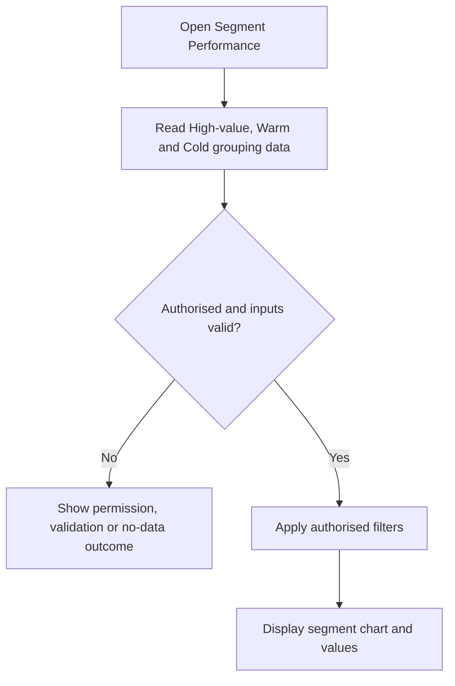

**Screenshot:** 

### RA-F-006 – AI Insights cards

**Classification:** To-Be  
**Goal:** RA-GO-001, RA-GO-006  
**Workflow:** RA-WF-05  
**Relevant rules:** RA-BR-001–009

**User Story (Jira)**  
As an authorised AiXPurpose reporting user, I want to display AI Insights cards and their visible associated actions, so that I can complete this reporting task using my organisation's permitted data.

**Functional Requirements**

1. Display AI Insights cards and their visible associated actions.
2. Restrict inputs and output to the authenticated tenant, permissions and approved available sources.
3. Display a validation, no-data or failure state rather than fabricating a result.
4. Do not allow any editing or updating of integration-origin business records through this feature.

**Business Logic**  
Keep insight-generation method, triggers and meaning of each card action as RA-OD-001; do not claim model-driven insights are implemented.

**Acceptance Criteria**

- Cards can display when supported insight data is available; corresponding actions are verified against the approved behavior; no unsupported claims are shown.
- Unauthorised users and other-tenant records are never accessible.
- Where integration-origin records are shown, manual edit/update is not available and equivalent backend modifications are denied.

**Exceptions / Open Items:** Unspecified calculations, field mapping, icon actions or delivery logic must follow the relevant `RA-OD-###` entries and be confirmed before implementation.

**Mermaid Feature Flow**


**Screenshot:** 

### RA-F-007 – Dashboard export

**Classification:** To-Be  
**Goal:** RA-GO-001, RA-GO-006  
**Workflow:** RA-WF-06  
**Relevant rules:** RA-BR-001–009

**User Story (Jira)**  
As an authorised AiXPurpose reporting user, I want to export the currently authorised dashboard view, so that I can complete this reporting task using my organisation's permitted data.

**Functional Requirements**

1. Export the currently authorised dashboard view.
2. Restrict inputs and output to the authenticated tenant, permissions and approved available sources.
3. Display a validation, no-data or failure state rather than fabricating a result.
4. Do not allow any editing or updating of integration-origin business records through this feature.

**Business Logic**  
Respect tenant permissions and active filters. Exact export contents and supported dashboard format require confirmation.

**Acceptance Criteria**

- Export cannot include another tenant; output corresponds to displayed authorised selection; unapproved export assumptions are not imposed.
- Unauthorised users and other-tenant records are never accessible.
- Where integration-origin records are shown, manual edit/update is not available and equivalent backend modifications are denied.

**Exceptions / Open Items:** Unspecified calculations, field mapping, icon actions or delivery logic must follow the relevant `RA-OD-###` entries and be confirmed before implementation.

**Mermaid Feature Flow**

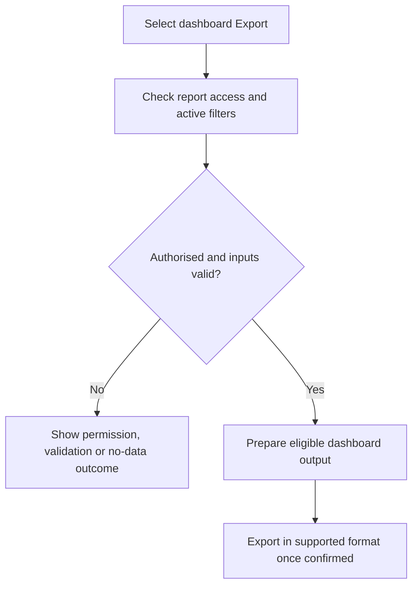

**Screenshot:** 

## 3.2 Standard Reports

**Screen reference:** `screenshots/05_reference.png`, `screenshots/06_reference.png`, `screenshots/07_reference.png`, `screenshots/08_reference.png`.

### RA-F-008 – Report catalogue

**Classification:** To-Be  
**Goal:** RA-GO-002, RA-GO-006  
**Workflow:** RA-WF-07  
**Relevant rules:** RA-BR-001–009

**User Story (Jira)**  
As an authorised AiXPurpose reporting user, I want to show Donation, Donor and Campaign report categories with the 12 supplied report types, so that I can complete this reporting task using my organisation's permitted data.

**Functional Requirements**

1. Show Donation, Donor and Campaign report categories with the 12 supplied report types.
2. Restrict inputs and output to the authenticated tenant, permissions and approved available sources.
3. Display a validation, no-data or failure state rather than fabricating a result.
4. Do not allow any editing or updating of integration-origin business records through this feature.

**Business Logic**  
Donation: Total Donations by Time, Donations by Campaign, Donations by Channel, Payment Method Breakdown. Donor: New vs Returning, High-Value, Retention Rate, At-Risk. Campaign: Campaign Performance, Goal vs Achieved, Conversion Rate, ROI per Campaign.

**Acceptance Criteria**

- All 12 report entries appear under the correct category; selecting one opens its report view; no additional report types are introduced.
- Unauthorised users and other-tenant records are never accessible.
- Where integration-origin records are shown, manual edit/update is not available and equivalent backend modifications are denied.

**Exceptions / Open Items:** Unspecified calculations, field mapping, icon actions or delivery logic must follow the relevant `RA-OD-###` entries and be confirmed before implementation.

**Mermaid Feature Flow**

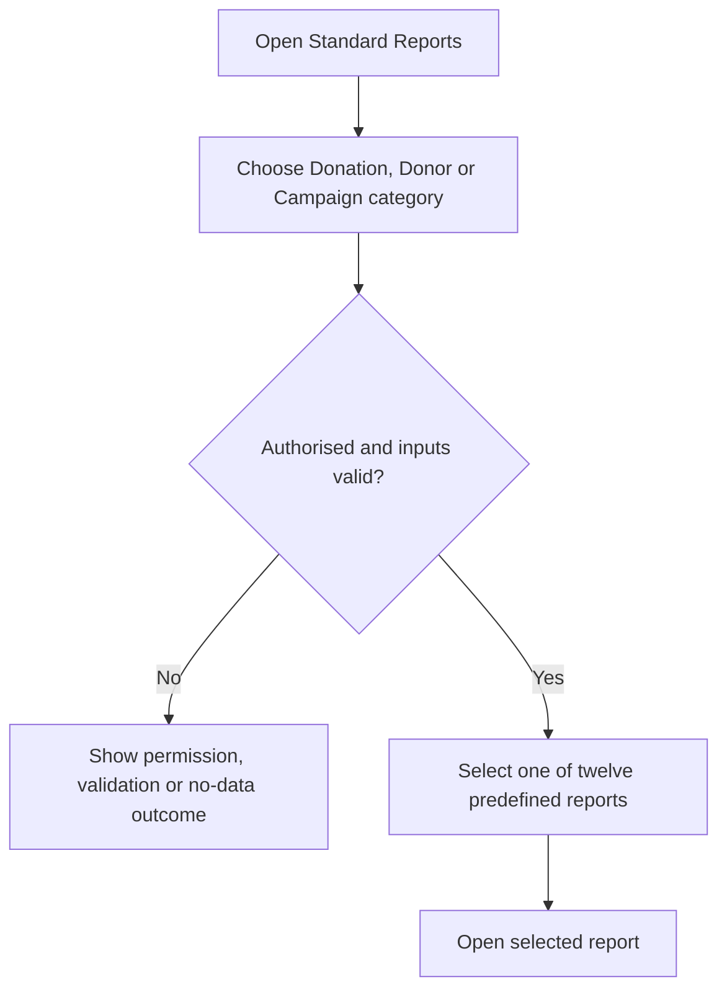

**Screenshot:** 

### RA-F-009 – Report viewing and filters

**Classification:** To-Be  
**Goal:** RA-GO-002, RA-GO-006  
**Workflow:** RA-WF-08  
**Relevant rules:** RA-BR-001–009

**User Story (Jira)**  
As an authorised AiXPurpose reporting user, I want to run predefined reports with available report-specific filters, so that I can complete this reporting task using my organisation's permitted data.

**Functional Requirements**

1. Run predefined reports with available report-specific filters.
2. Restrict inputs and output to the authenticated tenant, permissions and approved available sources.
3. Display a validation, no-data or failure state rather than fabricating a result.
4. Do not allow any editing or updating of integration-origin business records through this feature.

**Business Logic**  
Use approved metric formulas. Screenshot shows date-range, campaign and More Filters in a report view. Source filtering is an approved additional selection.

**Acceptance Criteria**

- Selected report displays only eligible tenant data; applicable filters change results; All Sources preserves separate source-record counts.
- Unauthorised users and other-tenant records are never accessible.
- Where integration-origin records are shown, manual edit/update is not available and equivalent backend modifications are denied.

**Exceptions / Open Items:** Unspecified calculations, field mapping, icon actions or delivery logic must follow the relevant `RA-OD-###` entries and be confirmed before implementation.

**Mermaid Feature Flow**

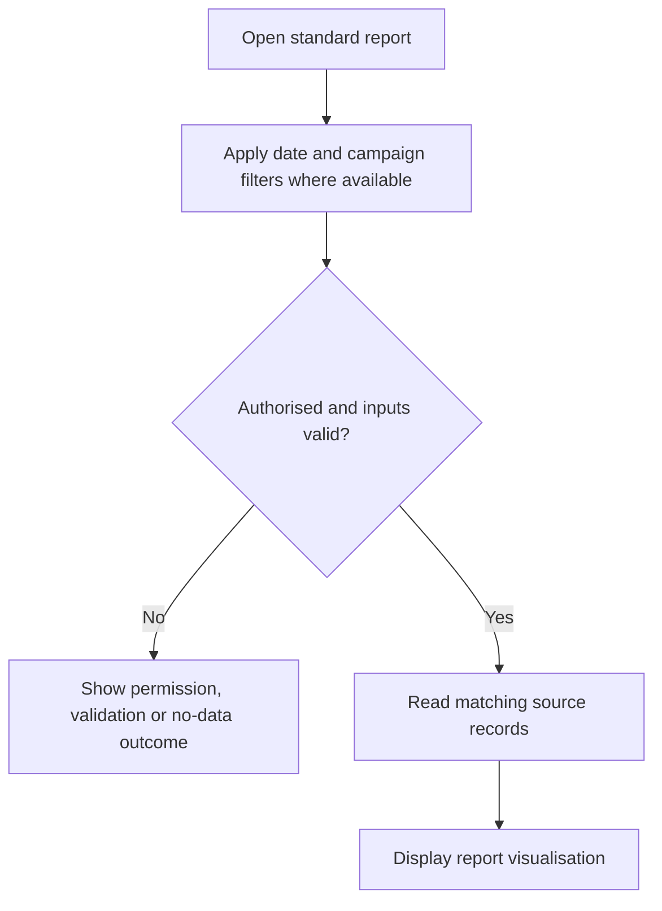

**Screenshot:** 

### RA-F-010 – Standard report export

**Classification:** To-Be  
**Goal:** RA-GO-002, RA-GO-006  
**Workflow:** RA-WF-09  
**Relevant rules:** RA-BR-001–009

**User Story (Jira)**  
As an authorised AiXPurpose reporting user, I want to export a selected standard report, so that I can complete this reporting task using my organisation's permitted data.

**Functional Requirements**

1. Export a selected standard report.
2. Restrict inputs and output to the authenticated tenant, permissions and approved available sources.
3. Display a validation, no-data or failure state rather than fabricating a result.
4. Do not allow any editing or updating of integration-origin business records through this feature.

**Business Logic**  
Export the authorised filtered report; supported report export options follow the UI and require precise confirmation if not visible.

**Acceptance Criteria**

- Export respects current report, filters and source scope; no cross-tenant records can be exported.
- Unauthorised users and other-tenant records are never accessible.
- Where integration-origin records are shown, manual edit/update is not available and equivalent backend modifications are denied.

**Exceptions / Open Items:** Unspecified calculations, field mapping, icon actions or delivery logic must follow the relevant `RA-OD-###` entries and be confirmed before implementation.

**Mermaid Feature Flow**

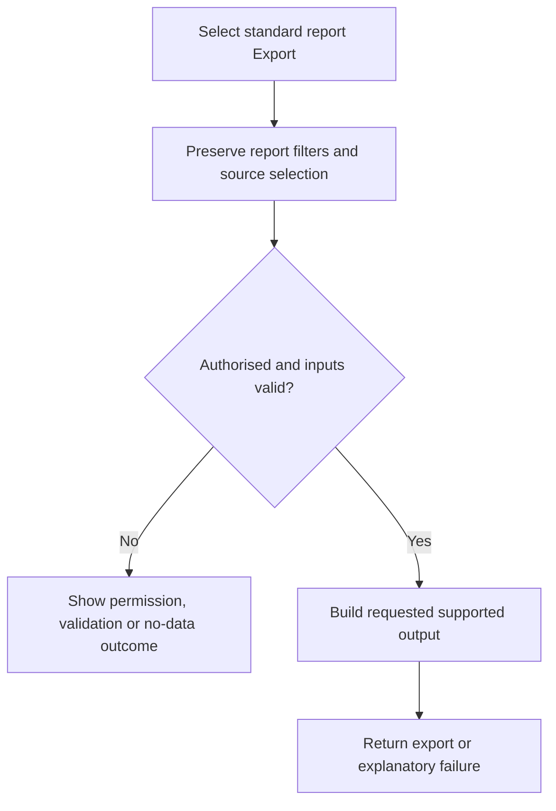

**Screenshot:** 

### RA-F-011 – Save as Custom

**Classification:** To-Be  
**Goal:** RA-GO-002, RA-GO-006  
**Workflow:** RA-WF-10  
**Relevant rules:** RA-BR-001–009

**User Story (Jira)**  
As an authorised AiXPurpose reporting user, I want to open a standard report in Custom Report Builder through Save as Custom, so that I can complete this reporting task using my organisation's permitted data.

**Functional Requirements**

1. Open a standard report in Custom Report Builder through Save as Custom.
2. Restrict inputs and output to the authenticated tenant, permissions and approved available sources.
3. Display a validation, no-data or failure state rather than fabricating a result.
4. Do not allow any editing or updating of integration-origin business records through this feature.

**Business Logic**  
Carry eligible report definition into builder where supported; exact field prepopulation needs confirmation. Do not overwrite standard report definitions.

**Acceptance Criteria**

- Save as Custom navigates to builder; standard preset remains unchanged; user can save a new report.
- Unauthorised users and other-tenant records are never accessible.
- Where integration-origin records are shown, manual edit/update is not available and equivalent backend modifications are denied.

**Exceptions / Open Items:** Unspecified calculations, field mapping, icon actions or delivery logic must follow the relevant `RA-OD-###` entries and be confirmed before implementation.

**Mermaid Feature Flow**

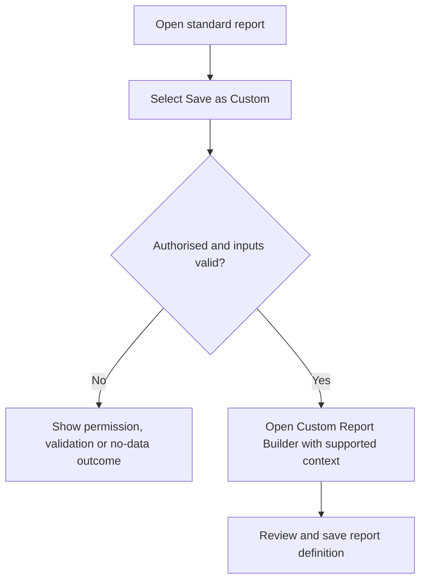

**Screenshot:** 

## 3.3 Custom Report Builder

**Screen reference:** `screenshots/09_reference.png`, `screenshots/10_reference.png`, `screenshots/11_reference.png`.

### RA-F-012 – Select source and name

**Classification:** To-Be  
**Goal:** RA-GO-003, RA-GO-006  
**Workflow:** RA-WF-11  
**Relevant rules:** RA-BR-001–009

**User Story (Jira)**  
As an authorised AiXPurpose reporting user, I want to select Donations, Donors, Campaigns or Communications and enter a report name, so that I can complete this reporting task using my organisation's permitted data.

**Functional Requirements**

1. Select Donations, Donors, Campaigns or Communications and enter a report name.
2. Restrict inputs and output to the authenticated tenant, permissions and approved available sources.
3. Display a validation, no-data or failure state rather than fabricating a result.
4. Do not allow any editing or updating of integration-origin business records through this feature.

**Business Logic**  
Data source controls eligible fields. A named report can be saved only after applicable required selections are met; exact field rules remain open.

**Acceptance Criteria**

- All four available sources are selectable; name and source are preserved in report definition; disallowed tenant/source fields are not exposed.
- Unauthorised users and other-tenant records are never accessible.
- Where integration-origin records are shown, manual edit/update is not available and equivalent backend modifications are denied.

**Exceptions / Open Items:** Unspecified calculations, field mapping, icon actions or delivery logic must follow the relevant `RA-OD-###` entries and be confirmed before implementation.

**Mermaid Feature Flow**

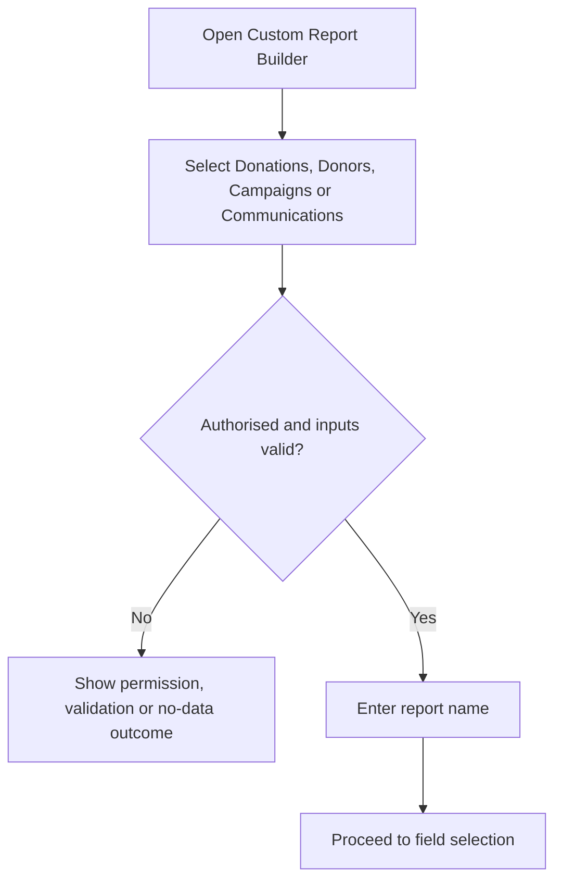

**Screenshot:** 

### RA-F-013 – Fields, filters and Group By

**Classification:** To-Be  
**Goal:** RA-GO-003, RA-GO-006  
**Workflow:** RA-WF-12  
**Relevant rules:** RA-BR-001–009

**User Story (Jira)**  
As an authorised AiXPurpose reporting user, I want to choose source-specific fields, filters and an optional grouping field, so that I can complete this reporting task using my organisation's permitted data.

**Functional Requirements**

1. Choose source-specific fields, filters and an optional grouping field.
2. Restrict inputs and output to the authenticated tenant, permissions and approved available sources.
3. Display a validation, no-data or failure state rather than fabricating a result.
4. Do not allow any editing or updating of integration-origin business records through this feature.

**Business Logic**  
Only fields supported by the chosen source may be selected; saved filters/grouping are applied on report execution. Exact supported combinations are RA-OD-005.

**Acceptance Criteria**

- Supported selected fields appear in output; filters restrict results; Group By aggregates where valid; invalid configurations are rejected without silently running.
- Unauthorised users and other-tenant records are never accessible.
- Where integration-origin records are shown, manual edit/update is not available and equivalent backend modifications are denied.

**Exceptions / Open Items:** Unspecified calculations, field mapping, icon actions or delivery logic must follow the relevant `RA-OD-###` entries and be confirmed before implementation.

**Mermaid Feature Flow**

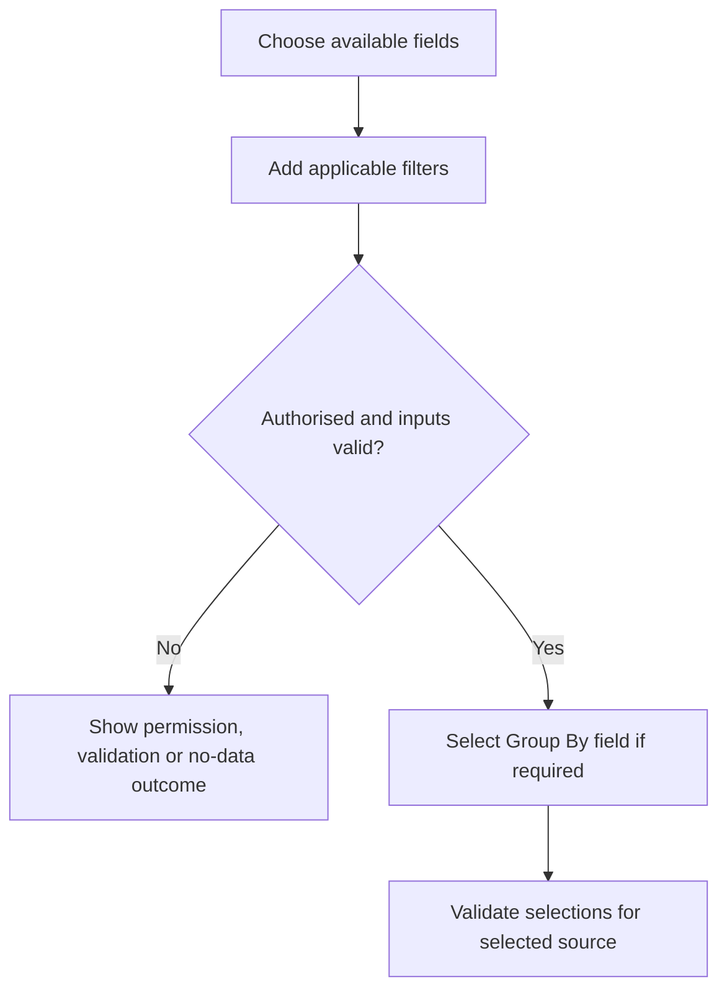

**Screenshot:** 

### RA-F-014 – Visualisation

**Classification:** To-Be  
**Goal:** RA-GO-003, RA-GO-006  
**Workflow:** RA-WF-13  
**Relevant rules:** RA-BR-001–009

**User Story (Jira)**  
As an authorised AiXPurpose reporting user, I want to choose Table, Bar Chart, Line Chart or Pie Chart, so that I can complete this reporting task using my organisation's permitted data.

**Functional Requirements**

1. Choose Table, Bar Chart, Line Chart or Pie Chart.
2. Restrict inputs and output to the authenticated tenant, permissions and approved available sources.
3. Display a validation, no-data or failure state rather than fabricating a result.
4. Do not allow any editing or updating of integration-origin business records through this feature.

**Business Logic**  
Use selected fields and grouping to render the chosen visualisation; unsupported field/chart combinations require confirmation rather than invented conversion.

**Acceptance Criteria**

- Four view types are selectable; selected view uses report result; unsupported combinations display a validation outcome.
- Unauthorised users and other-tenant records are never accessible.
- Where integration-origin records are shown, manual edit/update is not available and equivalent backend modifications are denied.

**Exceptions / Open Items:** Unspecified calculations, field mapping, icon actions or delivery logic must follow the relevant `RA-OD-###` entries and be confirmed before implementation.

**Mermaid Feature Flow**

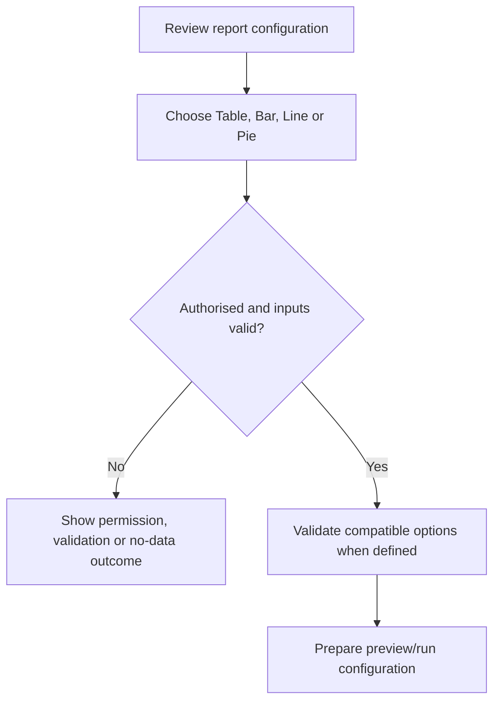

**Screenshot:** 

### RA-F-015 – Run Report

**Classification:** To-Be  
**Goal:** RA-GO-003, RA-GO-006  
**Workflow:** RA-WF-14  
**Relevant rules:** RA-BR-001–009

**User Story (Jira)**  
As an authorised AiXPurpose reporting user, I want to execute report preview using current builder selections, so that I can complete this reporting task using my organisation's permitted data.

**Functional Requirements**

1. Execute report preview using current builder selections.
2. Restrict inputs and output to the authenticated tenant, permissions and approved available sources.
3. Display a validation, no-data or failure state rather than fabricating a result.
4. Do not allow any editing or updating of integration-origin business records through this feature.

**Business Logic**  
Run Report must become operational (the reference says it does not work). Filter and calculate within authorised tenant/source data; apply approved formulas.

**Acceptance Criteria**

- Run Report returns a valid view or clear validation/error state; respects selected fields/filters/source; never exposes cross-tenant records.
- Unauthorised users and other-tenant records are never accessible.
- Where integration-origin records are shown, manual edit/update is not available and equivalent backend modifications are denied.

**Exceptions / Open Items:** Unspecified calculations, field mapping, icon actions or delivery logic must follow the relevant `RA-OD-###` entries and be confirmed before implementation.

**Mermaid Feature Flow**


**Screenshot:** 

### RA-F-016 – Save Report

**Classification:** To-Be  
**Goal:** RA-GO-003, RA-GO-006  
**Workflow:** RA-WF-15  
**Relevant rules:** RA-BR-001–009

**User Story (Jira)**  
As an authorised AiXPurpose reporting user, I want to save a custom report definition, so that I can complete this reporting task using my organisation's permitted data.

**Functional Requirements**

1. Save a custom report definition.
2. Restrict inputs and output to the authenticated tenant, permissions and approved available sources.
3. Display a validation, no-data or failure state rather than fabricating a result.
4. Do not allow any editing or updating of integration-origin business records through this feature.

**Business Logic**  
Save name, source, fields, filters, grouping and selected visualisation so it can be reopened under Saved Reports.

**Acceptance Criteria**

- Saved report appears in Saved Reports, can be reopened with saved configuration, and is associated with the correct tenant.
- Unauthorised users and other-tenant records are never accessible.
- Where integration-origin records are shown, manual edit/update is not available and equivalent backend modifications are denied.

**Exceptions / Open Items:** Unspecified calculations, field mapping, icon actions or delivery logic must follow the relevant `RA-OD-###` entries and be confirmed before implementation.

**Mermaid Feature Flow**

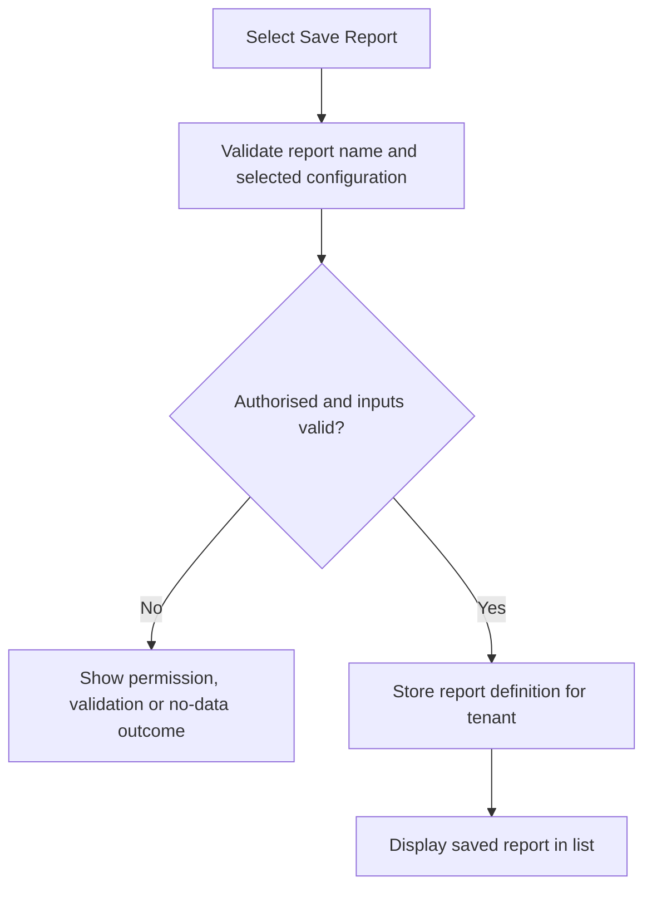

**Screenshot:** 

## 3.4 Saved Reports

**Screen reference:** `screenshots/12_reference.png`.

### RA-F-017 – Saved report listing and search

**Classification:** To-Be  
**Goal:** RA-GO-004, RA-GO-006  
**Workflow:** RA-WF-16  
**Relevant rules:** RA-BR-001–009

**User Story (Jira)**  
As an authorised AiXPurpose reporting user, I want to list and find saved reports and open Create New Report, so that I can complete this reporting task using my organisation's permitted data.

**Functional Requirements**

1. List and find saved reports and open Create New Report.
2. Restrict inputs and output to the authenticated tenant, permissions and approved available sources.
3. Display a validation, no-data or failure state rather than fabricating a result.
4. Do not allow any editing or updating of integration-origin business records through this feature.

**Business Logic**  
Show accessible saved report cards and search; Create New Report navigates to Custom Report Builder.

**Acceptance Criteria**

- Matching reports are shown; nonmatches show empty state; tenant-inaccessible reports never appear.
- Unauthorised users and other-tenant records are never accessible.
- Where integration-origin records are shown, manual edit/update is not available and equivalent backend modifications are denied.

**Exceptions / Open Items:** Unspecified calculations, field mapping, icon actions or delivery logic must follow the relevant `RA-OD-###` entries and be confirmed before implementation.

**Mermaid Feature Flow**

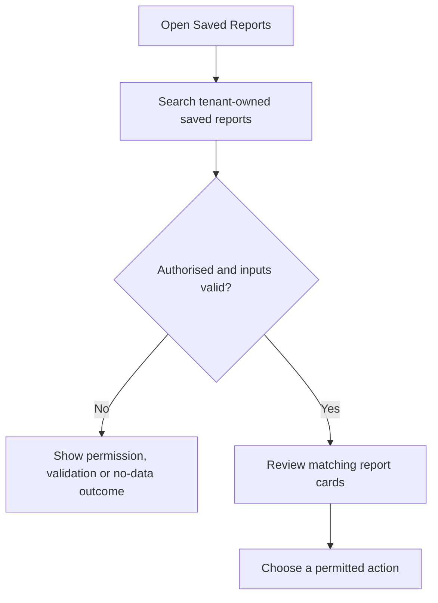

**Screenshot:** 

### RA-F-018 – Run saved report

**Classification:** To-Be  
**Goal:** RA-GO-004, RA-GO-006  
**Workflow:** RA-WF-17  
**Relevant rules:** RA-BR-001–009

**User Story (Jira)**  
As an authorised AiXPurpose reporting user, I want to execute a previously saved report, so that I can complete this reporting task using my organisation's permitted data.

**Functional Requirements**

1. Execute a previously saved report.
2. Restrict inputs and output to the authenticated tenant, permissions and approved available sources.
3. Display a validation, no-data or failure state rather than fabricating a result.
4. Do not allow any editing or updating of integration-origin business records through this feature.

**Business Logic**  
Reapply stored fields, filters and visualisation to the current eligible authorised dataset; preserve previously saved definition.

**Acceptance Criteria**

- Run action produces current authorised result or a clear error; current data and source filters are respected.
- Unauthorised users and other-tenant records are never accessible.
- Where integration-origin records are shown, manual edit/update is not available and equivalent backend modifications are denied.

**Exceptions / Open Items:** Unspecified calculations, field mapping, icon actions or delivery logic must follow the relevant `RA-OD-###` entries and be confirmed before implementation.

**Mermaid Feature Flow**

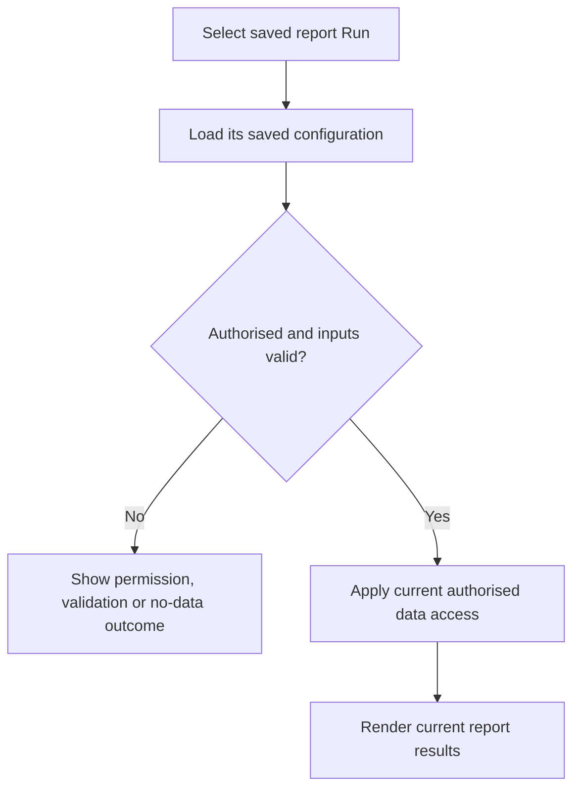

**Screenshot:** 

### RA-F-019 – Edit saved report

**Classification:** To-Be  
**Goal:** RA-GO-004, RA-GO-006  
**Workflow:** RA-WF-18  
**Relevant rules:** RA-BR-001–009

**User Story (Jira)**  
As an authorised AiXPurpose reporting user, I want to open an editable saved report definition, so that I can complete this reporting task using my organisation's permitted data.

**Functional Requirements**

1. Open an editable saved report definition.
2. Restrict inputs and output to the authenticated tenant, permissions and approved available sources.
3. Display a validation, no-data or failure state rather than fabricating a result.
4. Do not allow any editing or updating of integration-origin business records through this feature.

**Business Logic**  
Edits affect report configuration only, not underlying donor/member/campaign records. No operation may edit integration-origin records.

**Acceptance Criteria**

- Changes to report settings are saved and shown next time; underlying data is unchanged; tenant access enforced.
- Unauthorised users and other-tenant records are never accessible.
- Where integration-origin records are shown, manual edit/update is not available and equivalent backend modifications are denied.

**Exceptions / Open Items:** Unspecified calculations, field mapping, icon actions or delivery logic must follow the relevant `RA-OD-###` entries and be confirmed before implementation.

**Mermaid Feature Flow**

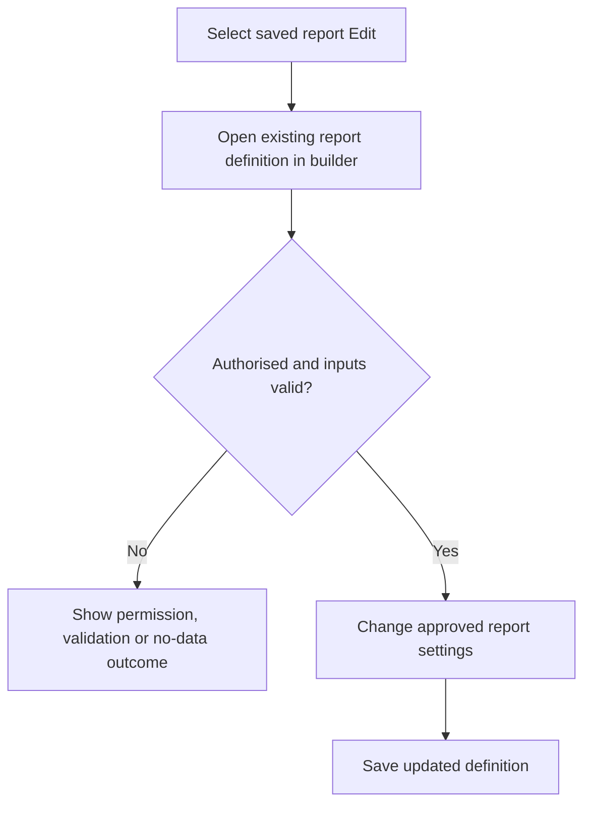

**Screenshot:** 

### RA-F-020 – Copy saved report

**Classification:** To-Be  
**Goal:** RA-GO-004, RA-GO-006  
**Workflow:** RA-WF-18  
**Relevant rules:** RA-BR-001–009

**User Story (Jira)**  
As an authorised AiXPurpose reporting user, I want to create a separate report definition from a saved report, so that I can complete this reporting task using my organisation's permitted data.

**Functional Requirements**

1. Create a separate report definition from a saved report.
2. Restrict inputs and output to the authenticated tenant, permissions and approved available sources.
3. Display a validation, no-data or failure state rather than fabricating a result.
4. Do not allow any editing or updating of integration-origin business records through this feature.

**Business Logic**  
Copy duplicates a report configuration, not business records; source report stays unchanged.

**Acceptance Criteria**

- Copy creates an independent saved definition; original is retained; permissions enforced.
- Unauthorised users and other-tenant records are never accessible.
- Where integration-origin records are shown, manual edit/update is not available and equivalent backend modifications are denied.

**Exceptions / Open Items:** Unspecified calculations, field mapping, icon actions or delivery logic must follow the relevant `RA-OD-###` entries and be confirmed before implementation.

**Mermaid Feature Flow**

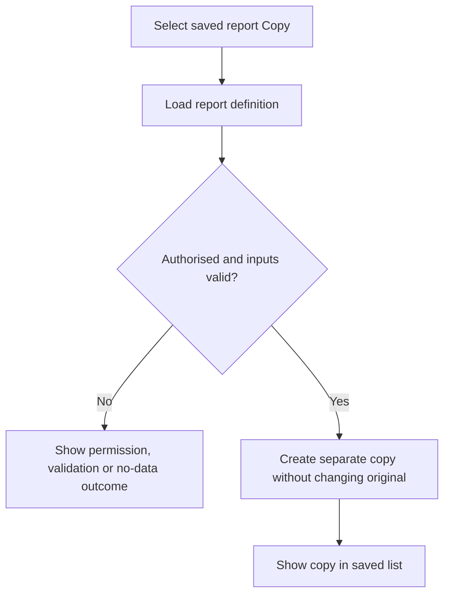

**Screenshot:** 

### RA-F-021 – Delete saved report

**Classification:** To-Be  
**Goal:** RA-GO-004, RA-GO-006  
**Workflow:** RA-WF-18  
**Relevant rules:** RA-BR-001–009

**User Story (Jira)**  
As an authorised AiXPurpose reporting user, I want to remove an authorised saved report definition, so that I can complete this reporting task using my organisation's permitted data.

**Functional Requirements**

1. Remove an authorised saved report definition.
2. Restrict inputs and output to the authenticated tenant, permissions and approved available sources.
3. Display a validation, no-data or failure state rather than fabricating a result.
4. Do not allow any editing or updating of integration-origin business records through this feature.

**Business Logic**  
Deletion affects report configuration, not business data. Confirmation UX is not established by source.

**Acceptance Criteria**

- Report no longer appears when removed; underlying transaction and integration records remain untouched.
- Unauthorised users and other-tenant records are never accessible.
- Where integration-origin records are shown, manual edit/update is not available and equivalent backend modifications are denied.

**Exceptions / Open Items:** Unspecified calculations, field mapping, icon actions or delivery logic must follow the relevant `RA-OD-###` entries and be confirmed before implementation.

**Mermaid Feature Flow**

```mermaid
flowchart TD
    A["Select saved report Delete"] --> B["Check permission and confirm intent"]
    B --> C{"Authorised and inputs valid?"}
    C -->|No| X["Show permission, validation or no-data outcome"]
    C -->|Yes| D["Delete specified saved report definition"]
    D --> E["Refresh saved reports list"]
```

**Screenshot:** 

## 3.5 Scheduled Reports

**Screen reference:** `screenshots/13_reference.png`, `screenshots/14_reference.png`.

### RA-F-022 – Create schedule

**Classification:** To-Be  
**Goal:** RA-GO-005, RA-GO-006  
**Workflow:** RA-WF-19  
**Relevant rules:** RA-BR-001–009

**User Story (Jira)**  
As an authorised AiXPurpose reporting user permitted to configure schedules, I want to select report, Daily/Weekly/Monthly, email recipients and PDF/Excel/CSV format, so that I can complete this reporting task using my organisation's permitted data.

**Functional Requirements**

1. Select report, Daily/Weekly/Monthly, email recipients and PDF/Excel/CSV format.
2. Restrict inputs and output to the authenticated tenant, permissions and approved available sources.
3. Display a validation, no-data or failure state rather than fabricating a result.
4. Do not allow any editing or updating of integration-origin business records through this feature.

**Business Logic**  
Persist schedule configuration. Mechanism for execution, delivery, recipients validation and failures remains RA-OD-002/003, to confirm with Development.

**Acceptance Criteria**

- Schedule captures all UI settings; invalid or missing required inputs are not silently accepted; no claim of successful delivery without verification.
- Unauthorised users and other-tenant records are never accessible.
- Where integration-origin records are shown, manual edit/update is not available and equivalent backend modifications are denied.

**Exceptions / Open Items:** Unspecified calculations, field mapping, icon actions or delivery logic must follow the relevant `RA-OD-###` entries and be confirmed before implementation.

**Mermaid Feature Flow**

```mermaid
flowchart TD
    A["Open Create Schedule"] --> B["Select report and Daily, Weekly or Monthly"]
    B --> C{"Authorised and inputs valid?"}
    C -->|No| X["Show permission, validation or no-data outcome"]
    C -->|Yes| D["Enter recipients and choose PDF, Excel or CSV"]
    D --> E["Save schedule configuration; delivery rules pending"]
```

**Screenshot:** 

### RA-F-023 – Schedule listing and management

**Classification:** To-Be  
**Goal:** RA-GO-005, RA-GO-006  
**Workflow:** RA-WF-20  
**Relevant rules:** RA-BR-001–009

**User Story (Jira)**  
As an authorised AiXPurpose reporting user permitted to configure schedules, I want to display existing scheduled reports with next run, recipient and format details and visible actions, so that I can complete this reporting task using my organisation's permitted data.

**Functional Requirements**

1. Display existing scheduled reports with next run, recipient and format details and visible actions.
2. Restrict inputs and output to the authenticated tenant, permissions and approved available sources.
3. Display a validation, no-data or failure state rather than fabricating a result.
4. Do not allow any editing or updating of integration-origin business records through this feature.

**Business Logic**  
Use screenshot schedule cards. Define exact semantics of individual management icons with Development before implementation.

**Acceptance Criteria**

- Saved schedules appear under correct tenant with correct configured details; actions are permission-checked and verified when defined.
- Unauthorised users and other-tenant records are never accessible.
- Where integration-origin records are shown, manual edit/update is not available and equivalent backend modifications are denied.

**Exceptions / Open Items:** Unspecified calculations, field mapping, icon actions or delivery logic must follow the relevant `RA-OD-###` entries and be confirmed before implementation.

**Mermaid Feature Flow**

```mermaid
flowchart TD
    A["Open Scheduled Reports"] --> B["Review report, next run, recipients and format"]
    B --> C{"Authorised and inputs valid?"}
    C -->|No| X["Show permission, validation or no-data outcome"]
    C -->|Yes| D["Select available authorised schedule action"]
    D --> E["Apply action only after semantics are confirmed"]
```

**Screenshot:** 

## 4. Business Rule Register

| ID        | Business Rule                                                                                                                                                                                                       |
| --------- | ------------------------------------------------------------------------------------------------------------------------------------------------------------------------------------------------------------------- |
| RA-BR-001 | Tenant-scoped data, filters, reports, saved definitions and schedules; enforce authorised access.                                                                                                                   |
| RA-BR-002 | All Sources counts each eligible source record separately, including native AiXPurpose records; do not deduplicate records from different sources.                                                                  |
| RA-BR-003 | Source filtering includes All Sources and individual available connected applications for the tenant.                                                                                                               |
| RA-BR-004 | Records received from integrations are strictly read-only in AiXPurpose. Only natively created records can be edited in their owning module by authorised users. Report-definition editing never edits source data. |
| RA-BR-005 | Report metrics and categories rely on approved Donors, Donations, Members, Campaigns and Communications definitions; undefined formulas are open decisions.                                                         |
| RA-BR-006 | Global and report-level filters apply to eligible widgets, charts and exported results consistently.                                                                                                                |
| RA-BR-007 | AI Insights generation method and click actions remain open; do not assume a model or decision engine.                                                                                                              |
| RA-BR-008 | Scheduled report execution, email-delivery rules, and failure handling remain open for Development confirmation.                                                                                                    |
| RA-BR-009 | Data source selectors show only tenant-authorised and supported connected applications and approved native records.                                                                                                 |

## 5. Screenshot Reference Mapping

| Images         | Functional area       |
| -------------- | --------------------- |
| 01, 02, 03, 04 | Overview Dashboard    |
| 05, 06, 07, 08 | Standard Reports      |
| 09, 10, 11     | Custom Report Builder |
| 12             | Saved Reports         |
| 13, 14         | Scheduled Reports     |

## 6. Goals-to-Workflow-to-Feature Traceability

| Feature  | Workflow | Goal                 |
| -------- | -------- | -------------------- |
| RA-F-001 | RA-WF-01 | RA-GO-001, RA-GO-006 |
| RA-F-002 | RA-WF-02 | RA-GO-001, RA-GO-006 |
| RA-F-003 | RA-WF-03 | RA-GO-001, RA-GO-006 |
| RA-F-004 | RA-WF-04 | RA-GO-001, RA-GO-006 |
| RA-F-005 | RA-WF-04 | RA-GO-001, RA-GO-006 |
| RA-F-006 | RA-WF-05 | RA-GO-001, RA-GO-006 |
| RA-F-007 | RA-WF-06 | RA-GO-001, RA-GO-006 |
| RA-F-008 | RA-WF-07 | RA-GO-002, RA-GO-006 |
| RA-F-009 | RA-WF-08 | RA-GO-002, RA-GO-006 |
| RA-F-010 | RA-WF-09 | RA-GO-002, RA-GO-006 |
| RA-F-011 | RA-WF-10 | RA-GO-002, RA-GO-006 |
| RA-F-012 | RA-WF-11 | RA-GO-003, RA-GO-006 |
| RA-F-013 | RA-WF-12 | RA-GO-003, RA-GO-006 |
| RA-F-014 | RA-WF-13 | RA-GO-003, RA-GO-006 |
| RA-F-015 | RA-WF-14 | RA-GO-003, RA-GO-006 |
| RA-F-016 | RA-WF-15 | RA-GO-003, RA-GO-006 |
| RA-F-017 | RA-WF-16 | RA-GO-004, RA-GO-006 |
| RA-F-018 | RA-WF-17 | RA-GO-004, RA-GO-006 |
| RA-F-019 | RA-WF-18 | RA-GO-004, RA-GO-006 |
| RA-F-020 | RA-WF-18 | RA-GO-004, RA-GO-006 |
| RA-F-021 | RA-WF-18 | RA-GO-004, RA-GO-006 |
| RA-F-022 | RA-WF-19 | RA-GO-005, RA-GO-006 |
| RA-F-023 | RA-WF-20 | RA-GO-005, RA-GO-006 |

## 7. Open Business and Development Decisions

| ID        | Open decision / confirmation                                                                      |
| --------- | ------------------------------------------------------------------------------------------------- |
| RA-OD-001 | AI Insights computation/generation and actions                                                    |
| RA-OD-002 | Schedule execution, email delivery and recipient rules                                            |
| RA-OD-003 | Schedule failure handling and run/status semantics                                                |
| RA-OD-004 | Unconfirmed KPI formulas: conversion, retention, ROI, channel conversions and segment definitions |
| RA-OD-005 | Builder supported fields, filter/grouping combinations and chart validity                         |
| RA-OD-006 | Exact export choices for dashboard/standard reports and Saved/Scheduled action icon semantics     |
| RA-OD-007 | Applicability of global/source filters to specific communications/campaign calculations           |

## 8. QA/Product Validation Summary

QA verifies all 23 To-Be stories after implementation; proposed screenshots are reference only. No features are presented as existing. Preserve per-source counts and reporting provenance; prohibit integrated-record edits; respect approved metrics and unresolved decisions.
