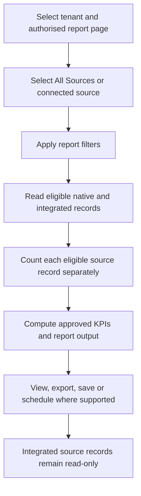
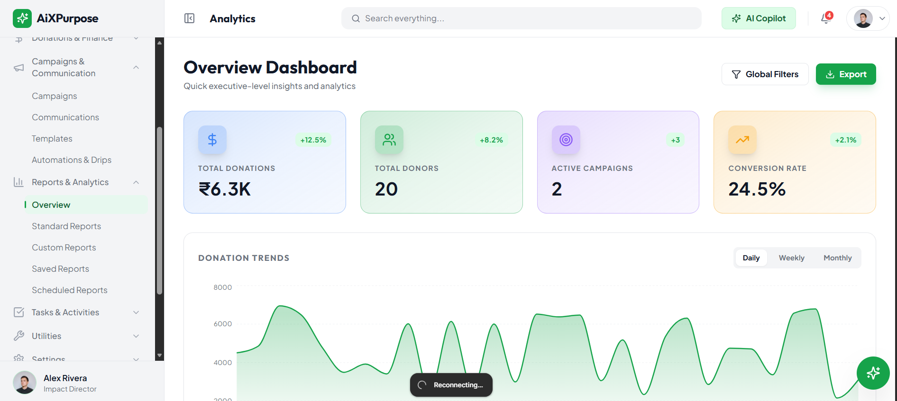
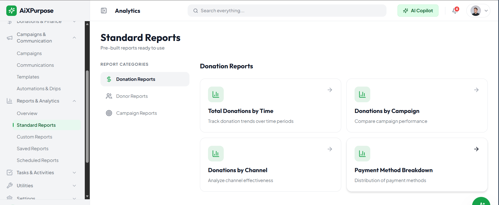
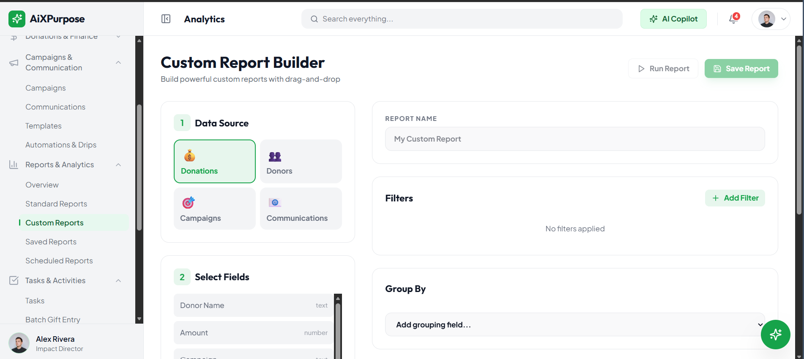
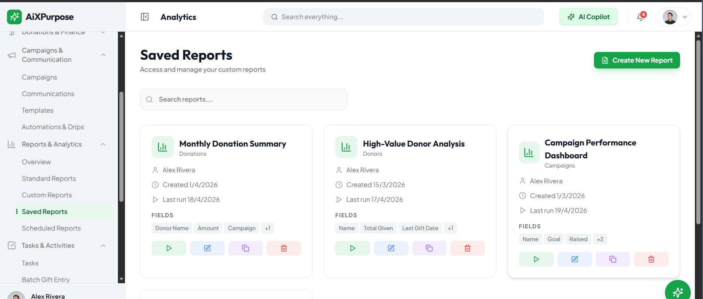
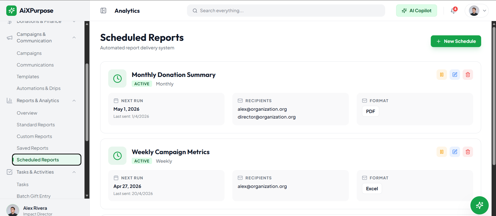

# AiXPurpose Standalone – Reports & Analytics – Goals

> **Document Type:** Business Requirements Document – Goals  
> **Product:** AiXPurpose Standalone (multi-tenant)  
> **Module:** Reports & Analytics  
> **Version:** 1.0 | **Status:** Draft for Business and Development Review  
> **Scope:** To-Be only. No As-Is implementation and no Future Scope.

## Document Control

| Field | Value |
|---|---|
| Source of truth | Uploaded Reports & Analytics screenshots and description; approved Q1–Q4 decisions; established Members/Donors rules; latest integration read-only policy |
| Related BRDs | Reports & Analytics Goals, Workflow, Feature Catalogue |
| Requirement IDs | RA-GO-###, RA-BR-###, RA-WF-##, RA-F-###, RA-OD-### |
| Development assumption | Screen is a proposed reference; visible controls do not prove implementation |

## Overview

Define the first implementation of the five-screen Reports & Analytics capability. Screenshots describe intended interface only; nothing here is classified as As-Is. No Future Scope is included.

## Contents

1. Purpose and Scope
2. Business Context and Vision
3. To-Be Goals
4. Target Operating Model
5. Capability and Screen Inventory
6. Reporting Data Rules
7. Business Rules
8. Dependencies and Boundaries
9. Business Success Criteria
10. Open Decisions
11. Goals-to-Workflow-to-Feature Traceability
12. Product Validation Summary

## 1. Purpose and Scope

Deliver Overview Dashboard, Standard Reports, Custom Report Builder, Saved Reports and Scheduled Reports as specified by the screenshots. Do not add unsupported functionality.

## 2. Business Context and Vision

Present approved tenant-owned native records and integrated records for analysis without modifying integrated data. Source-specific results and All Sources share the same count-by-source-record convention.

## 3. To-Be Goals

| Goal ID | Business Goal | Success outcome |
|---|---|---|
| RA-GO-001 | Provide a tenant-scoped overview dashboard | Four KPIs, global filtering, trends, channels, segments and insight area |
| RA-GO-002 | Deliver the defined standard reports | 12 predefined donation/donor/campaign reports |
| RA-GO-003 | Enable custom report building | Four data sources, fields, filters, grouping, four views, run and save |
| RA-GO-004 | Enable saved report reuse | Search, run, edit definition, copy and delete |
| RA-GO-005 | Enable report scheduling configuration | Select report, frequency, recipients, format; delivery open |
| RA-GO-006 | Apply source-aware reporting consistently | All Sources and source filter; separate counting; integration records read-only |

## 4. Target Operating Model

## 5. Capability and Screen Inventory

| Area | Screenshot references | To-Be behavior |
|---|---|---|
| Overview Dashboard | 1, 2, 3, 4 | 7 detailed features |
| Standard Reports | 5, 6, 7, 8 | 4 detailed features |
| Custom Report Builder | 9, 10, 11 | 5 detailed features |
| Saved Reports | 12 | 5 detailed features |
| Scheduled Reports | 13, 14 | 2 detailed features |

### Visual references

## 6. Reporting Data Rules

**All Sources:** If the same person appears as distinct source records in SAP, Salesforce and iWave, the total is three source records, not one unique donor. Eligibility and formulas follow the approved owning-module definitions; any unapproved formula remains an open decision. Local AiXPurpose records also count when eligible. Source filtering does not authorise any edit of integrated business records.

## 7. Business Rules

| ID | Business Rule |
|---|---|
| RA-BR-001 | Tenant-scoped data, filters, reports, saved definitions and schedules; enforce authorised access. |
| RA-BR-002 | All Sources counts each eligible source record separately, including native AiXPurpose records; do not deduplicate records from different sources. |
| RA-BR-003 | Source filtering includes All Sources and individual available connected applications for the tenant. |
| RA-BR-004 | Records received from integrations are strictly read-only in AiXPurpose. Only natively created records can be edited in their owning module by authorised users. Report-definition editing never edits source data. |
| RA-BR-005 | Report metrics and categories rely on approved Donors, Donations, Members, Campaigns and Communications definitions; undefined formulas are open decisions. |
| RA-BR-006 | Global and report-level filters apply to eligible widgets, charts and exported results consistently. |
| RA-BR-007 | AI Insights generation method and click actions remain open; do not assume a model or decision engine. |
| RA-BR-008 | Scheduled report execution, email-delivery rules, and failure handling remain open for Development confirmation. |
| RA-BR-009 | Data source selectors show only tenant-authorised and supported connected applications and approved native records. |

## 8. Dependencies and Boundaries

| Dependency | Boundary |
|---|---|
| Members/Donors/Donations | Existing member–donor qualification and donation data definitions; no independent donor record editing |
| Campaigns | Campaign targets, giving, reporting definitions |
| Communications | Channel activity as available; no invented SMS/WhatsApp performance data |
| Utilities API Sync | Approved source records and per-application provenance; imported records remain read-only |
| Settings Email | Scheduled-delivery mechanism open for Development confirmation |

## 9. Business Success Criteria

- **RA-GO-001:** Four KPIs, global filtering, trends, channels, segments and insight area; QA verifies relevant authorised behaviour and no cross-tenant data exposure.
- **RA-GO-002:** 12 predefined donation/donor/campaign reports; QA verifies relevant authorised behaviour and no cross-tenant data exposure.
- **RA-GO-003:** Four data sources, fields, filters, grouping, four views, run and save; QA verifies relevant authorised behaviour and no cross-tenant data exposure.
- **RA-GO-004:** Search, run, edit definition, copy and delete; QA verifies relevant authorised behaviour and no cross-tenant data exposure.
- **RA-GO-005:** Select report, frequency, recipients, format; delivery open; QA verifies relevant authorised behaviour and no cross-tenant data exposure.
- **RA-GO-006:** All Sources and source filter; separate counting; integration records read-only; QA verifies relevant authorised behaviour and no cross-tenant data exposure.

## 10. Open Decisions

| ID | Open decision / confirmation |
|---|---|
| RA-OD-001 | AI Insights computation/generation and actions |
| RA-OD-002 | Schedule execution, email delivery and recipient rules |
| RA-OD-003 | Schedule failure handling and run/status semantics |
| RA-OD-004 | Unconfirmed KPI formulas: conversion, retention, ROI, channel conversions and segment definitions |
| RA-OD-005 | Builder supported fields, filter/grouping combinations and chart validity |
| RA-OD-006 | Exact export choices for dashboard/standard reports and Saved/Scheduled action icon semantics |
| RA-OD-007 | Applicability of global/source filters to specific communications/campaign calculations |

## 11. Goals-to-Workflow-to-Feature Traceability

| Goal | Workflow IDs | Feature IDs |
|---|---|---|
| RA-GO-001, RA-GO-006 | RA-WF-01, RA-WF-02, RA-WF-03, RA-WF-04, RA-WF-05, RA-WF-06 | RA-F-001, RA-F-002, RA-F-003, RA-F-004, RA-F-005, RA-F-006, RA-F-007 |
| RA-GO-002, RA-GO-006 | RA-WF-07, RA-WF-08, RA-WF-09, RA-WF-10 | RA-F-008, RA-F-009, RA-F-010, RA-F-011 |
| RA-GO-003, RA-GO-006 | RA-WF-11, RA-WF-12, RA-WF-13, RA-WF-14, RA-WF-15 | RA-F-012, RA-F-013, RA-F-014, RA-F-015, RA-F-016 |
| RA-GO-004, RA-GO-006 | RA-WF-16, RA-WF-17, RA-WF-18 | RA-F-017, RA-F-018, RA-F-019, RA-F-020, RA-F-021 |
| RA-GO-005, RA-GO-006 | RA-WF-19, RA-WF-20 | RA-F-022, RA-F-023 |

## 12. Product Validation Summary

All five pages are To-Be. Formulas, insights, scheduled delivery and some builder/export details remain open; no unsupported assumption constitutes acceptance. Integrated business records are immutable through the user interface and relevant API operations.
