# AiXPurpose Standalone – Reports & Analytics – Workflow

> **Document Type:** Business Requirements Document – Workflow  
> **Product:** AiXPurpose Standalone (multi-tenant)  
> **Module:** Reports & Analytics  
> **Version:** 1.0 | **Status:** Draft for Business and Development Review  
> **Scope:** To-Be only. No As-Is implementation and no Future Scope.

## Document Control

| Field                  | Value                                                                                                                                                     |
| ---------------------- | --------------------------------------------------------------------------------------------------------------------------------------------------------- |
| Source of truth        | Uploaded Reports & Analytics screenshots and description; approved Q1–Q4 decisions; established Members/Donors rules; latest integration read-only policy |
| Related BRDs           | Reports & Analytics Goals, Workflow, Feature Catalogue                                                                                                    |
| Requirement IDs        | RA-GO-###, RA-BR-###, RA-WF-##, RA-F-###, RA-OD-###                                                                                                       |
| Development assumption | Screen is a proposed reference; visible controls do not prove implementation                                                                              |

## Overview

All described workflows are **To-Be**. Workflow steps reflect only supplied UI controls and approved scope decisions.

## Contents

1. Workflow Principles and Actors
2. End-to-End To-Be Flow
3. Workflow Inventory
4. Detailed To-Be Workflows
5. Exception Handling and Verification
6. Screenshot Map
7. Traceability
8. Open Decisions

## 1. Workflow Principles and Actors

**Actors:** authorised reporting user, permitted report scheduler, AiXPurpose reporting service and tenant-bound data sources. No new user roles are assumed. Native records remain editable only in their owner modules by authorised users; integrated records are read-only.

| ID        | Business Rule                                                                                                                                                                                                       |
| --------- | ------------------------------------------------------------------------------------------------------------------------------------------------------------------------------------------------------------------- |
| RA-BR-001 | Tenant-scoped data, filters, reports, saved definitions and schedules; enforce authorised access.                                                                                                                   |
| RA-BR-002 | All Sources counts each eligible source record separately, including native AiXPurpose records; do not deduplicate records from different sources.                                                                  |
| RA-BR-003 | Source filtering includes All Sources and individual available connected applications for the tenant.                                                                                                               |
| RA-BR-004 | Records received from integrations are strictly read-only in AiXPurpose. Only natively created records can be edited in their owning module by authorised users. Report-definition editing never edits source data. |
| RA-BR-005 | Report metrics and categories rely on approved Donors, Donations, Members, Campaigns and Communications definitions; undefined formulas are open decisions.                                                         |
| RA-BR-006 | Global and report-level filters apply to eligible widgets, charts and exported results consistently.                                                                                                                |
| RA-BR-007 | AI Insights generation method and click actions remain open; do not assume a model or decision engine.                                                                                                              |
| RA-BR-008 | Scheduled report execution, email-delivery rules, and failure handling remain open for Development confirmation.                                                                                                    |
| RA-BR-009 | Data source selectors show only tenant-authorised and supported connected applications and approved native records.                                                                                                 |

## 2. End-to-End To-Be Flow

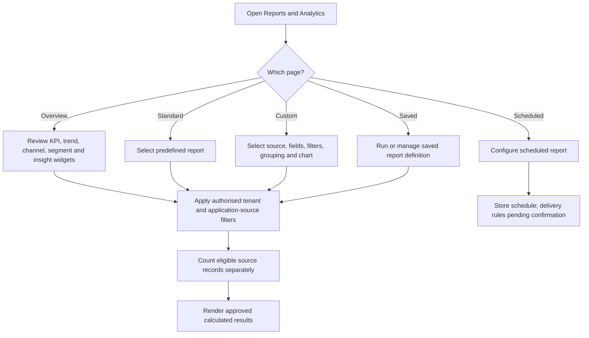

## 3. Workflow Inventory

| Workflow ID | To-Be process                   | Features                     |
| ----------- | ------------------------------- | ---------------------------- |
| RA-WF-01    | KPI summary                     | RA-F-001                     |
| RA-WF-02    | Global filters                  | RA-F-002                     |
| RA-WF-03    | Donation trend                  | RA-F-003                     |
| RA-WF-04    | Channel performance             | RA-F-004, RA-F-005           |
| RA-WF-05    | AI Insights cards               | RA-F-006                     |
| RA-WF-06    | Dashboard export                | RA-F-007                     |
| RA-WF-07    | Report catalogue                | RA-F-008                     |
| RA-WF-08    | Report viewing and filters      | RA-F-009                     |
| RA-WF-09    | Standard report export          | RA-F-010                     |
| RA-WF-10    | Save as Custom                  | RA-F-011                     |
| RA-WF-11    | Select source and name          | RA-F-012                     |
| RA-WF-12    | Fields, filters and Group By    | RA-F-013                     |
| RA-WF-13    | Visualisation                   | RA-F-014                     |
| RA-WF-14    | Run Report                      | RA-F-015                     |
| RA-WF-15    | Save Report                     | RA-F-016                     |
| RA-WF-16    | Saved report listing and search | RA-F-017                     |
| RA-WF-17    | Run saved report                | RA-F-018                     |
| RA-WF-18    | Edit saved report               | RA-F-019, RA-F-020, RA-F-021 |
| RA-WF-19    | Create schedule                 | RA-F-022                     |
| RA-WF-20    | Schedule listing and management | RA-F-023                     |

## 4. Detailed To-Be Workflows

### RA-WF-01 – KPI summary

**Classification:** To-Be. **Related features:** RA-F-001.

- **KPI summary:** Display Total Donations, Total Donors, Active Campaigns and Conversion Rate.

**Process:** Open overview dashboard → Read authorised tenant source records → Apply active filters and source-record counts → Display four KPI cards.

**Exception:** Access denied, invalid selections, unavailable source data or unconfirmed execution/AI delivery must produce a clear outcome rather than invent results.

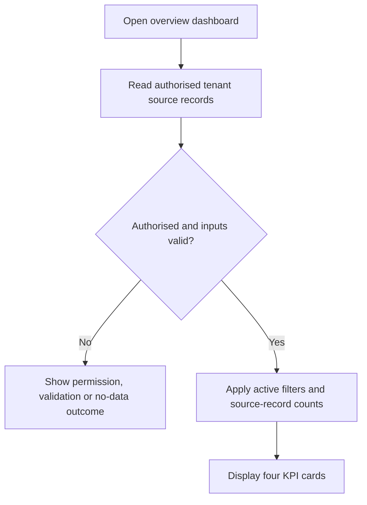

### RA-WF-02 – Global filters

**Classification:** To-Be. **Related features:** RA-F-002.

- **Global filters:** Filter dashboard widgets by date range, campaign, channel, segment and donor type.

**Process:** Open Global Filters → Select date, campaign, channel, segment, donor type and source → Apply selected filters to eligible dashboard widgets → Reset to defaults when requested.

**Exception:** Access denied, invalid selections, unavailable source data or unconfirmed execution/AI delivery must produce a clear outcome rather than invent results.

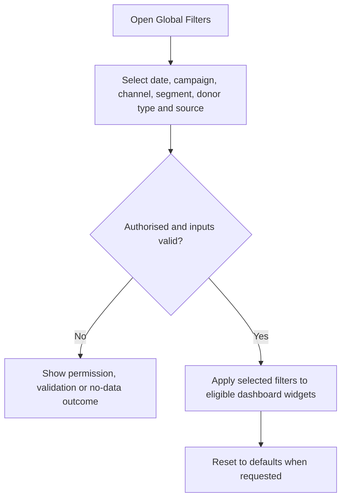

### RA-WF-03 – Donation trend

**Classification:** To-Be. **Related features:** RA-F-003.

- **Donation trend:** Display donation trends in daily, weekly and monthly views.

**Process:** Open Donation Trends → Select Daily, Weekly or Monthly → Read eligible donation records using filters → Display trend chart.

**Exception:** Access denied, invalid selections, unavailable source data or unconfirmed execution/AI delivery must produce a clear outcome rather than invent results.

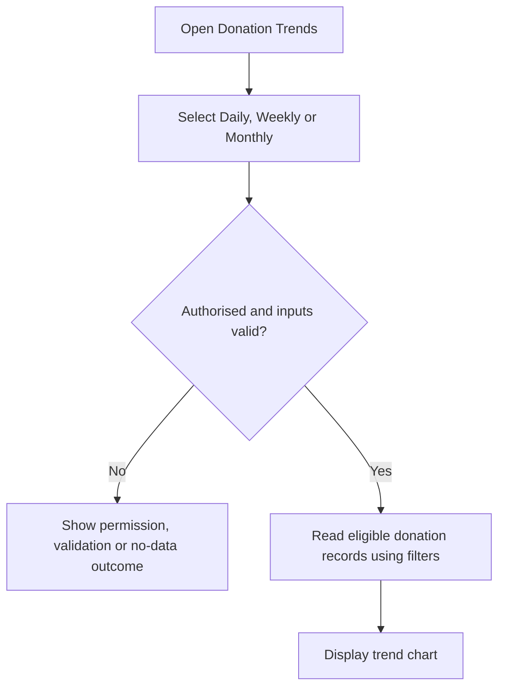

### RA-WF-04 – Channel performance / Segment performance

**Classification:** To-Be. **Related features:** RA-F-004, RA-F-005.

- **Channel performance:** Show Email, SMS and WhatsApp performance panels.
- **Segment performance:** Show High-value, Warm and Cold donor segment performance.

**Process:** Open Channel Performance → Select Channel or Segment view → Apply rules for the chosen action → Show corresponding outcome.

**Exception:** Access denied, invalid selections, unavailable source data or unconfirmed execution/AI delivery must produce a clear outcome rather than invent results.

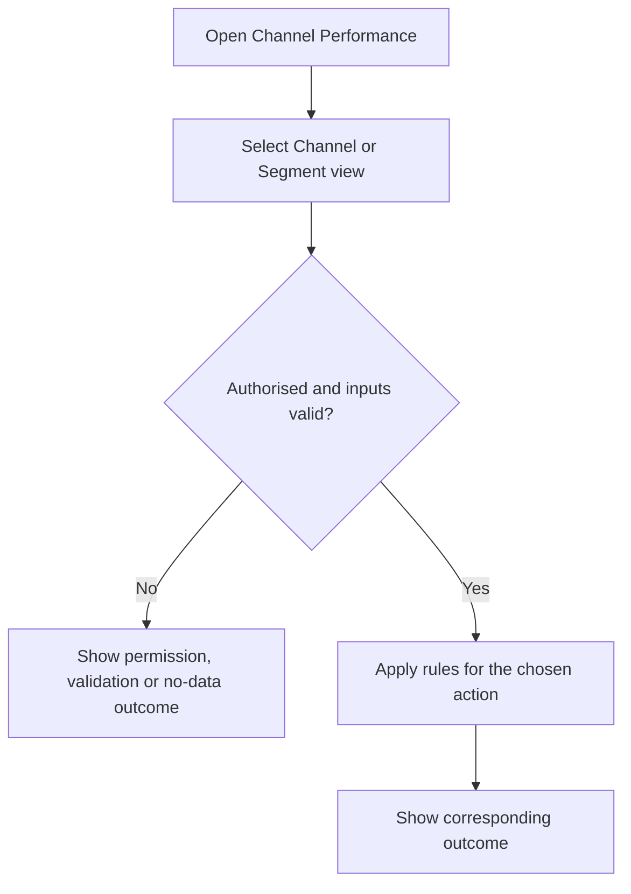

### RA-WF-05 – AI Insights cards

**Classification:** To-Be. **Related features:** RA-F-006.

- **AI Insights cards:** Display AI Insights cards and their visible associated actions.

**Process:** Open AI Insights area → Read eligible tenant reporting data → Check whether insight method is approved → Display approved insights or pending/empty state.

**Exception:** Access denied, invalid selections, unavailable source data or unconfirmed execution/AI delivery must produce a clear outcome rather than invent results.


### RA-WF-06 – Dashboard export

**Classification:** To-Be. **Related features:** RA-F-007.

- **Dashboard export:** Export the currently authorised dashboard view.

**Process:** Select dashboard Export → Check report access and active filters → Prepare eligible dashboard output → Export in supported format once confirmed.

**Exception:** Access denied, invalid selections, unavailable source data or unconfirmed execution/AI delivery must produce a clear outcome rather than invent results.

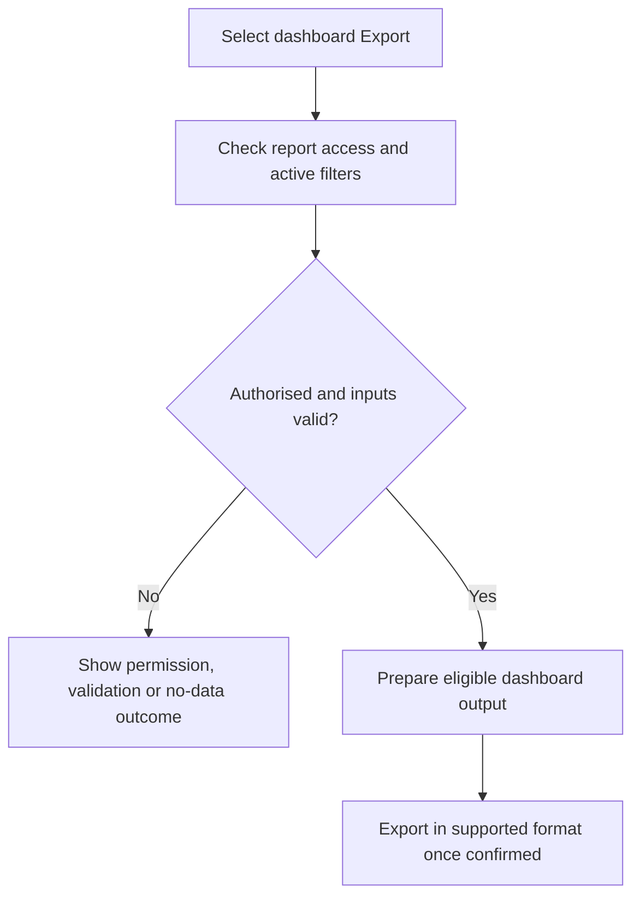

### RA-WF-07 – Report catalogue

**Classification:** To-Be. **Related features:** RA-F-008.

- **Report catalogue:** Show Donation, Donor and Campaign report categories with the 12 supplied report types.

**Process:** Open Standard Reports → Choose Donation, Donor or Campaign category → Select one of twelve predefined reports → Open selected report.

**Exception:** Access denied, invalid selections, unavailable source data or unconfirmed execution/AI delivery must produce a clear outcome rather than invent results.

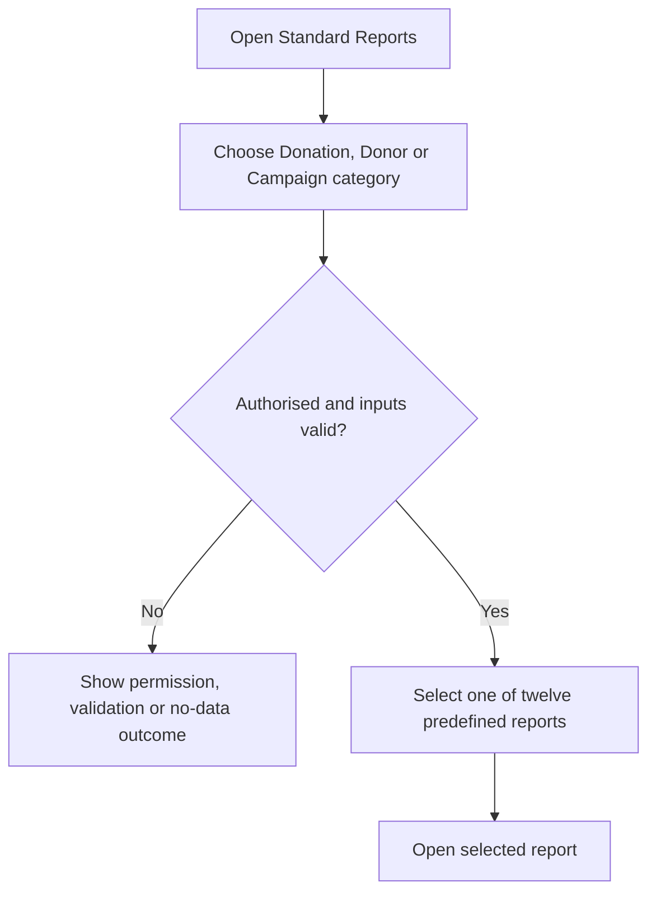

### RA-WF-08 – Report viewing and filters

**Classification:** To-Be. **Related features:** RA-F-009.

- **Report viewing and filters:** Run predefined reports with available report-specific filters.

**Process:** Open standard report → Apply date and campaign filters where available → Read matching source records → Display report visualisation.

**Exception:** Access denied, invalid selections, unavailable source data or unconfirmed execution/AI delivery must produce a clear outcome rather than invent results.

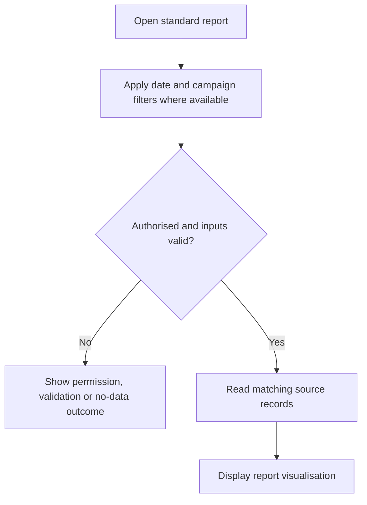

### RA-WF-09 – Standard report export

**Classification:** To-Be. **Related features:** RA-F-010.

- **Standard report export:** Export a selected standard report.

**Process:** Select standard report Export → Preserve report filters and source selection → Build requested supported output → Return export or explanatory failure.

**Exception:** Access denied, invalid selections, unavailable source data or unconfirmed execution/AI delivery must produce a clear outcome rather than invent results.

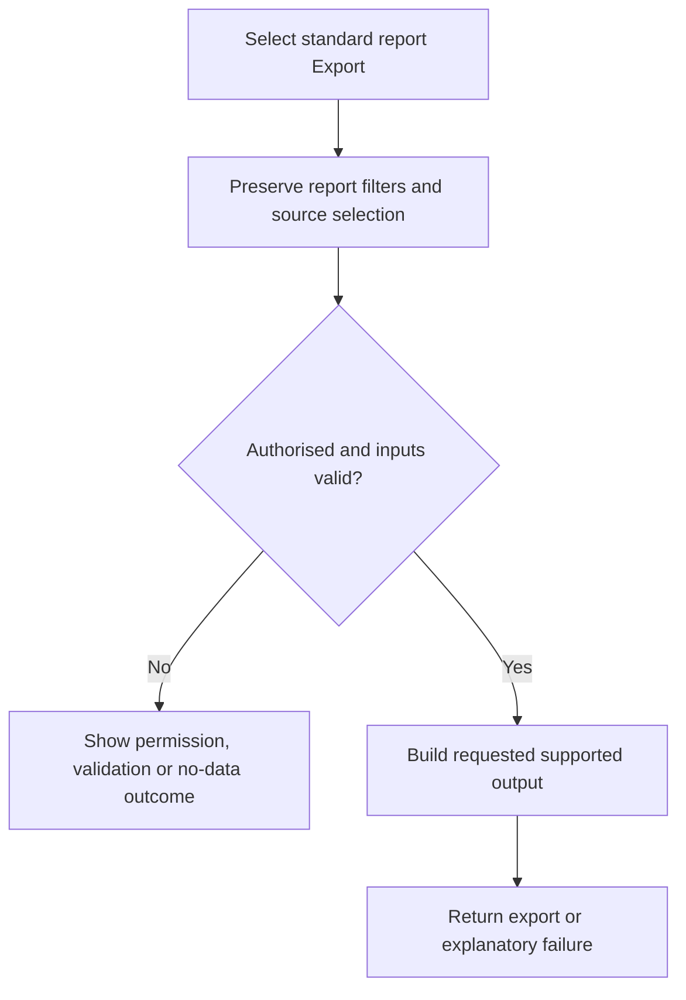

### RA-WF-10 – Save as Custom

**Classification:** To-Be. **Related features:** RA-F-011.

- **Save as Custom:** Open a standard report in Custom Report Builder through Save as Custom.

**Process:** Open standard report → Select Save as Custom → Open Custom Report Builder with supported context → Review and save report definition.

**Exception:** Access denied, invalid selections, unavailable source data or unconfirmed execution/AI delivery must produce a clear outcome rather than invent results.

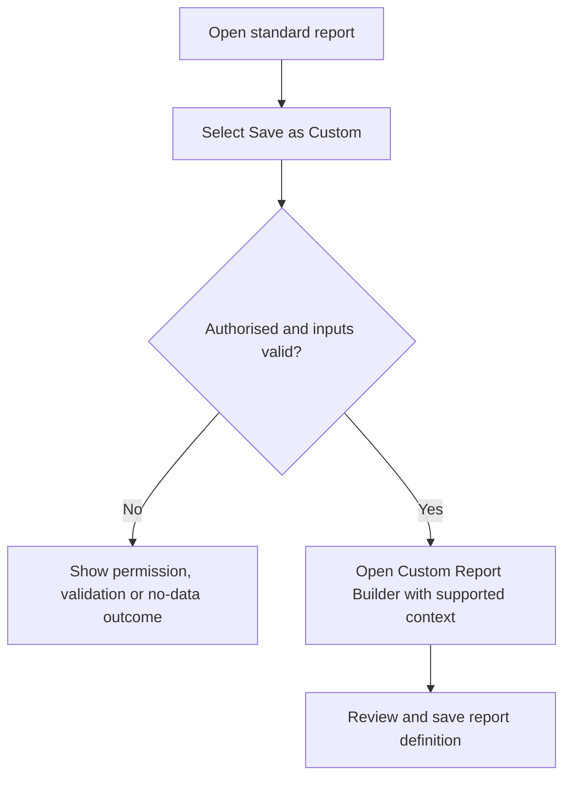

### RA-WF-11 – Select source and name

**Classification:** To-Be. **Related features:** RA-F-012.

- **Select source and name:** Select Donations, Donors, Campaigns or Communications and enter a report name.

**Process:** Open Custom Report Builder → Select Donations, Donors, Campaigns or Communications → Enter report name → Proceed to field selection.

**Exception:** Access denied, invalid selections, unavailable source data or unconfirmed execution/AI delivery must produce a clear outcome rather than invent results.

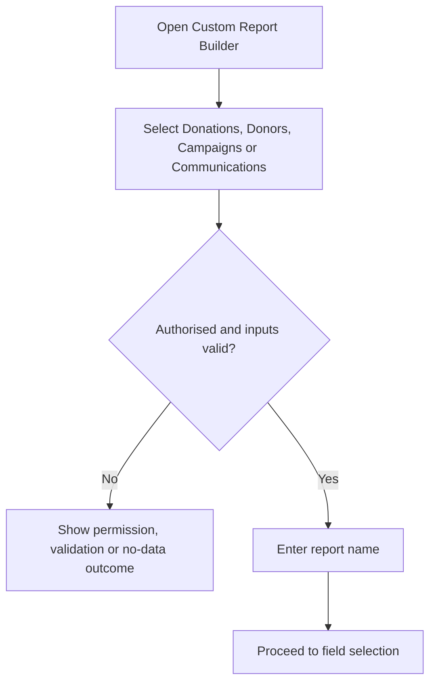

### RA-WF-12 – Fields, filters and Group By

**Classification:** To-Be. **Related features:** RA-F-013.

- **Fields, filters and Group By:** Choose source-specific fields, filters and an optional grouping field.

**Process:** Choose available fields → Add applicable filters → Select Group By field if required → Validate selections for selected source.

**Exception:** Access denied, invalid selections, unavailable source data or unconfirmed execution/AI delivery must produce a clear outcome rather than invent results.

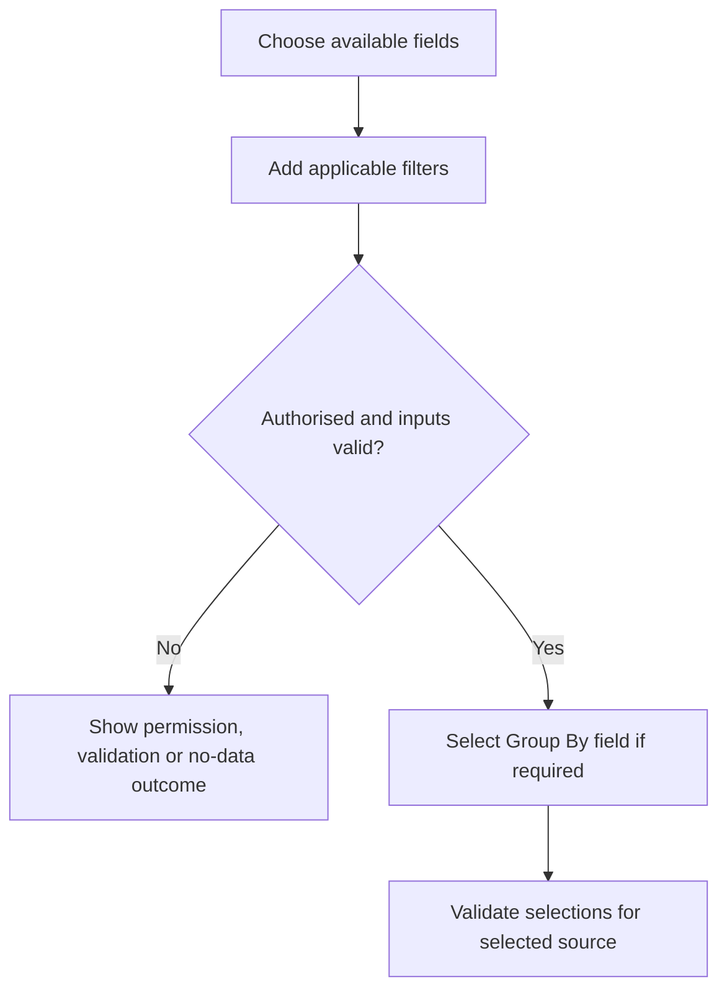

### RA-WF-13 – Visualisation

**Classification:** To-Be. **Related features:** RA-F-014.

- **Visualisation:** Choose Table, Bar Chart, Line Chart or Pie Chart.

**Process:** Review report configuration → Choose Table, Bar, Line or Pie → Validate compatible options when defined → Prepare preview/run configuration.

**Exception:** Access denied, invalid selections, unavailable source data or unconfirmed execution/AI delivery must produce a clear outcome rather than invent results.

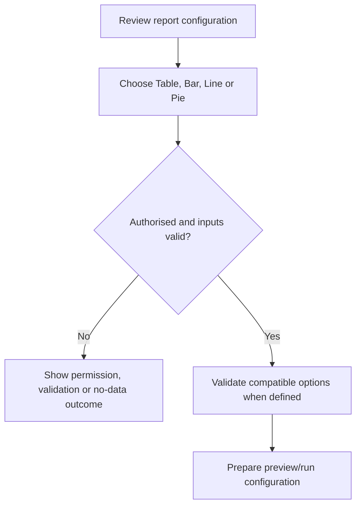

### RA-WF-14 – Run Report

**Classification:** To-Be. **Related features:** RA-F-015.

- **Run Report:** Execute report preview using current builder selections.

**Process:** Select Run Report → Validate source, fields, filters and view → Read authorised eligible data → Render report or clear error.

**Exception:** Access denied, invalid selections, unavailable source data or unconfirmed execution/AI delivery must produce a clear outcome rather than invent results.


### RA-WF-15 – Save Report

**Classification:** To-Be. **Related features:** RA-F-016.

- **Save Report:** Save a custom report definition.

**Process:** Select Save Report → Validate report name and selected configuration → Store report definition for tenant → Display saved report in list.

**Exception:** Access denied, invalid selections, unavailable source data or unconfirmed execution/AI delivery must produce a clear outcome rather than invent results.

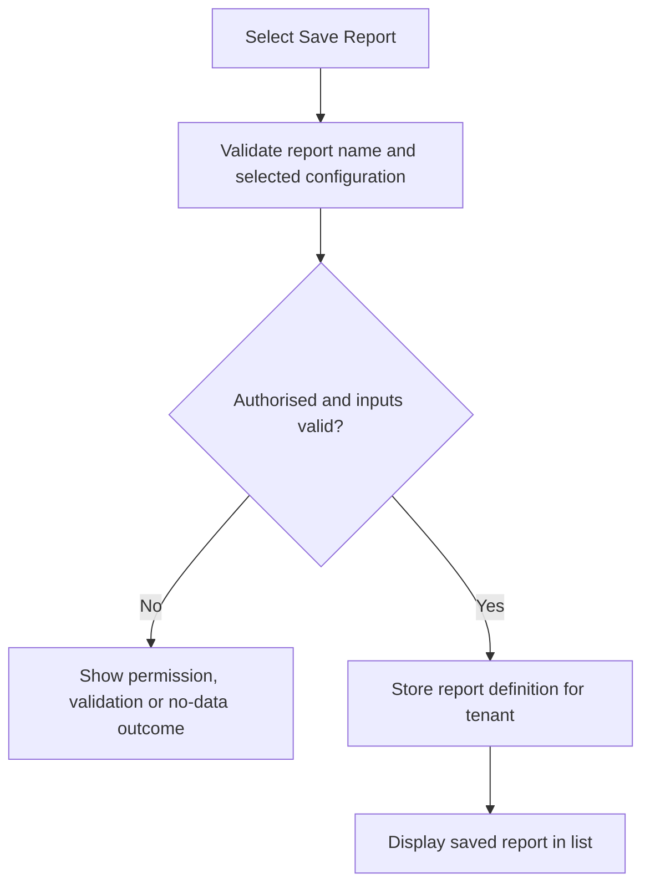

### RA-WF-16 – Saved report listing and search

**Classification:** To-Be. **Related features:** RA-F-017.

- **Saved report listing and search:** List and find saved reports and open Create New Report.

**Process:** Open Saved Reports → Search tenant-owned saved reports → Review matching report cards → Choose a permitted action.

**Exception:** Access denied, invalid selections, unavailable source data or unconfirmed execution/AI delivery must produce a clear outcome rather than invent results.

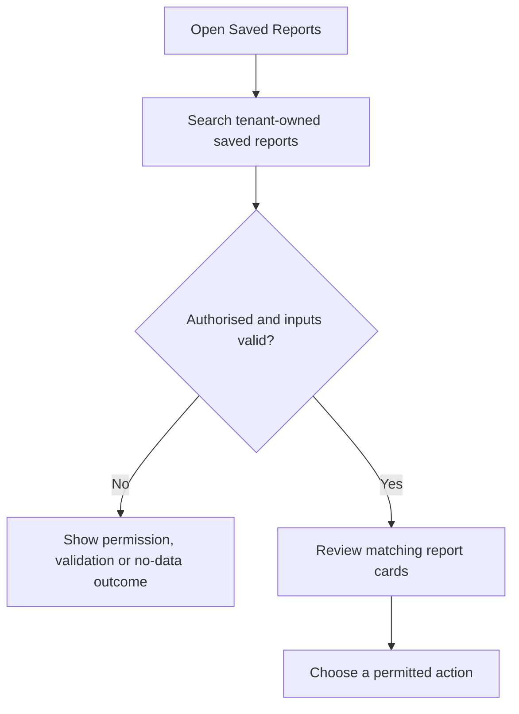

### RA-WF-17 – Run saved report

**Classification:** To-Be. **Related features:** RA-F-018.

- **Run saved report:** Execute a previously saved report.

**Process:** Select saved report Run → Load its saved configuration → Apply current authorised data access → Render current report results.

**Exception:** Access denied, invalid selections, unavailable source data or unconfirmed execution/AI delivery must produce a clear outcome rather than invent results.

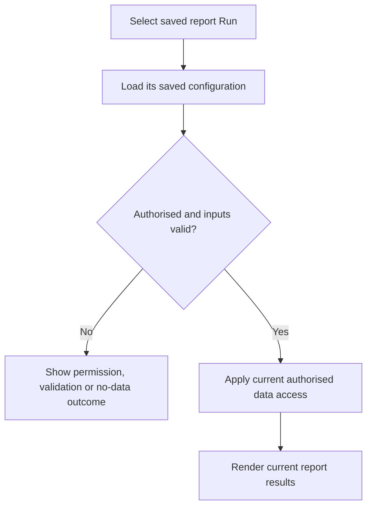

### RA-WF-18 – Edit saved report / Copy saved report / Delete saved report

**Classification:** To-Be. **Related features:** RA-F-019, RA-F-020, RA-F-021.

- **Edit saved report:** Open an editable saved report definition.
- **Copy saved report:** Create a separate report definition from a saved report.
- **Delete saved report:** Remove an authorised saved report definition.

**Process:** Select saved report Edit → Select Edit, Copy or Delete action → Apply rules for the chosen action → Show corresponding outcome.

**Exception:** Access denied, invalid selections, unavailable source data or unconfirmed execution/AI delivery must produce a clear outcome rather than invent results.

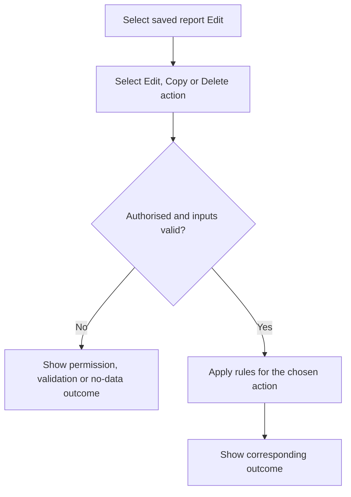

### RA-WF-19 – Create schedule

**Classification:** To-Be. **Related features:** RA-F-022.

- **Create schedule:** Select report, Daily/Weekly/Monthly, email recipients and PDF/Excel/CSV format.

**Process:** Open Create Schedule → Select report and Daily, Weekly or Monthly → Enter recipients and choose PDF, Excel or CSV → Save schedule configuration; delivery rules pending.

**Exception:** Access denied, invalid selections, unavailable source data or unconfirmed execution/AI delivery must produce a clear outcome rather than invent results.

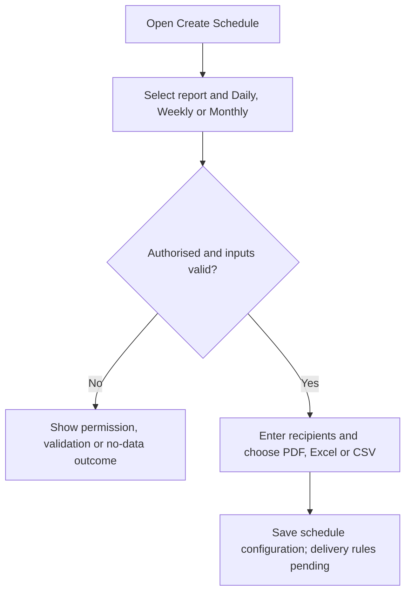

### RA-WF-20 – Schedule listing and management

**Classification:** To-Be. **Related features:** RA-F-023.

- **Schedule listing and management:** Display existing scheduled reports with next run, recipient and format details and visible actions.

**Process:** Open Scheduled Reports → Review report, next run, recipients and format → Select available authorised schedule action → Apply action only after semantics are confirmed.

**Exception:** Access denied, invalid selections, unavailable source data or unconfirmed execution/AI delivery must produce a clear outcome rather than invent results.

```mermaid
flowchart TD
    A["Open Scheduled Reports"] --> B["Review report, next run, recipients and format"]
    B --> C{"Authorised and inputs valid?"}
    C -->|No| X["Show permission, validation or no-data outcome"]
    C -->|Yes| D["Select available authorised schedule action"]
    D --> E["Apply action only after semantics are confirmed"]
```

## 5. Exception Handling and Verification

| Situation                          | Required business response                                                                 |
| ---------------------------------- | ------------------------------------------------------------------------------------------ |
| Non-matching filter / no records   | Show an empty state without fabricated values                                              |
| Attempted integrated-record edit   | Deny record update; report views and editing report configurations are allowed             |
| Unknown metric definition          | Track RA-OD-004, do not silently invent formula                                            |
| AI output undefined                | Track RA-OD-001                                                                            |
| Scheduled delivery undefined       | Save schedule inputs where implemented; track RA-OD-002/003; do not claim delivery success |
| Source unconnected or unauthorised | Do not expose the source or its records                                                    |

## 6. Screenshot Map

### Overview Dashboard

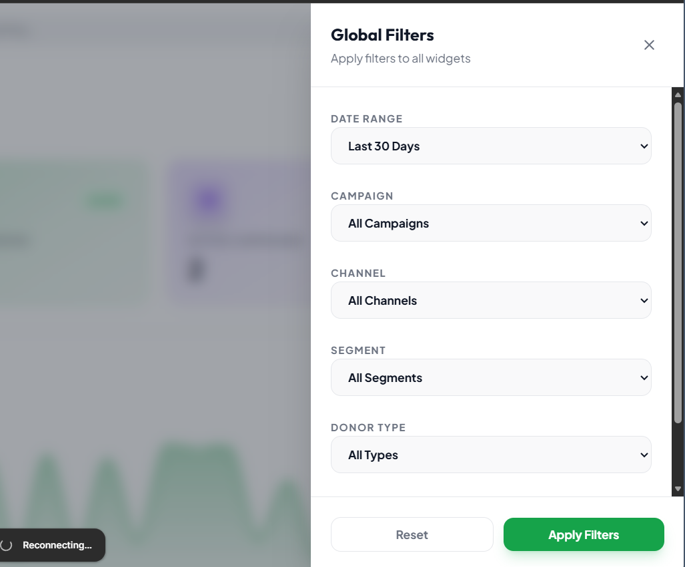


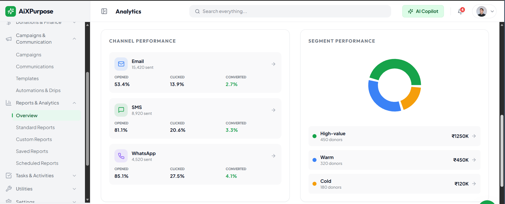

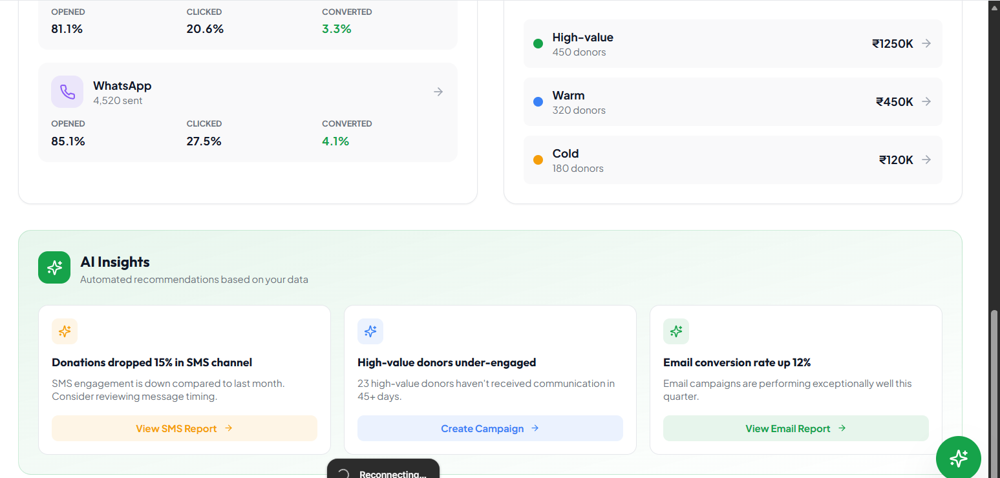

### Standard Reports


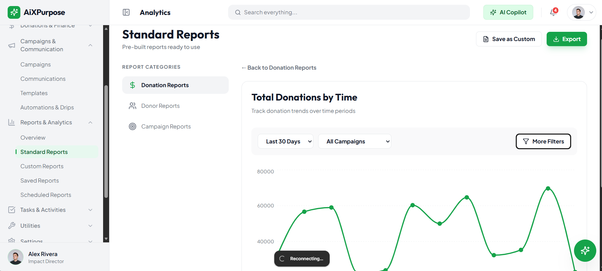

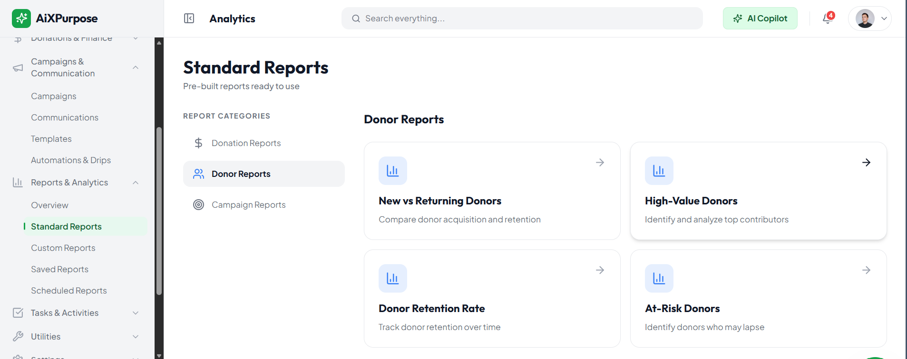

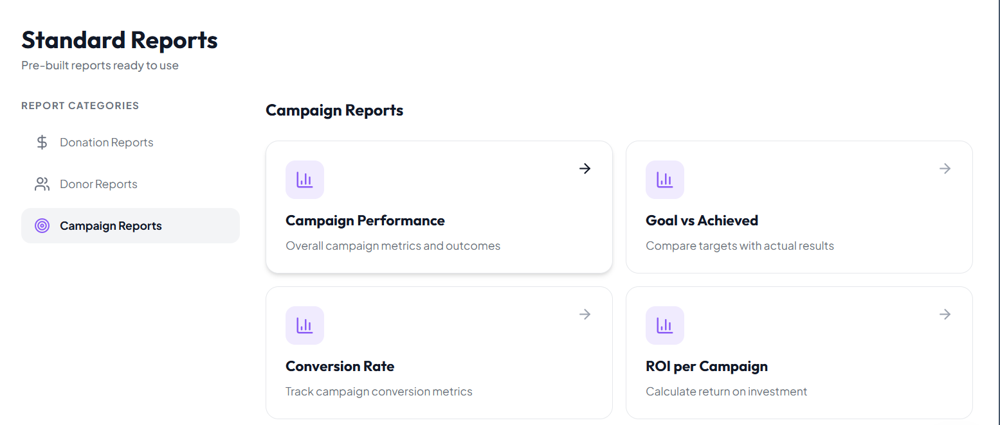

### Custom Report Builder


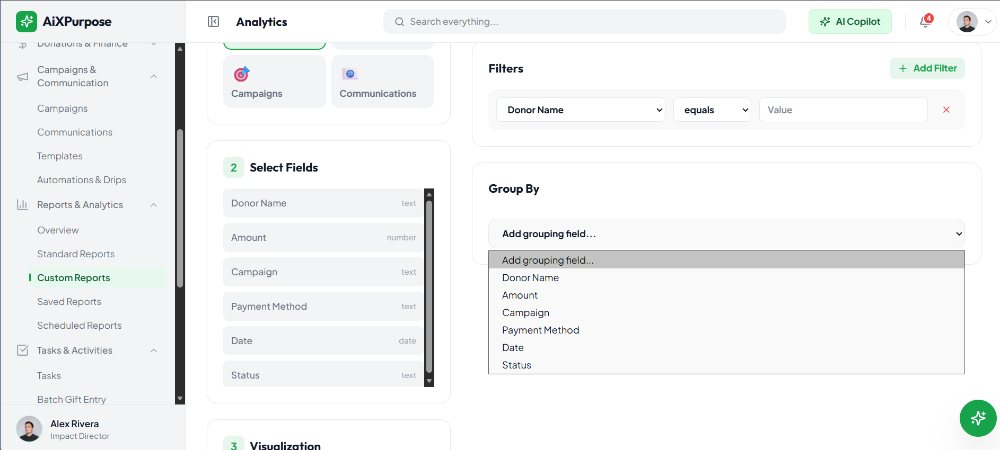

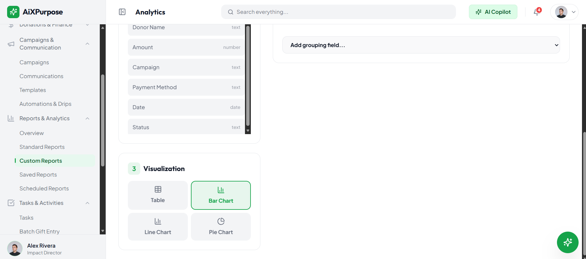

### Saved Reports


### Scheduled Reports


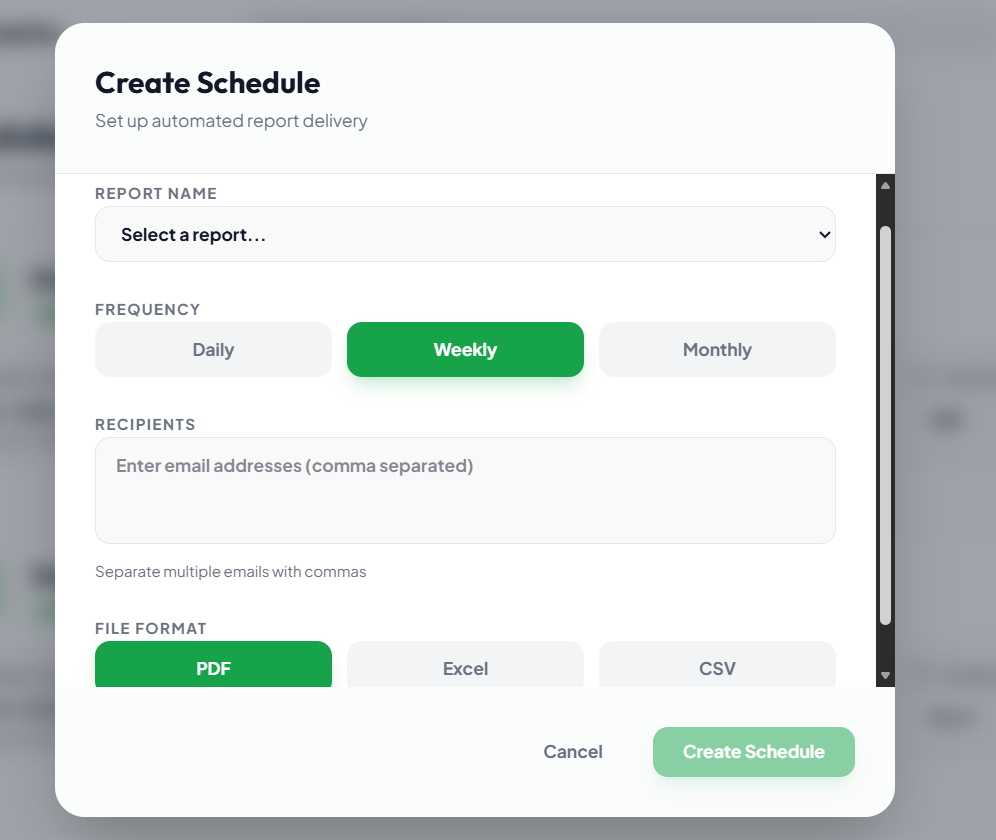

## 7. Traceability

| Workflow | Features                     | Goals                |
| -------- | ---------------------------- | -------------------- |
| RA-WF-01 | RA-F-001                     | RA-GO-001, RA-GO-006 |
| RA-WF-02 | RA-F-002                     | RA-GO-001, RA-GO-006 |
| RA-WF-03 | RA-F-003                     | RA-GO-001, RA-GO-006 |
| RA-WF-04 | RA-F-004, RA-F-005           | RA-GO-001, RA-GO-006 |
| RA-WF-05 | RA-F-006                     | RA-GO-001, RA-GO-006 |
| RA-WF-06 | RA-F-007                     | RA-GO-001, RA-GO-006 |
| RA-WF-07 | RA-F-008                     | RA-GO-002, RA-GO-006 |
| RA-WF-08 | RA-F-009                     | RA-GO-002, RA-GO-006 |
| RA-WF-09 | RA-F-010                     | RA-GO-002, RA-GO-006 |
| RA-WF-10 | RA-F-011                     | RA-GO-002, RA-GO-006 |
| RA-WF-11 | RA-F-012                     | RA-GO-003, RA-GO-006 |
| RA-WF-12 | RA-F-013                     | RA-GO-003, RA-GO-006 |
| RA-WF-13 | RA-F-014                     | RA-GO-003, RA-GO-006 |
| RA-WF-14 | RA-F-015                     | RA-GO-003, RA-GO-006 |
| RA-WF-15 | RA-F-016                     | RA-GO-003, RA-GO-006 |
| RA-WF-16 | RA-F-017                     | RA-GO-004, RA-GO-006 |
| RA-WF-17 | RA-F-018                     | RA-GO-004, RA-GO-006 |
| RA-WF-18 | RA-F-019, RA-F-020, RA-F-021 | RA-GO-004, RA-GO-006 |
| RA-WF-19 | RA-F-022                     | RA-GO-005, RA-GO-006 |
| RA-WF-20 | RA-F-023                     | RA-GO-005, RA-GO-006 |

## 8. Open Decisions

| ID        | Open decision / confirmation                                                                      |
| --------- | ------------------------------------------------------------------------------------------------- |
| RA-OD-001 | AI Insights computation/generation and actions                                                    |
| RA-OD-002 | Schedule execution, email delivery and recipient rules                                            |
| RA-OD-003 | Schedule failure handling and run/status semantics                                                |
| RA-OD-004 | Unconfirmed KPI formulas: conversion, retention, ROI, channel conversions and segment definitions |
| RA-OD-005 | Builder supported fields, filter/grouping combinations and chart validity                         |
| RA-OD-006 | Exact export choices for dashboard/standard reports and Saved/Scheduled action icon semantics     |
| RA-OD-007 | Applicability of global/source filters to specific communications/campaign calculations           |
