# AiXPurpose – Settings – BRD Feature Catalogue

> Business Requirements Document – Feature Catalogue

## Document Control

| Field | Value |
|---|---|
| Product | AiXPurpose Standalone (multi-tenant) |
| Capability | Settings: Organization, Users & Roles, Communication, Payment, API Integration |
| Version | 1.0 |
| Status | Draft for Product, QA, Development and stakeholder review |
| Authoritative evidence | `settings Module.docx` screenshots and description; user-approved Q1–Q8/C1–C6 decisions and final AiXIdentity clarification |
| Documentation convention | Members/Donors BRD structure and revised Profile Jira-story pattern |


## Overview

**Evidence rule:** A screenshot demonstrates an available interface, not working integration. All As-Is functionality must survive in standalone; QA checks it. To-Be items require implementation/repair only if the current implementation does not already meet the agreed requirement. Future flows are conceptual and require approval.

**Authority rule:** AiXIdentity is authoritative for authentication/access, roles and permissions. AiXPurpose provides the Users & Roles view and the Admin/Manager Add User interface. The exact provisioning API, invitation activation, identity synchronization cadence and permitted Manager role-selection boundaries must be verified with Development/AiXIdentity, not assumed. Earlier notes call the identity source AiXHub; the user's latest clarification names AiXIdentity for access and permissions. Their interface/ownership relationship is an open architecture point, not an invented equivalence.


## Contents
1. Purpose and classification
2. Feature inventory
3. As-Is: QA/regression user stories
4. To-Be: Jira-ready implementation stories
5. Future: conceptual Jira backlog candidates
6. Field/control evidence coverage
7. Traceability and dependencies
8. Open decisions and acceptance handoff

## 1. Purpose and classification

| Classification | Required treatment |
|---|---|

| As-Is | Keep visible existing features, test actual behavior, raise defects when broken. |

| To-Be | Implement approved standalone functionality and verified operational gaps. |

| Future candidate | Document possibility and conceptual flow; no delivery commitment or implementation without approval. |

## 2. Feature inventory

| Class | IDs | Count |
|---|---|---|

| As-Is QA | SET-A-01 to SET-A-14 | 14 |

| To-Be | SET-P01 to SET-P13 plus SET-P03A | 14 |

| Future | SET-F01 to SET-F08 | 8 |

## 3. Detailed As-Is feature catalogue – Jira QA stories

### SET-A-01 – Organization basic information

**Classification:** As-Is / QA baseline | **Area:** Organization

**Screenshot:** 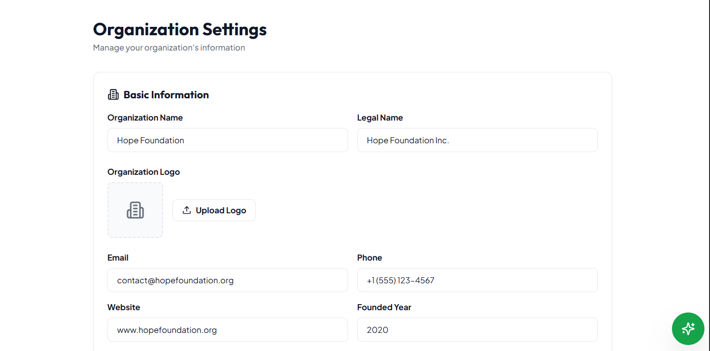

**Jira user story:** As an authorised Settings user, I want to use the existing organization basic information capability so that the functionality is retained when AiXPurpose becomes standalone.

**Existing fields / controls:** name, legal name, logo, email, phone, website, founded year.

**Business logic and workflow:** open organisation settings; inspect basic information; update permitted details; save. Source supports the UI; operational claims require QA verification.

**Acceptance criteria (As-Is verification):**
1. **Given** authorised access, **when** the screen loads, **then** all stated fields and controls are present.
2. **Given** the user performs the existing operation, **when** its result is checked, **then** QA records actual persistence/integration success or a reproducible defect.
3. **Given** an unauthorised or wrong-tenant request, **when** the action is attempted, **then** QA verifies restrictions and records any failed control.
4. **Specific QA focus:** User can see existing fields and Save Organization Settings; QA confirms save persistence, field handling, and access restrictions.

**Existing / QA verification flow:**
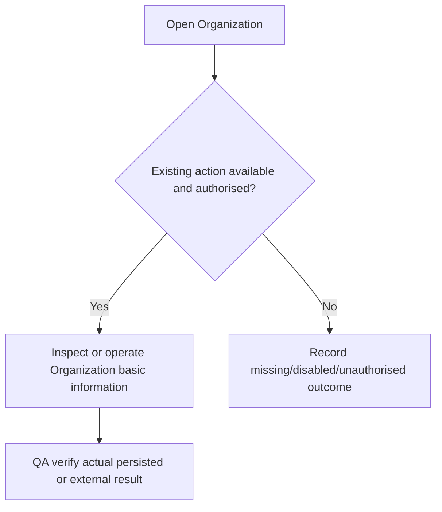

### SET-A-02 – Organization address and registration

**Classification:** As-Is / QA baseline | **Area:** Organization

**Screenshot:** 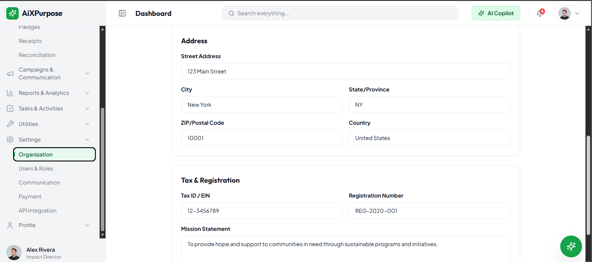 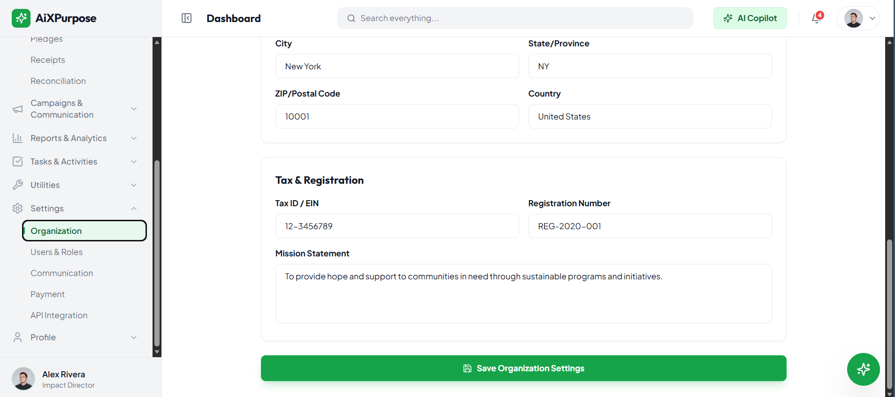

**Jira user story:** As an authorised Settings user, I want to use the existing organization address and registration capability so that the functionality is retained when AiXPurpose becomes standalone.

**Existing fields / controls:** street address, city, state/province, ZIP/postal code, country, tax/EIN, registration number, mission statement.

**Business logic and workflow:** open remaining organisation details; inspect/edit permitted fields; save. Source supports the UI; operational claims require QA verification.

**Acceptance criteria (As-Is verification):**
1. **Given** authorised access, **when** the screen loads, **then** all stated fields and controls are present.
2. **Given** the user performs the existing operation, **when** its result is checked, **then** QA records actual persistence/integration success or a reproducible defect.
3. **Given** an unauthorised or wrong-tenant request, **when** the action is attempted, **then** QA verifies restrictions and records any failed control.
4. **Specific QA focus:** QA checks displayed and saved address, tax/registration, and mission data.

**Existing / QA verification flow:**


### SET-A-03 – Users and roles KPI cards

**Classification:** As-Is / QA baseline | **Area:** Users & Roles

**Screenshot:** 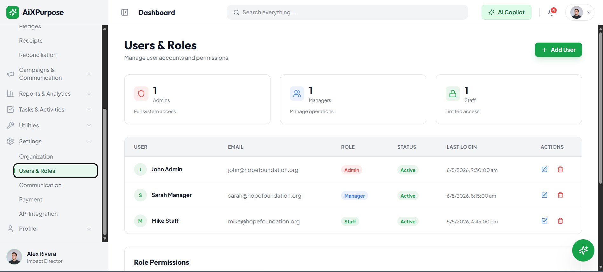

**Jira user story:** As an authorised Settings user, I want to use the existing users and roles kpi cards capability so that the functionality is retained when AiXPurpose becomes standalone.

**Existing fields / controls:** three user/role summary cards visible on the Users & Roles page.

**Business logic and workflow:** open Users & Roles; review the three summary values. Source supports the UI; operational claims require QA verification.

**Acceptance criteria (As-Is verification):**
1. **Given** authorised access, **when** the screen loads, **then** all stated fields and controls are present.
2. **Given** the user performs the existing operation, **when** its result is checked, **then** QA records actual persistence/integration success or a reproducible defect.
3. **Given** an unauthorised or wrong-tenant request, **when** the action is attempted, **then** QA verifies restrictions and records any failed control.
4. **Specific QA focus:** QA verifies actual KPI meanings, values and AiXIdentity source mapping; screenshots do not establish calculations.

**Existing / QA verification flow:**


### SET-A-04 – Users listing and displayed access

**Classification:** As-Is / QA baseline | **Area:** Users & Roles

**Screenshot:** 

**Jira user story:** As an authorised Settings user, I want to use the existing users listing and displayed access capability so that the functionality is retained when AiXPurpose becomes standalone.

**Existing fields / controls:** user name, email, role, status, last login, row actions and role permissions area.

**Business logic and workflow:** load user directory; search/review available rows and permissions. Source supports the UI; operational claims require QA verification.

**Acceptance criteria (As-Is verification):**
1. **Given** authorised access, **when** the screen loads, **then** all stated fields and controls are present.
2. **Given** the user performs the existing operation, **when** its result is checked, **then** QA records actual persistence/integration success or a reproducible defect.
3. **Given** an unauthorised or wrong-tenant request, **when** the action is attempted, **then** QA verifies restrictions and records any failed control.
4. **Specific QA focus:** QA checks identity source, pagination/search only if present, displayed role/status/last-login, and permissible actions.

**Existing / QA verification flow:**
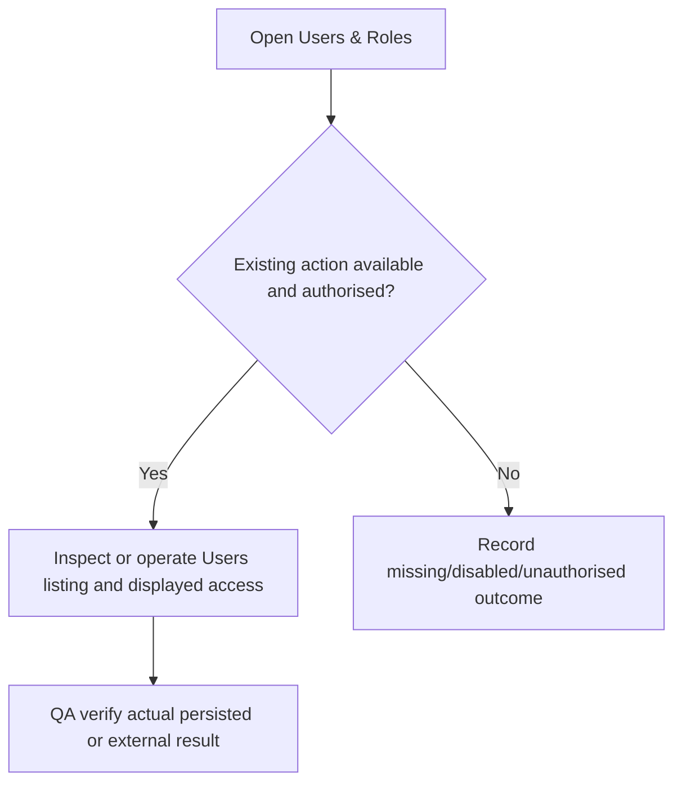

### SET-A-05 – Existing Add User control

**Classification:** As-Is / QA baseline | **Area:** Users & Roles

**Screenshot:** 

**Jira user story:** As an authorised Settings user, I want to use the existing existing add user control capability so that the functionality is retained when AiXPurpose becomes standalone.

**Existing fields / controls:** Add User button visible; currently non-functional.

**Business logic and workflow:** select Add User; observe current behaviour; record failed/unfinished action. Source supports the UI; operational claims require QA verification.

**Acceptance criteria (As-Is verification):**
1. **Given** authorised access, **when** the screen loads, **then** all stated fields and controls are present.
2. **Given** the user performs the existing operation, **when** its result is checked, **then** QA records actual persistence/integration success or a reproducible defect.
3. **Given** an unauthorised or wrong-tenant request, **when** the action is attempted, **then** QA verifies restrictions and records any failed control.
4. **Specific QA focus:** QA records as existing UI gap; functional creation is a separately approved To-Be feature.

**Existing / QA verification flow:**


### SET-A-06 – SMTP email configuration

**Classification:** As-Is / QA baseline | **Area:** Communication

**Screenshot:** 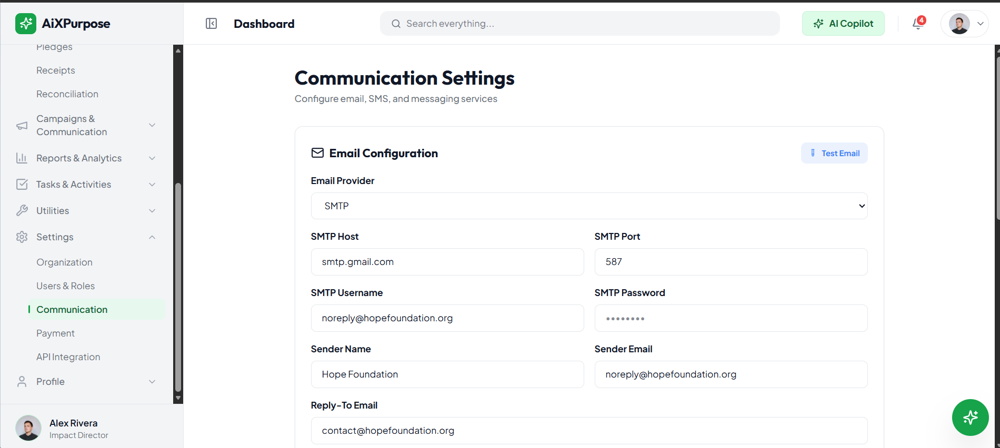

**Jira user story:** As an authorised Settings user, I want to use the existing smtp email configuration capability so that the functionality is retained when AiXPurpose becomes standalone.

**Existing fields / controls:** email provider, SMTP host, port, username, password, sender name, sender email, reply-to email, Test Email.

**Business logic and workflow:** view and configure email fields; test; save. Source supports the UI; operational claims require QA verification.

**Acceptance criteria (As-Is verification):**
1. **Given** authorised access, **when** the screen loads, **then** all stated fields and controls are present.
2. **Given** the user performs the existing operation, **when** its result is checked, **then** QA records actual persistence/integration success or a reproducible defect.
3. **Given** an unauthorised or wrong-tenant request, **when** the action is attempted, **then** QA verifies restrictions and records any failed control.
4. **Specific QA focus:** Email is reported operational; QA verifies connection test and persistence without exposing password.

**Existing / QA verification flow:**


### SET-A-07 – SMS provider configuration UI

**Classification:** As-Is / QA baseline | **Area:** Communication

**Screenshot:** 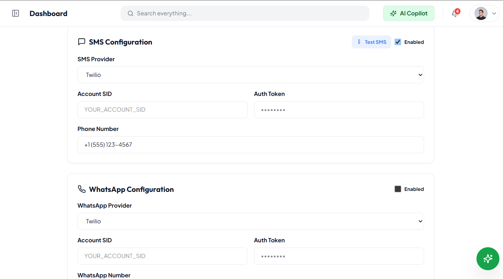

**Jira user story:** As an authorised Settings user, I want to use the existing sms provider configuration ui capability so that the functionality is retained when AiXPurpose becomes standalone.

**Existing fields / controls:** SMS provider, account SID, authentication token, phone number, enable control and Test SMS.

**Business logic and workflow:** open SMS panel; edit provider values; review test/enable control. Source supports the UI; operational claims require QA verification.

**Acceptance criteria (As-Is verification):**
1. **Given** authorised access, **when** the screen loads, **then** all stated fields and controls are present.
2. **Given** the user performs the existing operation, **when** its result is checked, **then** QA records actual persistence/integration success or a reproducible defect.
3. **Given** an unauthorised or wrong-tenant request, **when** the action is attempted, **then** QA verifies restrictions and records any failed control.
4. **Specific QA focus:** UI retained; operational SMS transmission not As-Is and must be built in To-Be.

**Existing / QA verification flow:**
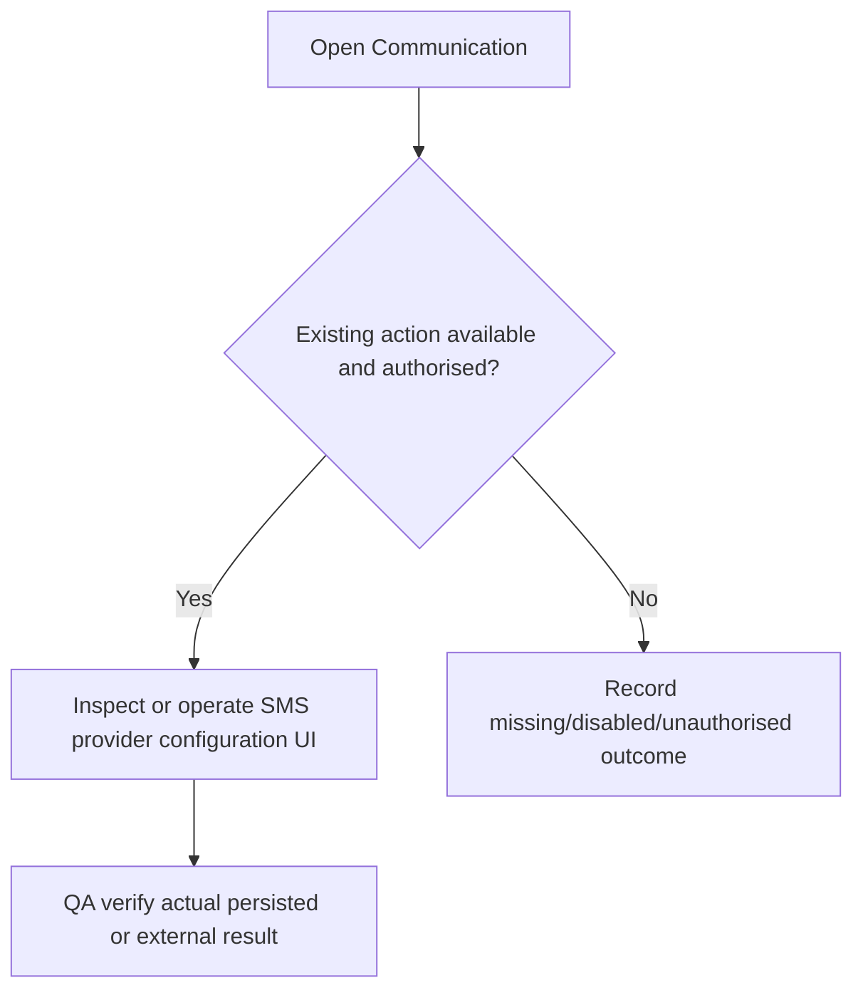

### SET-A-08 – WhatsApp provider configuration UI

**Classification:** As-Is / QA baseline | **Area:** Communication

**Screenshot:**  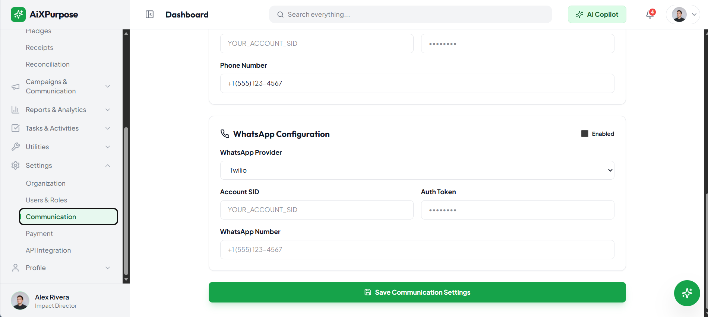

**Jira user story:** As an authorised Settings user, I want to use the existing whatsapp provider configuration ui capability so that the functionality is retained when AiXPurpose becomes standalone.

**Existing fields / controls:** WhatsApp provider, account SID, auth token, WhatsApp number and enable control.

**Business logic and workflow:** open WhatsApp panel; edit provider values; save. Source supports the UI; operational claims require QA verification.

**Acceptance criteria (As-Is verification):**
1. **Given** authorised access, **when** the screen loads, **then** all stated fields and controls are present.
2. **Given** the user performs the existing operation, **when** its result is checked, **then** QA records actual persistence/integration success or a reproducible defect.
3. **Given** an unauthorised or wrong-tenant request, **when** the action is attempted, **then** QA verifies restrictions and records any failed control.
4. **Specific QA focus:** UI retained; operational WhatsApp transmission not As-Is and must be built in To-Be.

**Existing / QA verification flow:**
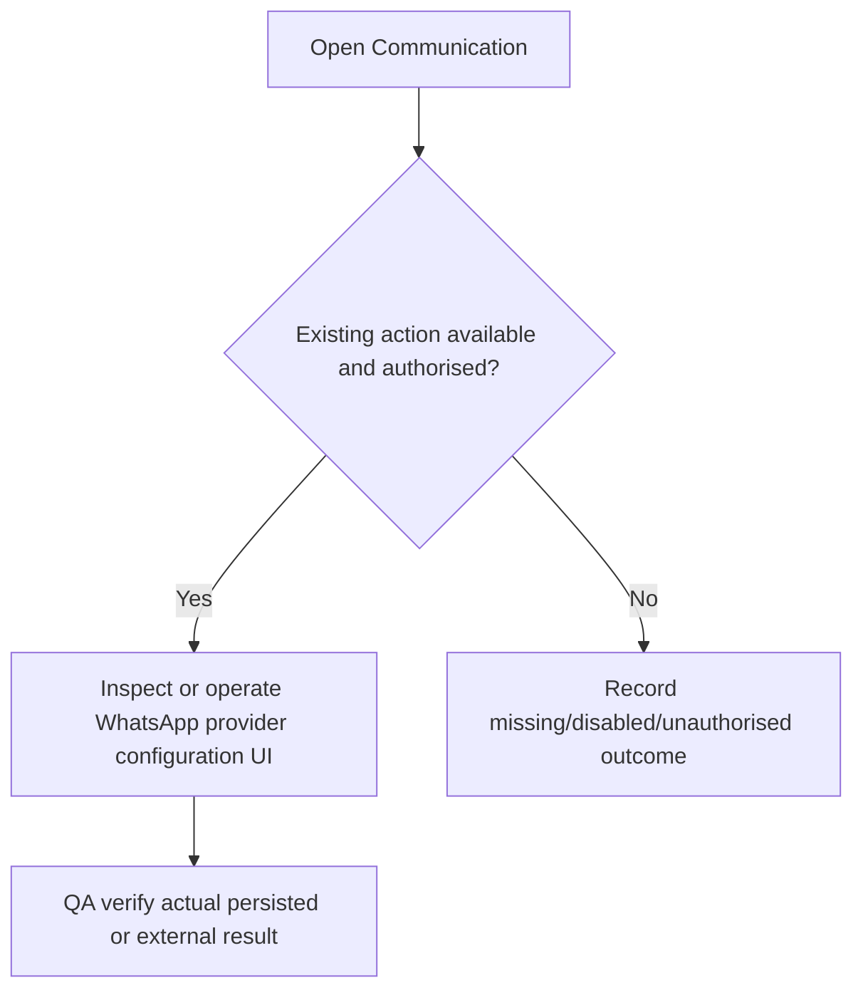

### SET-A-09 – Communication settings save

**Classification:** As-Is / QA baseline | **Area:** Communication

**Screenshot:** 

**Jira user story:** As an authorised Settings user, I want to use the existing communication settings save capability so that the functionality is retained when AiXPurpose becomes standalone.

**Existing fields / controls:** Save Communication Settings action.

**Business logic and workflow:** change permitted settings; choose save; reopen. Source supports the UI; operational claims require QA verification.

**Acceptance criteria (As-Is verification):**
1. **Given** authorised access, **when** the screen loads, **then** all stated fields and controls are present.
2. **Given** the user performs the existing operation, **when** its result is checked, **then** QA records actual persistence/integration success or a reproducible defect.
3. **Given** an unauthorised or wrong-tenant request, **when** the action is attempted, **then** QA verifies restrictions and records any failed control.
4. **Specific QA focus:** QA confirms which settings persist; operational behaviour assessed separately per provider.

**Existing / QA verification flow:**
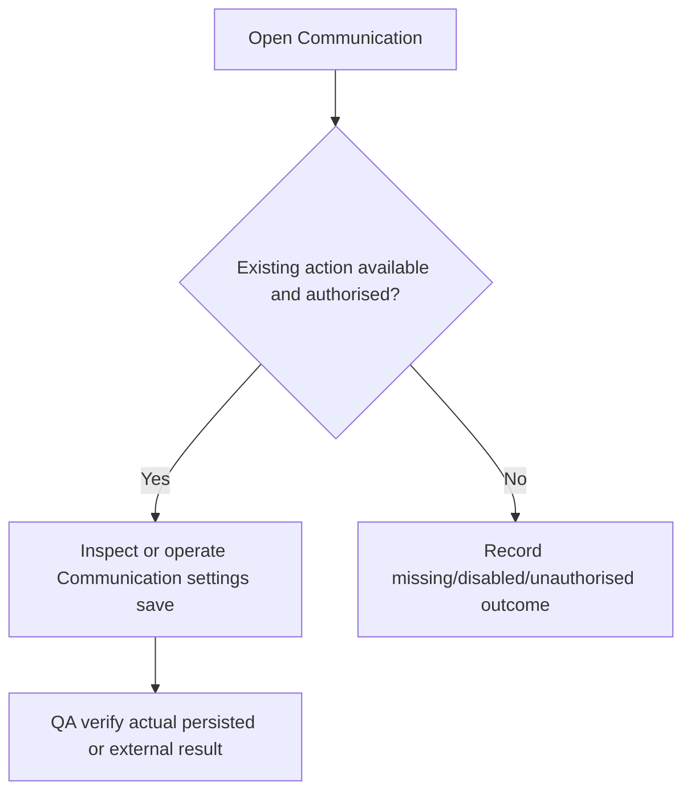

### SET-A-10 – Payment gateways configuration

**Classification:** As-Is / QA baseline | **Area:** Payment

**Screenshot:** 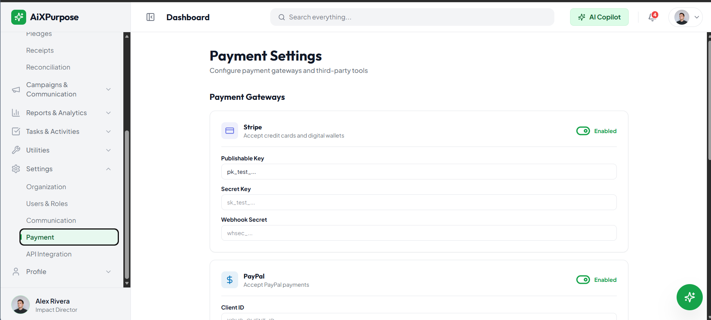

**Jira user story:** As an authorised Settings user, I want to use the existing payment gateways configuration capability so that the functionality is retained when AiXPurpose becomes standalone.

**Existing fields / controls:** Stripe and PayPal provider cards with credentials/settings and enable state.

**Business logic and workflow:** open payment; inspect provider configurations; save settings. Source supports the UI; operational claims require QA verification.

**Acceptance criteria (As-Is verification):**
1. **Given** authorised access, **when** the screen loads, **then** all stated fields and controls are present.
2. **Given** the user performs the existing operation, **when** its result is checked, **then** QA records actual persistence/integration success or a reproducible defect.
3. **Given** an unauthorised or wrong-tenant request, **when** the action is attempted, **then** QA verifies restrictions and records any failed control.
4. **Specific QA focus:** Configuration UI exists; successful external payment transaction is NOT verified.

**Existing / QA verification flow:**
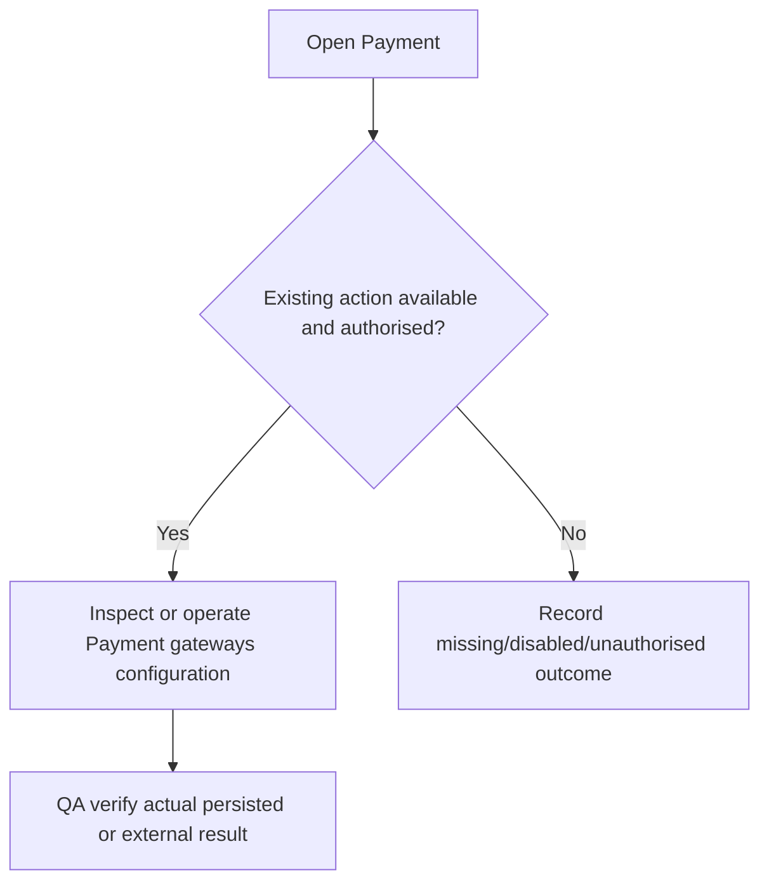

### SET-A-11 – Third-party fundraising tool settings

**Classification:** As-Is / QA baseline | **Area:** Payment

**Screenshot:** 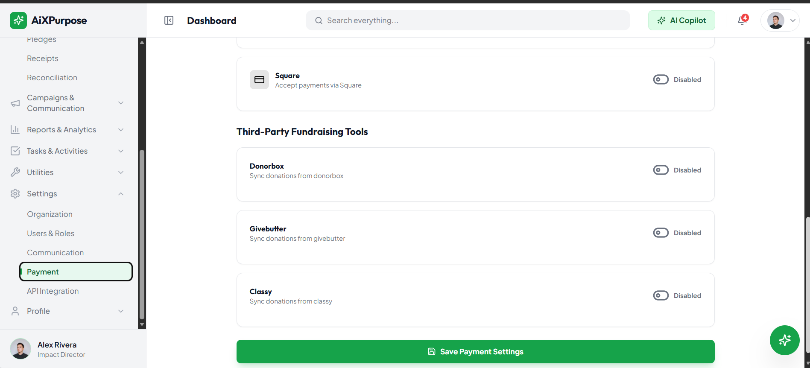

**Jira user story:** As an authorised Settings user, I want to use the existing third-party fundraising tool settings capability so that the functionality is retained when AiXPurpose becomes standalone.

**Existing fields / controls:** Donorbox, Givebutter and Classy integrations represented by configuration/enable cards; other provider tiles may appear.

**Business logic and workflow:** inspect fundraising tool toggles; save settings. Source supports the UI; operational claims require QA verification.

**Acceptance criteria (As-Is verification):**
1. **Given** authorised access, **when** the screen loads, **then** all stated fields and controls are present.
2. **Given** the user performs the existing operation, **when** its result is checked, **then** QA records actual persistence/integration success or a reproducible defect.
3. **Given** an unauthorised or wrong-tenant request, **when** the action is attempted, **then** QA verifies restrictions and records any failed control.
4. **Specific QA focus:** QA verifies tile availability, stored state and any actual integrations; no unverified processing claims.

**Existing / QA verification flow:**
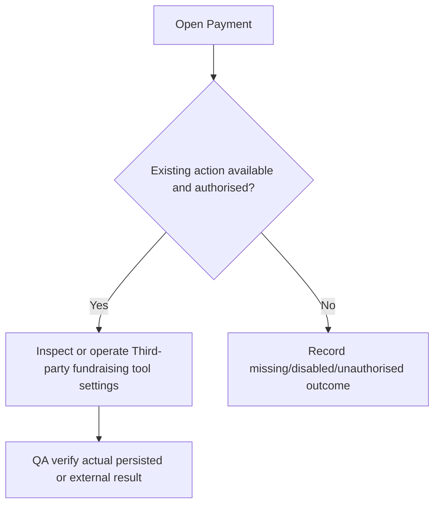

### SET-A-12 – Payment settings save

**Classification:** As-Is / QA baseline | **Area:** Payment

**Screenshot:** 

**Jira user story:** As an authorised Settings user, I want to use the existing payment settings save capability so that the functionality is retained when AiXPurpose becomes standalone.

**Existing fields / controls:** Save Payment Settings control.

**Business logic and workflow:** modify a permitted provider configuration; save; reopen. Source supports the UI; operational claims require QA verification.

**Acceptance criteria (As-Is verification):**
1. **Given** authorised access, **when** the screen loads, **then** all stated fields and controls are present.
2. **Given** the user performs the existing operation, **when** its result is checked, **then** QA records actual persistence/integration success or a reproducible defect.
3. **Given** an unauthorised or wrong-tenant request, **when** the action is attempted, **then** QA verifies restrictions and records any failed control.
4. **Specific QA focus:** QA verifies persistence, state and permission behaviour separately from operational payment integration.

**Existing / QA verification flow:**
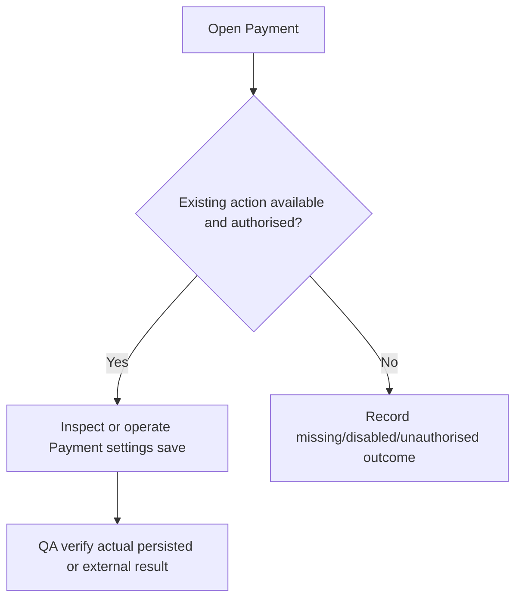

### SET-A-13 – API key management UI

**Classification:** As-Is / QA baseline | **Area:** API

**Screenshot:** 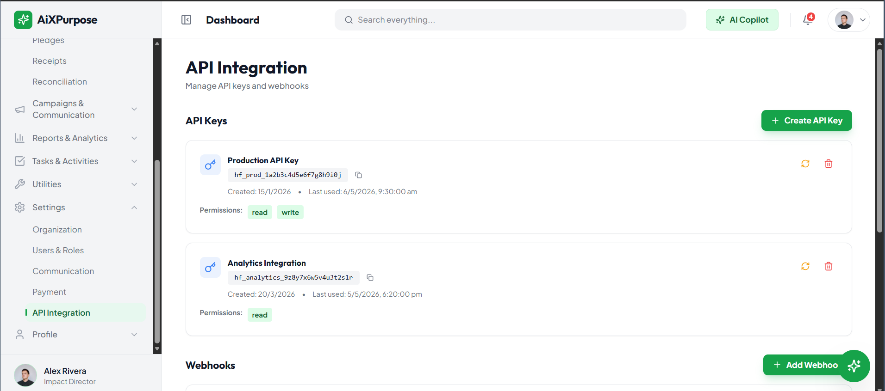

**Jira user story:** As an authorised Settings user, I want to use the existing api key management ui capability so that the functionality is retained when AiXPurpose becomes standalone.

**Existing fields / controls:** API key entries, shown permission tags, Create API Key, and row controls.

**Business logic and workflow:** open keys; inspect listed scopes and operations; try supported actions. Source supports the UI; operational claims require QA verification.

**Acceptance criteria (As-Is verification):**
1. **Given** authorised access, **when** the screen loads, **then** all stated fields and controls are present.
2. **Given** the user performs the existing operation, **when** its result is checked, **then** QA records actual persistence/integration success or a reproducible defect.
3. **Given** an unauthorised or wrong-tenant request, **when** the action is attempted, **then** QA verifies restrictions and records any failed control.
4. **Specific QA focus:** Partially functional; QA records working create/view/revoke/edit operations rather than assuming all.

**Existing / QA verification flow:**
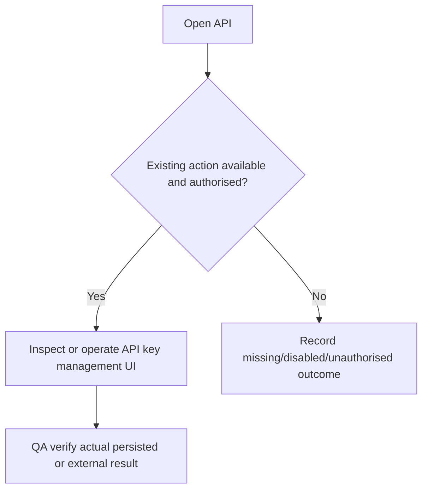

### SET-A-14 – Webhook and API documentation UI

**Classification:** As-Is / QA baseline | **Area:** API

**Screenshot:** 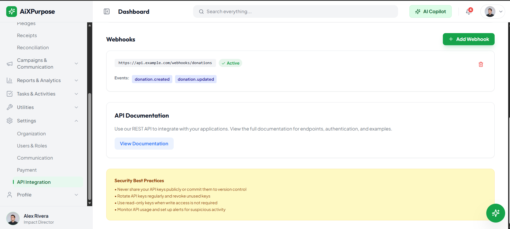

**Jira user story:** As an authorised Settings user, I want to use the existing webhook and api documentation ui capability so that the functionality is retained when AiXPurpose becomes standalone.

**Existing fields / controls:** webhook endpoint listing, active status, event tags, Add Webhook, API Documentation link, security guidance.

**Business logic and workflow:** inspect webhook list, try allowed webhook actions and documentation link. Source supports the UI; operational claims require QA verification.

**Acceptance criteria (As-Is verification):**
1. **Given** authorised access, **when** the screen loads, **then** all stated fields and controls are present.
2. **Given** the user performs the existing operation, **when** its result is checked, **then** QA records actual persistence/integration success or a reproducible defect.
3. **Given** an unauthorised or wrong-tenant request, **when** the action is attempted, **then** QA verifies restrictions and records any failed control.
4. **Specific QA focus:** Partially functional; QA records actual persistence, delivery and action support; no invented callback payload.

**Existing / QA verification flow:**
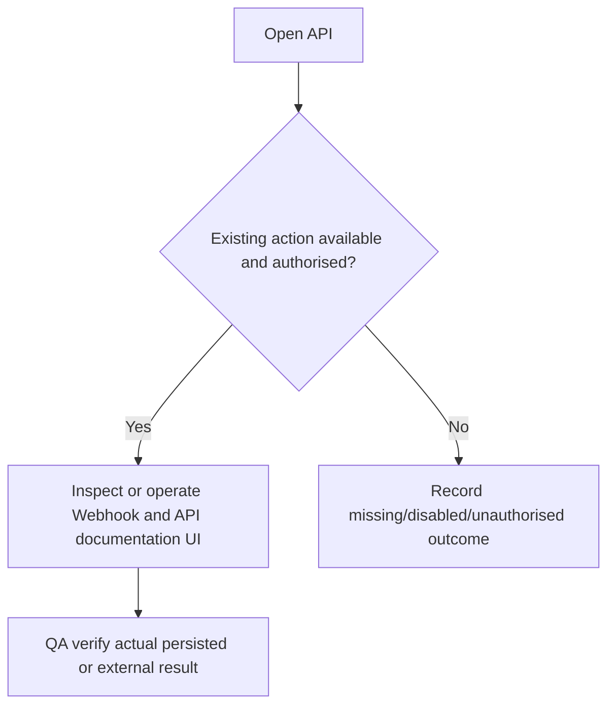

## 4. Approved To-Be feature catalogue – Jira development stories

### SET-P01 – Tenant-isolated organisation settings

**Classification:** Approved To-Be | **Goal:** SET-GO-01 | **Workflow:** SET-WF-01 | **Area:** Organization

**Jira user story:** As an Organisation administrator, I want to manage my organisation settings in my tenant so that organisation information stays separate across tenants.

**Business requirements / rules:** resolve tenant; load tenant settings; administrator edits; save to same tenant. These changes preserve the existing As-Is interface unless an approved requirement says otherwise.

**Acceptance criteria:**
1. **Given** the user opens Organization, **when** their tenant and permissions are resolved, **then** only authorised data/actions are made available.
2. **Given** the feature is exercised with valid approved inputs, **when** its operation completes, **then** the expected outcome is: Tenant A cannot view/change Tenant B data; verified values persist; missing context denies access.
3. **Given** the operation fails validation, identity handoff, provider connectivity or permission checks, **when** the response is received, **then** users see an accurate failure/pending result, not a false success.
4. **Given** another tenant exists, **when** the operation is attempted against that tenant, **then** access is rejected and no other tenant data changes.
5. QA must verify the existing feature baseline remains intact and reclassify already-working target behaviour as verification, not duplicate implementation.

**Dependencies / unresolved:** Development provider/API verification where applicable; no unapproved technical details assumed.

**Mermaid target flow:**
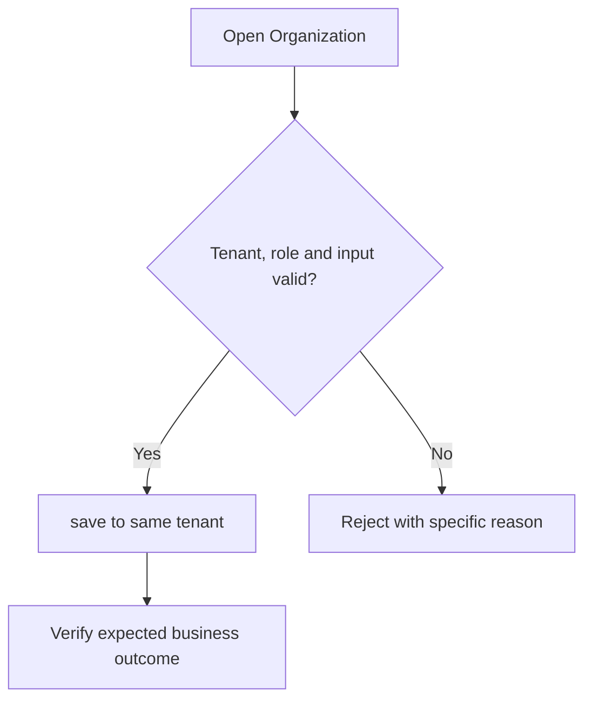

### SET-P02 – Organisation administrator editing

**Classification:** Approved To-Be | **Goal:** SET-GO-02 | **Workflow:** SET-WF-02 | **Area:** Organization

**Jira user story:** As an authorised organisation administrator, I want to edit organisation configuration so that legal and contact information is controlled.

**Business requirements / rules:** authenticate role; open settings; check organisation admin privilege; allow edit or deny. These changes preserve the existing As-Is interface unless an approved requirement says otherwise.

**Acceptance criteria:**
1. **Given** the user opens Organization, **when** their tenant and permissions are resolved, **then** only authorised data/actions are made available.
2. **Given** the feature is exercised with valid approved inputs, **when** its operation completes, **then** the expected outcome is: Non-admin edit attempts rejected; existing fields retained; allowed admin changes saved.
3. **Given** the operation fails validation, identity handoff, provider connectivity or permission checks, **when** the response is received, **then** users see an accurate failure/pending result, not a false success.
4. **Given** another tenant exists, **when** the operation is attempted against that tenant, **then** access is rejected and no other tenant data changes.
5. QA must verify the existing feature baseline remains intact and reclassify already-working target behaviour as verification, not duplicate implementation.

**Dependencies / unresolved:** Development provider/API verification where applicable; no unapproved technical details assumed.

**Mermaid target flow:**
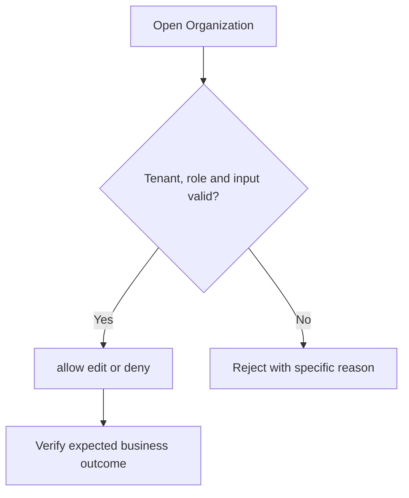

### SET-P03 – AiXIdentity-sourced users and roles

**Classification:** Approved To-Be | **Goal:** SET-GO-03 | **Workflow:** SET-WF-03 | **Area:** Users & Roles

**Jira user story:** As an authorised settings viewer, I want to view synchronized user, role, status and permission information so that identity authority remains consistent.

**Business requirements / rules:** resolve tenant; request approved AiXIdentity user/role data; present synchronized view. These changes preserve the existing As-Is interface unless an approved requirement says otherwise.

**Acceptance criteria:**
1. **Given** the user opens Users & Roles, **when** their tenant and permissions are resolved, **then** only authorised data/actions are made available.
2. **Given** the feature is exercised with valid approved inputs, **when** its operation completes, **then** the expected outcome is: Displays only users in authorised tenant; no local authority for roles/permissions; failure shows non-misleading error.
3. **Given** the operation fails validation, identity handoff, provider connectivity or permission checks, **when** the response is received, **then** users see an accurate failure/pending result, not a false success.
4. **Given** another tenant exists, **when** the operation is attempted against that tenant, **then** access is rejected and no other tenant data changes.
5. QA must verify the existing feature baseline remains intact and reclassify already-working target behaviour as verification, not duplicate implementation.

**Dependencies / unresolved:** Development provider/API verification where applicable; no unapproved technical details assumed.

**Mermaid target flow:**
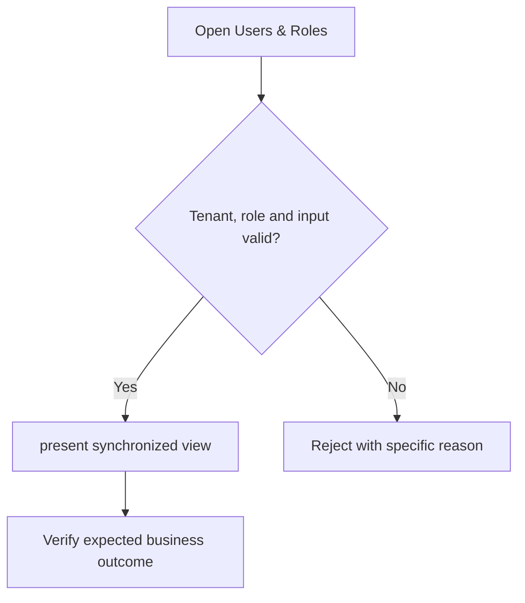

### SET-P03A – Add user from Users & Roles

**Classification:** Approved To-Be | **Goal:** SET-GO-04 | **Workflow:** SET-WF-04 | **Area:** Users & Roles

**Jira user story:** As an Admin or Manager, I want to create a user (for example Nilesh Raj) and designate Manager from the Users & Roles page so that the user can be onboarded without separately assigning privileges inside AiXPurpose.

**Business requirements / rules:** open Add User; check Admin/Manager; enter requested user details and role; submit to approved identity provisioning workflow; synchronize result. These changes preserve the existing As-Is interface unless an approved requirement says otherwise.

**Acceptance criteria:**
1. **Given** the user opens Users & Roles, **when** their tenant and permissions are resolved, **then** only authorised data/actions are made available.
2. **Given** the feature is exercised with valid approved inputs, **when** its operation completes, **then** the expected outcome is: Only Admin/Manager may open/submit; other users denied; no duplicate/conflicting account on repeated requests; AiXIdentity controls final access/permission; exact handoff pending Development.
3. **Given** the operation fails validation, identity handoff, provider connectivity or permission checks, **when** the response is received, **then** users see an accurate failure/pending result, not a false success.
4. **Given** another tenant exists, **when** the operation is attempted against that tenant, **then** access is rejected and no other tenant data changes.
5. QA must verify the existing feature baseline remains intact and reclassify already-working target behaviour as verification, not duplicate implementation.

**Dependencies / unresolved:** SET-OD-001, SET-OD-009: identity provisioning and roles.

**Mermaid target flow:**
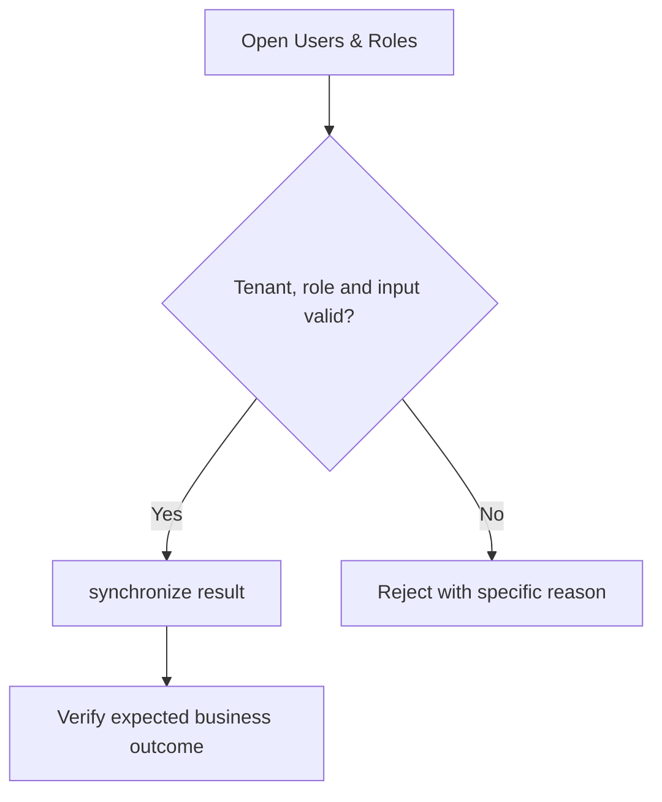

### SET-P04 – Tenant-specific communication configuration

**Classification:** Approved To-Be | **Goal:** SET-GO-05 | **Workflow:** SET-WF-05 | **Area:** Communication

**Jira user story:** As an authorised configuration administrator, I want to maintain separate email, SMS and WhatsApp settings so that each organisation uses its own provider configuration.

**Business requirements / rules:** resolve tenant; load corresponding provider settings; edit; save tenant config. These changes preserve the existing As-Is interface unless an approved requirement says otherwise.

**Acceptance criteria:**
1. **Given** the user opens Communication, **when** their tenant and permissions are resolved, **then** only authorised data/actions are made available.
2. **Given** the feature is exercised with valid approved inputs, **when** its operation completes, **then** the expected outcome is: Tenant isolation applies to all three configuration panels; setting save affects only current tenant.
3. **Given** the operation fails validation, identity handoff, provider connectivity or permission checks, **when** the response is received, **then** users see an accurate failure/pending result, not a false success.
4. **Given** another tenant exists, **when** the operation is attempted against that tenant, **then** access is rejected and no other tenant data changes.
5. QA must verify the existing feature baseline remains intact and reclassify already-working target behaviour as verification, not duplicate implementation.

**Dependencies / unresolved:** Development provider/API verification where applicable; no unapproved technical details assumed.

**Mermaid target flow:**


### SET-P05 – Provider credential protection

**Classification:** Approved To-Be | **Goal:** SET-GO-06 | **Workflow:** SET-WF-06 | **Area:** Communication

**Jira user story:** As an authorised administrator, I want to configure provider credentials without exposing secrets so that provider access information remains restricted.

**Business requirements / rules:** open provider fields; show masked stored secrets; submit updates securely; restrict readback. These changes preserve the existing As-Is interface unless an approved requirement says otherwise.

**Acceptance criteria:**
1. **Given** the user opens Communication, **when** their tenant and permissions are resolved, **then** only authorised data/actions are made available.
2. **Given** the feature is exercised with valid approved inputs, **when** its operation completes, **then** the expected outcome is: Secrets are not displayed as plaintext after save; unauthorised users cannot retrieve/modify provider credentials; failed save does not leak secrets.
3. **Given** the operation fails validation, identity handoff, provider connectivity or permission checks, **when** the response is received, **then** users see an accurate failure/pending result, not a false success.
4. **Given** another tenant exists, **when** the operation is attempted against that tenant, **then** access is rejected and no other tenant data changes.
5. QA must verify the existing feature baseline remains intact and reclassify already-working target behaviour as verification, not duplicate implementation.

**Dependencies / unresolved:** Development provider/API verification where applicable; no unapproved technical details assumed.

**Mermaid target flow:**


### SET-P06 – Tenant-specific payment providers

**Classification:** Approved To-Be | **Goal:** SET-GO-07 | **Workflow:** SET-WF-07 | **Area:** Payment

**Jira user story:** As an authorised payment-settings administrator, I want to configure my organisation payment providers so that another tenant cannot use or edit my configuration.

**Business requirements / rules:** resolve tenant; view gateways/fundraising tools; save permitted changes. These changes preserve the existing As-Is interface unless an approved requirement says otherwise.

**Acceptance criteria:**
1. **Given** the user opens Payment, **when** their tenant and permissions are resolved, **then** only authorised data/actions are made available.
2. **Given** the feature is exercised with valid approved inputs, **when** its operation completes, **then** the expected outcome is: Provider settings and enable states stay within tenant; cross-tenant access denied.
3. **Given** the operation fails validation, identity handoff, provider connectivity or permission checks, **when** the response is received, **then** users see an accurate failure/pending result, not a false success.
4. **Given** another tenant exists, **when** the operation is attempted against that tenant, **then** access is rejected and no other tenant data changes.
5. QA must verify the existing feature baseline remains intact and reclassify already-working target behaviour as verification, not duplicate implementation.

**Dependencies / unresolved:** Development provider/API verification where applicable; no unapproved technical details assumed.

**Mermaid target flow:**
```mermaid
flowchart TD
    A["Open Payment"] --> B{"Tenant, role and input valid?"}
    B -->|Yes| C["save permitted changes"]
    B -->|No| D["Reject with specific reason"]
    C --> E["Verify expected business outcome"]
```

### SET-P07 – Payment configuration validation

**Classification:** Approved To-Be | **Goal:** SET-GO-07 | **Workflow:** SET-WF-08 | **Area:** Payment

**Jira user story:** As an authorised payment-settings administrator, I want to know when a provider is sufficiently configured so that incomplete providers are not treated as ready.

**Business requirements / rules:** choose provider; supply provider-required fields; validate; enable or show correction. These changes preserve the existing As-Is interface unless an approved requirement says otherwise.

**Acceptance criteria:**
1. **Given** the user opens Payment, **when** their tenant and permissions are resolved, **then** only authorised data/actions are made available.
2. **Given** the feature is exercised with valid approved inputs, **when** its operation completes, **then** the expected outcome is: Missing or invalid required configuration cannot be marked operational; exact provider-specific fields require Development confirmation.
3. **Given** the operation fails validation, identity handoff, provider connectivity or permission checks, **when** the response is received, **then** users see an accurate failure/pending result, not a false success.
4. **Given** another tenant exists, **when** the operation is attempted against that tenant, **then** access is rejected and no other tenant data changes.
5. QA must verify the existing feature baseline remains intact and reclassify already-working target behaviour as verification, not duplicate implementation.

**Dependencies / unresolved:** Development provider/API verification where applicable; no unapproved technical details assumed.

**Mermaid target flow:**
```mermaid
flowchart TD
    A["Open Payment"] --> B{"Tenant, role and input valid?"}
    B -->|Yes| C["enable or show correction"]
    B -->|No| D["Reject with specific reason"]
    C --> E["Verify expected business outcome"]
```

### SET-P08 – Tenant-scoped API keys and webhooks

**Classification:** Approved To-Be | **Goal:** SET-GO-08 | **Workflow:** SET-WF-09 | **Area:** API

**Jira user story:** As an authorised integration administrator, I want to manage API credentials and webhook endpoints for my organisation only so that integrations cannot cross tenant boundaries.

**Business requirements / rules:** open API Integration; resolve tenant; view/create permitted resources; validate tenant context. These changes preserve the existing As-Is interface unless an approved requirement says otherwise.

**Acceptance criteria:**
1. **Given** the user opens API, **when** their tenant and permissions are resolved, **then** only authorised data/actions are made available.
2. **Given** the feature is exercised with valid approved inputs, **when** its operation completes, **then** the expected outcome is: API key and webhook resources are tenant-scoped; cross-tenant access blocked; scopes tied to authorised capabilities.
3. **Given** the operation fails validation, identity handoff, provider connectivity or permission checks, **when** the response is received, **then** users see an accurate failure/pending result, not a false success.
4. **Given** another tenant exists, **when** the operation is attempted against that tenant, **then** access is rejected and no other tenant data changes.
5. QA must verify the existing feature baseline remains intact and reclassify already-working target behaviour as verification, not duplicate implementation.

**Dependencies / unresolved:** Development provider/API verification where applicable; no unapproved technical details assumed.

**Mermaid target flow:**
```mermaid
flowchart TD
    A["Open API"] --> B{"Tenant, role and input valid?"}
    B -->|Yes| C["validate tenant context"]
    B -->|No| D["Reject with specific reason"]
    C --> E["Verify expected business outcome"]
```

### SET-P09 – Verify and repair API functions

**Classification:** Approved To-Be | **Goal:** SET-GO-09 | **Workflow:** SET-WF-10 | **Area:** API

**Jira user story:** As an integration administrator, I want to use supported API key and webhook operations reliably so that existing integration tools work as represented.

**Business requirements / rules:** QA tests existing actions; classify pass/defect; repair confirmed defects; retest. These changes preserve the existing As-Is interface unless an approved requirement says otherwise.

**Acceptance criteria:**
1. **Given** the user opens API, **when** their tenant and permissions are resolved, **then** only authorised data/actions are made available.
2. **Given** the feature is exercised with valid approved inputs, **when** its operation completes, **then** the expected outcome is: Each existing action has QA evidence; confirmed defects fixed; do not add unspecified new API methods/events.
3. **Given** the operation fails validation, identity handoff, provider connectivity or permission checks, **when** the response is received, **then** users see an accurate failure/pending result, not a false success.
4. **Given** another tenant exists, **when** the operation is attempted against that tenant, **then** access is rejected and no other tenant data changes.
5. QA must verify the existing feature baseline remains intact and reclassify already-working target behaviour as verification, not duplicate implementation.

**Dependencies / unresolved:** Development provider/API verification where applicable; no unapproved technical details assumed.

**Mermaid target flow:**
```mermaid
flowchart TD
    A["Open API"] --> B{"Tenant, role and input valid?"}
    B -->|Yes| C["retest"]
    B -->|No| D["Reject with specific reason"]
    C --> E["Verify expected business outcome"]
```

### SET-P10 – Settings section access control

**Classification:** Approved To-Be | **Goal:** SET-GO-02 | **Workflow:** SET-WF-11 | **Area:** All

**Jira user story:** As an authorised user, I want to see and change only the Settings functions permitted for my role so that sensitive configuration remains protected.

**Business requirements / rules:** resolve role and tenant; show eligible pages/actions; enforce server permissions on changes. These changes preserve the existing As-Is interface unless an approved requirement says otherwise.

**Acceptance criteria:**
1. **Given** the user opens All, **when** their tenant and permissions are resolved, **then** only authorised data/actions are made available.
2. **Given** the feature is exercised with valid approved inputs, **when** its operation completes, **then** the expected outcome is: Denied actions are blocked at server even if UI called directly; access to each Settings section follows authoritative permissions.
3. **Given** the operation fails validation, identity handoff, provider connectivity or permission checks, **when** the response is received, **then** users see an accurate failure/pending result, not a false success.
4. **Given** another tenant exists, **when** the operation is attempted against that tenant, **then** access is rejected and no other tenant data changes.
5. QA must verify the existing feature baseline remains intact and reclassify already-working target behaviour as verification, not duplicate implementation.

**Dependencies / unresolved:** Development provider/API verification where applicable; no unapproved technical details assumed.

**Mermaid target flow:**
```mermaid
flowchart TD
    A["Open All"] --> B{"Tenant, role and input valid?"}
    B -->|Yes| C["enforce server permissions on changes"]
    B -->|No| D["Reject with specific reason"]
    C --> E["Verify expected business outcome"]
```

### SET-P11 – Operational SMS integration

**Classification:** Approved To-Be | **Goal:** SET-GO-10 | **Workflow:** SET-WF-12 | **Area:** Communication

**Jira user story:** As an authorised communication administrator, I want to connect and test SMS using the existing provider form so that supported SMS notifications can be sent.

**Business requirements / rules:** configure provider; validate credentials; run Test SMS; enable upon success; save. These changes preserve the existing As-Is interface unless an approved requirement says otherwise.

**Acceptance criteria:**
1. **Given** the user opens Communication, **when** their tenant and permissions are resolved, **then** only authorised data/actions are made available.
2. **Given** the feature is exercised with valid approved inputs, **when** its operation completes, **then** the expected outcome is: Working test reports actual provider outcome; failed credentials/errors do not falsely mark enabled; channel remains tenant-scoped.
3. **Given** the operation fails validation, identity handoff, provider connectivity or permission checks, **when** the response is received, **then** users see an accurate failure/pending result, not a false success.
4. **Given** another tenant exists, **when** the operation is attempted against that tenant, **then** access is rejected and no other tenant data changes.
5. QA must verify the existing feature baseline remains intact and reclassify already-working target behaviour as verification, not duplicate implementation.

**Dependencies / unresolved:** Development provider/API verification where applicable; no unapproved technical details assumed.

**Mermaid target flow:**
```mermaid
flowchart TD
    A["Open Communication"] --> B{"Tenant, role and input valid?"}
    B -->|Yes| C["save"]
    B -->|No| D["Reject with specific reason"]
    C --> E["Verify expected business outcome"]
```

### SET-P12 – Operational WhatsApp integration

**Classification:** Approved To-Be | **Goal:** SET-GO-10 | **Workflow:** SET-WF-13 | **Area:** Communication

**Jira user story:** As an authorised communication administrator, I want to connect WhatsApp using the existing provider form so that supported WhatsApp communications can be delivered.

**Business requirements / rules:** configure provider; validate; attempt approved provider connectivity/delivery; enable upon success. These changes preserve the existing As-Is interface unless an approved requirement says otherwise.

**Acceptance criteria:**
1. **Given** the user opens Communication, **when** their tenant and permissions are resolved, **then** only authorised data/actions are made available.
2. **Given** the feature is exercised with valid approved inputs, **when** its operation completes, **then** the expected outcome is: Provider test/delivery must be real, errors surfaced, credential protection applies; exact test/approval rules await technical confirmation.
3. **Given** the operation fails validation, identity handoff, provider connectivity or permission checks, **when** the response is received, **then** users see an accurate failure/pending result, not a false success.
4. **Given** another tenant exists, **when** the operation is attempted against that tenant, **then** access is rejected and no other tenant data changes.
5. QA must verify the existing feature baseline remains intact and reclassify already-working target behaviour as verification, not duplicate implementation.

**Dependencies / unresolved:** Development provider/API verification where applicable; no unapproved technical details assumed.

**Mermaid target flow:**
```mermaid
flowchart TD
    A["Open Communication"] --> B{"Tenant, role and input valid?"}
    B -->|Yes| C["enable upon success"]
    B -->|No| D["Reject with specific reason"]
    C --> E["Verify expected business outcome"]
```

### SET-P13 – Operational payment gateway integration

**Classification:** Approved To-Be | **Goal:** SET-GO-11 | **Workflow:** SET-WF-14 | **Area:** Payment

**Jira user story:** As an authorised payment administrator, I want to use configured payment gateways where integration is currently missing so that supported donation payment operations can complete via verified gateways.

**Business requirements / rules:** QA identify provider gaps; configure provider; validate credentials; execute supported payment workflow; confirm result. These changes preserve the existing As-Is interface unless an approved requirement says otherwise.

**Acceptance criteria:**
1. **Given** the user opens Payment, **when** their tenant and permissions are resolved, **then** only authorised data/actions are made available.
2. **Given** the feature is exercised with valid approved inputs, **when** its operation completes, **then** the expected outcome is: Do not claim payment completion from saving settings; only successful verified gateway response qualifies; failures surfaced and no duplicate transaction assumed.
3. **Given** the operation fails validation, identity handoff, provider connectivity or permission checks, **when** the response is received, **then** users see an accurate failure/pending result, not a false success.
4. **Given** another tenant exists, **when** the operation is attempted against that tenant, **then** access is rejected and no other tenant data changes.
5. QA must verify the existing feature baseline remains intact and reclassify already-working target behaviour as verification, not duplicate implementation.

**Dependencies / unresolved:** Development provider/API verification where applicable; no unapproved technical details assumed.

**Mermaid target flow:**
```mermaid
flowchart TD
    A["Open Payment"] --> B{"Tenant, role and input valid?"}
    B -->|Yes| C["confirm result"]
    B -->|No| D["Reject with specific reason"]
    C --> E["Verify expected business outcome"]
```

## 5. Future enhancement backlog candidates – not approved

### SET-F01 – Organisation settings change history

**Classification:** Future candidate / NOT APPROVED | **Workflow:** SET-WF-15 | **Area:** Organization

**Jira candidate story:** As an authorised organisation user, I want organisation settings change history so that I can administrator reviews important setting change records.

**Business logic (conceptual only):** Product Owner approves separately; authoritative tenant/access restrictions remain; no delivery state, field validation, integration protocol or rollout timing has been approved.

**Future acceptance criteria, subject to approval:**
1. A product decision explicitly authorises this feature and defines the permitted user, scope and data.
2. An authorised tenant user can initiate the approved flow and view an accurate result.
3. Unauthorised/cross-tenant access is denied; failure is clearly reported.
4. The feature must not change any existing production behaviour before approval.

**Conceptual Mermaid flow:**
```mermaid
flowchart TD
    A["Future capability proposed"] --> B{"Approved by Product Owner?"}
    B -->|Yes| C["Specify detailed rules, then implement separately"]
    B -->|No| D["Leave excluded from current release"]
    C --> E["Validate tenant-scoped result"]
```

### SET-F02 – User invitation and activation workflow

**Classification:** Future candidate / NOT APPROVED | **Workflow:** SET-WF-16 | **Area:** Users & Roles

**Jira candidate story:** As an authorised organisation user, I want user invitation and activation workflow so that I can advanced invitation/activation process in addition to basic Add User; possible overlap remains open.

**Business logic (conceptual only):** Product Owner approves separately; authoritative tenant/access restrictions remain; no delivery state, field validation, integration protocol or rollout timing has been approved.

**Future acceptance criteria, subject to approval:**
1. A product decision explicitly authorises this feature and defines the permitted user, scope and data.
2. An authorised tenant user can initiate the approved flow and view an accurate result.
3. Unauthorised/cross-tenant access is denied; failure is clearly reported.
4. The feature must not change any existing production behaviour before approval.

**Conceptual Mermaid flow:**
```mermaid
flowchart TD
    A["Future capability proposed"] --> B{"Approved by Product Owner?"}
    B -->|Yes| C["Specify detailed rules, then implement separately"]
    B -->|No| D["Leave excluded from current release"]
    C --> E["Validate tenant-scoped result"]
```

### SET-F03 – Custom organisation roles

**Classification:** Future candidate / NOT APPROVED | **Workflow:** SET-WF-17 | **Area:** Users & Roles

**Jira candidate story:** As an authorised organisation user, I want custom organisation roles so that I can request custom roles through AiXIdentity authority rather than independently in AiXPurpose.

**Business logic (conceptual only):** Product Owner approves separately; authoritative tenant/access restrictions remain; no delivery state, field validation, integration protocol or rollout timing has been approved.

**Future acceptance criteria, subject to approval:**
1. A product decision explicitly authorises this feature and defines the permitted user, scope and data.
2. An authorised tenant user can initiate the approved flow and view an accurate result.
3. Unauthorised/cross-tenant access is denied; failure is clearly reported.
4. The feature must not change any existing production behaviour before approval.

**Conceptual Mermaid flow:**
```mermaid
flowchart TD
    A["Future capability proposed"] --> B{"Approved by Product Owner?"}
    B -->|Yes| C["Specify detailed rules, then implement separately"]
    B -->|No| D["Leave excluded from current release"]
    C --> E["Validate tenant-scoped result"]
```

### SET-F04 – Communication provider health monitoring

**Classification:** Future candidate / NOT APPROVED | **Workflow:** SET-WF-18 | **Area:** Communication

**Jira candidate story:** As an authorised organisation user, I want communication provider health monitoring so that I can show diagnostics and alerts on supported provider health.

**Business logic (conceptual only):** Product Owner approves separately; authoritative tenant/access restrictions remain; no delivery state, field validation, integration protocol or rollout timing has been approved.

**Future acceptance criteria, subject to approval:**
1. A product decision explicitly authorises this feature and defines the permitted user, scope and data.
2. An authorised tenant user can initiate the approved flow and view an accurate result.
3. Unauthorised/cross-tenant access is denied; failure is clearly reported.
4. The feature must not change any existing production behaviour before approval.

**Conceptual Mermaid flow:**
```mermaid
flowchart TD
    A["Future capability proposed"] --> B{"Approved by Product Owner?"}
    B -->|Yes| C["Specify detailed rules, then implement separately"]
    B -->|No| D["Leave excluded from current release"]
    C --> E["Validate tenant-scoped result"]
```

### SET-F05 – Multiple payment gateway routing

**Classification:** Future candidate / NOT APPROVED | **Workflow:** SET-WF-19 | **Area:** Payment

**Jira candidate story:** As an authorised organisation user, I want multiple payment gateway routing so that I can select among authorised gateways under a separately approved routing policy.

**Business logic (conceptual only):** Product Owner approves separately; authoritative tenant/access restrictions remain; no delivery state, field validation, integration protocol or rollout timing has been approved.

**Future acceptance criteria, subject to approval:**
1. A product decision explicitly authorises this feature and defines the permitted user, scope and data.
2. An authorised tenant user can initiate the approved flow and view an accurate result.
3. Unauthorised/cross-tenant access is denied; failure is clearly reported.
4. The feature must not change any existing production behaviour before approval.

**Conceptual Mermaid flow:**
```mermaid
flowchart TD
    A["Future capability proposed"] --> B{"Approved by Product Owner?"}
    B -->|Yes| C["Specify detailed rules, then implement separately"]
    B -->|No| D["Leave excluded from current release"]
    C --> E["Validate tenant-scoped result"]
```

### SET-F06 – API usage and webhook delivery monitoring

**Classification:** Future candidate / NOT APPROVED | **Workflow:** SET-WF-20 | **Area:** API

**Jira candidate story:** As an authorised organisation user, I want api usage and webhook delivery monitoring so that I can show permitted request activity and delivery outcomes.

**Business logic (conceptual only):** Product Owner approves separately; authoritative tenant/access restrictions remain; no delivery state, field validation, integration protocol or rollout timing has been approved.

**Future acceptance criteria, subject to approval:**
1. A product decision explicitly authorises this feature and defines the permitted user, scope and data.
2. An authorised tenant user can initiate the approved flow and view an accurate result.
3. Unauthorised/cross-tenant access is denied; failure is clearly reported.
4. The feature must not change any existing production behaviour before approval.

**Conceptual Mermaid flow:**
```mermaid
flowchart TD
    A["Future capability proposed"] --> B{"Approved by Product Owner?"}
    B -->|Yes| C["Specify detailed rules, then implement separately"]
    B -->|No| D["Leave excluded from current release"]
    C --> E["Validate tenant-scoped result"]
```

### SET-F07 – Credential expiry reminders

**Classification:** Future candidate / NOT APPROVED | **Workflow:** SET-WF-21 | **Area:** Communication / Payment / API

**Jira candidate story:** As an authorised organisation user, I want credential expiry reminders so that I can notify appropriate admin about expiring configured credentials where expiry metadata exists.

**Business logic (conceptual only):** Product Owner approves separately; authoritative tenant/access restrictions remain; no delivery state, field validation, integration protocol or rollout timing has been approved.

**Future acceptance criteria, subject to approval:**
1. A product decision explicitly authorises this feature and defines the permitted user, scope and data.
2. An authorised tenant user can initiate the approved flow and view an accurate result.
3. Unauthorised/cross-tenant access is denied; failure is clearly reported.
4. The feature must not change any existing production behaviour before approval.

**Conceptual Mermaid flow:**
```mermaid
flowchart TD
    A["Future capability proposed"] --> B{"Approved by Product Owner?"}
    B -->|Yes| C["Specify detailed rules, then implement separately"]
    B -->|No| D["Leave excluded from current release"]
    C --> E["Validate tenant-scoped result"]
```

### SET-F08 – Organisation settings import/export

**Classification:** Future candidate / NOT APPROVED | **Workflow:** SET-WF-22 | **Area:** Organization

**Jira candidate story:** As an authorised organisation user, I want organisation settings import/export so that I can transfer approved setting fields under an authorised process, excluding secrets by default.

**Business logic (conceptual only):** Product Owner approves separately; authoritative tenant/access restrictions remain; no delivery state, field validation, integration protocol or rollout timing has been approved.

**Future acceptance criteria, subject to approval:**
1. A product decision explicitly authorises this feature and defines the permitted user, scope and data.
2. An authorised tenant user can initiate the approved flow and view an accurate result.
3. Unauthorised/cross-tenant access is denied; failure is clearly reported.
4. The feature must not change any existing production behaviour before approval.

**Conceptual Mermaid flow:**
```mermaid
flowchart TD
    A["Future capability proposed"] --> B{"Approved by Product Owner?"}
    B -->|Yes| C["Specify detailed rules, then implement separately"]
    B -->|No| D["Leave excluded from current release"]
    C --> E["Validate tenant-scoped result"]
```

## 6. Full field, action and screenshot coverage

| Area | Screenshot assets | Included As-Is QA IDs |
|---|---|---|

| Organization |    | SET-A-01, SET-A-02 |

| Users & Roles |  | SET-A-03, SET-A-04, SET-A-05 |

| Communication |    | SET-A-06, SET-A-07, SET-A-08, SET-A-09 |

| Payment |   | SET-A-10, SET-A-11, SET-A-12 |

| API |   | SET-A-13, SET-A-14 |

## 7. Cross-document traceability

| Goal | Workflow | Feature | Jira scope |
|---|---|---|---|

| SET-WF-01 | SET-WF-01 | SET-P01 | To-Be |

| SET-WF-02 | SET-WF-02 | SET-P02 | To-Be |

| SET-WF-03 | SET-WF-03 | SET-P03 | To-Be |

| SET-WF-04 | SET-WF-04 | SET-P03A | To-Be |

| SET-WF-05 | SET-WF-05 | SET-P04 | To-Be |

| SET-WF-06 | SET-WF-06 | SET-P05 | To-Be |

| SET-WF-07 | SET-WF-07 | SET-P06 | To-Be |

| SET-WF-08 | SET-WF-08 | SET-P07 | To-Be |

| SET-WF-09 | SET-WF-09 | SET-P08 | To-Be |

| SET-WF-10 | SET-WF-10 | SET-P09 | To-Be |

| SET-WF-11 | SET-WF-11 | SET-P10 | To-Be |

| SET-WF-12 | SET-WF-12 | SET-P11 | To-Be |

| SET-WF-13 | SET-WF-13 | SET-P12 | To-Be |

| SET-WF-14 | SET-WF-14 | SET-P13 | To-Be |

| Future candidate | SET-WF-15 | SET-F01 | Future only |

| Future candidate | SET-WF-16 | SET-F02 | Future only |

| Future candidate | SET-WF-17 | SET-F03 | Future only |

| Future candidate | SET-WF-18 | SET-F04 | Future only |

| Future candidate | SET-WF-19 | SET-F05 | Future only |

| Future candidate | SET-WF-20 | SET-F06 | Future only |

| Future candidate | SET-WF-21 | SET-F07 | Future only |

| Future candidate | SET-WF-22 | SET-F08 | Future only |

## 8. Open decisions and QA/development handoff

1. **User creation:** Admin and Manager may create from Users & Roles; AiXIdentity handles access and permissions. Development must confirm required fields, role-selection policy, duplicate matching, provisioning transport and sync acknowledgements.
2. **Existing user actions:** QA must verify any edit/disable/permission links visible; no additional write permission is assumed.
3. **SMS/WhatsApp:** Existing UI is retained, actual provider functionality must be delivered; provider-specific validation and approved sending/testing mechanisms remain to be confirmed.
4. **Payments:** UI alone does not confirm transaction connectivity. QA identifies provider gaps; implement missing approved gateway operations and verify real outcomes.
5. **API:** QA tests existing keys/webhooks, Development fixes confirmed defects and tenant-isolation gaps, without adding unsupported functionality.
6. **SET-F02:** Remains an eight-item future candidate as user requested even though the advanced invitation/activation concept may overlap with To-Be Add User.
7. **Evidence:** Screenshots are references, not proof of backend functionality. Jira stories must be classified QA, To-Be or Future and routed accordingly.

## 9. Product Owner review summary

Feature scope is comprehensive against supplied visible settings, confirmed decisions, and open technical boundaries. QA and stakeholder sign-off remain required; the catalogue is a draft, not proof of existing deployment success.