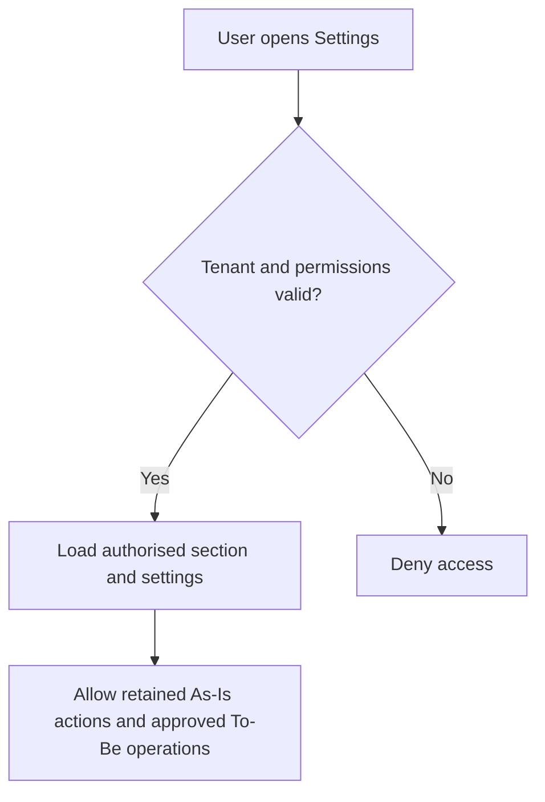

# AiXPurpose – Settings – BRD Goals

> Business Requirements Document – Goals

## Document Control

| Field | Value |
|---|---|
| Product | AiXPurpose Standalone (multi-tenant) |
| Capability | Settings: Organization, Users & Roles, Communication, Payment, API Integration |
| Version | 1.0 |
| Status | Draft for Product, QA, Development and stakeholder review |
| Authoritative evidence | `settings Module.docx` screenshots and description; user-approved Q1–Q8/C1–C6 decisions and final AiXIdentity clarification |
| Documentation convention | Members/Donors BRD structure and revised Profile Jira-story pattern |

## Overview

**Evidence rule:** A screenshot demonstrates an available interface, not working integration. All As-Is functionality must survive in standalone; QA checks it. To-Be items require implementation/repair only if the current implementation does not already meet the agreed requirement. Future flows are conceptual and require approval.

**Authority rule:** AiXIdentity is authoritative for authentication/access, roles and permissions. AiXPurpose provides the Users & Roles view and the Admin/Manager Add User interface. The exact provisioning API, invitation activation, identity synchronization cadence and permitted Manager role-selection boundaries must be verified with Development/AiXIdentity, not assumed. Earlier notes call the identity source AiXHub; the user's latest clarification names AiXIdentity for access and permissions. Their interface/ownership relationship is an open architecture point, not an invented equivalence.

## Contents
1. Purpose and business context
2. As-Is baseline
3. To-Be standalone goals
4. Future enhancement candidates
5. Business logic and rules
6. Cross-module dependencies
7. Risks and open decisions
8. Success/QA criteria
9. Traceability and review summary

## 1. Purpose and business context

Existing client-specific Settings must remain available to independently configured organisations without leaking one tenant’s settings, provider credentials, payment configurations, users or API integrations to another. Settings consists of five sections already visible in the supplied screenshots. No functionality unrelated to the supplied source is introduced.

## 2. As-Is – preserve and verify

### Organization

  

### Users & Roles

### Communication

  

### Payment

 

### API

 

- **SET-A-01 – Organization basic information** (Organization): name, legal name, logo, email, phone, website, founded year. **QA:** User can see existing fields and Save Organization Settings; QA confirms save persistence, field handling, and access restrictions.

- **SET-A-02 – Organization address and registration** (Organization): street address, city, state/province, ZIP/postal code, country, tax/EIN, registration number, mission statement. **QA:** QA checks displayed and saved address, tax/registration, and mission data.

- **SET-A-03 – Users and roles KPI cards** (Users & Roles): three user/role summary cards visible on the Users & Roles page. **QA:** QA verifies actual KPI meanings, values and AiXIdentity source mapping; screenshots do not establish calculations.

- **SET-A-04 – Users listing and displayed access** (Users & Roles): user name, email, role, status, last login, row actions and role permissions area. **QA:** QA checks identity source, pagination/search only if present, displayed role/status/last-login, and permissible actions.

- **SET-A-05 – Existing Add User control** (Users & Roles): Add User button visible; currently non-functional. **QA:** QA records as existing UI gap; functional creation is a separately approved To-Be feature.

- **SET-A-06 – SMTP email configuration** (Communication): email provider, SMTP host, port, username, password, sender name, sender email, reply-to email, Test Email. **QA:** Email is reported operational; QA verifies connection test and persistence without exposing password.

- **SET-A-07 – SMS provider configuration UI** (Communication): SMS provider, account SID, authentication token, phone number, enable control and Test SMS. **QA:** UI retained; operational SMS transmission not As-Is and must be built in To-Be.

- **SET-A-08 – WhatsApp provider configuration UI** (Communication): WhatsApp provider, account SID, auth token, WhatsApp number and enable control. **QA:** UI retained; operational WhatsApp transmission not As-Is and must be built in To-Be.

- **SET-A-09 – Communication settings save** (Communication): Save Communication Settings action. **QA:** QA confirms which settings persist; operational behaviour assessed separately per provider.

- **SET-A-10 – Payment gateways configuration** (Payment): Stripe and PayPal provider cards with credentials/settings and enable state. **QA:** Configuration UI exists; successful external payment transaction is NOT verified.

- **SET-A-11 – Third-party fundraising tool settings** (Payment): Donorbox, Givebutter and Classy integrations represented by configuration/enable cards; other provider tiles may appear. **QA:** QA verifies tile availability, stored state and any actual integrations; no unverified processing claims.

- **SET-A-12 – Payment settings save** (Payment): Save Payment Settings control. **QA:** QA verifies persistence, state and permission behaviour separately from operational payment integration.

- **SET-A-13 – API key management UI** (API): API key entries, shown permission tags, Create API Key, and row controls. **QA:** Partially functional; QA records working create/view/revoke/edit operations rather than assuming all.

- **SET-A-14 – Webhook and API documentation UI** (API): webhook endpoint listing, active status, event tags, Add Webhook, API Documentation link, security guidance. **QA:** Partially functional; QA records actual persistence, delivery and action support; no invented callback payload.

## 3. To-Be – standalone business objectives

| Goal | Outcome | Feature / Workflow |
|---|---|---|

| SET-GO-01 | Tenant-isolated organisation settings — organisation information stays separate across tenants | SET-P01 / SET-WF-01 |

| SET-GO-02 | Organisation administrator editing — legal and contact information is controlled | SET-P02 / SET-WF-02 |

| SET-GO-03 | AiXIdentity-sourced users and roles — identity authority remains consistent | SET-P03 / SET-WF-03 |

| SET-GO-04 | Add user from Users & Roles — the user can be onboarded without separately assigning privileges inside AiXPurpose | SET-P03A / SET-WF-04 |

| SET-GO-05 | Tenant-specific communication configuration — each organisation uses its own provider configuration | SET-P04 / SET-WF-05 |

| SET-GO-06 | Provider credential protection — provider access information remains restricted | SET-P05 / SET-WF-06 |

| SET-GO-07 | Tenant-specific payment providers — another tenant cannot use or edit my configuration | SET-P06 / SET-WF-07 |

| SET-GO-07 | Payment configuration validation — incomplete providers are not treated as ready | SET-P07 / SET-WF-08 |

| SET-GO-08 | Tenant-scoped API keys and webhooks — integrations cannot cross tenant boundaries | SET-P08 / SET-WF-09 |

| SET-GO-09 | Verify and repair API functions — existing integration tools work as represented | SET-P09 / SET-WF-10 |

| SET-GO-02 | Settings section access control — sensitive configuration remains protected | SET-P10 / SET-WF-11 |

| SET-GO-10 | Operational SMS integration — supported SMS notifications can be sent | SET-P11 / SET-WF-12 |

| SET-GO-10 | Operational WhatsApp integration — supported WhatsApp communications can be delivered | SET-P12 / SET-WF-13 |

| SET-GO-11 | Operational payment gateway integration — supported donation payment operations can complete via verified gateways | SET-P13 / SET-WF-14 |

### Approved target-state overview

## 4. Future scope – candidates, not release commitments

| ID | Candidate | Intended business value / constraints |
|---|---|---|

| SET-F01 | Organisation settings change history | administrator reviews important setting change records |

| SET-F02 | User invitation and activation workflow | advanced invitation/activation process in addition to basic Add User; possible overlap remains open |

| SET-F03 | Custom organisation roles | request custom roles through AiXIdentity authority rather than independently in AiXPurpose |

| SET-F04 | Communication provider health monitoring | show diagnostics and alerts on supported provider health |

| SET-F05 | Multiple payment gateway routing | select among authorised gateways under a separately approved routing policy |

| SET-F06 | API usage and webhook delivery monitoring | show permitted request activity and delivery outcomes |

| SET-F07 | Credential expiry reminders | notify appropriate admin about expiring configured credentials where expiry metadata exists |

| SET-F08 | Organisation settings import/export | transfer approved setting fields under an authorised process, excluding secrets by default |

## 5. Business rules and constraints

| Rule ID | Rule |
|---|---|

| SET-BR-001 | Organisation settings and provider/API resources are tenant-isolated. |

| SET-BR-002 | Only authorised organisation administrators may edit organisation settings. |

| SET-BR-003 | AiXIdentity remains authoritative for access, roles and permissions; AiXPurpose must not override it. |

| SET-BR-004 | Admin and Manager may initiate Add User in AiXPurpose; other roles are denied. Final access/permission changes remain governed by AiXIdentity. |

| SET-BR-005 | Email is reported operational; SMS and WhatsApp delivery are To-Be, while their present UI is As-Is. |

| SET-BR-006 | Provider credentials must be protected and access-controlled. |

| SET-BR-007 | Payment setting persistence does not prove external transaction processing. |

| SET-BR-008 | Provider validation is required before declaring the integration operational. |

| SET-BR-009 | API keys and webhooks must be tenant-scoped; partially working actions need QA defects and retesting. |

| SET-BR-010 | Maintain all existing fields, controls and configuration screens in standalone; QA establishes actual behaviour. |

| SET-BR-011 | Future candidates do not become delivery commitments without a separate approval. |

## 6. Cross-module responsibility boundaries

- **Identity:** AiXIdentity decides roles and permissions; user creation is initiated from AiXPurpose by Admin/Manager. The previously documented AiXHub source and current AiXIdentity responsibility need integration clarification.
- **Profile:** Individual email/notification preferences use only channels actually available through Settings.
- **Donations:** Payment gateway configuration belongs to Settings; transaction statuses, donation recording and reconciliation belong to their respective donation workflows.
- **API-consuming modules:** API keys/webhooks provide integration access only within approved tenant and permission boundaries.

## 7. Risks, assumptions and decisions

| Decision | Unresolved question / QA evidence needed |
|---|---|

| SET-OD-001 | AiXPurpose Add User -> AiXIdentity/AiXHub provisioning handoff, invitation/activation states, duplicate handling and resulting role approval. |

| SET-OD-002 | Exact current Users & Roles row actions, edit/deactivate behaviour and sync source. |

| SET-OD-003 | Provider-specific SMS connection, Test SMS and usable delivery outcomes. |

| SET-OD-004 | Provider-specific WhatsApp verification, permitted messaging and test mechanism. |

| SET-OD-005 | Which of the displayed Stripe/PayPal/other payment and fundraising integrations actually operate. |

| SET-OD-006 | Actual supported API key actions, scope semantics and webhook delivery handling. |

| SET-OD-007 | Current permissions and server-side enforcement gaps for each Settings section. |

| SET-OD-008 | Scope overlap: basic Add User is To-Be, invitation/activation is an unapproved future candidate. |

| SET-OD-009 | Relationship and naming between AiXHub (earlier source) and AiXIdentity (latest authority). |

## 8. Success criteria and QA handoff

1. Every existing Settings control and field remains present and is independently marked Pass/Defect/Not Verified by QA.
2. Two tenants cannot read or modify each other’s settings, keys, webhooks or provider configurations.
3. Only permitted organisation administrators save organisation data; Admin/Manager can initiate Add User, and AiXIdentity remains authoritative.
4. Email continues working; SMS and WhatsApp meet actual provider-integrated To-Be acceptance outcomes; payment operations work for providers agreed after QA gap assessment.
5. Existing API key/webhook actions are verified; defects are remediated and retested.
6. Unapproved future workflows remain excluded from initial development.

## 9. Traceability

The Feature Catalogue contains Jira-ready stories and acceptance criteria for `SET-A-01..14`, all 14 approved To-Be items and eight future candidates. The Workflow document describes related process flows `SET-WF-01..22`. IDs and evidence references are shared across all three documents.

## 10. Product Owner validation summary

Business scope is defined from supplied material and approved decisions; technical behavior requiring evidence is deliberately left open. Sign-off depends on QA/Development decisions above.