# AiXPurpose – Settings – BRD Workflow

> Business Requirements Document – Workflow

## Document Control

| Field | Value |
|---|---|
| Product | AiXPurpose Standalone (multi-tenant) |
| Capability | Settings: Organization, Users & Roles, Communication, Payment, API Integration |
| Version | 1.0 |
| Status | Draft for Product, QA, Development and stakeholder review |
| Authoritative evidence | `settings Module.docx` screenshots and description; user-approved Q1–Q8/C1–C6 decisions and final AiXIdentity clarification |
| Documentation convention | Members/Donors BRD structure and revised Profile Jira-story pattern |


## Overview

**Evidence rule:** A screenshot demonstrates an available interface, not working integration. All As-Is functionality must survive in standalone; QA checks it. To-Be items require implementation/repair only if the current implementation does not already meet the agreed requirement. Future flows are conceptual and require approval.

**Authority rule:** AiXIdentity is authoritative for authentication/access, roles and permissions. AiXPurpose provides the Users & Roles view and the Admin/Manager Add User interface. The exact provisioning API, invitation activation, identity synchronization cadence and permitted Manager role-selection boundaries must be verified with Development/AiXIdentity, not assumed. Earlier notes call the identity source AiXHub; the user's latest clarification names AiXIdentity for access and permissions. Their interface/ownership relationship is an open architecture point, not an invented equivalence.


## Contents
1. Actor/ownership rules
2. End-to-end As-Is and To-Be
3. Existing workflow inventory
4. Approved To-Be detailed workflows
5. Future candidate conceptual workflows
6. Exceptions and validation
7. Screenshot evidence and traceability

## 1. Actor and responsibility rules

| Actor | Permitted responsibility |
|---|---|

| Organisation administrator | Modify authorised organisation settings; subject to identity permissions. |

| Admin / Manager | Initiate Add User through AiXPurpose Users & Roles (latest confirmed decision). |

| Other authorised viewer | See user and settings information only where access is granted. |

| AiXIdentity | Own access controls, roles and permissions; provisioning handoff pending Development confirmation. |

| AiXPurpose | Display user/role data, accept approved create-user input, manage tenant-scoped Settings UI and integrations. |

## 2. End-to-end processes

### Existing interface – As-Is

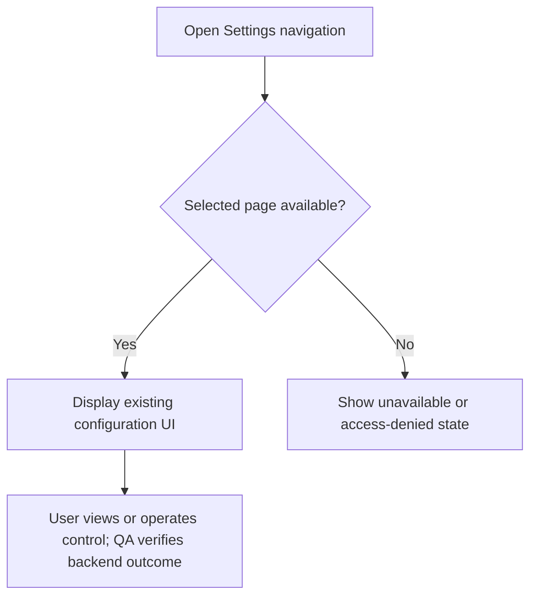

### Standalone target – To-Be

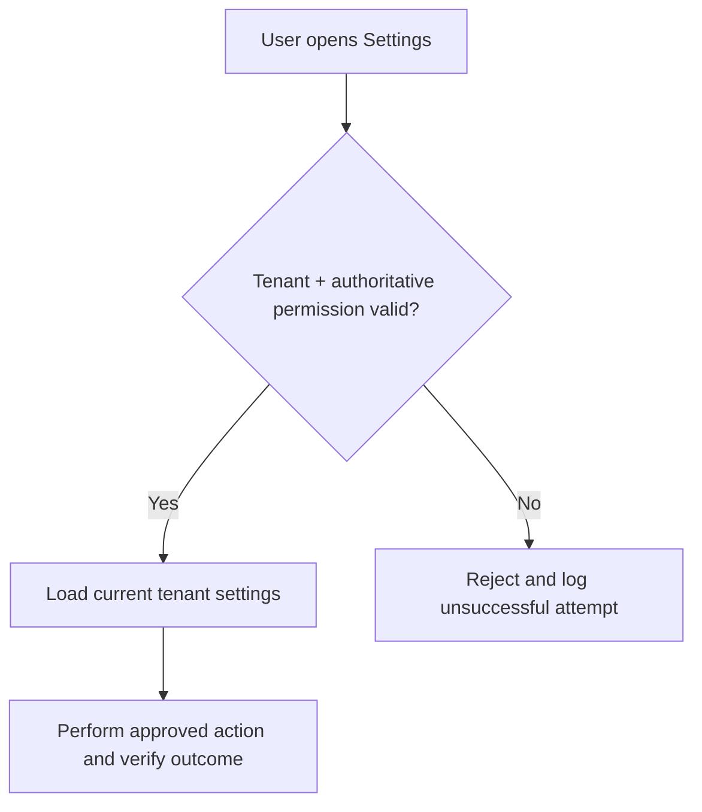

### User creation – approved business intent

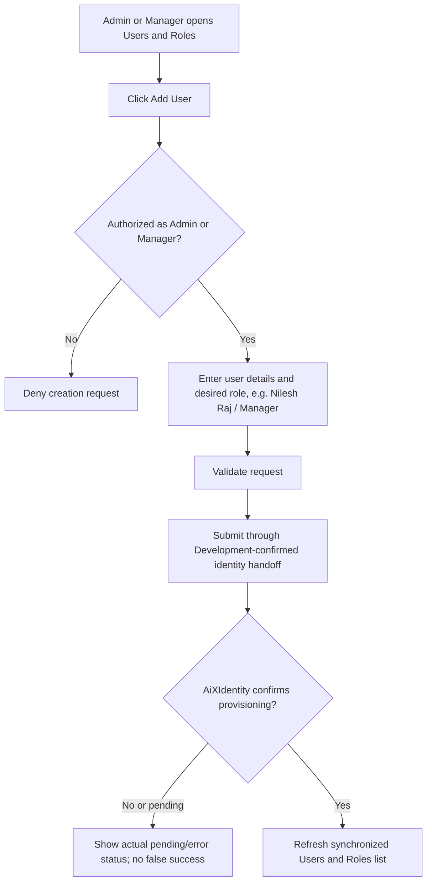

## 3. As-Is inventory – retain with QA evidence

| QA ID | Existing flow | Steps / verification |
|---|---|---|

| SET-A-01 | Organization basic information | open organisation settings; inspect basic information; update permitted details; save; User can see existing fields and Save Organization Settings; QA confirms save persistence, field handling, and access restrictions. |

| SET-A-02 | Organization address and registration | open remaining organisation details; inspect/edit permitted fields; save; QA checks displayed and saved address, tax/registration, and mission data. |

| SET-A-03 | Users and roles KPI cards | open Users & Roles; review the three summary values; QA verifies actual KPI meanings, values and AiXIdentity source mapping; screenshots do not establish calculations. |

| SET-A-04 | Users listing and displayed access | load user directory; search/review available rows and permissions; QA checks identity source, pagination/search only if present, displayed role/status/last-login, and permissible actions. |

| SET-A-05 | Existing Add User control | select Add User; observe current behaviour; record failed/unfinished action; QA records as existing UI gap; functional creation is a separately approved To-Be feature. |

| SET-A-06 | SMTP email configuration | view and configure email fields; test; save; Email is reported operational; QA verifies connection test and persistence without exposing password. |

| SET-A-07 | SMS provider configuration UI | open SMS panel; edit provider values; review test/enable control; UI retained; operational SMS transmission not As-Is and must be built in To-Be. |

| SET-A-08 | WhatsApp provider configuration UI | open WhatsApp panel; edit provider values; save; UI retained; operational WhatsApp transmission not As-Is and must be built in To-Be. |

| SET-A-09 | Communication settings save | change permitted settings; choose save; reopen; QA confirms which settings persist; operational behaviour assessed separately per provider. |

| SET-A-10 | Payment gateways configuration | open payment; inspect provider configurations; save settings; Configuration UI exists; successful external payment transaction is NOT verified. |

| SET-A-11 | Third-party fundraising tool settings | inspect fundraising tool toggles; save settings; QA verifies tile availability, stored state and any actual integrations; no unverified processing claims. |

| SET-A-12 | Payment settings save | modify a permitted provider configuration; save; reopen; QA verifies persistence, state and permission behaviour separately from operational payment integration. |

| SET-A-13 | API key management UI | open keys; inspect listed scopes and operations; try supported actions; Partially functional; QA records working create/view/revoke/edit operations rather than assuming all. |

| SET-A-14 | Webhook and API documentation UI | inspect webhook list, try allowed webhook actions and documentation link; Partially functional; QA records actual persistence, delivery and action support; no invented callback payload. |

## 4. Approved To-Be detailed workflows

### SET-WF-01 – Tenant-isolated organisation settings

**Classification:** To-Be | **Goal:** SET-GO-01 | **Feature:** SET-P01 | **Actor:** Organisation administrator | **Settings page:** Organization

**Trigger and steps:** resolve tenant; load tenant settings; administrator edits; save to same tenant.

**Expected result / exceptions:** Tenant A cannot view/change Tenant B data; verified values persist; missing context denies access.

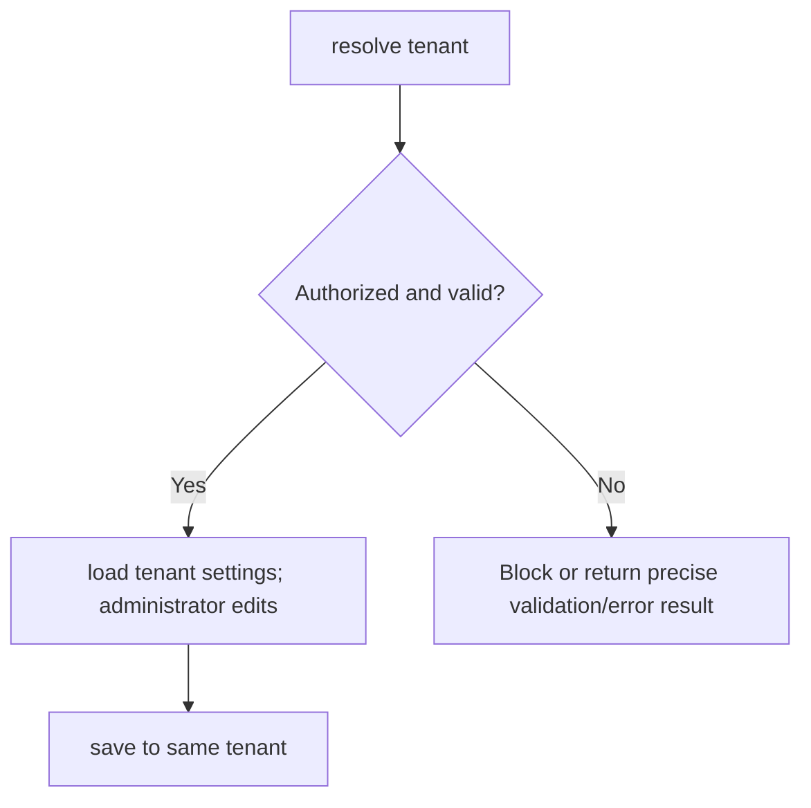

### SET-WF-02 – Organisation administrator editing

**Classification:** To-Be | **Goal:** SET-GO-02 | **Feature:** SET-P02 | **Actor:** authorised organisation administrator | **Settings page:** Organization

**Trigger and steps:** authenticate role; open settings; check organisation admin privilege; allow edit or deny.

**Expected result / exceptions:** Non-admin edit attempts rejected; existing fields retained; allowed admin changes saved.

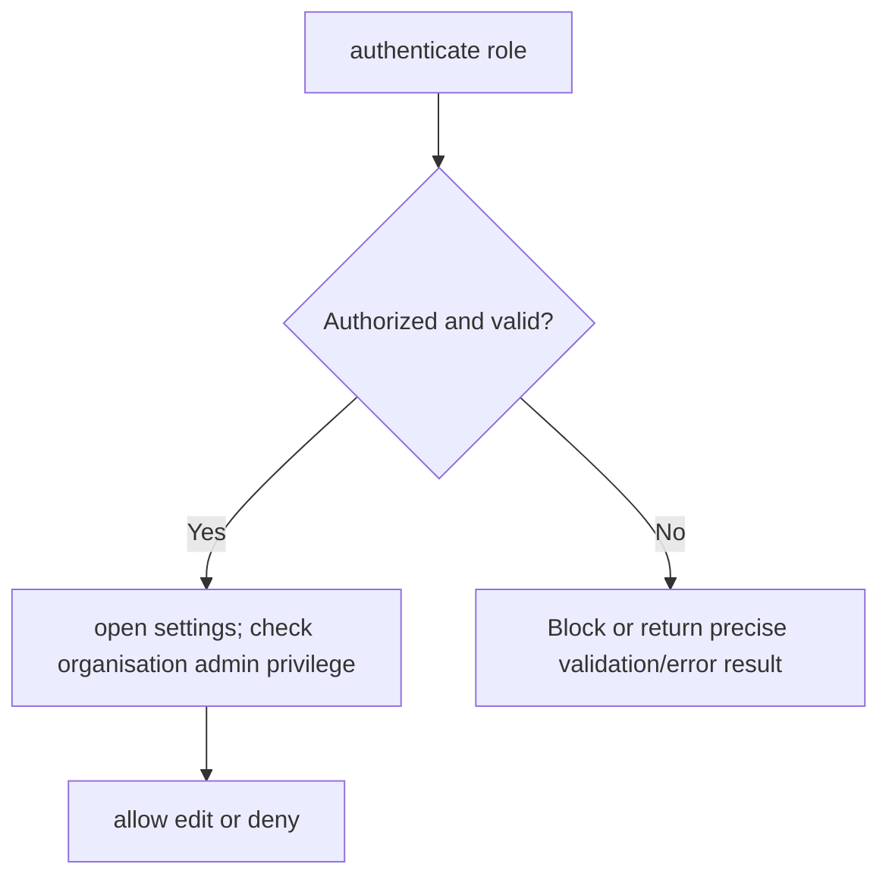

### SET-WF-03 – AiXIdentity-sourced users and roles

**Classification:** To-Be | **Goal:** SET-GO-03 | **Feature:** SET-P03 | **Actor:** authorised settings viewer | **Settings page:** Users & Roles

**Trigger and steps:** resolve tenant; request approved AiXIdentity user/role data; present synchronized view.

**Expected result / exceptions:** Displays only users in authorised tenant; no local authority for roles/permissions; failure shows non-misleading error.

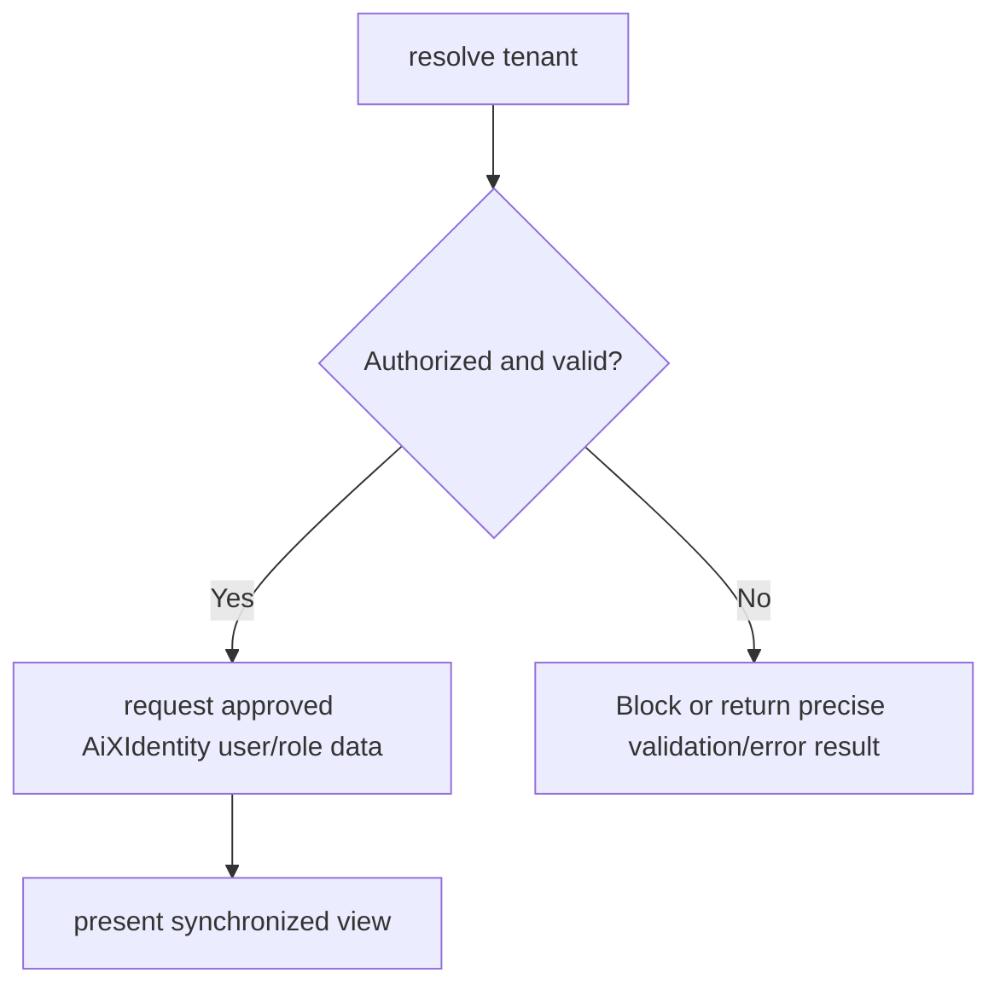

### SET-WF-04 – Add user from Users & Roles

**Classification:** To-Be | **Goal:** SET-GO-04 | **Feature:** SET-P03A | **Actor:** Admin or Manager | **Settings page:** Users & Roles

**Trigger and steps:** open Add User; check Admin/Manager; enter requested user details and role; submit to approved identity provisioning workflow; synchronize result.

**Expected result / exceptions:** Only Admin/Manager may open/submit; other users denied; no duplicate/conflicting account on repeated requests; AiXIdentity controls final access/permission; exact handoff pending Development.

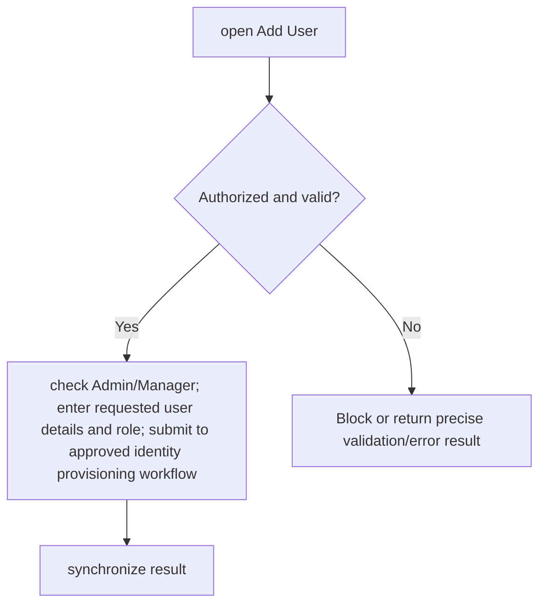

### SET-WF-05 – Tenant-specific communication configuration

**Classification:** To-Be | **Goal:** SET-GO-05 | **Feature:** SET-P04 | **Actor:** authorised configuration administrator | **Settings page:** Communication

**Trigger and steps:** resolve tenant; load corresponding provider settings; edit; save tenant config.

**Expected result / exceptions:** Tenant isolation applies to all three configuration panels; setting save affects only current tenant.

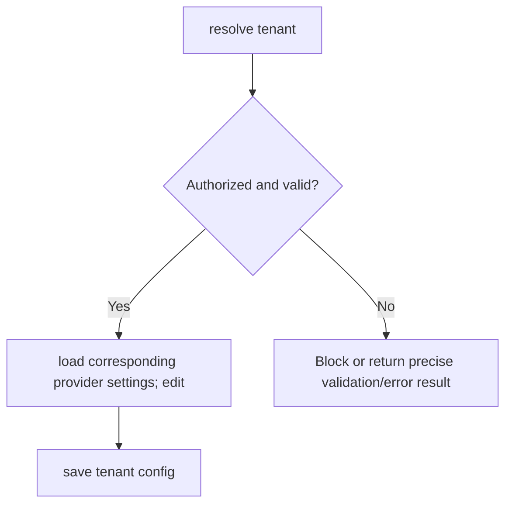

### SET-WF-06 – Provider credential protection

**Classification:** To-Be | **Goal:** SET-GO-06 | **Feature:** SET-P05 | **Actor:** authorised administrator | **Settings page:** Communication

**Trigger and steps:** open provider fields; show masked stored secrets; submit updates securely; restrict readback.

**Expected result / exceptions:** Secrets are not displayed as plaintext after save; unauthorised users cannot retrieve/modify provider credentials; failed save does not leak secrets.

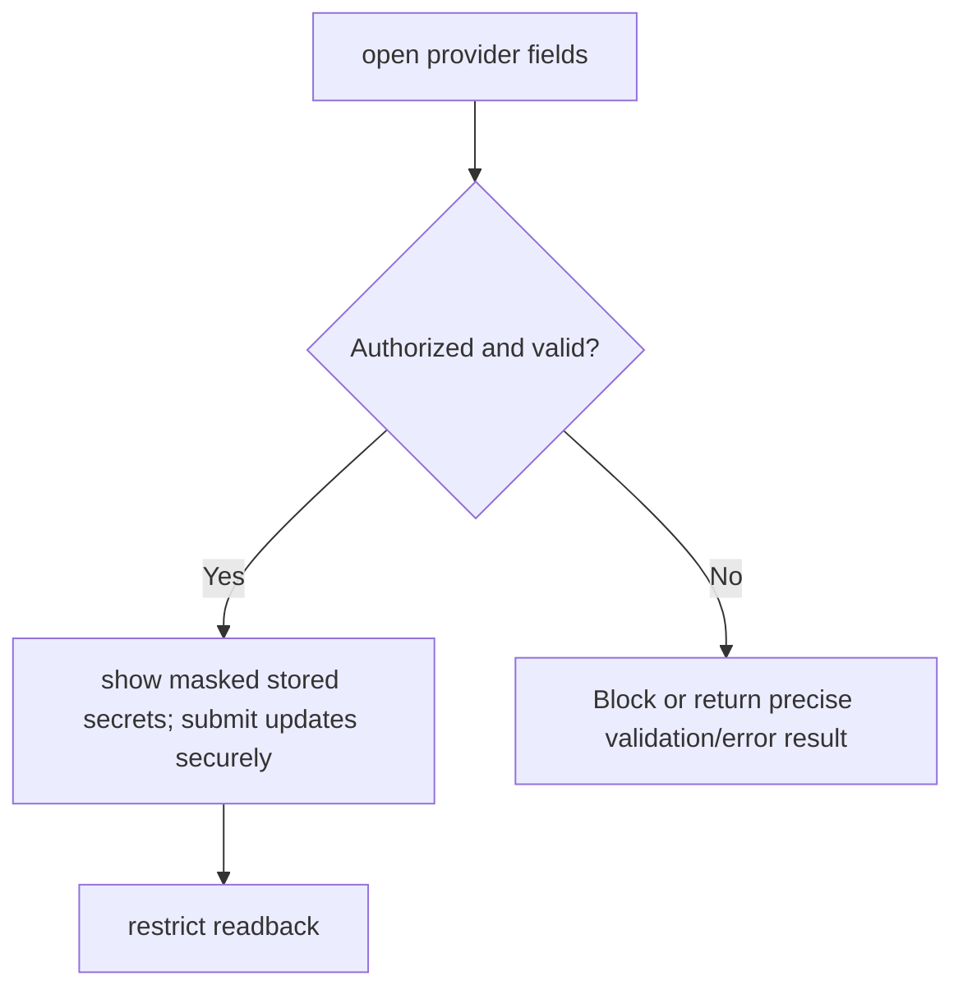

### SET-WF-07 – Tenant-specific payment providers

**Classification:** To-Be | **Goal:** SET-GO-07 | **Feature:** SET-P06 | **Actor:** authorised payment-settings administrator | **Settings page:** Payment

**Trigger and steps:** resolve tenant; view gateways/fundraising tools; save permitted changes.

**Expected result / exceptions:** Provider settings and enable states stay within tenant; cross-tenant access denied.

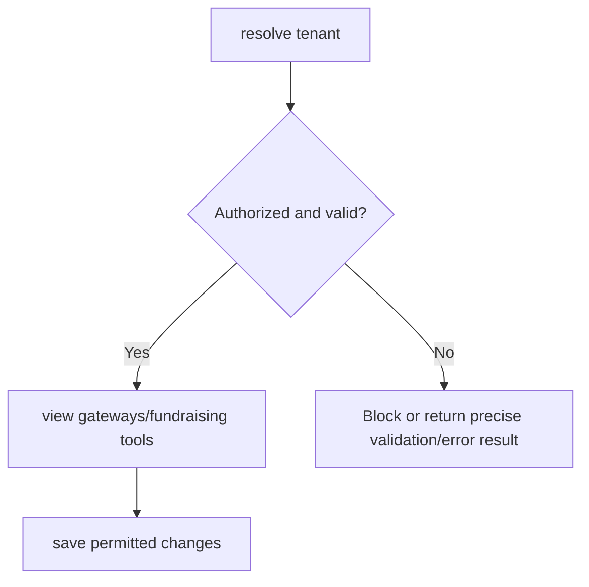

### SET-WF-08 – Payment configuration validation

**Classification:** To-Be | **Goal:** SET-GO-07 | **Feature:** SET-P07 | **Actor:** authorised payment-settings administrator | **Settings page:** Payment

**Trigger and steps:** choose provider; supply provider-required fields; validate; enable or show correction.

**Expected result / exceptions:** Missing or invalid required configuration cannot be marked operational; exact provider-specific fields require Development confirmation.

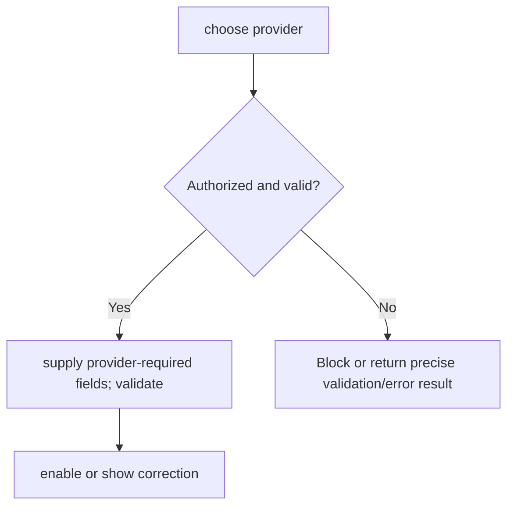

### SET-WF-09 – Tenant-scoped API keys and webhooks

**Classification:** To-Be | **Goal:** SET-GO-08 | **Feature:** SET-P08 | **Actor:** authorised integration administrator | **Settings page:** API

**Trigger and steps:** open API Integration; resolve tenant; view/create permitted resources; validate tenant context.

**Expected result / exceptions:** API key and webhook resources are tenant-scoped; cross-tenant access blocked; scopes tied to authorised capabilities.

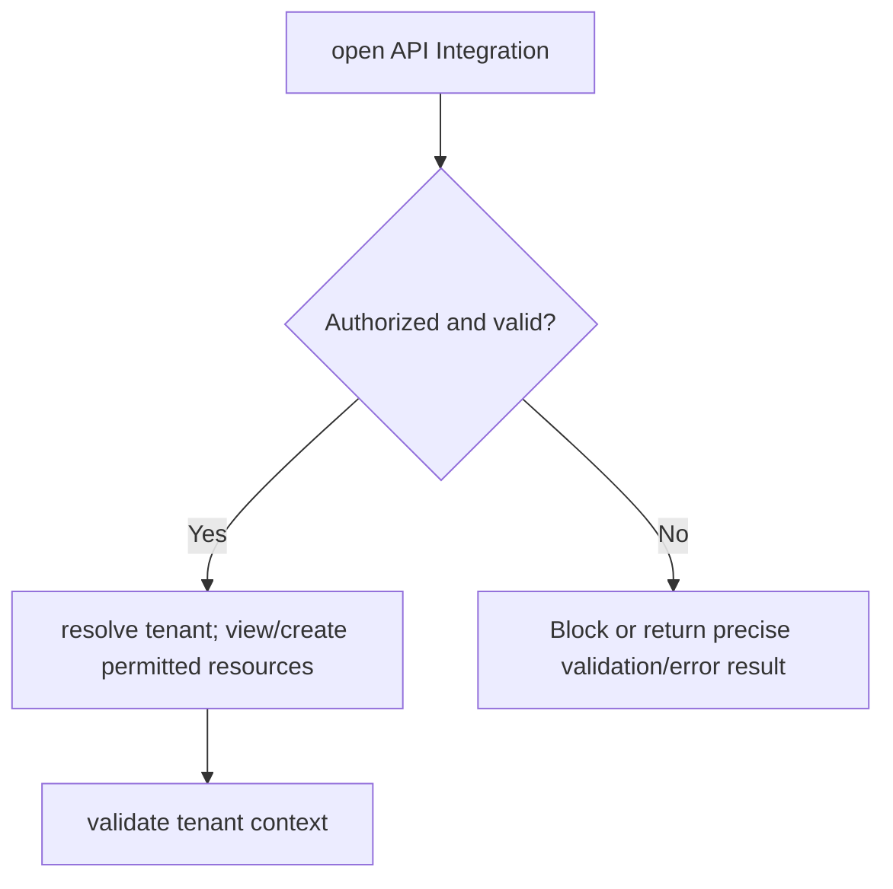

### SET-WF-10 – Verify and repair API functions

**Classification:** To-Be | **Goal:** SET-GO-09 | **Feature:** SET-P09 | **Actor:** integration administrator | **Settings page:** API

**Trigger and steps:** QA tests existing actions; classify pass/defect; repair confirmed defects; retest.

**Expected result / exceptions:** Each existing action has QA evidence; confirmed defects fixed; do not add unspecified new API methods/events.

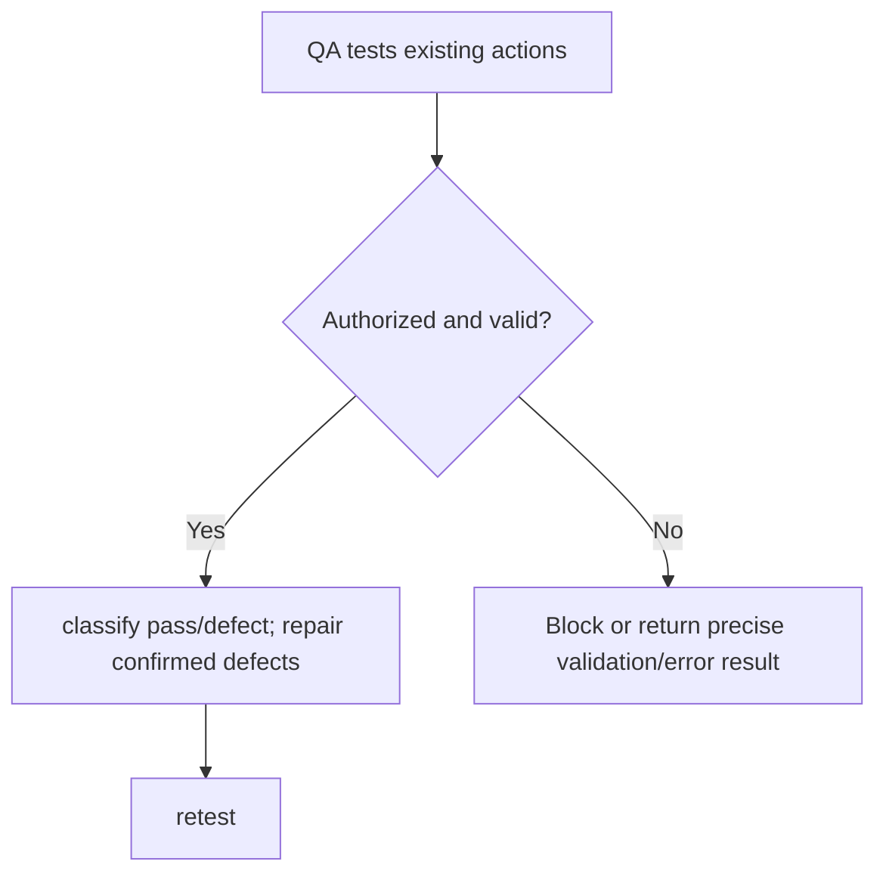

### SET-WF-11 – Settings section access control

**Classification:** To-Be | **Goal:** SET-GO-02 | **Feature:** SET-P10 | **Actor:** authorised user | **Settings page:** All

**Trigger and steps:** resolve role and tenant; show eligible pages/actions; enforce server permissions on changes.

**Expected result / exceptions:** Denied actions are blocked at server even if UI called directly; access to each Settings section follows authoritative permissions.

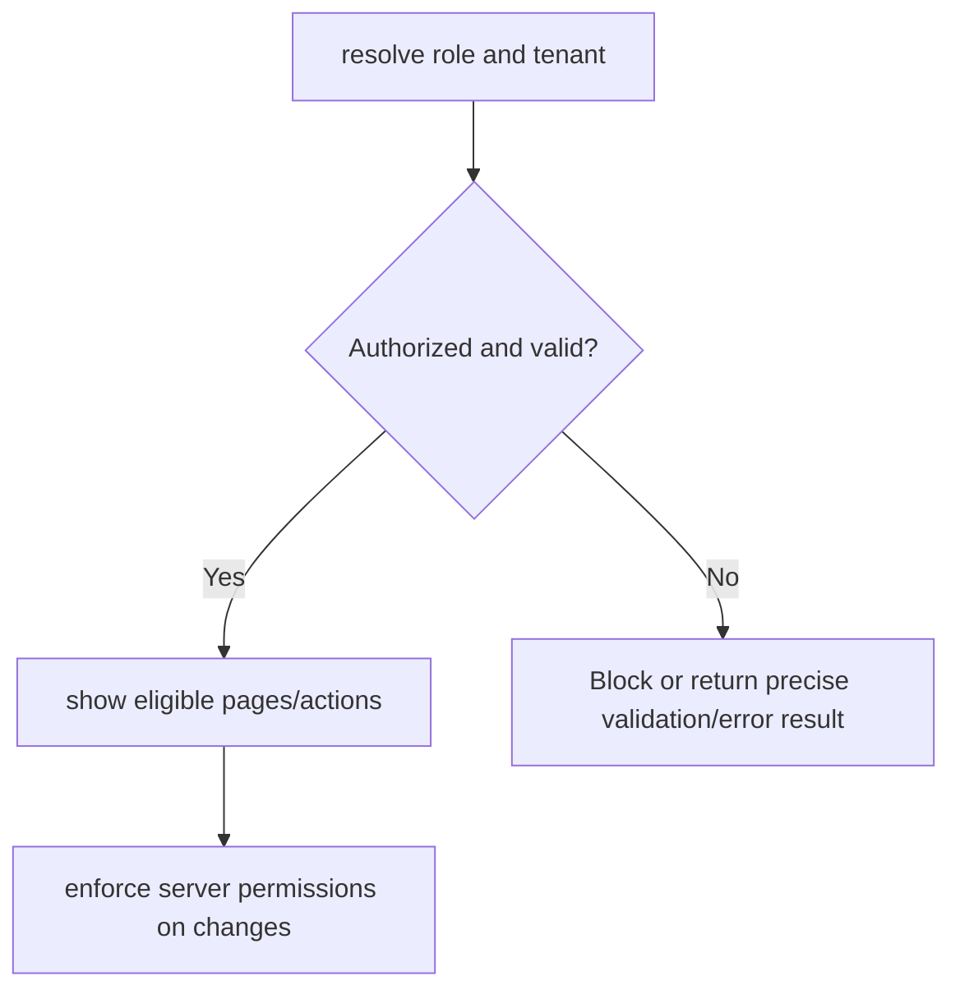

### SET-WF-12 – Operational SMS integration

**Classification:** To-Be | **Goal:** SET-GO-10 | **Feature:** SET-P11 | **Actor:** authorised communication administrator | **Settings page:** Communication

**Trigger and steps:** configure provider; validate credentials; run Test SMS; enable upon success; save.

**Expected result / exceptions:** Working test reports actual provider outcome; failed credentials/errors do not falsely mark enabled; channel remains tenant-scoped.

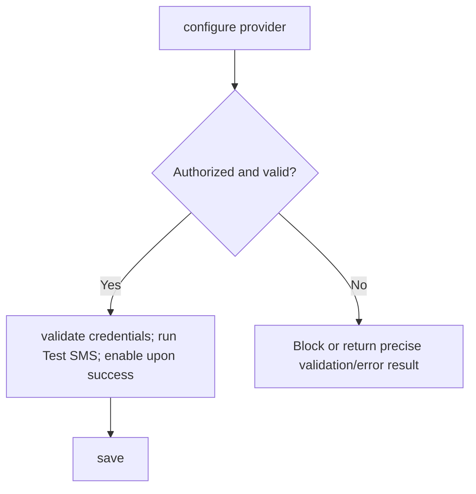

### SET-WF-13 – Operational WhatsApp integration

**Classification:** To-Be | **Goal:** SET-GO-10 | **Feature:** SET-P12 | **Actor:** authorised communication administrator | **Settings page:** Communication

**Trigger and steps:** configure provider; validate; attempt approved provider connectivity/delivery; enable upon success.

**Expected result / exceptions:** Provider test/delivery must be real, errors surfaced, credential protection applies; exact test/approval rules await technical confirmation.

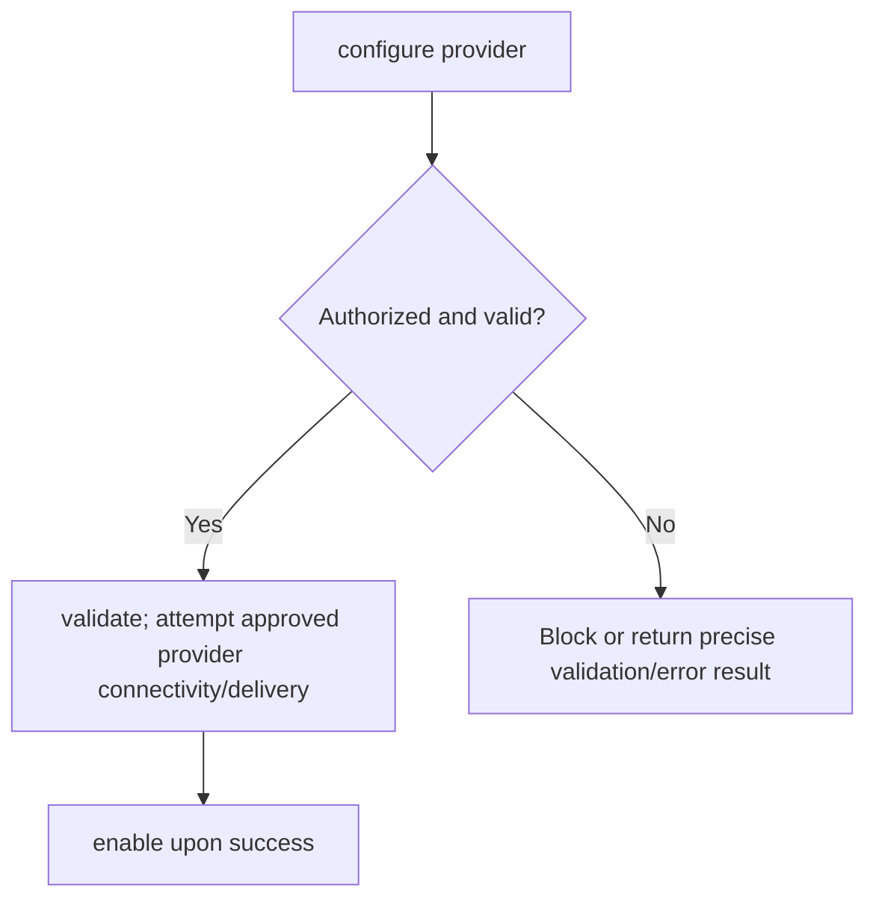

### SET-WF-14 – Operational payment gateway integration

**Classification:** To-Be | **Goal:** SET-GO-11 | **Feature:** SET-P13 | **Actor:** authorised payment administrator | **Settings page:** Payment

**Trigger and steps:** QA identify provider gaps; configure provider; validate credentials; execute supported payment workflow; confirm result.

**Expected result / exceptions:** Do not claim payment completion from saving settings; only successful verified gateway response qualifies; failures surfaced and no duplicate transaction assumed.

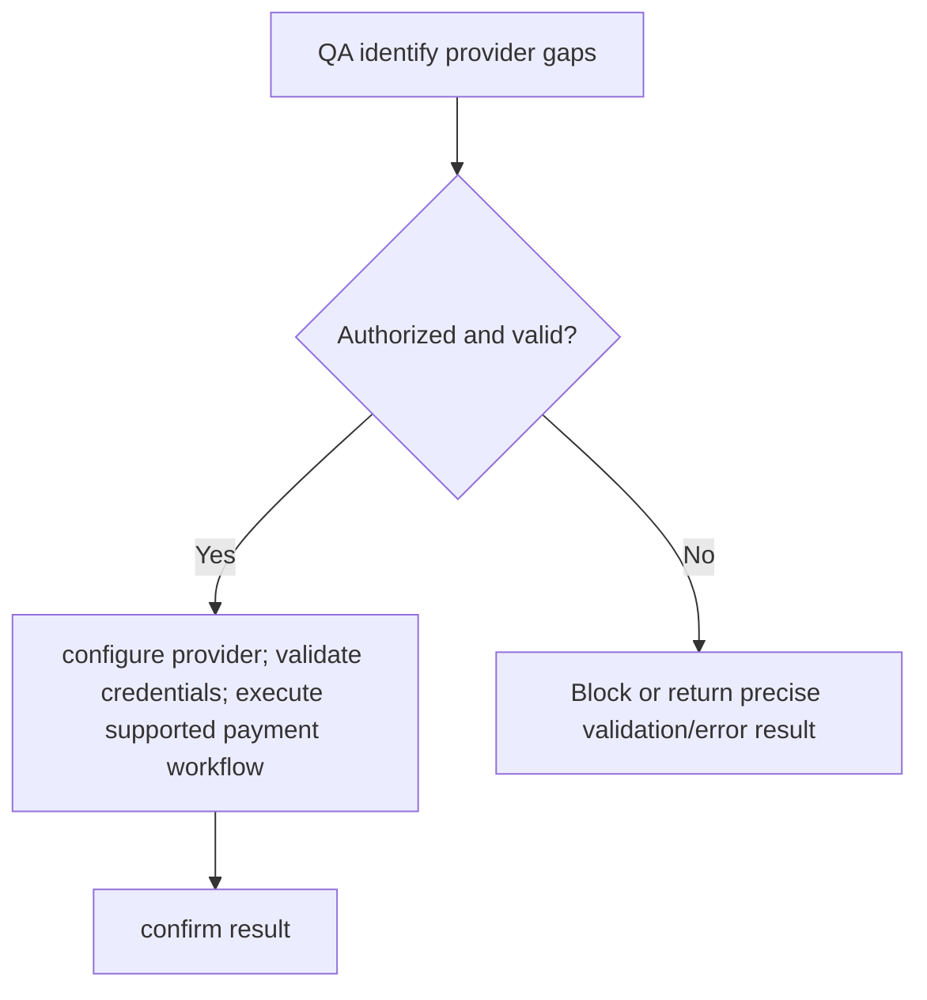

## 5. Future candidate conceptual workflows – not approved

### SET-WF-15 – Organisation settings change history

**Feature:** SET-F01 | **Scope:** Future only | **Area:** Organization

**Conceptual purpose:** administrator reviews important setting change records. No approved implementation details, provider guarantees or development commitment.

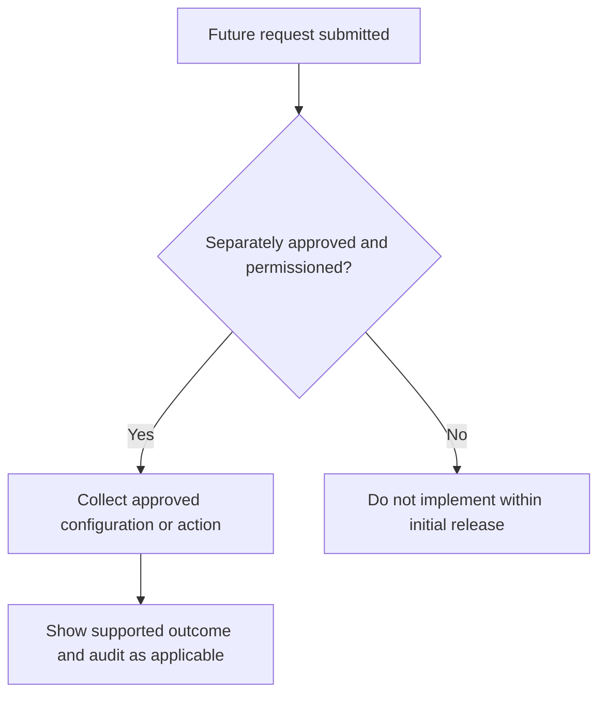

### SET-WF-16 – User invitation and activation workflow

**Feature:** SET-F02 | **Scope:** Future only | **Area:** Users & Roles

**Conceptual purpose:** advanced invitation/activation process in addition to basic Add User; possible overlap remains open. No approved implementation details, provider guarantees or development commitment.


### SET-WF-17 – Custom organisation roles

**Feature:** SET-F03 | **Scope:** Future only | **Area:** Users & Roles

**Conceptual purpose:** request custom roles through AiXIdentity authority rather than independently in AiXPurpose. No approved implementation details, provider guarantees or development commitment.


### SET-WF-18 – Communication provider health monitoring

**Feature:** SET-F04 | **Scope:** Future only | **Area:** Communication

**Conceptual purpose:** show diagnostics and alerts on supported provider health. No approved implementation details, provider guarantees or development commitment.

```mermaid
flowchart TD
    A["Future request submitted"] --> B{"Separately approved and permissioned?"}
    B -->|Yes| C["Collect approved configuration or action"]
    B -->|No| D["Do not implement within initial release"]
    C --> E["Show supported outcome and audit as applicable"]
```

### SET-WF-19 – Multiple payment gateway routing

**Feature:** SET-F05 | **Scope:** Future only | **Area:** Payment

**Conceptual purpose:** select among authorised gateways under a separately approved routing policy. No approved implementation details, provider guarantees or development commitment.

```mermaid
flowchart TD
    A["Future request submitted"] --> B{"Separately approved and permissioned?"}
    B -->|Yes| C["Collect approved configuration or action"]
    B -->|No| D["Do not implement within initial release"]
    C --> E["Show supported outcome and audit as applicable"]
```

### SET-WF-20 – API usage and webhook delivery monitoring

**Feature:** SET-F06 | **Scope:** Future only | **Area:** API

**Conceptual purpose:** show permitted request activity and delivery outcomes. No approved implementation details, provider guarantees or development commitment.

```mermaid
flowchart TD
    A["Future request submitted"] --> B{"Separately approved and permissioned?"}
    B -->|Yes| C["Collect approved configuration or action"]
    B -->|No| D["Do not implement within initial release"]
    C --> E["Show supported outcome and audit as applicable"]
```

### SET-WF-21 – Credential expiry reminders

**Feature:** SET-F07 | **Scope:** Future only | **Area:** Communication / Payment / API

**Conceptual purpose:** notify appropriate admin about expiring configured credentials where expiry metadata exists. No approved implementation details, provider guarantees or development commitment.

```mermaid
flowchart TD
    A["Future request submitted"] --> B{"Separately approved and permissioned?"}
    B -->|Yes| C["Collect approved configuration or action"]
    B -->|No| D["Do not implement within initial release"]
    C --> E["Show supported outcome and audit as applicable"]
```

### SET-WF-22 – Organisation settings import/export

**Feature:** SET-F08 | **Scope:** Future only | **Area:** Organization

**Conceptual purpose:** transfer approved setting fields under an authorised process, excluding secrets by default. No approved implementation details, provider guarantees or development commitment.

```mermaid
flowchart TD
    A["Future request submitted"] --> B{"Separately approved and permissioned?"}
    B -->|Yes| C["Collect approved configuration or action"]
    B -->|No| D["Do not implement within initial release"]
    C --> E["Show supported outcome and audit as applicable"]
```

## 6. Shared validations and exceptions

- **Tenant resolution failure:** no cross-tenant fallback.
- **Permission failure:** deny write at server even if UI displays a control.
- **Identity handoff unavailable:** show error/pending state; do not claim user created.
- **Provider credential test fails:** display actual result, do not mark provider operational.
- **Payment failure:** do not claim donation payment was successful solely because settings saved.
- **API/webhook error:** report supported failure and maintain correct resource/tenant state.
- **Future workflow:** not executable until independently approved.

## 7. Screenshot mapping

| Section | Source screenshot(s) |
|---|---|

| Organization |    |

| Users & Roles |  |

| Communication |    |

| Payment |   |

| API |   |

## 8. Goals-to-workflow-to-feature traceability

| Goal | Workflow | To-Be Feature |
|---|---|---|

| SET-WF-01 | SET-WF-01 | SET-P01 |

| SET-WF-02 | SET-WF-02 | SET-P02 |

| SET-WF-03 | SET-WF-03 | SET-P03 |

| SET-WF-04 | SET-WF-04 | SET-P03A |

| SET-WF-05 | SET-WF-05 | SET-P04 |

| SET-WF-06 | SET-WF-06 | SET-P05 |

| SET-WF-07 | SET-WF-07 | SET-P06 |

| SET-WF-08 | SET-WF-08 | SET-P07 |

| SET-WF-09 | SET-WF-09 | SET-P08 |

| SET-WF-10 | SET-WF-10 | SET-P09 |

| SET-WF-11 | SET-WF-11 | SET-P10 |

| SET-WF-12 | SET-WF-12 | SET-P11 |

| SET-WF-13 | SET-WF-13 | SET-P12 |

| SET-WF-14 | SET-WF-14 | SET-P13 |

## 9. Workflow validation summary

Future workflows are conceptual only. QA establishes As-Is states, Development establishes identity/provider-specific technical details, Product Owner approves open decisions.