# AiXPurpose Standalone – Tasks & Activities – BRD Feature Catalogue

> **Document type:** Business Requirements Document – Feature Catalogue

## Document Control

| Field                | Details                                                                                                    |
| -------------------- | ---------------------------------------------------------------------------------------------------------- |
| Product              | AiXPurpose Standalone                                                                                      |
| Module               | Tasks & Activities                                                                                         |
| Document             | BRD Feature Catalogue                                                                                      |
| Version              | 1.0                                                                                                        |
| Status               | Draft for Business and Development Review                                                                  |
| Scope classification | **To-Be only**. No As-Is functionality implemented and no future enhancement scope.                        |
| Source               | Provided `TASK AND ANALYTICS MODULE.docx` screenshots and approved decisions Q1–Q4                         |
| Related documents    | Tasks_Activities_BRD_Goals.md, Tasks_Activities_BRD_Workflow.md, Tasks_Activities_BRD_Feature_Catalogue.md |

## Overview

This document defines the **proposed, not yet implemented** Tasks & Activities scope. The screenshots illustrate target interfaces only. Unspecified behaviour is listed as an open decision, not filled in as fact.

## Contents

1. Classification and Jira Standards
2. Feature Inventory
3. Individual Feature Specifications
4. Field and Business Rule Notes
5. Goals–Workflow–Feature Traceability
6. Open Decisions
7. Screenshot References

## 1. Classification and Jira Standards

**Every feature is To-Be.** Each numbered specification can be copied into Jira as a story. No As-Is functionality is claimed, and no future enhancement is proposed. Role labels not supported by the screenshots are intentionally excluded.

## 2. Feature Inventory

| Feature ID | Feature                                 | Page             | Goal      | Workflow |
| ---------- | --------------------------------------- | ---------------- | --------- | -------- |
| TA-F-001   | Tasks workspace, list and search        | Tasks            | TA-GO-001 | TA-WF-01 |
| TA-F-002   | Create a task                           | Tasks            | TA-GO-001 | TA-WF-01 |
| TA-F-003   | View, edit, delete and complete task    | Tasks            | TA-GO-001 | TA-WF-01 |
| TA-F-004   | Batch gift entry grid                   | Batch Gift Entry | TA-GO-002 | TA-WF-02 |
| TA-F-005   | Batch CSV import and validation summary | Batch Gift Entry | TA-GO-002 | TA-WF-02 |
| TA-F-006   | Save batch donations                    | Batch Gift Entry | TA-GO-002 | TA-WF-02 |
| TA-F-007   | Event list, details and create event    | Event Management | TA-GO-003 | TA-WF-03 |
| TA-F-008   | Event attendees and email invitations   | Event Management | TA-GO-003 | TA-WF-03 |
| TA-F-009   | Monthly giving plans and list           | Monthly Giving   | TA-GO-004 | TA-WF-04 |
| TA-F-010   | Monthly giving plan status and KPIs     | Monthly Giving   | TA-GO-004 | TA-WF-04 |
| TA-F-011   | Moves pipeline and stage counts         | Moves Management | TA-GO-005 | TA-WF-05 |
| TA-F-012   | Add donor to pipeline                   | Moves Management | TA-GO-005 | TA-WF-05 |
| TA-F-013   | Pipeline note                           | Moves Management | TA-GO-005 | TA-WF-05 |
| TA-F-014   | Pipeline follow-up task                 | Moves Management | TA-GO-005 | TA-WF-05 |

## 3. Individual Feature Specifications

### TA-F-001 – Tasks workspace, list and search

**Classification:** To-Be  
**Page:** Tasks  
**Goal:** TA-GO-001  
**Workflow:** TA-WF-01

**Jira User Story**  
As an authorised user, I want to find and review tasks so that I can manage my follow-ups.

**Functional Requirements**  
Show task name, status, related record, due date and actions; search tasks and filter by the controls shown: status, related-to and priority.

**Business Logic / Rules**  
The list is based on saved tasks; selected filters restrict results. Do not imply additional filters or task ownership rules.

**Acceptance Criteria**

1. **Given** the authorised user is in Tasks, **when** they perform the relevant action, **then** task list displays saved tasks and associated fields.
2. **Given** the authorised user is in Tasks, **when** they perform the relevant action, **then** search and available filters return matching results; no match shows an empty result.
3. **Given** the authorised user is in Tasks, **when** they perform the relevant action, **then** task actions open the corresponding existing UI.

**Mermaid Feature Flow**

**Screenshot reference:** 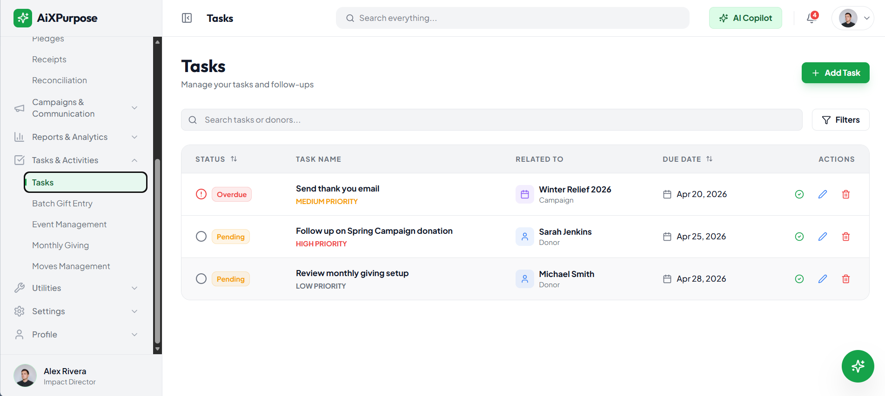

### TA-F-002 – Create a task

**Classification:** To-Be  
**Page:** Tasks  
**Goal:** TA-GO-001  
**Workflow:** TA-WF-01

**Jira User Story**  
As an authorised user, I want to create a task related to an available record so that I can plan work.

**Functional Requirements**  
Create Task fields: Task Name (required), Related To (required), selectable related record (shown as Select Donor for Donor), Due Date (required), Priority, Notes.

**Business Logic / Rules**  
Related To values are limited to supported UI options; Development confirms the complete option set. The selected related record must exist.

**Acceptance Criteria**

1. **Given** the authorised user is in Tasks, **when** they perform the relevant action, **then** required fields are checked before creation.
2. **Given** the authorised user is in Tasks, **when** they perform the relevant action, **then** successfully created task appears in the list with its selected related record and due date.
3. **Given** the authorised user is in Tasks, **when** they perform the relevant action, **then** cancel closes without creating a task.

**Mermaid Feature Flow**

**Screenshot reference:** 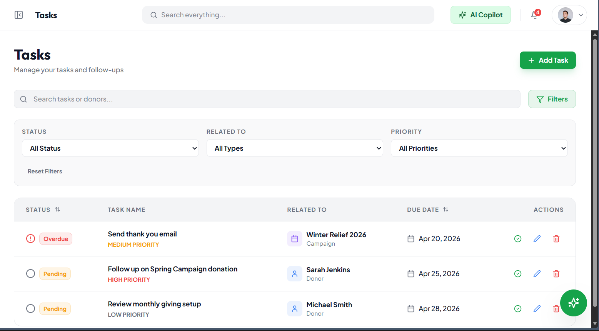

### TA-F-003 – View, edit, delete and complete task

**Classification:** To-Be  
**Page:** Tasks  
**Goal:** TA-GO-001  
**Workflow:** TA-WF-01

**Jira User Story**  
As an authorised user, I want to inspect and maintain a task so that its state stays current.

**Functional Requirements**  
Task Details shows name, status, related record, due date and priority; list provides edit, delete and green complete action.

**Business Logic / Rules**  
Mark Complete changes the task to completed as described in the walkthrough. Other lifecycle transitions are not specified.

**Acceptance Criteria**

1. **Given** the authorised user is in Tasks, **when** they perform the relevant action, **then** selecting a task shows saved details.
2. **Given** the authorised user is in Tasks, **when** they perform the relevant action, **then** edited task details are reflected in the list.
3. **Given** the authorised user is in Tasks, **when** they perform the relevant action, **then** delete removes the selected task after approved confirmation behaviour (confirmation UI remains to be defined).
4. **Given** the authorised user is in Tasks, **when** they perform the relevant action, **then** complete action marks the selected task completed.

**Mermaid Feature Flow**

**Screenshot reference:** 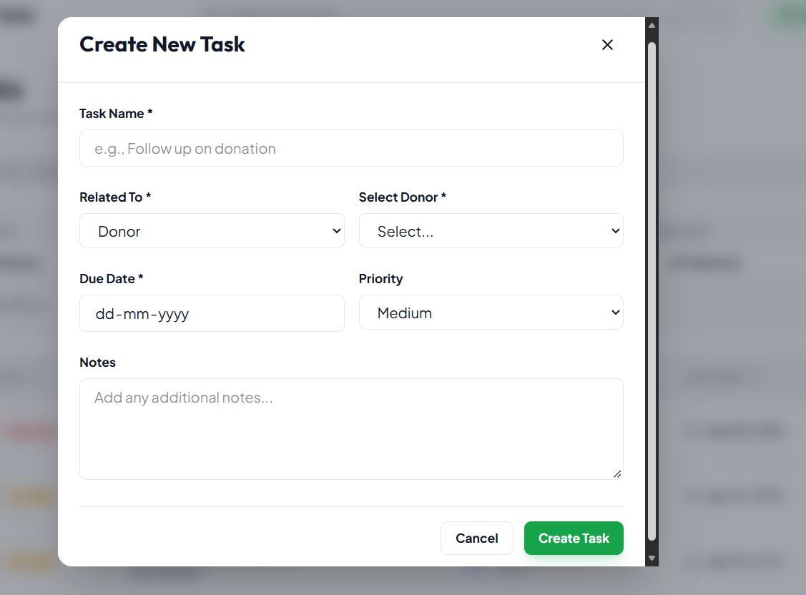

### TA-F-004 – Batch gift entry grid

**Classification:** To-Be  
**Page:** Batch Gift Entry  
**Goal:** TA-GO-002  
**Workflow:** TA-WF-02

**Jira User Story**  
As a donation operator, I want to enter several donations in a grid so that I can record a batch.

**Functional Requirements**  
Fields shown: donor name, amount, date, campaign, payment method and status; support Add Row and row removal.

**Business Logic / Rules**  
Donor and campaign references must use existing applicable records; donation rules align with Members/Donors business relationship.

**Acceptance Criteria**

1. **Given** the authorised user is in Batch Gift Entry, **when** they perform the relevant action, **then** grid allows entering the fields shown.
2. **Given** the authorised user is in Batch Gift Entry, **when** they perform the relevant action, **then** add Row adds an editable row; remove action removes that row.
3. **Given** the authorised user is in Batch Gift Entry, **when** they perform the relevant action, **then** rows remain available for review before submission.

**Mermaid Feature Flow**

**Screenshot reference:** 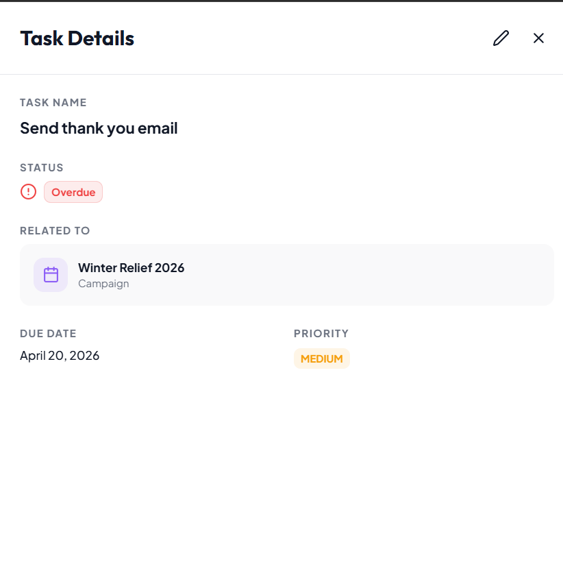

### TA-F-005 – Batch CSV import and validation summary

**Classification:** To-Be  
**Page:** Batch Gift Entry  
**Goal:** TA-GO-002  
**Workflow:** TA-WF-02

**Jira User Story**  
As a donation operator, I want to import a CSV and see batch totals so that I can review data before saving.

**Functional Requirements**  
Import CSV control and KPI cards Total Rows, Valid Entries, Invalid Entries, Total Amount.

**Business Logic / Rules**  
Exact CSV columns, invalid-row criteria and amount inclusion rules need Development confirmation. Do not assert import processing already works.

**Acceptance Criteria**

1. **Given** the authorised user is in Batch Gift Entry, **when** they perform the relevant action, **then** import CSV initiates the agreed CSV entry flow.
2. **Given** the authorised user is in Batch Gift Entry, **when** they perform the relevant action, **then** summary presents the four shown metrics based on current batch entries.
3. **Given** the authorised user is in Batch Gift Entry, **when** they perform the relevant action, **then** unsupported or invalid data is handled according to subsequently approved validation rules.

**Mermaid Feature Flow**

**Screenshot reference:** 

### TA-F-006 – Save batch donations

**Classification:** To-Be  
**Page:** Batch Gift Entry  
**Goal:** TA-GO-002  
**Workflow:** TA-WF-02

**Jira User Story**  
As a donation operator, I want to save a reviewed donation batch so that valid donation transactions can be recorded.

**Functional Requirements**  
Save Batch applies the final approved validation and transaction outcome rules.

**Business Logic / Rules**  
Partial success versus all-or-nothing is open; must not count uncommitted rows as donations.

**Acceptance Criteria**

1. **Given** the authorised user is in Batch Gift Entry, **when** they perform the relevant action, **then** save Batch does not silently commit rows marked invalid.
2. **Given** the authorised user is in Batch Gift Entry, **when** they perform the relevant action, **then** the result reports committed and rejected/unsaved records according to the approved rule.
3. **Given** the authorised user is in Batch Gift Entry, **when** they perform the relevant action, **then** committed donations follow existing member–donor and donation constraints.

**Mermaid Feature Flow**

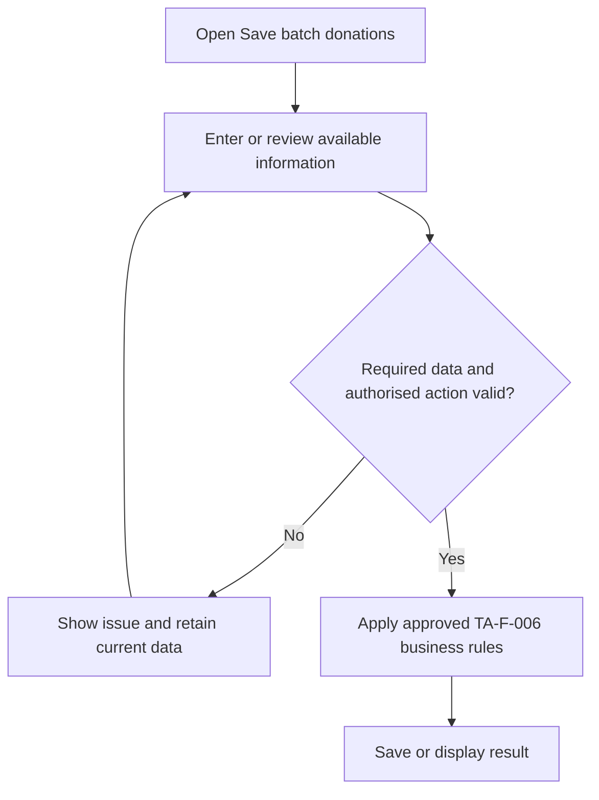

**Screenshot reference:** 

### TA-F-007 – Event list, details and create event

**Classification:** To-Be  
**Page:** Event Management  
**Goal:** TA-GO-003  
**Workflow:** TA-WF-03

**Jira User Story**  
As an event coordinator, I want to create and review events so that I can manage upcoming and past activities.

**Functional Requirements**  
Upcoming/Past tabs; Create Event requires Event Name, Date and Location, with optional Description; details show date, location, description, attendees and donations.

**Business Logic / Rules**  
Event date determines the relevant listing; definition of past/upcoming boundary requires implementation confirmation.

**Acceptance Criteria**

1. **Given** the authorised user is in Event Management, **when** they perform the relevant action, **then** required event fields must be provided.
2. **Given** the authorised user is in Event Management, **when** they perform the relevant action, **then** created event is displayed in the appropriate listing.
3. **Given** the authorised user is in Event Management, **when** they perform the relevant action, **then** selecting an event displays the saved details and available metrics.

**Mermaid Feature Flow**

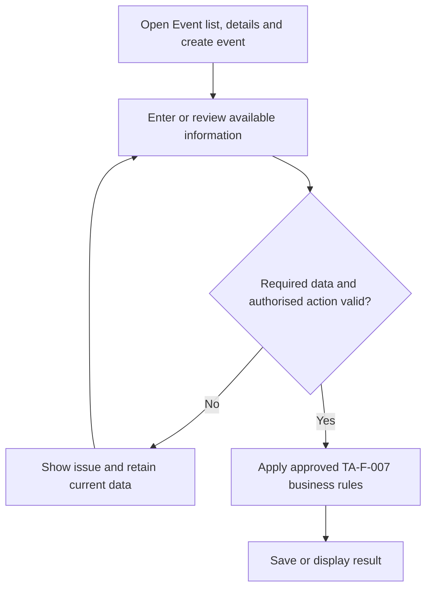

**Screenshot reference:** 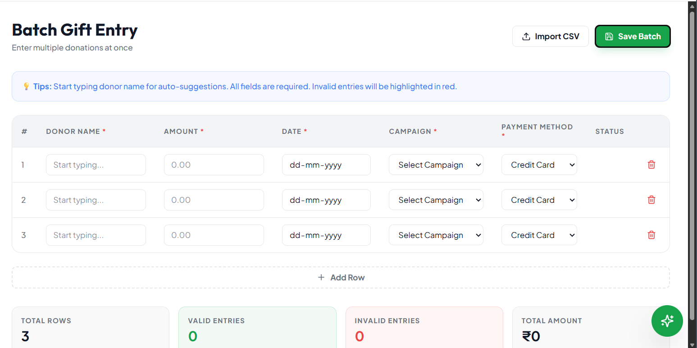

### TA-F-008 – Event attendees and email invitations

**Classification:** To-Be  
**Page:** Event Management  
**Goal:** TA-GO-003  
**Workflow:** TA-WF-03

**Jira User Story**  
As an event coordinator, I want to add attendees and send invitations so that I can coordinate participation.

**Functional Requirements**  
Event details offers Add Attendees and Send Invitations. Invitations use the organisation’s configured email service.

**Business Logic / Rules**  
Attendee selection, exact message/template and delivery acknowledgement are open; no SMS or WhatsApp is assumed.

**Acceptance Criteria**

1. **Given** the authorised user is in Event Management, **when** they perform the relevant action, **then** add Attendees opens the supported attendee flow.
2. **Given** the authorised user is in Event Management, **when** they perform the relevant action, **then** send Invitations uses the configured organisation email channel.
3. **Given** the authorised user is in Event Management, **when** they perform the relevant action, **then** when email service is unavailable, the user receives an error rather than a false success message.

**Mermaid Feature Flow**

**Screenshot reference:** 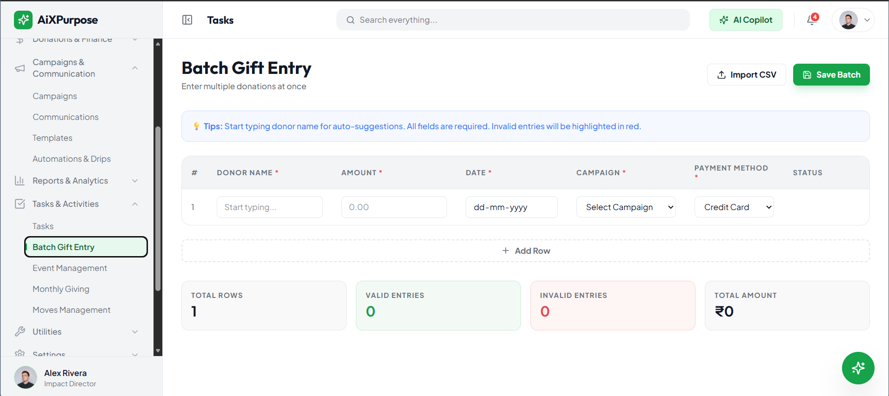

### TA-F-009 – Monthly giving plans and list

**Classification:** To-Be  
**Page:** Monthly Giving  
**Goal:** TA-GO-004  
**Workflow:** TA-WF-04

**Jira User Story**  
As a fundraising user, I want to register recurring giving plans so that I can track a donor’s intended contributions.

**Functional Requirements**  
Create Plan fields: Donor, Amount, Frequency, Start Date, Next Payment Date; list provides Active, Paused and Cancelled tabs.

**Business Logic / Rules**  
Plan creation must reference an existing donor. Automatic payment collection remains an open decision.

**Acceptance Criteria**

1. **Given** the authorised user is in Monthly Giving, **when** they perform the relevant action, **then** required plan fields are validated before creation.
2. **Given** the authorised user is in Monthly Giving, **when** they perform the relevant action, **then** created plan appears in its applicable status list.
3. **Given** the authorised user is in Monthly Giving, **when** they perform the relevant action, **then** tabs distinguish Active, Paused and Cancelled plans.

**Mermaid Feature Flow**

**Screenshot reference:** 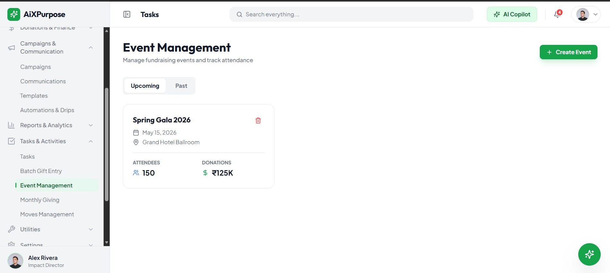

### TA-F-010 – Monthly giving plan status and KPIs

**Classification:** To-Be  
**Page:** Monthly Giving  
**Goal:** TA-GO-004  
**Workflow:** TA-WF-04

**Jira User Story**  
As a fundraising user, I want to review plan status and summary values so that I can monitor recurring giving.

**Functional Requirements**  
Display Active Plans, Monthly Revenue and Total Collected; retain shown plan action controls.

**Business Logic / Rules**  
KPI formulas and payment collection/linkage remain to be confirmed; do not equate scheduled plans with collected payments.

**Acceptance Criteria**

1. **Given** the authorised user is in Monthly Giving, **when** they perform the relevant action, **then** all three KPI labels appear.
2. **Given** the authorised user is in Monthly Giving, **when** they perform the relevant action, **then** plan status shown matches the stored state.
3. **Given** the authorised user is in Monthly Giving, **when** they perform the relevant action, **then** totals follow approved calculation definitions; unconfirmed formulas are not hard-coded as requirements.

**Mermaid Feature Flow**

**Screenshot reference:** 

### TA-F-011 – Moves pipeline and stage counts

**Classification:** To-Be  
**Page:** Moves Management  
**Goal:** TA-GO-005  
**Workflow:** TA-WF-05

**Jira User Story**  
As a fundraiser, I want to see donors across fundraising stages so that I can prioritise follow-ups.

**Functional Requirements**  
Stage columns and KPI cards: Identified, Contacted, Engaged, Committed and Donated, with donor cards showing notes/next action where available.

**Business Logic / Rules**  
A donor pipeline entry must reference an existing donor; exact stage movement controls beyond shown UI require confirmation.

**Acceptance Criteria**

1. **Given** the authorised user is in Moves Management, **when** they perform the relevant action, **then** all five stage columns are available.
2. **Given** the authorised user is in Moves Management, **when** they perform the relevant action, **then** donor records appear under their assigned pipeline stage.
3. **Given** the authorised user is in Moves Management, **when** they perform the relevant action, **then** stage counts reflect stored pipeline entries as defined by the approved counting rule.

**Mermaid Feature Flow**

**Screenshot reference:** 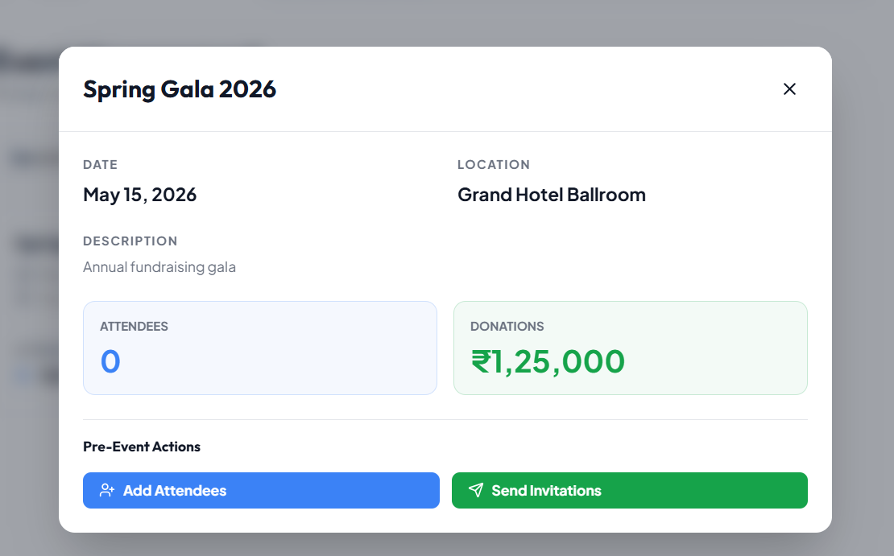

### TA-F-012 – Add donor to pipeline

**Classification:** To-Be  
**Page:** Moves Management  
**Goal:** TA-GO-005  
**Workflow:** TA-WF-05

**Jira User Story**  
As a fundraiser, I want to add an existing donor at a selected stage with a potential value so that I can track an opportunity.

**Functional Requirements**  
Add to Pipeline requires Select Donor, Starting Stage and Potential Value; available stage values are the five shown stages.

**Business Logic / Rules**  
Duplicate pipeline entries for the same donor and potential-value validation are not specified; Development/Product must resolve.

**Acceptance Criteria**

1. **Given** the authorised user is in Moves Management, **when** they perform the relevant action, **then** an existing donor can be selected.
2. **Given** the authorised user is in Moves Management, **when** they perform the relevant action, **then** a stage and potential value are required before submission.
3. **Given** the authorised user is in Moves Management, **when** they perform the relevant action, **then** successful addition creates a pipeline entry in the chosen stage.

**Mermaid Feature Flow**

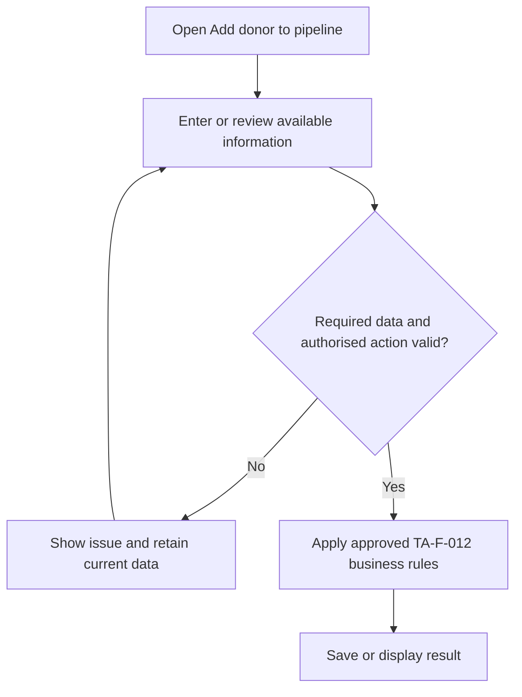

**Screenshot reference:** 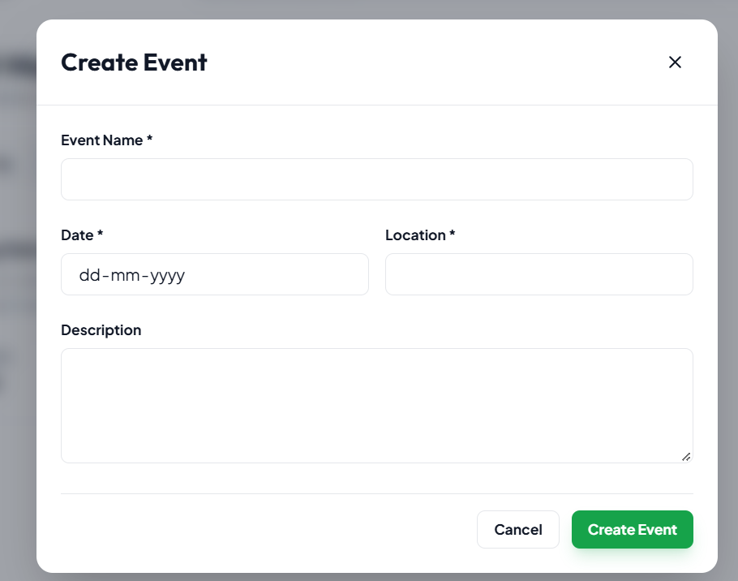

### TA-F-013 – Pipeline note

**Classification:** To-Be  
**Page:** Moves Management  
**Goal:** TA-GO-005  
**Workflow:** TA-WF-05

**Jira User Story**  
As a fundraiser, I want to record a note on a pipeline donor so that I can preserve follow-up context.

**Functional Requirements**  
Add Note dialog with required Note text and Save Note.

**Business Logic / Rules**  
Note belongs to the selected donor/pipeline context. Edit/delete/history not shown and not assumed.

**Acceptance Criteria**

1. **Given** the authorised user is in Moves Management, **when** they perform the relevant action, **then** empty required note cannot be submitted.
2. **Given** the authorised user is in Moves Management, **when** they perform the relevant action, **then** saved note is associated with the selected pipeline donor.
3. **Given** the authorised user is in Moves Management, **when** they perform the relevant action, **then** cancel leaves existing notes unchanged.

**Mermaid Feature Flow**

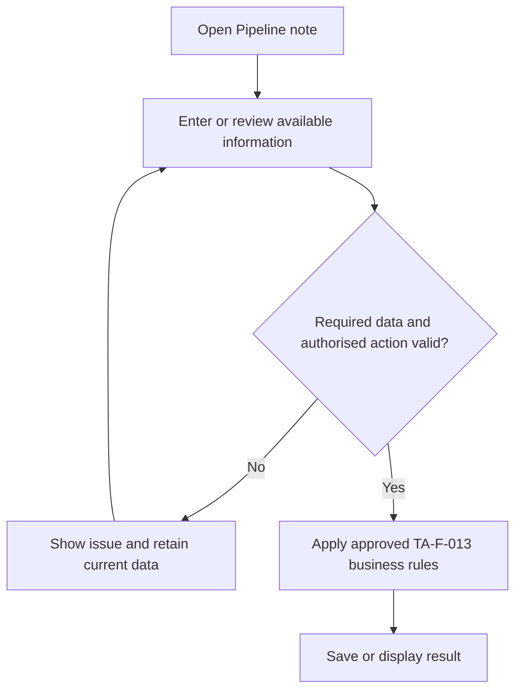

**Screenshot reference:** 

### TA-F-014 – Pipeline follow-up task

**Classification:** To-Be  
**Page:** Moves Management  
**Goal:** TA-GO-005  
**Workflow:** TA-WF-05

**Jira User Story**  
As a fundraiser, I want to create a follow-up task from a donor card so that I can act on the next step.

**Functional Requirements**  
Create Task dialog from Moves requires Task Name, Due Date, Priority and optional Notes.

**Business Logic / Rules**  
Selected donor is the related record; reuse Tasks capability rather than maintain a second task store.

**Acceptance Criteria**

1. **Given** the authorised user is in Moves Management, **when** they perform the relevant action, **then** valid submission creates a task linked to the selected donor.
2. **Given** the authorised user is in Moves Management, **when** they perform the relevant action, **then** the new task can be found in Tasks.
3. **Given** the authorised user is in Moves Management, **when** they perform the relevant action, **then** cancel does not create a task.

**Mermaid Feature Flow**

**Screenshot reference:** 

## 4. Field and Business Rule Notes

- Task: Task Name, Related To, relevant selection, Due Date, Priority and Notes.
- Batch: Donor Name, Amount, Date, Campaign, Payment Method, Status; the four pictured KPIs.
- Event: Event Name, Date, Location, Description; upcoming/past, attendees and donations; email invitation via configured channel.
- Monthly Giving: Donor, Amount, Frequency, Start Date, Next Payment Date; Active/Paused/Cancelled and three pictured KPIs.
- Moves: Select Donor, Starting Stage, Potential Value; five stages; Note and Task dialogs.
- Only the fields evident in the source are specified; exact lists, backend rules and formulas stay open where not shown.

## 5. Goals–Workflow–Feature Traceability

| Goal      | Workflow | Feature range |
| --------- | -------- | ------------- |
| TA-GO-001 | TA-WF-01 | TA-F-001–003  |
| TA-GO-002 | TA-WF-02 | TA-F-004–006  |
| TA-GO-003 | TA-WF-03 | TA-F-007–008  |
| TA-GO-004 | TA-WF-04 | TA-F-009–010  |
| TA-GO-005 | TA-WF-05 | TA-F-011–014  |

## 6. Open Decisions

- **TA-OD-001:** Confirm complete task Related To options from available UI.
- **TA-OD-002:** Confirm CSV schema, row validation, and batch-save behaviour.
- **TA-OD-003:** Confirm whether giving plans are tracking-only or trigger recurring payment collection.
- **TA-OD-004:** Confirm email invitation audience, content and delivery results.
- **TA-OD-005:** Confirm formulas for KPI summaries.
- **TA-OD-006:** Confirm pipeline duplicate treatment and stage transitions.

## 7. Source Screenshot Index

- **1**: 
- **2**: 
- **3**: 
- **4**: 
- **5**: 
- **6**: 
- **7**: 
- **8**: 
- **9**: 
- **10**: 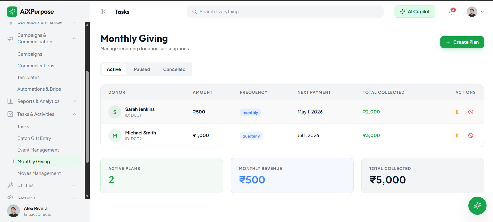
- **11**: 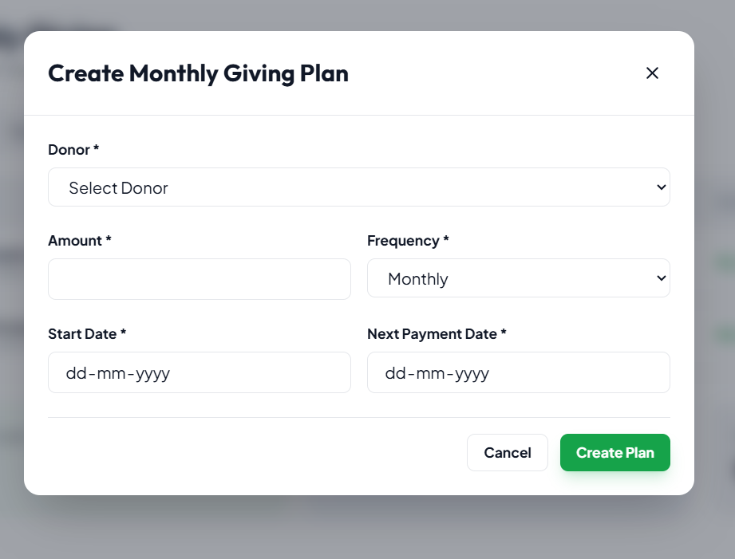
- **12**: 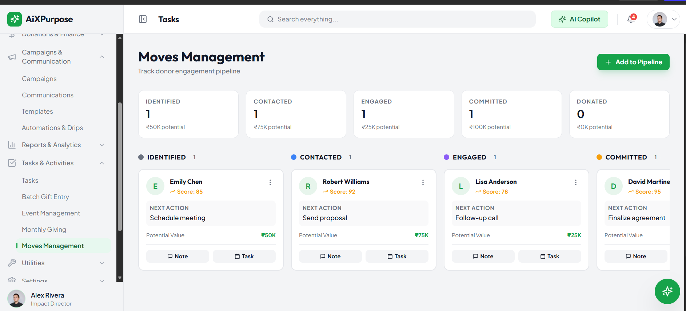
- **13**: 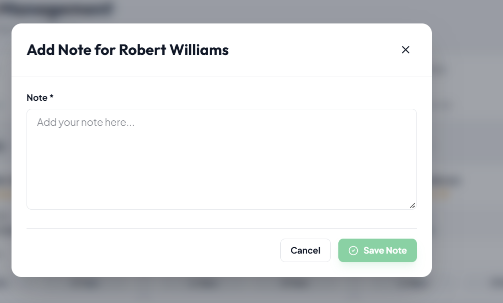
- **14**: 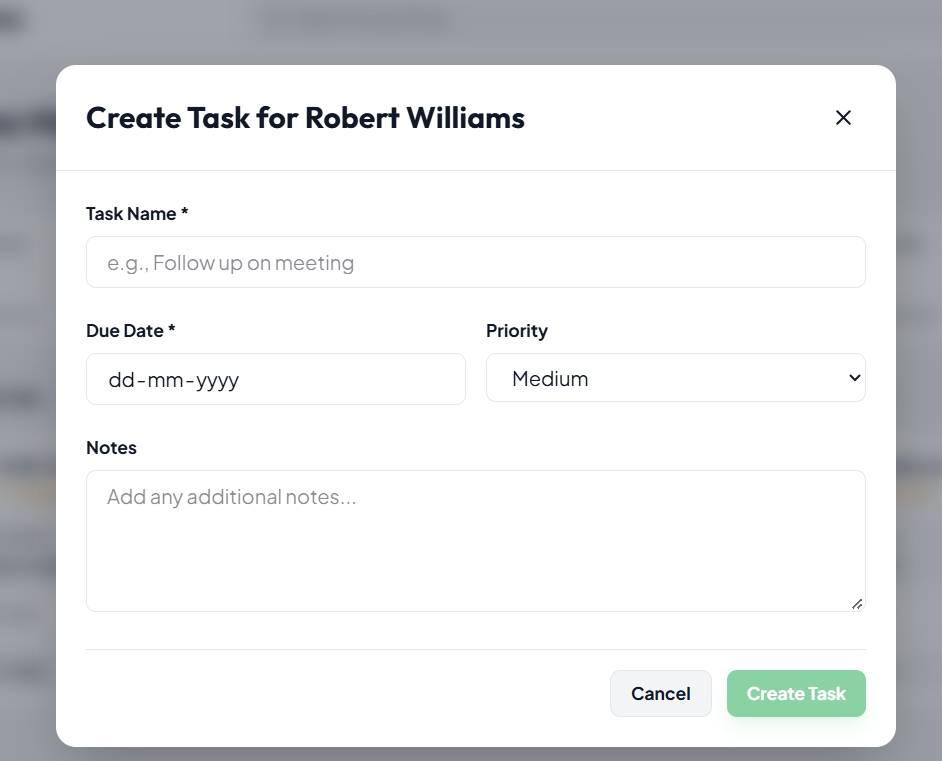
- **15**: 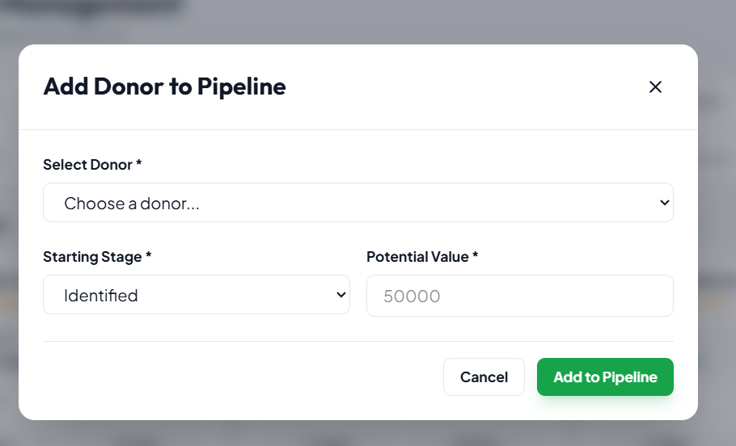
- **16**: 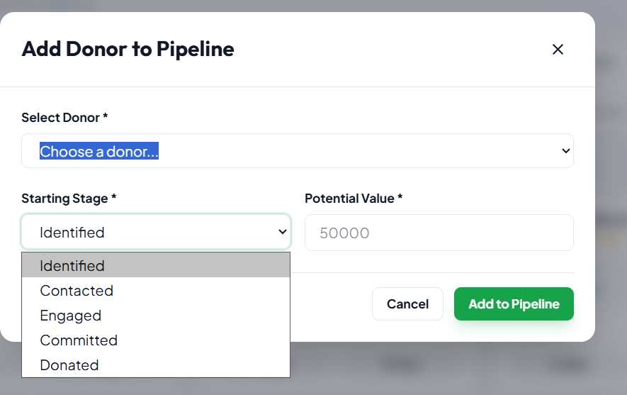
