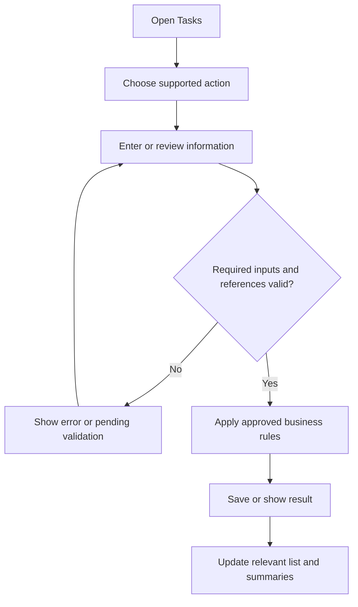
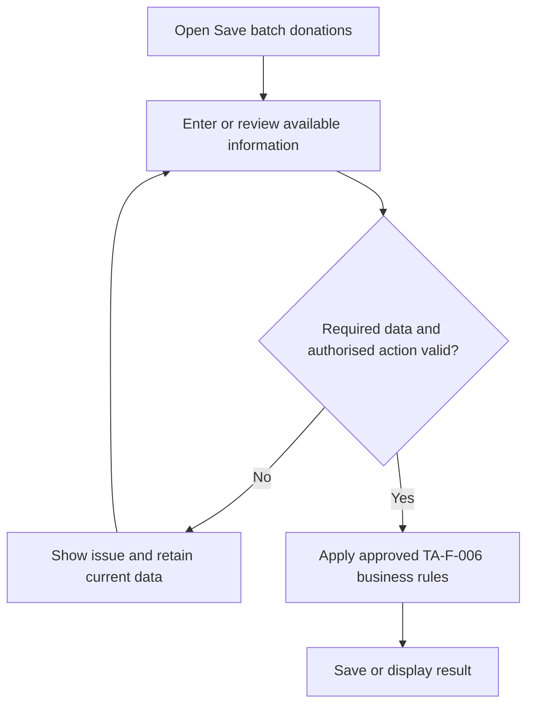
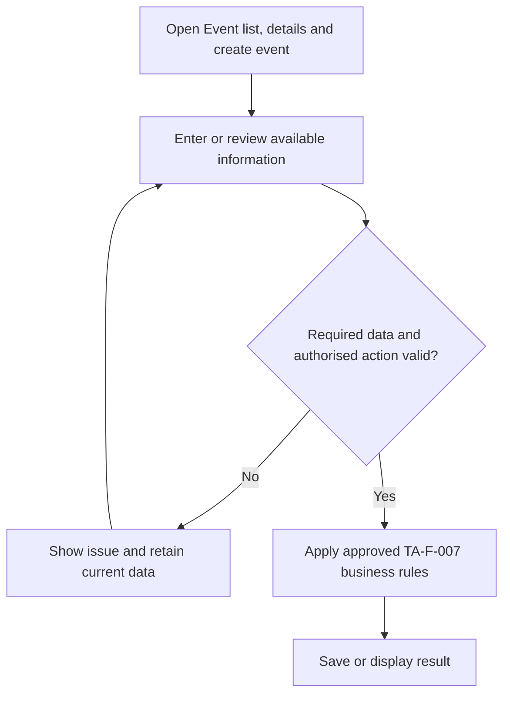
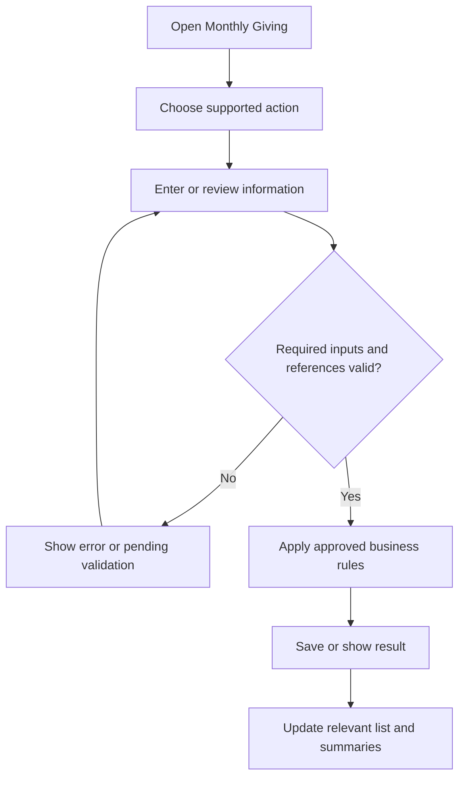
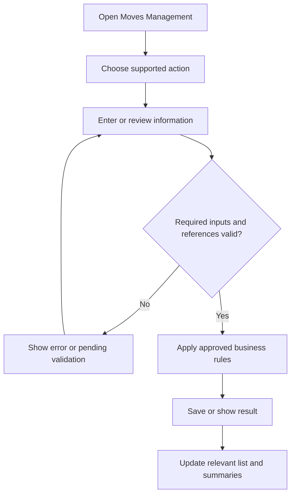
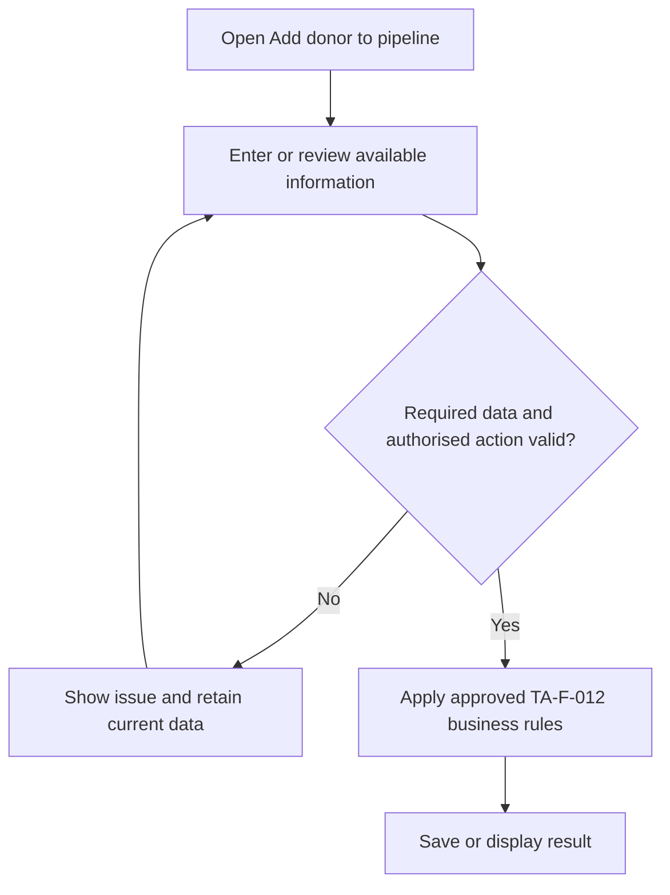
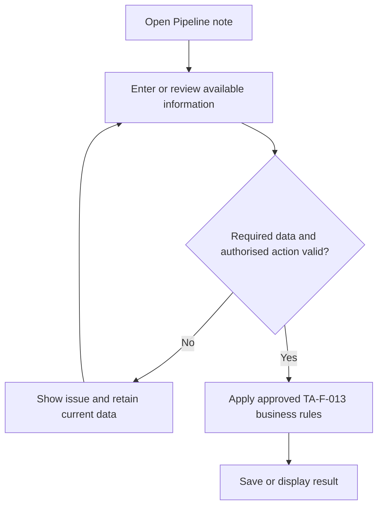

# AiXPurpose Standalone – Tasks & Activities – BRD Workflow

> **Document type:** Business Requirements Document – Workflow

## Document Control

| Field                | Details                                                                                                    |
| -------------------- | ---------------------------------------------------------------------------------------------------------- |
| Product              | AiXPurpose Standalone                                                                                      |
| Module               | Tasks & Activities                                                                                         |
| Document             | BRD Workflow                                                                                               |
| Version              | 1.0                                                                                                        |
| Status               | Draft for Business and Development Review                                                                  |
| Scope classification | **To-Be only**. No As-Is functionality implemented and no future enhancement scope.                        |
| Source               | Provided `TASK AND ANALYTICS MODULE.docx` screenshots and approved decisions Q1–Q4                         |
| Related documents    | Tasks_Activities_BRD_Goals.md, Tasks_Activities_BRD_Workflow.md, Tasks_Activities_BRD_Feature_Catalogue.md |

## Overview

This document defines the **proposed, not yet implemented** Tasks & Activities scope. The screenshots illustrate target interfaces only. Unspecified behaviour is listed as an open decision, not filled in as fact.

## Contents

1. Workflow Principles
2. Workflow Inventory
3. Detailed To-Be Workflows
4. Shared Validation and Exceptions
5. Decisions and Traceability
6. Screenshot References

## 1. Workflow Principles

- All diagrams show **To-Be** flows only. No As-Is or future scope is claimed.
- Use existing donors, campaigns and other related entities where applicable.
- Validation and payment logic not supported by the source stays open.

## 2. Workflow Inventory

| Workflow | Page             | Goal      |
| -------- | ---------------- | --------- |
| TA-WF-01 | Tasks            | TA-GO-001 |
| TA-WF-02 | Batch Gift Entry | TA-GO-002 |
| TA-WF-03 | Event Management | TA-GO-003 |
| TA-WF-04 | Monthly Giving   | TA-GO-004 |
| TA-WF-05 | Moves Management | TA-GO-005 |

## 3.1 TA-WF-01 – Tasks

**Classification:** To-Be. **Goal:** TA-GO-001. **Features:** TA-F-001, TA-F-002, TA-F-003.

**Steps:**

1. Open Tasks; display saved tasks and search/filter controls.
2. Create a task with the supported related record, name and due date.
3. Save and show the task in the list.
4. View details, edit/delete or mark complete.

**Exceptions:** Missing required fields must not be committed; unapproved validation outcomes remain open.

### TA-F-001 – Tasks workspace, list and search

**Business logic:** The list is based on saved tasks; selected filters restrict results. Do not imply additional filters or task ownership rules.

### TA-F-002 – Create a task

**Business logic:** Related To values are limited to supported UI options; Development confirms the complete option set. The selected related record must exist.

### TA-F-003 – View, edit, delete and complete task

**Business logic:** Mark Complete changes the task to completed as described in the walkthrough. Other lifecycle transitions are not specified.

## 3.2 TA-WF-02 – Batch Gift Entry

**Classification:** To-Be. **Goal:** TA-GO-002. **Features:** TA-F-004, TA-F-005, TA-F-006.

**Steps:**

1. Open Batch Gift Entry and enter donations row by row or use Import CSV.
2. Show total rows, valid entries, invalid entries and total amount.
3. Select Save Batch after validation.
4. Apply approved saving outcomes; report unsaved and committed rows.

**Exceptions:** Missing required fields must not be committed; unapproved validation outcomes remain open.

### TA-F-004 – Batch gift entry grid

**Business logic:** Donor and campaign references must use existing applicable records; donation rules align with Members/Donors business relationship.

### TA-F-005 – Batch CSV import and validation summary

**Business logic:** Exact CSV columns, invalid-row criteria and amount inclusion rules need Development confirmation. Do not assert import processing already works.

### TA-F-006 – Save batch donations

**Business logic:** Partial success versus all-or-nothing is open; must not count uncommitted rows as donations.

## 3.3 TA-WF-03 – Event Management

**Classification:** To-Be. **Goal:** TA-GO-003. **Features:** TA-F-007, TA-F-008.

**Steps:**

1. Open Events and switch Upcoming/Past.
2. Create an event with name, date, location and optional description.
3. View event details and metrics; add attendees.
4. Send invitations using the configured email service.

**Exceptions:** Missing required fields must not be committed; unapproved validation outcomes remain open.

### TA-F-007 – Event list, details and create event

**Business logic:** Event date determines the relevant listing; definition of past/upcoming boundary requires implementation confirmation.

### TA-F-008 – Event attendees and email invitations

**Business logic:** Attendee selection, exact message/template and delivery acknowledgement are open; no SMS or WhatsApp is assumed.

## 3.4 TA-WF-04 – Monthly Giving

**Classification:** To-Be. **Goal:** TA-GO-004. **Features:** TA-F-009, TA-F-010.

**Steps:**

1. Open Monthly Giving and review Active/Paused/Cancelled tabs and KPI cards.
2. Choose Create Plan; select donor and enter amount, frequency, dates.
3. Save the plan and show its status.
4. Do not assume automatic gateway collection until approved.

**Exceptions:** Missing required fields must not be committed; unapproved validation outcomes remain open.

### TA-F-009 – Monthly giving plans and list

**Business logic:** Plan creation must reference an existing donor. Automatic payment collection remains an open decision.

### TA-F-010 – Monthly giving plan status and KPIs

**Business logic:** KPI formulas and payment collection/linkage remain to be confirmed; do not equate scheduled plans with collected payments.

## 3.5 TA-WF-05 – Moves Management

**Classification:** To-Be. **Goal:** TA-GO-005. **Features:** TA-F-011, TA-F-012, TA-F-013, TA-F-014.

**Steps:**

1. Open Moves Management and review stages and counts.
2. Select Add to Pipeline; choose existing donor, starting stage and potential value.
3. Save donor to pipeline.
4. Add a note or create a linked task from the donor card.

**Exceptions:** Missing required fields must not be committed; unapproved validation outcomes remain open.

### TA-F-011 – Moves pipeline and stage counts

**Business logic:** A donor pipeline entry must reference an existing donor; exact stage movement controls beyond shown UI require confirmation.

### TA-F-012 – Add donor to pipeline

**Business logic:** Duplicate pipeline entries for the same donor and potential-value validation are not specified; Development/Product must resolve.

### TA-F-013 – Pipeline note

**Business logic:** Note belongs to the selected donor/pipeline context. Edit/delete/history not shown and not assumed.

### TA-F-014 – Pipeline follow-up task

**Business logic:** Selected donor is the related record; reuse Tasks capability rather than maintain a second task store.

## 4. Shared Validation and Exceptions

- Required fields are visible on each creation form; respect the screenshot and do not add undocumented fields.
- Related donor/campaign references must resolve to eligible records.
- Batch save behaviour remains pending Development confirmation.
- Email invitations depend on configured email; unavailable service must not be reported as successful delivery.
- Recurring payment processing remains undefined.

## 5. Decisions and Traceability

See `Tasks_Activities_BRD_Goals.md` Section 6 for TA-OD-001–006; every workflow maps to its corresponding TA-GO and TA-F items above.

## 6. Screenshot References

- **1**: 
- **2**: 
- **3**: 
- **4**: 
- **5**: 
- **6**: 
- **7**: 
- **8**: 
- **9**: 
- **10**: 
- **11**: 
- **12**: 
- **13**: 
- **14**: 
- **15**: 
- **16**: 
