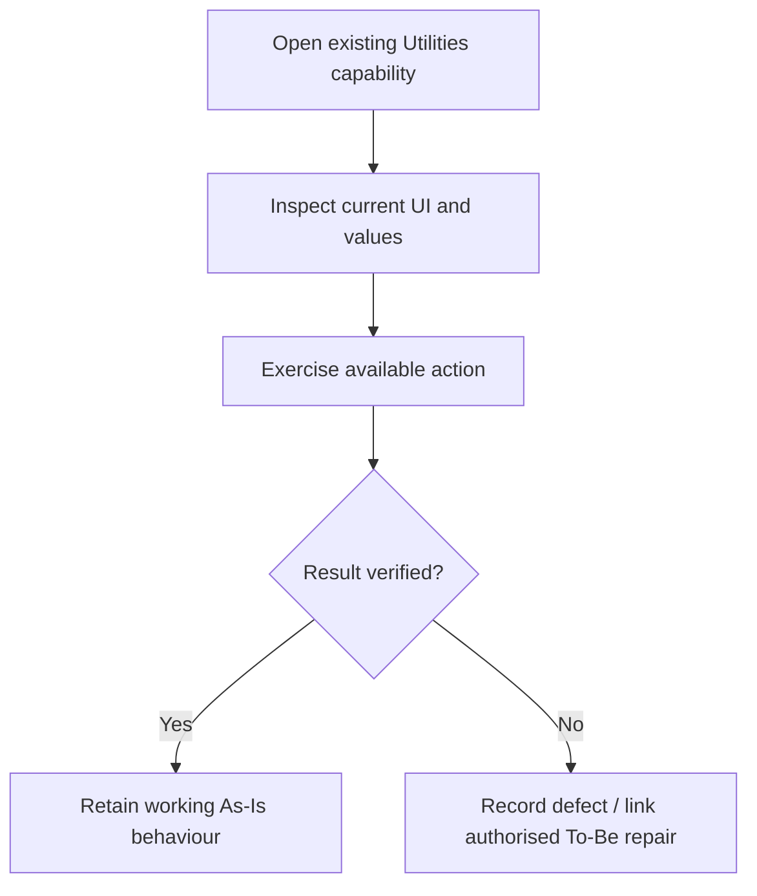
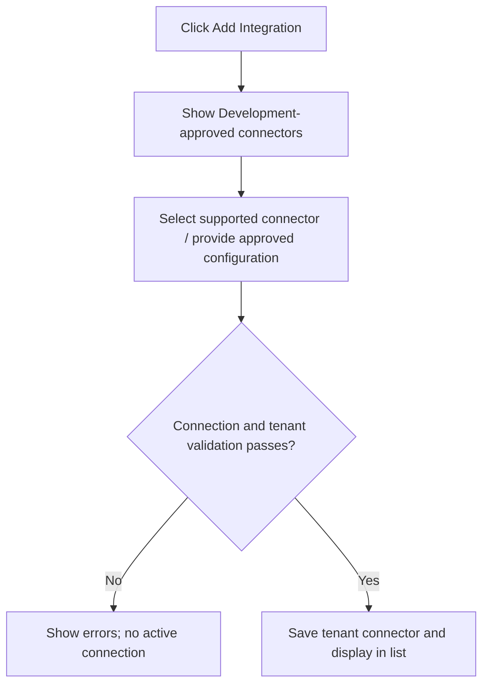
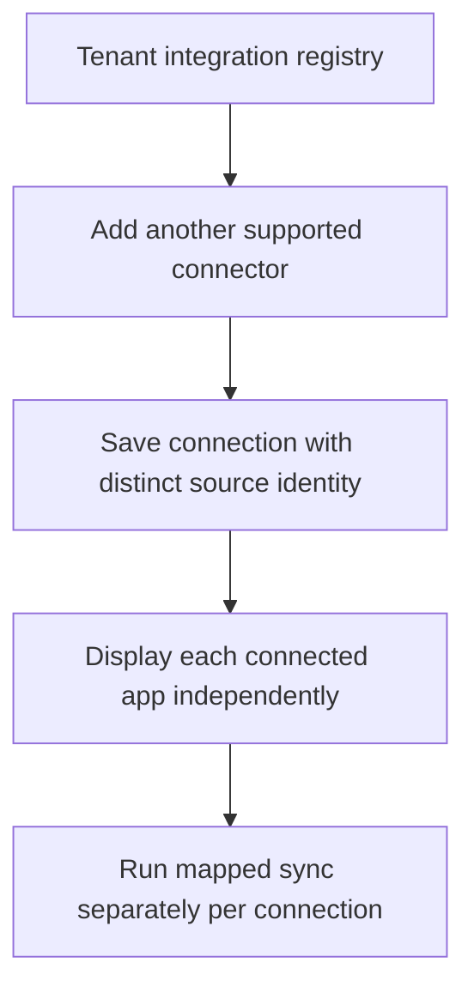
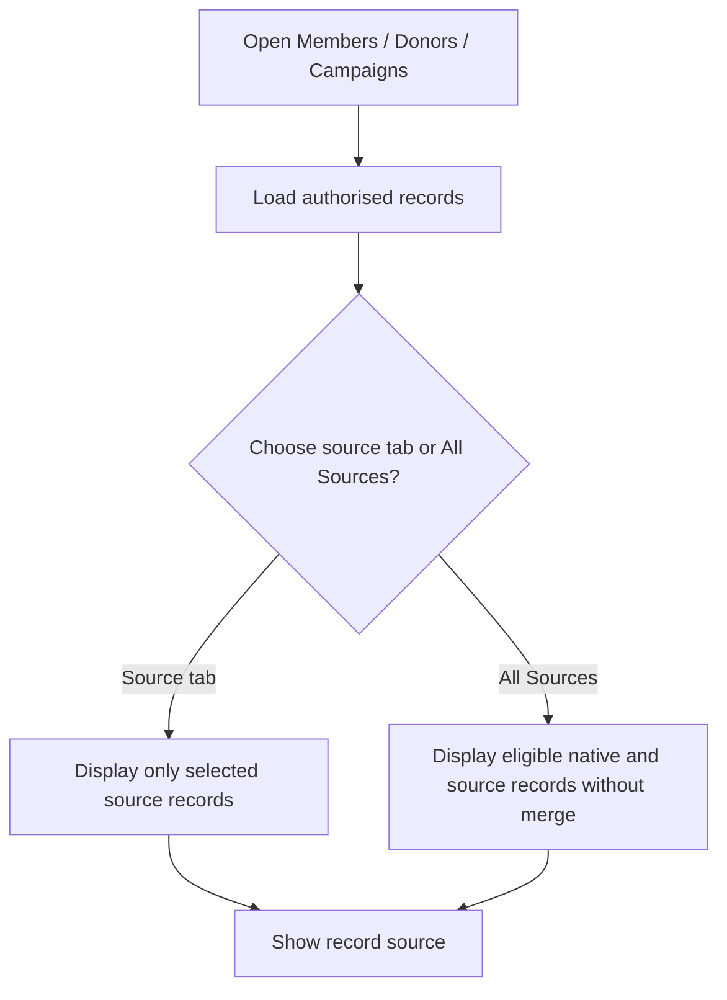
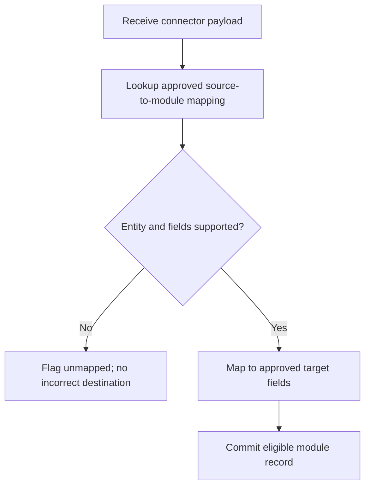
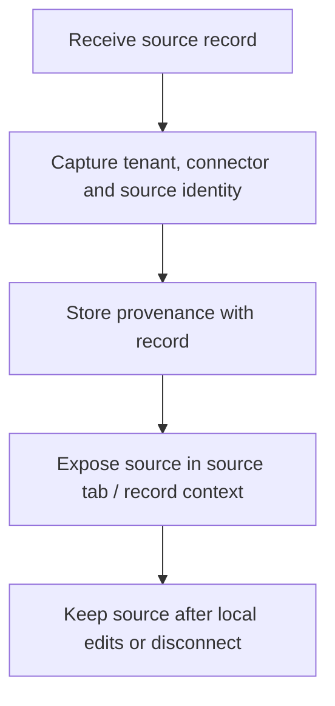
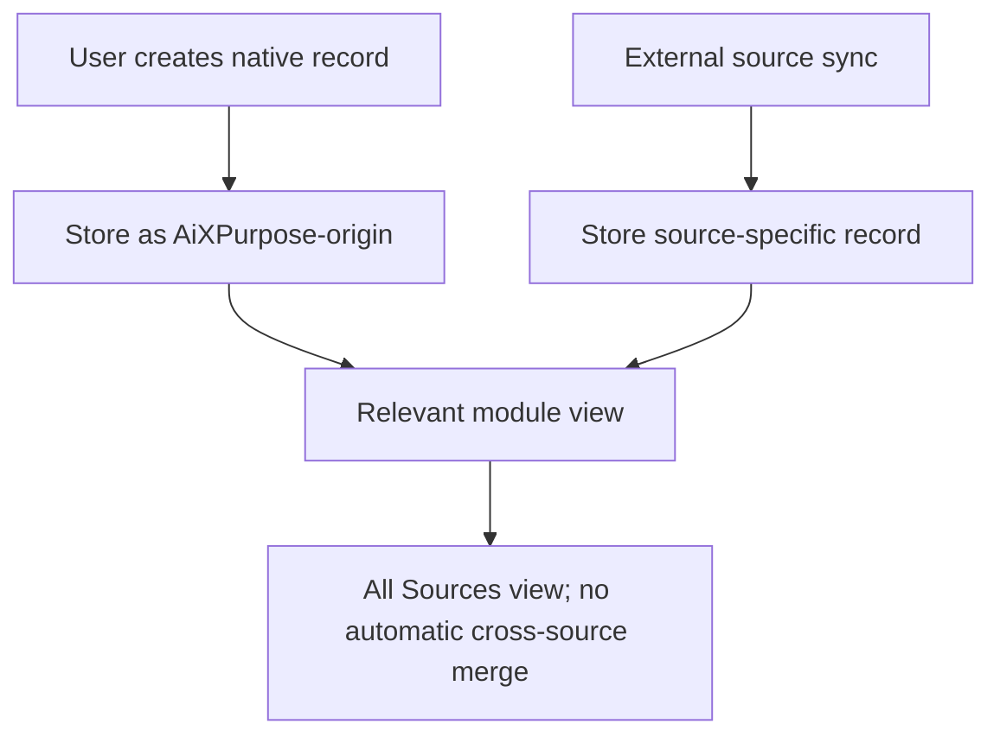

# AiXPurpose – Utilities – BRD Feature Catalogue

> **Status:** Draft for Product Owner, QA and Development review. **Classification:** As-Is, To-Be and Future candidates kept separate.

## Document Control

| Field | Value |
|---|---|
| Product | AiXPurpose Standalone, multi-tenant |
| Capability | Utilities: Quick Entry, Import/Export, Duplicate Management, Code Management, Template Manager, API Integration & Data Sync |
| Document | BRD Feature Catalogue |
| Version | 1.0 |
| Sources | `utlities module.docx` screenshots and narration; approved Q1–Q8, D1–D3 and incremental-sync decisions |
| Reference conventions | Members/Donors BRDs; Profile/Settings Jira-ready specification format |

**Evidence boundary:** A screen confirms a visible control, not functioning backend logic. No unapproved field mapping, connector contract, reconciliation algorithm or provider behaviour is assumed.

## Contents

1. Purpose / classification / ID conventions
2. Feature summary
3. Detailed As-Is QA feature stories
4. Detailed To-Be Jira implementation stories
5. Detailed future candidates
6. Cross-feature business rules and field/source evidence
7. Requirements traceability and open decisions
8. QA and Product acceptance handoff

## 1. Purpose, Jira format and classification

This document is structured as individually copyable Jira user stories, each with feature ID, linked goal/workflow, evidence, business logic, acceptance criteria (Given/When/Then) and native Mermaid code. As-Is describes baseline QA/regression, To-Be describes agreed implementation, and Future is a proposed backlog only.

| Identifier | Purpose |
|---|---|
| UTL-A## | Existing screenshot functionality; QA verifies |
| UTL-P## | Approved To-Be features; UTL-P17 intentionally unused to avoid duplicating Add Integration |
| UTL-F## | Future only, not implementation approved |
| UTL-GO-### | Business goal |
| UTL-WF-A##/P##/F## | Linked workflow |
| UTL-BR-### | Business rule |
| UTL-OD-### | Open decision |

## 2. Feature summary

| Class | Count | Identifiers |
|---|---|---|
| As-Is | 14 | UTL-A01–A14 |
| To-Be | 17 | UTL-P01–P16, P18 (no P17) |
| Future | 7 | UTL-F01–F07 |

## 3. Detailed As-Is feature catalogue – QA/Jira verification stories

### UTL-A01 – Quick Entry donation grid

**Classification:** As-Is / retain and verify. **Goal:** UTL-GO-001. **Workflow:** UTL-WF-A01.

**Jira user story:** As an authorised Utilities user, I want to enter donor name, amount, date, campaign and payment method in a grid. so that the existing capability remains available in standalone AiXPurpose.

**Screenshot evidence:** 

**Business logic / scope:** The screenshot shows rows of donation inputs; it does not establish how member lookup, donation persistence or payment processing works.

**QA acceptance criteria:**

1. **Given** an authorised tenant user opens the relevant Utilities page, **when** it loads, **then** the existing controls and values described above are present.
2. **Given** a user operates the existing control, **when** the outcome is inspected, **then** QA verifies its saved/effective result or logs the reproducible existing failure.
3. **Given** an action is disabled or non-functional, **when** QA exercises it, **then** it must not be falsely passed as fully operational; the approved To-Be repair is traced where applicable.
4. **Specific QA evidence:** Confirm fields, selectable campaign/payment options and correct row display.

**Mermaid flow:**



### UTL-A02 – Quick Entry row management

**Classification:** As-Is / retain and verify. **Goal:** UTL-GO-002. **Workflow:** UTL-WF-A02.

**Jira user story:** As an authorised Utilities user, I want to add rows and use the visible per-row remove action. so that the existing capability remains available in standalone AiXPurpose.

**Screenshot evidence:** 

**Business logic / scope:** Additional rows show the same donation fields; do not infer bulk-save transactional guarantees.

**QA acceptance criteria:**

1. **Given** an authorised tenant user opens the relevant Utilities page, **when** it loads, **then** the existing controls and values described above are present.
2. **Given** a user operates the existing control, **when** the outcome is inspected, **then** QA verifies its saved/effective result or logs the reproducible existing failure.
3. **Given** an action is disabled or non-functional, **when** QA exercises it, **then** it must not be falsely passed as fully operational; the approved To-Be repair is traced where applicable.
4. **Specific QA evidence:** Add/remove rows and confirm retained field values and the empty-row behaviour.

**Mermaid flow:**


### UTL-A03 – Quick Entry Save All Donations

**Classification:** As-Is / retain and verify. **Goal:** UTL-GO-003. **Workflow:** UTL-WF-A03.

**Jira user story:** As an authorised Utilities user, I want to use Save All Donations to submit entered donation rows. so that the existing capability remains available in standalone AiXPurpose.

**Screenshot evidence:** 

**Business logic / scope:** User explicitly reports this action non-functional; functional implementation is UTL-P14.

**QA acceptance criteria:**

1. **Given** an authorised tenant user opens the relevant Utilities page, **when** it loads, **then** the existing controls and values described above are present.
2. **Given** a user operates the existing control, **when** the outcome is inspected, **then** QA verifies its saved/effective result or logs the reproducible existing failure.
3. **Given** an action is disabled or non-functional, **when** QA exercises it, **then** it must not be falsely passed as fully operational; the approved To-Be repair is traced where applicable.
4. **Specific QA evidence:** Record existing non-functional outcome, then validate future implementation against UTL-P14.

**Mermaid flow:**


### UTL-A04 – Import data selection

**Classification:** As-Is / retain and verify. **Goal:** UTL-GO-004. **Workflow:** UTL-WF-A04.

**Jira user story:** As an authorised Utilities user, I want to select Donors, Donations or Campaigns and choose CSV/Excel files. so that the existing capability remains available in standalone AiXPurpose.

**Screenshot evidence:** 

**Business logic / scope:** The screen shows import type and file selection; completion, validations and limits are unverified.

**QA acceptance criteria:**

1. **Given** an authorised tenant user opens the relevant Utilities page, **when** it loads, **then** the existing controls and values described above are present.
2. **Given** a user operates the existing control, **when** the outcome is inspected, **then** QA verifies its saved/effective result or logs the reproducible existing failure.
3. **Given** an action is disabled or non-functional, **when** QA exercises it, **then** it must not be falsely passed as fully operational; the approved To-Be repair is traced where applicable.
4. **Specific QA evidence:** Verify selectable types, file selection, import result and any supported constraints.

**Mermaid flow:**


### UTL-A05 – Export data actions

**Classification:** As-Is / retain and verify. **Goal:** UTL-GO-005. **Workflow:** UTL-WF-A05.

**Jira user story:** As an authorised Utilities user, I want to export donors, donations and campaigns using visible controls. so that the existing capability remains available in standalone AiXPurpose.

**Screenshot evidence:** 

**Business logic / scope:** Export cards indicate CSV downloads; the precise dataset/permissions remain for QA.

**QA acceptance criteria:**

1. **Given** an authorised tenant user opens the relevant Utilities page, **when** it loads, **then** the existing controls and values described above are present.
2. **Given** a user operates the existing control, **when** the outcome is inspected, **then** QA verifies its saved/effective result or logs the reproducible existing failure.
3. **Given** an action is disabled or non-functional, **when** QA exercises it, **then** it must not be falsely passed as fully operational; the approved To-Be repair is traced where applicable.
4. **Specific QA evidence:** Verify each download, accuracy, scope and permission filtering.

**Mermaid flow:**


### UTL-A06 – Duplicate Management overview

**Classification:** As-Is / retain and verify. **Goal:** UTL-GO-006. **Workflow:** UTL-WF-A06.

**Jira user story:** As an authorised Utilities user, I want to access the duplicate management page and its no-duplicates empty state. so that the existing capability remains available in standalone AiXPurpose.

**Screenshot evidence:** 

**Business logic / scope:** No matching criteria or merge flow are demonstrated; do not invent existing resolution functions.

**QA acceptance criteria:**

1. **Given** an authorised tenant user opens the relevant Utilities page, **when** it loads, **then** the existing controls and values described above are present.
2. **Given** a user operates the existing control, **when** the outcome is inspected, **then** QA verifies its saved/effective result or logs the reproducible existing failure.
3. **Given** an action is disabled or non-functional, **when** QA exercises it, **then** it must not be falsely passed as fully operational; the approved To-Be repair is traced where applicable.
4. **Specific QA evidence:** Verify empty state with no findings and investigate outcomes with test duplicates.

**Mermaid flow:**


### UTL-A07 – Code Management listing

**Classification:** As-Is / retain and verify. **Goal:** UTL-GO-007. **Workflow:** UTL-WF-A07.

**Jira user story:** As an authorised Utilities user, I want to use All Codes, GL Codes and Campaign Codes filters to inspect code, name, description, status and edit controls. so that the existing capability remains available in standalone AiXPurpose.

**Screenshot evidence:** 

**Business logic / scope:** Add Code appears but is non-functional. Record editing behaviour is not confirmed.

**QA acceptance criteria:**

1. **Given** an authorised tenant user opens the relevant Utilities page, **when** it loads, **then** the existing controls and values described above are present.
2. **Given** a user operates the existing control, **when** the outcome is inspected, **then** QA verifies its saved/effective result or logs the reproducible existing failure.
3. **Given** an action is disabled or non-functional, **when** QA exercises it, **then** it must not be falsely passed as fully operational; the approved To-Be repair is traced where applicable.
4. **Specific QA evidence:** Verify tab filtering, row content, status and existing edit control.

**Mermaid flow:**


### UTL-A08 – Add Code action

**Classification:** As-Is / retain and verify. **Goal:** UTL-GO-008. **Workflow:** UTL-WF-A08.

**Jira user story:** As an authorised Utilities user, I want to use the Add Code control. so that the existing capability remains available in standalone AiXPurpose.

**Screenshot evidence:** 

**Business logic / scope:** Existing button is non-functional; new creation is UTL-P15 with field rules open.

**QA acceptance criteria:**

1. **Given** an authorised tenant user opens the relevant Utilities page, **when** it loads, **then** the existing controls and values described above are present.
2. **Given** a user operates the existing control, **when** the outcome is inspected, **then** QA verifies its saved/effective result or logs the reproducible existing failure.
3. **Given** an action is disabled or non-functional, **when** QA exercises it, **then** it must not be falsely passed as fully operational; the approved To-Be repair is traced where applicable.
4. **Specific QA evidence:** Document current failure and test approved creation when implemented.

**Mermaid flow:**


### UTL-A09 – Template Manager listing

**Classification:** As-Is / retain and verify. **Goal:** UTL-GO-009. **Workflow:** UTL-WF-A09.

**Jira user story:** As an authorised Utilities user, I want to view Email and SMS templates, categories and available Edit/Delete actions. so that the existing capability remains available in standalone AiXPurpose.

**Screenshot evidence:** 

**Business logic / scope:** Example templates are shown with names, content previews and tokens; editor behaviour is unverified.

**QA acceptance criteria:**

1. **Given** an authorised tenant user opens the relevant Utilities page, **when** it loads, **then** the existing controls and values described above are present.
2. **Given** a user operates the existing control, **when** the outcome is inspected, **then** QA verifies its saved/effective result or logs the reproducible existing failure.
3. **Given** an action is disabled or non-functional, **when** QA exercises it, **then** it must not be falsely passed as fully operational; the approved To-Be repair is traced where applicable.
4. **Specific QA evidence:** Verify filters, listing, preview and existing edit/delete outcomes.

**Mermaid flow:**


### UTL-A10 – Create Template action

**Classification:** As-Is / retain and verify. **Goal:** UTL-GO-010. **Workflow:** UTL-WF-A10.

**Jira user story:** As an authorised Utilities user, I want to use the existing Create Template control. so that the existing capability remains available in standalone AiXPurpose.

**Screenshot evidence:** 

**Business logic / scope:** Existing button is non-functional; UTL-P16 handles implementation; do not assume form fields.

**QA acceptance criteria:**

1. **Given** an authorised tenant user opens the relevant Utilities page, **when** it loads, **then** the existing controls and values described above are present.
2. **Given** a user operates the existing control, **when** the outcome is inspected, **then** QA verifies its saved/effective result or logs the reproducible existing failure.
3. **Given** an action is disabled or non-functional, **when** QA exercises it, **then** it must not be falsely passed as fully operational; the approved To-Be repair is traced where applicable.
4. **Specific QA evidence:** Document non-functional outcome and confirm intended input form before implementation.

**Mermaid flow:**


### UTL-A11 – Integration registry

**Classification:** As-Is / retain and verify. **Goal:** UTL-GO-011. **Workflow:** UTL-WF-A11.

**Jira user story:** As an authorised Utilities user, I want to view configured integration names and displayed status, sync mode and last sync information. so that the existing capability remains available in standalone AiXPurpose.

**Screenshot evidence:** 

**Business logic / scope:** Screenshot names DonorPerfect connected and Kindsight disconnected; user separately confirms DonorPerfect and iWave mappings. These are distinct evidence statements.

**QA acceptance criteria:**

1. **Given** an authorised tenant user opens the relevant Utilities page, **when** it loads, **then** the existing controls and values described above are present.
2. **Given** a user operates the existing control, **when** the outcome is inspected, **then** QA verifies its saved/effective result or logs the reproducible existing failure.
3. **Given** an action is disabled or non-functional, **when** QA exercises it, **then** it must not be falsely passed as fully operational; the approved To-Be repair is traced where applicable.
4. **Specific QA evidence:** Verify connectors, status validity and tenant-specific information.

**Mermaid flow:**


### UTL-A12 – Sync Now control

**Classification:** As-Is / retain and verify. **Goal:** UTL-GO-012. **Workflow:** UTL-WF-A12.

**Jira user story:** As an authorised Utilities user, I want to use the existing Sync Now action for a connected integration. so that the existing capability remains available in standalone AiXPurpose.

**Screenshot evidence:** 

**Business logic / scope:** UI control exists; working incremental logic and sync outcomes are not proven.

**QA acceptance criteria:**

1. **Given** an authorised tenant user opens the relevant Utilities page, **when** it loads, **then** the existing controls and values described above are present.
2. **Given** a user operates the existing control, **when** the outcome is inspected, **then** QA verifies its saved/effective result or logs the reproducible existing failure.
3. **Given** an action is disabled or non-functional, **when** QA exercises it, **then** it must not be falsely passed as fully operational; the approved To-Be repair is traced where applicable.
4. **Specific QA evidence:** QA tests current trigger and observes source effects; UTL-P08 defines target processing.

**Mermaid flow:**


### UTL-A13 – Add Integration control

**Classification:** As-Is / retain and verify. **Goal:** UTL-GO-013. **Workflow:** UTL-WF-A13.

**Jira user story:** As an authorised Utilities user, I want to use Add Integration from the integration registry. so that the existing capability remains available in standalone AiXPurpose.

**Screenshot evidence:** 

**Business logic / scope:** Existing control non-functional; UTL-P01 is To-Be.

**QA acceptance criteria:**

1. **Given** an authorised tenant user opens the relevant Utilities page, **when** it loads, **then** the existing controls and values described above are present.
2. **Given** a user operates the existing control, **when** the outcome is inspected, **then** QA verifies its saved/effective result or logs the reproducible existing failure.
3. **Given** an action is disabled or non-functional, **when** QA exercises it, **then** it must not be falsely passed as fully operational; the approved To-Be repair is traced where applicable.
4. **Specific QA evidence:** Capture current failure; test onboarding only after approved connector contract.

**Mermaid flow:**


### UTL-A14 – Existing connector mapping baseline

**Classification:** As-Is / retain and verify. **Goal:** UTL-GO-014. **Workflow:** UTL-WF-A14.

**Jira user story:** As an authorised Utilities user, I want to use current approved integration mappings as reference. so that the existing capability remains available in standalone AiXPurpose.

**Screenshot evidence:** 

**Business logic / scope:** User confirms existing DonorPerfect and iWave integrations/mappings; screenshot presents DonorPerfect and Kindsight. QA/Development must reconcile actual deployed connector availability.

**QA acceptance criteria:**

1. **Given** an authorised tenant user opens the relevant Utilities page, **when** it loads, **then** the existing controls and values described above are present.
2. **Given** a user operates the existing control, **when** the outcome is inspected, **then** QA verifies its saved/effective result or logs the reproducible existing failure.
3. **Given** an action is disabled or non-functional, **when** QA exercises it, **then** it must not be falsely passed as fully operational; the approved To-Be repair is traced where applicable.
4. **Specific QA evidence:** Validate confirmed DonorPerfect/iWave mapping endpoints and target module fields without assuming unseen mapping sheets.

**Mermaid flow:**


## 4. Detailed To-Be feature catalogue – Jira implementation stories

### UTL-P01 – Functional Add Integration

**Classification:** To-Be (approved). **Goal:** UTL-GO-015. **Workflow:** UTL-WF-P01.

**Jira user story:** As an authorised AiXPurpose user or tenant integration administrator, I want to add an approved connector from Utilities, so that the standalone application supports the approved business operation without compromising existing data.

**Existing UI evidence:** 

**Functional requirements / business logic:** Only Development-approved connectors can be configured; no arbitrary connector wizard is assumed.

**Jira acceptance criteria:**

1. **Given** an authorised tenant user and the applicable approved configuration, **when** this operation is performed, **then** the feature follows the stated business logic and affects only the authorised tenant.
2. **Given** an invalid, missing, unsupported or unauthorised input, **when** it is processed, **then** the operation is rejected or surfaced for review without committing unapproved data.
3. **Given** related existing/native records or local edits, **when** the feature is used, **then** those records and edits are not silently lost or cross-tenant exposed.
4. **Feature-specific outcome:** Available approved connectors can be selected; invalid/unapproved connector cannot be activated; saved connection appears under tenant; actual connection method requires Development confirmation.

**Exceptions / unresolved implementation details:** Use relevant `UTL-OD-*` decisions; unprovided provider APIs, exact fields, retry policy and access role names require Development/Product confirmation.

**Mermaid workflow:**



### UTL-P02 – Multiple connections per tenant

**Classification:** To-Be (approved). **Goal:** UTL-GO-016. **Workflow:** UTL-WF-P02.

**Jira user story:** As an authorised AiXPurpose user or tenant integration administrator, I want to connect multiple supported external applications, so that the standalone application supports the approved business operation without compromising existing data.

**Existing UI evidence:** 

**Functional requirements / business logic:** A tenant may have multiple integrations; 15 is a scale example, not a delivery count or named connector commitment.

**Jira acceptance criteria:**

1. **Given** an authorised tenant user and the applicable approved configuration, **when** this operation is performed, **then** the feature follows the stated business logic and affects only the authorised tenant.
2. **Given** an invalid, missing, unsupported or unauthorised input, **when** it is processed, **then** the operation is rejected or surfaced for review without committing unapproved data.
3. **Given** related existing/native records or local edits, **when** the feature is used, **then** those records and edits are not silently lost or cross-tenant exposed.
4. **Feature-specific outcome:** Different supported connections coexist; configuration and data remain tenant-scoped; connection names/status remain identifiable.

**Exceptions / unresolved implementation details:** Use relevant `UTL-OD-*` decisions; unprovided provider APIs, exact fields, retry policy and access role names require Development/Product confirmation.

**Mermaid workflow:**



### UTL-P03 – Application-wise tabs and All Sources

**Classification:** To-Be (approved). **Goal:** UTL-GO-017. **Workflow:** UTL-WF-P03.

**Jira user story:** As an authorised AiXPurpose user or tenant integration administrator, I want to view integrated records by originating application or across all sources, so that the standalone application supports the approved business operation without compromising existing data.

**Existing UI evidence:** 

**Functional requirements / business logic:** Within eligible Members, Donors, Campaigns and other mapped modules, display separate application tabs and All Sources, plus native records where eligible; no cross-source merge.

**Jira acceptance criteria:**

1. **Given** an authorised tenant user and the applicable approved configuration, **when** this operation is performed, **then** the feature follows the stated business logic and affects only the authorised tenant.
2. **Given** an invalid, missing, unsupported or unauthorised input, **when** it is processed, **then** the operation is rejected or surfaced for review without committing unapproved data.
3. **Given** related existing/native records or local edits, **when** the feature is used, **then** those records and edits are not silently lost or cross-tenant exposed.
4. **Feature-specific outcome:** Each source tab contains its own supported records; All Sources can include repeated cross-source identities; user can distinguish origin; zero-data source shows empty state.

**Exceptions / unresolved implementation details:** Use relevant `UTL-OD-*` decisions; unprovided provider APIs, exact fields, retry policy and access role names require Development/Product confirmation.

**Mermaid workflow:**



### UTL-P04 – Approved source-to-module mapping

**Classification:** To-Be (approved). **Goal:** UTL-GO-018. **Workflow:** UTL-WF-P04.

**Jira user story:** As an authorised AiXPurpose user or tenant integration administrator, I want to receive fields in their correct business module, so that the standalone application supports the approved business operation without compromising existing data.

**Existing UI evidence:** 

**Functional requirements / business logic:** Keep verified DonorPerfect/iWave mappings; client supplies source fields for new connectors and Product/Development approve destination mapping; unsupported fields are not silently invented.

**Jira acceptance criteria:**

1. **Given** an authorised tenant user and the applicable approved configuration, **when** this operation is performed, **then** the feature follows the stated business logic and affects only the authorised tenant.
2. **Given** an invalid, missing, unsupported or unauthorised input, **when** it is processed, **then** the operation is rejected or surfaced for review without committing unapproved data.
3. **Given** related existing/native records or local edits, **when** the feature is used, **then** those records and edits are not silently lost or cross-tenant exposed.
4. **Feature-specific outcome:** Mapped entity lands in proper eligible module; unmapped information is not misfiled; mappings are reviewed per connector; tenant boundary respected.

**Exceptions / unresolved implementation details:** Use relevant `UTL-OD-*` decisions; unprovided provider APIs, exact fields, retry policy and access role names require Development/Product confirmation.

**Mermaid workflow:**



### UTL-P05 – Source provenance

**Classification:** To-Be (approved). **Goal:** UTL-GO-019. **Workflow:** UTL-WF-P05.

**Jira user story:** As an authorised AiXPurpose user or tenant integration administrator, I want to identify the application behind each synchronized record, so that the standalone application supports the approved business operation without compromising existing data.

**Existing UI evidence:** 

**Functional requirements / business logic:** Preserve tenant, connector/source reference, source record identifier and current connection status at a logical business level; exact technical identifiers are Development-defined.

**Jira acceptance criteria:**

1. **Given** an authorised tenant user and the applicable approved configuration, **when** this operation is performed, **then** the feature follows the stated business logic and affects only the authorised tenant.
2. **Given** an invalid, missing, unsupported or unauthorised input, **when** it is processed, **then** the operation is rejected or surfaced for review without committing unapproved data.
3. **Given** related existing/native records or local edits, **when** the feature is used, **then** those records and edits are not silently lost or cross-tenant exposed.
4. **Feature-specific outcome:** Every imported record reports origin; repeat sync retains attribution; local edits do not erase source; disconnected sources remain identified.

**Exceptions / unresolved implementation details:** Use relevant `UTL-OD-*` decisions; unprovided provider APIs, exact fields, retry policy and access role names require Development/Product confirmation.

**Mermaid workflow:**



### UTL-P06 – Manual and integrated records coexist

**Classification:** To-Be (approved). **Goal:** UTL-GO-020. **Workflow:** UTL-WF-P06.

**Jira user story:** As an authorised AiXPurpose user or tenant integration administrator, I want to use AiXPurpose-native data alongside integrated source data, so that the standalone application supports the approved business operation without compromising existing data.

**Existing UI evidence:** 

**Functional requirements / business logic:** Manual Add Member and donation functions are not dependent on external connections; source records remain separately traceable.

**Jira acceptance criteria:**

1. **Given** an authorised tenant user and the applicable approved configuration, **when** this operation is performed, **then** the feature follows the stated business logic and affects only the authorised tenant.
2. **Given** an invalid, missing, unsupported or unauthorised input, **when** it is processed, **then** the operation is rejected or surfaced for review without committing unapproved data.
3. **Given** related existing/native records or local edits, **when** the feature is used, **then** those records and edits are not silently lost or cross-tenant exposed.
4. **Feature-specific outcome:** Manual records remain visible without integrations; integrated records do not remove native records; cross-source auto-merge does not occur.

**Exceptions / unresolved implementation details:** Use relevant `UTL-OD-*` decisions; unprovided provider APIs, exact fields, retry policy and access role names require Development/Product confirmation.

**Mermaid workflow:**



### UTL-P07 – Local overrides and source preservation

**Classification:** To-Be (approved). **Goal:** UTL-GO-021. **Workflow:** UTL-WF-P07.

**Jira user story:** As an authorised AiXPurpose user or tenant integration administrator, I want to edit supported integrated fields without losing my changes during later sync, so that the standalone application supports the approved business operation without compromising existing data.

**Existing UI evidence:** 

**Functional requirements / business logic:** For an authorised local edit, store latest source value separately and show local value as effective; unedited fields may reflect new source updates; outbound source updates are excluded.

**Jira acceptance criteria:**

1. **Given** an authorised tenant user and the applicable approved configuration, **when** this operation is performed, **then** the feature follows the stated business logic and affects only the authorised tenant.
2. **Given** an invalid, missing, unsupported or unauthorised input, **when** it is processed, **then** the operation is rejected or surfaced for review without committing unapproved data.
3. **Given** related existing/native records or local edits, **when** the feature is used, **then** those records and edits are not silently lost or cross-tenant exposed.
4. **Feature-specific outcome:** Override survives incremental sync and historical backfill; latest source value available; non-overridden field updates from source; unauthorized edits denied; no source writeback implied.

**Exceptions / unresolved implementation details:** Use relevant `UTL-OD-*` decisions; unprovided provider APIs, exact fields, retry policy and access role names require Development/Product confirmation.

**Mermaid workflow:**

```mermaid
flowchart TD
    A["Open integrated record"] --> B["Authorised user edits supported field"]
    B --> C["Save local override"]
    C --> D["Display local effective value"]
    D --> E["Subsequent source sync"]
    E --> F["Refresh latest source value separately"]
    F --> G["Keep local effective value; update unedited fields"]
```

### UTL-P08 – Initial import and incremental automatic/manual sync

**Classification:** To-Be (approved). **Goal:** UTL-GO-022. **Workflow:** UTL-WF-P08.

**Jira user story:** As an authorised AiXPurpose user or tenant integration administrator, I want to receive new or changed external data using automatic scheduling and Sync Now, so that the standalone application supports the approved business operation without compromising existing data.

**Existing UI evidence:** 

**Functional requirements / business logic:** First connection imports available historical records; thereafter both triggers use per-connector last successful position and supported change retrieval; schedule frequency is open.

**Jira acceptance criteria:**

1. **Given** an authorised tenant user and the applicable approved configuration, **when** this operation is performed, **then** the feature follows the stated business logic and affects only the authorised tenant.
2. **Given** an invalid, missing, unsupported or unauthorised input, **when** it is processed, **then** the operation is rejected or surfaced for review without committing unapproved data.
3. **Given** related existing/native records or local edits, **when** the feature is used, **then** those records and edits are not silently lost or cross-tenant exposed.
4. **Feature-specific outcome:** Initial history imported; subsequent sync retrieves eligible changes not full history; manual and scheduled use same processing; matching prevents repeats; failed run does not skip unprocessed data.

**Exceptions / unresolved implementation details:** Use relevant `UTL-OD-*` decisions; unprovided provider APIs, exact fields, retry policy and access role names require Development/Product confirmation.

**Mermaid workflow:**

```mermaid
flowchart TD
    A["Connected integration"] --> B{"Initial history imported?"}
    B -->|No| C["Import available historical records"]
    B -->|Yes| D["Scheduled trigger or Sync Now"]
    D --> E["Fetch supported changes since successful sync position"]
    C --> F["Map and match within source"]
    E --> F
    F --> G["Commit safe updates and valid checkpoint"]
```

### UTL-P09 – Sync status and safe failure handling

**Classification:** To-Be (approved). **Goal:** UTL-GO-023. **Workflow:** UTL-WF-P09.

**Jira user story:** As an authorised AiXPurpose user or tenant integration administrator, I want to understand sync results and preserve usable committed data on failure, so that the standalone application supports the approved business operation without compromising existing data.

**Existing UI evidence:** 

**Functional requirements / business logic:** Show connection and last successful sync status, errors; source-specific checkpoints advance only for successfully committed processing under defined partial-success policy.

**Jira acceptance criteria:**

1. **Given** an authorised tenant user and the applicable approved configuration, **when** this operation is performed, **then** the feature follows the stated business logic and affects only the authorised tenant.
2. **Given** an invalid, missing, unsupported or unauthorised input, **when** it is processed, **then** the operation is rejected or surfaced for review without committing unapproved data.
3. **Given** related existing/native records or local edits, **when** the feature is used, **then** those records and edits are not silently lost or cross-tenant exposed.
4. **Feature-specific outcome:** Failed connector shows failure; committed records remain; last-successful position cannot falsely advance past failures; statuses distinguish pending/running/completed/failure where supported.

**Exceptions / unresolved implementation details:** Use relevant `UTL-OD-*` decisions; unprovided provider APIs, exact fields, retry policy and access role names require Development/Product confirmation.

**Mermaid workflow:**

```mermaid
flowchart TD
    A["Sync starts"] --> B["Show running status"]
    B --> C{"Processing outcome?"}
    C -->|Success| D["Commit and show last successful sync"]
    C -->|Failure / partial| E["Retain committed data; report error"]
    E --> F["Do not skip unsuccessful source changes"]
```

### UTL-P10 – Per-source record identity and non-merging

**Classification:** To-Be (approved). **Goal:** UTL-GO-024. **Workflow:** UTL-WF-P10.

**Jira user story:** As an authorised AiXPurpose user or tenant integration administrator, I want to keep records from separate applications distinct, so that the standalone application supports the approved business operation without compromising existing data.

**Existing UI evidence:** 

**Functional requirements / business logic:** Match repeats within the same source to the existing source record; never automatically merge SAP/Salesforce/iWave identities across apps; duplicate review and reporting unique counts remain separate issues.

**Jira acceptance criteria:**

1. **Given** an authorised tenant user and the applicable approved configuration, **when** this operation is performed, **then** the feature follows the stated business logic and affects only the authorised tenant.
2. **Given** an invalid, missing, unsupported or unauthorised input, **when** it is processed, **then** the operation is rejected or surfaced for review without committing unapproved data.
3. **Given** related existing/native records or local edits, **when** the feature is used, **then** those records and edits are not silently lost or cross-tenant exposed.
4. **Feature-specific outcome:** Repeat source record updates rather than duplicates; cross-source records remain separate; duplicate detection does not silently merge; Donors still need eligible Member linkage.

**Exceptions / unresolved implementation details:** Use relevant `UTL-OD-*` decisions; unprovided provider APIs, exact fields, retry policy and access role names require Development/Product confirmation.

**Mermaid workflow:**

```mermaid
flowchart TD
    A["Receive mapped source record"] --> B["Check tenant + same-source identity"]
    B --> C{"Same source record exists?"}
    C -->|Yes| D["Update that source record safely"]
    C -->|No| E["Create new source record"]
    D --> F["Keep other applications separate"]
    E --> F
```

### UTL-P11 – Tenant isolation

**Classification:** To-Be (approved). **Goal:** UTL-GO-025. **Workflow:** UTL-WF-P11.

**Jira user story:** As an authorised AiXPurpose user or tenant integration administrator, I want to use only my organization’s integration configurations and data, so that the standalone application supports the approved business operation without compromising existing data.

**Existing UI evidence:** 

**Functional requirements / business logic:** Every sync, source record, override, log and backfill belongs to an authorised tenant; platform architecture not prescribed.

**Jira acceptance criteria:**

1. **Given** an authorised tenant user and the applicable approved configuration, **when** this operation is performed, **then** the feature follows the stated business logic and affects only the authorised tenant.
2. **Given** an invalid, missing, unsupported or unauthorised input, **when** it is processed, **then** the operation is rejected or surfaced for review without committing unapproved data.
3. **Given** related existing/native records or local edits, **when** the feature is used, **then** those records and edits are not silently lost or cross-tenant exposed.
4. **Feature-specific outcome:** Tenant A cannot view/configure/sync Tenant B; tab and All Sources use only authorised tenant records; forbidden requests are rejected.

**Exceptions / unresolved implementation details:** Use relevant `UTL-OD-*` decisions; unprovided provider APIs, exact fields, retry policy and access role names require Development/Product confirmation.

**Mermaid workflow:**

```mermaid
flowchart TD
    A["User or sync requests tenant data"] --> B["Resolve authorised tenant"]
    B --> C{"Matches requested connector/record tenant?"}
    C -->|No| D["Deny access / processing"]
    C -->|Yes| E["Permit authorised tenant operation"]
```

### UTL-P12 – Disconnect with data retention

**Classification:** To-Be (approved). **Goal:** UTL-GO-026. **Workflow:** UTL-WF-P12.

**Jira user story:** As an authorised AiXPurpose user or tenant integration administrator, I want to retain synchronized history after a connector disconnects, so that the standalone application supports the approved business operation without compromising existing data.

**Existing UI evidence:** 

**Functional requirements / business logic:** Mark connection Disconnected; keep historical data and provenance; whether records remain editable or in normal listings is open.

**Jira acceptance criteria:**

1. **Given** an authorised tenant user and the applicable approved configuration, **when** this operation is performed, **then** the feature follows the stated business logic and affects only the authorised tenant.
2. **Given** an invalid, missing, unsupported or unauthorised input, **when** it is processed, **then** the operation is rejected or surfaced for review without committing unapproved data.
3. **Given** related existing/native records or local edits, **when** the feature is used, **then** those records and edits are not silently lost or cross-tenant exposed.
4. **Feature-specific outcome:** Data is not silently deleted; source displays disconnected status; no new sync until restored; visibility/edit controls follow later-approved policy.

**Exceptions / unresolved implementation details:** Use relevant `UTL-OD-*` decisions; unprovided provider APIs, exact fields, retry policy and access role names require Development/Product confirmation.

**Mermaid workflow:**

```mermaid
flowchart TD
    A["Disconnect connector"] --> B["Mark source disconnected"]
    B --> C["Retain committed historical records and source identity"]
    C --> D["Prevent further active sync"]
    D --> E["Apply future-approved edit/visibility policy"]
```

### UTL-P13 – Existing mappings and new-connector approval

**Classification:** To-Be (approved). **Goal:** UTL-GO-027. **Workflow:** UTL-WF-P13.

**Jira user story:** As an authorised AiXPurpose user or tenant integration administrator, I want to use verified mappings for DonorPerfect/iWave and approved mappings for new sources, so that the standalone application supports the approved business operation without compromising existing data.

**Existing UI evidence:** 

**Functional requirements / business logic:** DonorPerfect and iWave are user-confirmed existing mapped integrations; client field specification is required for additional source; Development approves connector support.

**Jira acceptance criteria:**

1. **Given** an authorised tenant user and the applicable approved configuration, **when** this operation is performed, **then** the feature follows the stated business logic and affects only the authorised tenant.
2. **Given** an invalid, missing, unsupported or unauthorised input, **when** it is processed, **then** the operation is rejected or surfaced for review without committing unapproved data.
3. **Given** related existing/native records or local edits, **when** the feature is used, **then** those records and edits are not silently lost or cross-tenant exposed.
4. **Feature-specific outcome:** Existing verified mapping is not replaced; new mappings documented and approved before sync; unsupported entities are not sent to unrelated modules.

**Exceptions / unresolved implementation details:** Use relevant `UTL-OD-*` decisions; unprovided provider APIs, exact fields, retry policy and access role names require Development/Product confirmation.

**Mermaid workflow:**

```mermaid
flowchart TD
    A["Source integration requirement"] --> B{"DonorPerfect/iWave mapping already approved?"}
    B -->|Yes| C["Retain and verify existing mapping"]
    B -->|No| D["Client supplies source fields"]
    D --> E["Development/Product approve connector and mapping"]
    C --> F["Apply supported module mapping"]
    E --> F
```

### UTL-P14 – Save All Donations works

**Classification:** To-Be (approved). **Goal:** UTL-GO-028. **Workflow:** UTL-WF-P14.

**Jira user story:** As an authorised AiXPurpose user or tenant integration administrator, I want to save multiple entered donation rows in one action, so that the standalone application supports the approved business operation without compromising existing data.

**Existing UI evidence:** 

**Functional requirements / business logic:** Implement the existing action and enforce the approved Donors/Members identity relationship and campaign reference requirements; per-row partial success is open.

**Jira acceptance criteria:**

1. **Given** an authorised tenant user and the applicable approved configuration, **when** this operation is performed, **then** the feature follows the stated business logic and affects only the authorised tenant.
2. **Given** an invalid, missing, unsupported or unauthorised input, **when** it is processed, **then** the operation is rejected or surfaced for review without committing unapproved data.
3. **Given** related existing/native records or local edits, **when** the feature is used, **then** those records and edits are not silently lost or cross-tenant exposed.
4. **Feature-specific outcome:** Authorized save submits rows; invalid data gets actionable outcome without unapproved transactions; committed donations link to eligible members and existing campaigns; repeated clicks do not create unapproved duplicates.

**Exceptions / unresolved implementation details:** Use relevant `UTL-OD-*` decisions; unprovided provider APIs, exact fields, retry policy and access role names require Development/Product confirmation.

**Mermaid workflow:**

```mermaid
flowchart TD
    A["Add donation rows"] --> B["Click Save All Donations"]
    B --> C["Validate member linkage, campaign and approved fields"]
    C --> D{"Rows valid under approved policy?"}
    D -->|No| E["Show row outcomes; no unapproved record"]
    D -->|Yes| F["Save eligible donations and show result"]
```

### UTL-P15 – Functional Add Code

**Classification:** To-Be (approved). **Goal:** UTL-GO-029. **Workflow:** UTL-WF-P15.

**Jira user story:** As an authorised AiXPurpose user or tenant integration administrator, I want to create a code from the existing Code Management page, so that the standalone application supports the approved business operation without compromising existing data.

**Existing UI evidence:** 

**Functional requirements / business logic:** Add Code should become operational for the applicable GL/Campaign categorisation; input fields, uniqueness and permissions are open decisions.

**Jira acceptance criteria:**

1. **Given** an authorised tenant user and the applicable approved configuration, **when** this operation is performed, **then** the feature follows the stated business logic and affects only the authorised tenant.
2. **Given** an invalid, missing, unsupported or unauthorised input, **when** it is processed, **then** the operation is rejected or surfaced for review without committing unapproved data.
3. **Given** related existing/native records or local edits, **when** the feature is used, **then** those records and edits are not silently lost or cross-tenant exposed.
4. **Feature-specific outcome:** Permitted user can access and submit approved form; accepted code appears in proper list/tab; invalid input rejected per approved rule; existing codes unchanged.

**Exceptions / unresolved implementation details:** Use relevant `UTL-OD-*` decisions; unprovided provider APIs, exact fields, retry policy and access role names require Development/Product confirmation.

**Mermaid workflow:**

```mermaid
flowchart TD
    A["Open Code Management"] --> B["Click Add Code"]
    B --> C["Enter fields defined by approved code form"]
    C --> D{"Approved validation passes?"}
    D -->|No| E["Show validation errors"]
    D -->|Yes| F["Create code and update correct list"]
```

### UTL-P16 – Functional Create Template

**Classification:** To-Be (approved). **Goal:** UTL-GO-030. **Workflow:** UTL-WF-P16.

**Jira user story:** As an authorised AiXPurpose user or tenant integration administrator, I want to create a template within existing Email/SMS categories, so that the standalone application supports the approved business operation without compromising existing data.

**Existing UI evidence:** 

**Functional requirements / business logic:** Enable existing button; fields and template tokens/validation require Product confirmation; do not infer a delivery or approval engine.

**Jira acceptance criteria:**

1. **Given** an authorised tenant user and the applicable approved configuration, **when** this operation is performed, **then** the feature follows the stated business logic and affects only the authorised tenant.
2. **Given** an invalid, missing, unsupported or unauthorised input, **when** it is processed, **then** the operation is rejected or surfaced for review without committing unapproved data.
3. **Given** related existing/native records or local edits, **when** the feature is used, **then** those records and edits are not silently lost or cross-tenant exposed.
4. **Feature-specific outcome:** Permitted user can create approved Email/SMS type; newly created template appears in proper filter; invalid form handled; existing templates remain.

**Exceptions / unresolved implementation details:** Use relevant `UTL-OD-*` decisions; unprovided provider APIs, exact fields, retry policy and access role names require Development/Product confirmation.

**Mermaid workflow:**

```mermaid
flowchart TD
    A["Open Template Manager"] --> B["Click Create Template"]
    B --> C["Choose existing Email/SMS type and approved fields"]
    C --> D{"Validation passes?"}
    D -->|No| E["Show errors"]
    D -->|Yes| F["Save template and display in selected category"]
```

### UTL-P18 – Authorised historical re-sync / backfill

**Classification:** To-Be (approved). **Goal:** UTL-GO-031. **Workflow:** UTL-WF-P17.

**Jira user story:** As an authorised AiXPurpose user or tenant integration administrator, I want to recover missed older records without losing effective local edits, so that the standalone application supports the approved business operation without compromising existing data.

**Existing UI evidence:** 

**Functional requirements / business logic:** Controlled backfill uses approved connector mappings and source identity matching; authorised action only; separate from future advanced sync history.

**Jira acceptance criteria:**

1. **Given** an authorised tenant user and the applicable approved configuration, **when** this operation is performed, **then** the feature follows the stated business logic and affects only the authorised tenant.
2. **Given** an invalid, missing, unsupported or unauthorised input, **when** it is processed, **then** the operation is rejected or surfaced for review without committing unapproved data.
3. **Given** related existing/native records or local edits, **when** the feature is used, **then** those records and edits are not silently lost or cross-tenant exposed.
4. **Feature-specific outcome:** Earlier missed record can be recovered; repeated backfill does not duplicate same source ID; local overrides survive; outcome/failure recorded; tenant access enforced.

**Exceptions / unresolved implementation details:** Use relevant `UTL-OD-*` decisions; unprovided provider APIs, exact fields, retry policy and access role names require Development/Product confirmation.

**Mermaid workflow:**

```mermaid
flowchart TD
    A["Authorised backfill request"] --> B["Select approved historical range/source"]
    B --> C["Fetch eligible older records"]
    C --> D["Match existing source identity and apply mapping"]
    D --> E["Preserve local overrides / update source values"]
    E --> F["Commit results and report failures"]
```

## 5. Detailed Future Scope – conceptual Jira backlog (not approved for development)

### UTL-F01 – Advanced scheduling controls

**Classification:** Future candidate only. **Goal:** UTL-GO-032. **Workflow:** UTL-WF-F01.

**Proposed user story (backlog only):** As an authorised tenant user, I want to configure richer timing options beyond basic automatic sync, so that the product could provide this additional capability if separately approved.

**Business logic boundary:** Future option beyond initial automatic incremental sync; no committed schedule settings.

**Provisional acceptance criteria – NOT a release commitment:**

1. **Given** a future business decision is approved, **when** implementation is scoped, **then** specific field, permission and failure rules must be agreed before development.
2. **Given** the optional capability is implemented later, **when** used, **then** it must preserve tenant isolation, source identity and local edit rules.
3. **Proposed observable outcome:** Configurable schedule policy governs eligible connectors without changing source matching or override rules.

**Conceptual Mermaid flow:**

```mermaid
flowchart TD
    A["Future idea submitted"] --> B["Confirm business requirement"]
    B --> C{"Separate approval granted?"}
    C -->|No| D["Remain excluded from current release"]
    C -->|Yes| E["Define detailed acceptance and implementation design"]
    E --> F["Deliver under separately approved scope"]
```

### UTL-F02 – Two-way source writeback

**Classification:** Future candidate only. **Goal:** UTL-GO-033. **Workflow:** UTL-WF-F02.

**Proposed user story (backlog only):** As an authorised tenant user, I want to send eligible local edits to the originating system, so that the product could provide this additional capability if separately approved.

**Business logic boundary:** No writeback in To-Be; future requires source API support, authorisation, conflict and error rules.

**Provisional acceptance criteria – NOT a release commitment:**

1. **Given** a future business decision is approved, **when** implementation is scoped, **then** specific field, permission and failure rules must be agreed before development.
2. **Given** the optional capability is implemented later, **when** used, **then** it must preserve tenant isolation, source identity and local edit rules.
3. **Proposed observable outcome:** Only approved editable fields are transmitted with acknowledgments and audited failures.

**Conceptual Mermaid flow:**

```mermaid
flowchart TD
    A["Future idea submitted"] --> B["Confirm business requirement"]
    B --> C{"Separate approval granted?"}
    C -->|No| D["Remain excluded from current release"]
    C -->|Yes| E["Define detailed acceptance and implementation design"]
    E --> F["Deliver under separately approved scope"]
```

### UTL-F03 – Tenant-controlled advanced mappings

**Classification:** Future candidate only. **Goal:** UTL-GO-034. **Workflow:** UTL-WF-F03.

**Proposed user story (backlog only):** As an authorised tenant user, I want to configure my own source-to-target field mappings, so that the product could provide this additional capability if separately approved.

**Business logic boundary:** Baseline mappings remain client-supplied and Development-approved; interactive designer is optional.

**Provisional acceptance criteria – NOT a release commitment:**

1. **Given** a future business decision is approved, **when** implementation is scoped, **then** specific field, permission and failure rules must be agreed before development.
2. **Given** the optional capability is implemented later, **when** used, **then** it must preserve tenant isolation, source identity and local edit rules.
3. **Proposed observable outcome:** Approved tenant changes validate against target schema before data flows.

**Conceptual Mermaid flow:**

```mermaid
flowchart TD
    A["Future idea submitted"] --> B["Confirm business requirement"]
    B --> C{"Separate approval granted?"}
    C -->|No| D["Remain excluded from current release"]
    C -->|Yes| E["Define detailed acceptance and implementation design"]
    E --> F["Deliver under separately approved scope"]
```

### UTL-F04 – Integration health dashboard

**Classification:** Future candidate only. **Goal:** UTL-GO-035. **Workflow:** UTL-WF-F04.

**Proposed user story (backlog only):** As an authorised tenant user, I want to view aggregated connection reliability, so that the product could provide this additional capability if separately approved.

**Business logic boundary:** Not required for baseline per-connector status.

**Provisional acceptance criteria – NOT a release commitment:**

1. **Given** a future business decision is approved, **when** implementation is scoped, **then** specific field, permission and failure rules must be agreed before development.
2. **Given** the optional capability is implemented later, **when** used, **then** it must preserve tenant isolation, source identity and local edit rules.
3. **Proposed observable outcome:** Proposed consolidated health view identifies degraded connectors and relevant trends.

**Conceptual Mermaid flow:**

```mermaid
flowchart TD
    A["Future idea submitted"] --> B["Confirm business requirement"]
    B --> C{"Separate approval granted?"}
    C -->|No| D["Remain excluded from current release"]
    C -->|Yes| E["Define detailed acceptance and implementation design"]
    E --> F["Deliver under separately approved scope"]
```

### UTL-F05 – Detailed sync history and reconciliation

**Classification:** Future candidate only. **Goal:** UTL-GO-036. **Workflow:** UTL-WF-F05.

**Proposed user story (backlog only):** As an authorised tenant user, I want to investigate historical sync runs and conflicts, so that the product could provide this additional capability if separately approved.

**Business logic boundary:** Baseline shows results needed for current sync and backfill; detailed investigative dashboard is optional.

**Provisional acceptance criteria – NOT a release commitment:**

1. **Given** a future business decision is approved, **when** implementation is scoped, **then** specific field, permission and failure rules must be agreed before development.
2. **Given** the optional capability is implemented later, **when** used, **then** it must preserve tenant isolation, source identity and local edit rules.
3. **Proposed observable outcome:** Proposed historical runs, row outcomes and comparison details are traceable.

**Conceptual Mermaid flow:**

```mermaid
flowchart TD
    A["Future idea submitted"] --> B["Confirm business requirement"]
    B --> C{"Separate approval granted?"}
    C -->|No| D["Remain excluded from current release"]
    C -->|Yes| E["Define detailed acceptance and implementation design"]
    E --> F["Deliver under separately approved scope"]
```

### UTL-F06 – Configurable source priorities

**Classification:** Future candidate only. **Goal:** UTL-GO-037. **Workflow:** UTL-WF-F06.

**Proposed user story (backlog only):** As an authorised tenant user, I want to set source authority rules for overlapping information, so that the product could provide this additional capability if separately approved.

**Business logic boundary:** Currently separate source records and local overrides; no automatic cross-source winner.

**Provisional acceptance criteria – NOT a release commitment:**

1. **Given** a future business decision is approved, **when** implementation is scoped, **then** specific field, permission and failure rules must be agreed before development.
2. **Given** the optional capability is implemented later, **when** used, **then** it must preserve tenant isolation, source identity and local edit rules.
3. **Proposed observable outcome:** Optional priority policies require explicit ownership, approval and effect definitions.

**Conceptual Mermaid flow:**

```mermaid
flowchart TD
    A["Future idea submitted"] --> B["Confirm business requirement"]
    B --> C{"Separate approval granted?"}
    C -->|No| D["Remain excluded from current release"]
    C -->|Yes| E["Define detailed acceptance and implementation design"]
    E --> F["Deliver under separately approved scope"]
```

### UTL-F07 – Integration-specific access controls

**Classification:** Future candidate only. **Goal:** UTL-GO-038. **Workflow:** UTL-WF-F07.

**Proposed user story (backlog only):** As an authorised tenant user, I want to restrict selected source tabs or connectors by permission, so that the product could provide this additional capability if separately approved.

**Business logic boundary:** Initial access is tenant- and role-scoped, not per-source granular permission model.

**Provisional acceptance criteria – NOT a release commitment:**

1. **Given** a future business decision is approved, **when** implementation is scoped, **then** specific field, permission and failure rules must be agreed before development.
2. **Given** the optional capability is implemented later, **when** used, **then** it must preserve tenant isolation, source identity and local edit rules.
3. **Proposed observable outcome:** Optional granular rules enforce source visibility without leaking via All Sources or exports.

**Conceptual Mermaid flow:**

```mermaid
flowchart TD
    A["Future idea submitted"] --> B["Confirm business requirement"]
    B --> C{"Separate approval granted?"}
    C -->|No| D["Remain excluded from current release"]
    C -->|Yes| E["Define detailed acceptance and implementation design"]
    E --> F["Deliver under separately approved scope"]
```

## 6. Source evidence, cross-feature rules and acceptance boundaries

### Field / UI evidence inventory

| Page | Visible fields / actions |
|---|---|
| Quick Entry | Donor Name, Amount, Date, Campaign, Payment Method, row delete, Add Row, Save All Donations |
| Import/Export | Donors, Donations, Campaigns import types; CSV/Excel file choice; donor/donation/campaign export cards |
| Duplicate Management | No Duplicates Found empty state; any merge capability unverified |
| Code Management | All Codes, GL Codes, Campaign Codes; Type/Code/Name/Description/Status/Actions; Add Code |
| Template Manager | All Types, Email, SMS; cards and Edit/Delete; Create Template |
| API Integration & Data Sync | Existing connected/disconnected integration cards, Sync Now, Add Integration and key-security warning |

### Business rules

| ID | Requirement |
|---|---|
| UTL-BR-001 | All pre-existing Utilities UI and behaviour remains a QA baseline; nonfunctional actions are labelled. |
| UTL-BR-002 | Tenant isolation applies to integrations, source records, local modifications and processing. |
| UTL-BR-003 | New connectors and their mappings need client data and Development approval. |
| UTL-BR-004 | Preserve source application and source record identity on sync. |
| UTL-BR-005 | Records from different applications remain separate; All Sources is not an automatic merge. |
| UTL-BR-006 | Native AiXPurpose records coexist with external-source records. |
| UTL-BR-007 | Locally overridden field is the effective value; preserve latest source value. |
| UTL-BR-008 | First sync imports available history, then supported incremental changes. |
| UTL-BR-009 | Scheduled sync and Sync Now share mapping/matching/override rules. |
| UTL-BR-010 | Retry/backfill must not duplicate source records or erase local edits. |
| UTL-BR-011 | Failed processing must not overwrite committed data or incorrectly advance a cursor. |
| UTL-BR-012 | Disconnect retains stored source data and marks source disconnected. |
| UTL-BR-013 | Donor records respect existing Member–Donor eligibility and donation rules. |
| UTL-BR-014 | No source writeback unless separately authorised in future scope. |
| UTL-BR-015 | KPI deduplication/counting and disconnected record editability remain open. |

### Data handling examples (illustrative only)

- iWave initial available historical import occurs on 24 June (example date only).
- Local edit made later to a mapped member field is separately saved as effective value.
- On 30 June, connector retrieves eligible changes since its last successful source position, refreshing unedited fields and source values while retaining effective local overrides.
- A permitted historical backfill can recover older missed records without duplicate source identity or override loss.
- DonorPerfect/iWave mappings are existing user-confirmed capabilities; screenshot label Kindsight remains evidence but not an inferred third confirmed live integration.

## 7. Feature/Goal/Workflow traceability

| Business Goal | Feature Story | Workflow | Area |
|---|---|---|---|
| UTL-GO-001 | UTL-A01 | UTL-WF-A01 | Quick Entry donation grid |
| UTL-GO-002 | UTL-A02 | UTL-WF-A02 | Quick Entry row management |
| UTL-GO-003 | UTL-A03 | UTL-WF-A03 | Quick Entry Save All Donations |
| UTL-GO-004 | UTL-A04 | UTL-WF-A04 | Import data selection |
| UTL-GO-005 | UTL-A05 | UTL-WF-A05 | Export data actions |
| UTL-GO-006 | UTL-A06 | UTL-WF-A06 | Duplicate Management overview |
| UTL-GO-007 | UTL-A07 | UTL-WF-A07 | Code Management listing |
| UTL-GO-008 | UTL-A08 | UTL-WF-A08 | Add Code action |
| UTL-GO-009 | UTL-A09 | UTL-WF-A09 | Template Manager listing |
| UTL-GO-010 | UTL-A10 | UTL-WF-A10 | Create Template action |
| UTL-GO-011 | UTL-A11 | UTL-WF-A11 | Integration registry |
| UTL-GO-012 | UTL-A12 | UTL-WF-A12 | Sync Now control |
| UTL-GO-013 | UTL-A13 | UTL-WF-A13 | Add Integration control |
| UTL-GO-014 | UTL-A14 | UTL-WF-A14 | Existing connector mapping baseline |
| UTL-GO-015 | UTL-P01 | UTL-WF-P01 | Functional Add Integration |
| UTL-GO-016 | UTL-P02 | UTL-WF-P02 | Multiple connections per tenant |
| UTL-GO-017 | UTL-P03 | UTL-WF-P03 | Application-wise tabs and All Sources |
| UTL-GO-018 | UTL-P04 | UTL-WF-P04 | Approved source-to-module mapping |
| UTL-GO-019 | UTL-P05 | UTL-WF-P05 | Source provenance |
| UTL-GO-020 | UTL-P06 | UTL-WF-P06 | Manual and integrated records coexist |
| UTL-GO-021 | UTL-P07 | UTL-WF-P07 | Local overrides and source preservation |
| UTL-GO-022 | UTL-P08 | UTL-WF-P08 | Initial import and incremental automatic/manual sync |
| UTL-GO-023 | UTL-P09 | UTL-WF-P09 | Sync status and safe failure handling |
| UTL-GO-024 | UTL-P10 | UTL-WF-P10 | Per-source record identity and non-merging |
| UTL-GO-025 | UTL-P11 | UTL-WF-P11 | Tenant isolation |
| UTL-GO-026 | UTL-P12 | UTL-WF-P12 | Disconnect with data retention |
| UTL-GO-027 | UTL-P13 | UTL-WF-P13 | Existing mappings and new-connector approval |
| UTL-GO-028 | UTL-P14 | UTL-WF-P14 | Save All Donations works |
| UTL-GO-029 | UTL-P15 | UTL-WF-P15 | Functional Add Code |
| UTL-GO-030 | UTL-P16 | UTL-WF-P16 | Functional Create Template |
| UTL-GO-031 | UTL-P18 | UTL-WF-P17 | Authorised historical re-sync / backfill |
| UTL-GO-032 | UTL-F01 | UTL-WF-F01 | Advanced scheduling controls |
| UTL-GO-033 | UTL-F02 | UTL-WF-F02 | Two-way source writeback |
| UTL-GO-034 | UTL-F03 | UTL-WF-F03 | Tenant-controlled advanced mappings |
| UTL-GO-035 | UTL-F04 | UTL-WF-F04 | Integration health dashboard |
| UTL-GO-036 | UTL-F05 | UTL-WF-F05 | Detailed sync history and reconciliation |
| UTL-GO-037 | UTL-F06 | UTL-WF-F06 | Configurable source priorities |
| UTL-GO-038 | UTL-F07 | UTL-WF-F07 | Integration-specific access controls |

### Open decisions

| Decision | Subject | Review owner |
|---|---|---|
| UTL-OD-001 | Cross-source KPI counting and unique-person reporting | Reporting/Product |
| UTL-OD-002 | Incomplete member identity for externally sourced donations | Members/Donors Product |
| UTL-OD-003 | Initial approved connector list beyond confirmed DonorPerfect and iWave | Development |
| UTL-OD-004 | Default sync schedule, sync source change-token/timestamp capabilities | Product/Development |
| UTL-OD-005 | Visibility, editing and reporting after disconnect | Product |
| UTL-OD-006 | Partial commit, retry and failed-row outcomes | Development/QA |
| UTL-OD-007 | Add Code fields, validation, uniqueness and access | Product/Development |
| UTL-OD-008 | Create Template fields, supported tokens and rules | Product/Development |
| UTL-OD-009 | Quick Entry invalid-row, all-or-nothing vs partial save, duplicate-safe outcomes | Product/Development |
| UTL-OD-010 | Same-source record identity matching and backfill boundaries | Development |
| UTL-OD-011 | Exact fields allowed for local source-record editing | Product/Module owners |
| UTL-OD-012 | Existing Kindsight screenshot vs confirmed iWave integration: environment/connector status | QA/Development |

## 8. Jira and QA handoff

- Create one Jira story per To-Be `UTL-P*` identifier; do not duplicate Add Integration as `UTL-P17`.
- Import As-Is `UTL-A*` as QA regression cases or verification tasks, logging defects for existing failures.
- Retain Future `UTL-F*` as unapproved product backlog candidates, not active sprint delivery commitments.
- Unprovided form field constraints, APIs, connector support, sync frequency and duplicate reporting/KPI decisions must be closed before relevant Jira implementation is marked ready.
- Confirm Users/tenant permissions with identity owners; do not invent role names.

**Related documents:** Goals: `Utilities_BRD_Goals.md` · Workflow: `Utilities_BRD_Workflow.md` · Feature Catalogue: `Utilities_BRD_Feature_Catalogue.md`.
