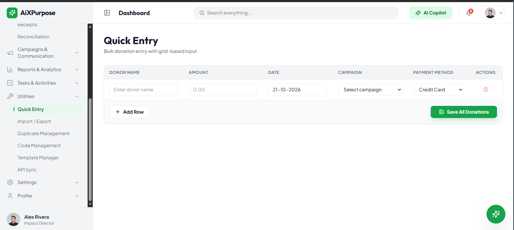
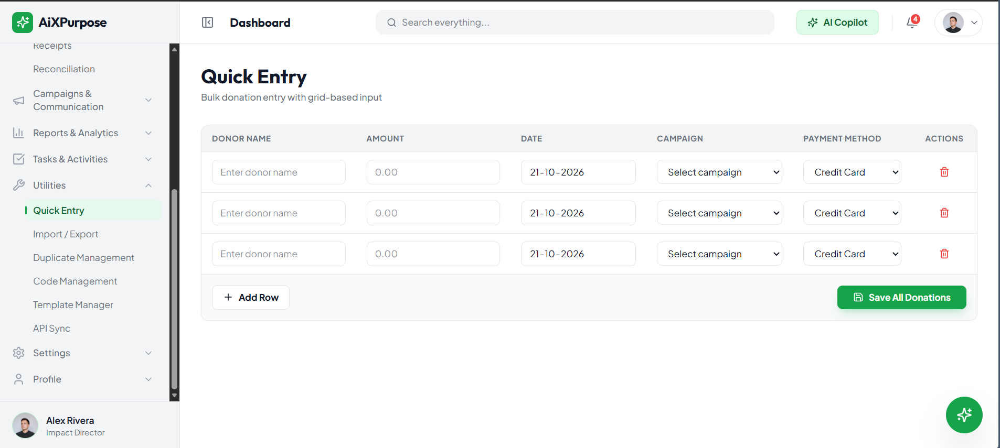
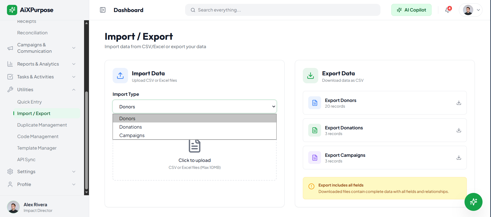
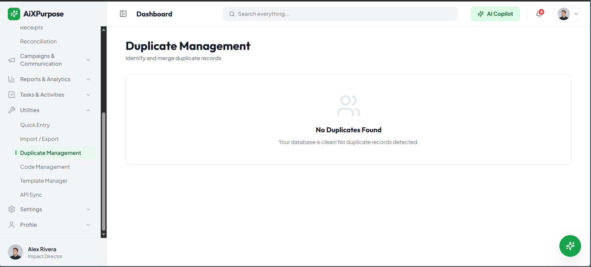
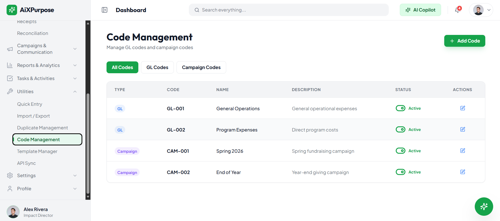
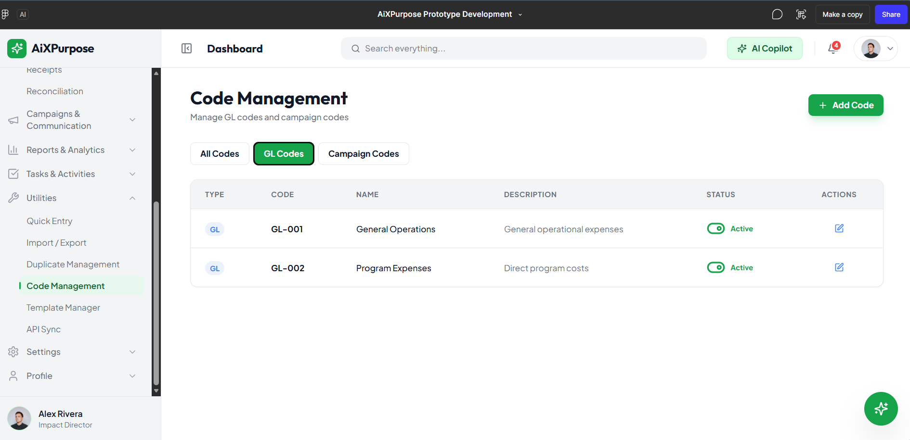
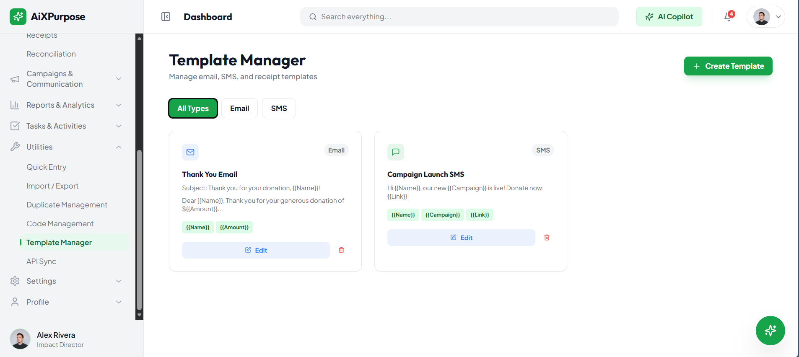
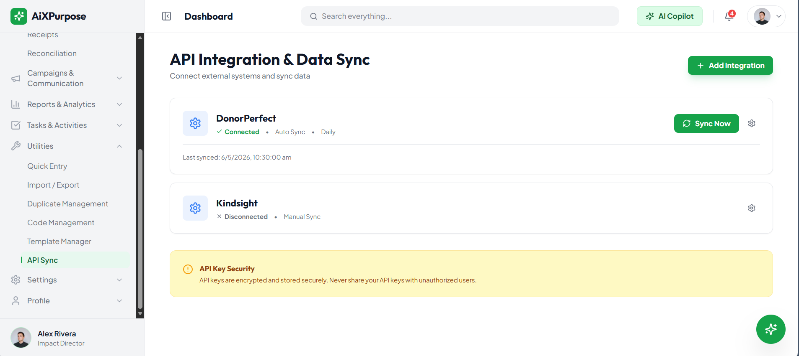
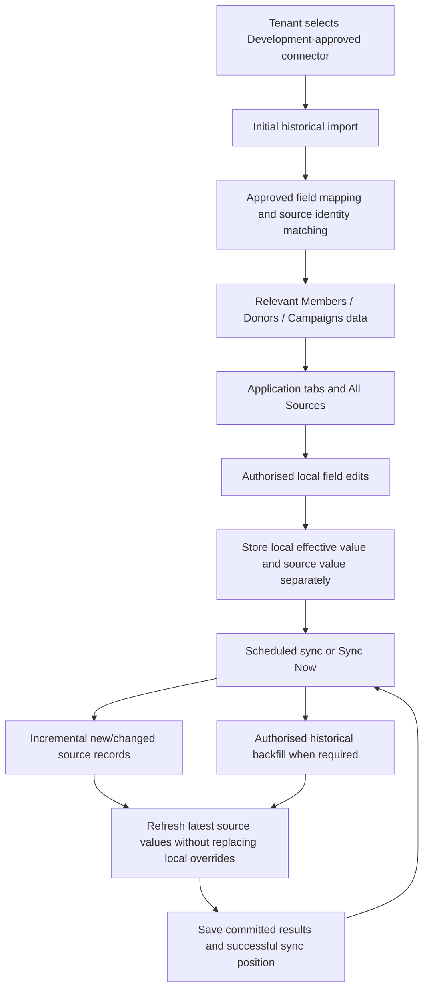

# AiXPurpose – Utilities – BRD Goals

> **Status:** Draft for Product Owner, QA and Development review. **Classification:** As-Is, To-Be and Future candidates kept separate.

## Document Control

| Field                 | Value                                                                                                                       |
| --------------------- | --------------------------------------------------------------------------------------------------------------------------- |
| Product               | AiXPurpose Standalone, multi-tenant                                                                                         |
| Capability            | Utilities: Quick Entry, Import/Export, Duplicate Management, Code Management, Template Manager, API Integration & Data Sync |
| Document              | BRD Goals                                                                                                                   |
| Version               | 1.0                                                                                                                         |
| Sources               | `utlities module.docx` screenshots and narration; approved Q1–Q8, D1–D3 and incremental-sync decisions                      |
| Reference conventions | Members/Donors BRDs; Profile/Settings Jira-ready specification format                                                       |

**Evidence boundary:** A screen confirms a visible control, not functioning backend logic. No unapproved field mapping, connector contract, reconciliation algorithm or provider behaviour is assumed.

## Contents

1. Purpose and business context
2. As-Is baseline and QA mandate
3. Standalone vision and To-Be goals
4. Target data lifecycle and business rules
5. Future scope
6. Dependencies and constraints
7. Risks and success criteria
8. Open decisions and traceability

## 1. Purpose and business context

Existing Utilities has six visible capability areas, including controls confirmed non-functional by the requester. Standalone AiXPurpose must retain existing utility functionality and enable multiple approved, tenant-owned integrations to populate relevant business modules while respecting native records and source identity.

**Module-specific objective:** an organisation using one supported connector sees that source’s eligible data; an organisation using multiple connectors sees each separately plus All Sources. Integration data must be displayed in the module matched by approved source-field mappings, without creating unsupported records.

## 2. As-Is – current UI and QA goals

| Feature | Existing visible capability         | Evidence / known status                                                                                          | QA objective                                                                                                             |
| ------- | ----------------------------------- | ---------------------------------------------------------------------------------------------------------------- | ------------------------------------------------------------------------------------------------------------------------ |
| UTL-A01 | Quick Entry donation grid           | Enter donor name, amount, date, campaign and payment method in a grid.                                           | Confirm fields, selectable campaign/payment options and correct row display.                                             |
| UTL-A02 | Quick Entry row management          | Add rows and use the visible per-row remove action.                                                              | Add/remove rows and confirm retained field values and the empty-row behaviour.                                           |
| UTL-A03 | Quick Entry Save All Donations      | Use Save All Donations to submit entered donation rows.                                                          | Record existing non-functional outcome, then validate future implementation against UTL-P14.                             |
| UTL-A04 | Import data selection               | Select Donors, Donations or Campaigns and choose CSV/Excel files.                                                | Verify selectable types, file selection, import result and any supported constraints.                                    |
| UTL-A05 | Export data actions                 | Export donors, donations and campaigns using visible controls.                                                   | Verify each download, accuracy, scope and permission filtering.                                                          |
| UTL-A06 | Duplicate Management overview       | Access the duplicate management page and its no-duplicates empty state.                                          | Verify empty state with no findings and investigate outcomes with test duplicates.                                       |
| UTL-A07 | Code Management listing             | Use All Codes, GL Codes and Campaign Codes filters to inspect code, name, description, status and edit controls. | Verify tab filtering, row content, status and existing edit control.                                                     |
| UTL-A08 | Add Code action                     | Use the Add Code control.                                                                                        | Document current failure and test approved creation when implemented.                                                    |
| UTL-A09 | Template Manager listing            | View Email and SMS templates, categories and available Edit/Delete actions.                                      | Verify filters, listing, preview and existing edit/delete outcomes.                                                      |
| UTL-A10 | Create Template action              | Use the existing Create Template control.                                                                        | Document non-functional outcome and confirm intended input form before implementation.                                   |
| UTL-A11 | Integration registry                | View configured integration names and displayed status, sync mode and last sync information.                     | Verify connectors, status validity and tenant-specific information.                                                      |
| UTL-A12 | Sync Now control                    | Use the existing Sync Now action for a connected integration.                                                    | QA tests current trigger and observes source effects; UTL-P08 defines target processing.                                 |
| UTL-A13 | Add Integration control             | Use Add Integration from the integration registry.                                                               | Capture current failure; test onboarding only after approved connector contract.                                         |
| UTL-A14 | Existing connector mapping baseline | Use current approved integration mappings as reference.                                                          | Validate confirmed DonorPerfect/iWave mapping endpoints and target module fields without assuming unseen mapping sheets. |

### Original screenshot references

**Known non-functional actions:** Save All Donations, Add Code, Create Template and Add Integration. Existing import/export, duplicate resolution, editing and Sync Now backend behaviour is not proven.

## 3. To-Be – approved standalone goals

| Business goal | Feature ID | Capability                                           | Business outcome                                                                   |
| ------------- | ---------- | ---------------------------------------------------- | ---------------------------------------------------------------------------------- |
| UTL-GO-015    | UTL-P01    | Functional Add Integration                           | add an approved connector from Utilities                                           |
| UTL-GO-016    | UTL-P02    | Multiple connections per tenant                      | connect multiple supported external applications                                   |
| UTL-GO-017    | UTL-P03    | Application-wise tabs and All Sources                | view integrated records by originating application or across all sources           |
| UTL-GO-018    | UTL-P04    | Approved source-to-module mapping                    | receive fields in their correct business module                                    |
| UTL-GO-019    | UTL-P05    | Source provenance                                    | identify the application behind each synchronized record                           |
| UTL-GO-020    | UTL-P06    | Manual and integrated records coexist                | use AiXPurpose-native data alongside integrated source data                        |
| UTL-GO-021    | UTL-P07    | Local overrides and source preservation              | edit supported integrated fields without losing my changes during later sync       |
| UTL-GO-022    | UTL-P08    | Initial import and incremental automatic/manual sync | receive new or changed external data using automatic scheduling and Sync Now       |
| UTL-GO-023    | UTL-P09    | Sync status and safe failure handling                | understand sync results and preserve usable committed data on failure              |
| UTL-GO-024    | UTL-P10    | Per-source record identity and non-merging           | keep records from separate applications distinct                                   |
| UTL-GO-025    | UTL-P11    | Tenant isolation                                     | use only my organization’s integration configurations and data                     |
| UTL-GO-026    | UTL-P12    | Disconnect with data retention                       | retain synchronized history after a connector disconnects                          |
| UTL-GO-027    | UTL-P13    | Existing mappings and new-connector approval         | use verified mappings for DonorPerfect/iWave and approved mappings for new sources |
| UTL-GO-028    | UTL-P14    | Save All Donations works                             | save multiple entered donation rows in one action                                  |
| UTL-GO-029    | UTL-P15    | Functional Add Code                                  | create a code from the existing Code Management page                               |
| UTL-GO-030    | UTL-P16    | Functional Create Template                           | create a template within existing Email/SMS categories                             |
| UTL-GO-031    | UTL-P18    | Authorised historical re-sync / backfill             | recover missed older records without losing effective local edits                  |

### Target process (To-Be)

## 4. Business rules and data lifecycle

| Rule       | Required behaviour                                                                                     |
| ---------- | ------------------------------------------------------------------------------------------------------ |
| UTL-BR-001 | All pre-existing Utilities UI and behaviour remains a QA baseline; nonfunctional actions are labelled. |
| UTL-BR-002 | Tenant isolation applies to integrations, source records, local modifications and processing.          |
| UTL-BR-003 | New connectors and their mappings need client data and Development approval.                           |
| UTL-BR-004 | Preserve source application and source record identity on sync.                                        |
| UTL-BR-005 | Records from different applications remain separate; All Sources is not an automatic merge.            |
| UTL-BR-006 | Native AiXPurpose records coexist with external-source records.                                        |
| UTL-BR-007 | Locally overridden field is the effective value; preserve latest source value.                         |
| UTL-BR-008 | First sync imports available history, then supported incremental changes.                              |
| UTL-BR-009 | Scheduled sync and Sync Now share mapping/matching/override rules.                                     |
| UTL-BR-010 | Retry/backfill must not duplicate source records or erase local edits.                                 |
| UTL-BR-011 | Failed processing must not overwrite committed data or incorrectly advance a cursor.                   |
| UTL-BR-012 | Disconnect retains stored source data and marks source disconnected.                                   |
| UTL-BR-013 | Donor records respect existing Member–Donor eligibility and donation rules.                            |
| UTL-BR-014 | No source writeback unless separately authorised in future scope.                                      |
| UTL-BR-015 | KPI deduplication/counting and disconnected record editability remain open.                            |

### Important boundaries

- **Existing mappings:** user confirms DonorPerfect and iWave mappings; supplied API screen depicts DonorPerfect and Kindsight. Do not treat the discrepancy as a new connector commitment.
- **All Sources:** source records are displayed together but not automatically merged; cross-source KPI counting is open and belongs to reporting owners.
- **Manual data:** independently created AiXPurpose records remain available alongside external data.
- **Effective fields:** a locally edited field wins for AiXPurpose display; the latest source value remains preserved. Unedited fields may reflect latest source data.
- **Incremental sync:** per-connection successful position and source identifiers; not an unsupported calendar-range-only guarantee.
- **Disconnected sources:** retain data and mark disconnected; whether retained data is editable or shown in normal lists remains open.
- **Existing Donors rule:** donor eligibility follows existing member and qualifying donation rules; no standalone source-only donor without appropriate member linkage.

## 5. Future scope – unapproved candidates

| Goal       | Future ID | Feature                                  | Possible benefit                                            |
| ---------- | --------- | ---------------------------------------- | ----------------------------------------------------------- |
| UTL-GO-032 | UTL-F01   | Advanced scheduling controls             | configure richer timing options beyond basic automatic sync |
| UTL-GO-033 | UTL-F02   | Two-way source writeback                 | send eligible local edits to the originating system         |
| UTL-GO-034 | UTL-F03   | Tenant-controlled advanced mappings      | configure my own source-to-target field mappings            |
| UTL-GO-035 | UTL-F04   | Integration health dashboard             | view aggregated connection reliability                      |
| UTL-GO-036 | UTL-F05   | Detailed sync history and reconciliation | investigate historical sync runs and conflicts              |
| UTL-GO-037 | UTL-F06   | Configurable source priorities           | set source authority rules for overlapping information      |
| UTL-GO-038 | UTL-F07   | Integration-specific access controls     | restrict selected source tabs or connectors by permission   |

These are documented for product planning only, not initial development commitments.

## 6. Dependencies and constraints

| Dependency                 | Boundary                                                                     |
| -------------------------- | ---------------------------------------------------------------------------- |
| Members                    | Authoritative member identities; no unapproved cross-source merge            |
| Donors / Donations         | Donor records and qualifying donations remain member-linked                  |
| Campaigns                  | Imported campaigns and donation campaign references require approved mapping |
| Settings / Tenant & Access | Tenant ownership and authorised integration actions                          |
| Reporting                  | Consolidated KPI identity/counting not decided here                          |
| Development                | Connector list, fields, identifiers, sync cursor capability, schedules       |
| QA                         | Verify baseline controls, connector behaviour, imports and failed outcomes   |

## 7. Business risks and success criteria

| Risk                             | Control / mitigation                                             |
| -------------------------------- | ---------------------------------------------------------------- |
| Incorrect module routing         | Approved connector field mappings; verify entity placement       |
| Local edits lost                 | Persist separate source/local values, verify after sync/backfill |
| Duplicate sources or repeat sync | Stable per-source matching; no cross-source merge                |
| Incomplete sync                  | Success checkpoints must not skip failed work                    |
| Cross-tenant exposure            | Tenant-isolated queries, logs and credentials                    |
| Disconnected data confusion      | Visible disconnected provenance, access rules pending            |
| Misleading KPIs                  | Keep counting open for Reporting decisions                       |

**Success criteria:** all screenshot baseline functions captured for QA; four explicitly broken actions treated as To-Be; approved connector data reaches only relevant modules; source-wise tabs and All Sources work; native records survive; local overrides survive incremental sync/backfill; committed data survives failures; no cross-tenant access.

## 8. Open decisions and traceability

| ID         | Question / decision                                                                        | Owner                  |
| ---------- | ------------------------------------------------------------------------------------------ | ---------------------- |
| UTL-OD-001 | Cross-source KPI counting and unique-person reporting                                      | Reporting/Product      |
| UTL-OD-002 | Incomplete member identity for externally sourced donations                                | Members/Donors Product |
| UTL-OD-003 | Initial approved connector list beyond confirmed DonorPerfect and iWave                    | Development            |
| UTL-OD-004 | Default sync schedule, sync source change-token/timestamp capabilities                     | Product/Development    |
| UTL-OD-005 | Visibility, editing and reporting after disconnect                                         | Product                |
| UTL-OD-006 | Partial commit, retry and failed-row outcomes                                              | Development/QA         |
| UTL-OD-007 | Add Code fields, validation, uniqueness and access                                         | Product/Development    |
| UTL-OD-008 | Create Template fields, supported tokens and rules                                         | Product/Development    |
| UTL-OD-009 | Quick Entry invalid-row, all-or-nothing vs partial save, duplicate-safe outcomes           | Product/Development    |
| UTL-OD-010 | Same-source record identity matching and backfill boundaries                               | Development            |
| UTL-OD-011 | Exact fields allowed for local source-record editing                                       | Product/Module owners  |
| UTL-OD-012 | Existing Kindsight screenshot vs confirmed iWave integration: environment/connector status | QA/Development         |

| Goal       | Feature | Workflow   | Description                                          |
| ---------- | ------- | ---------- | ---------------------------------------------------- |
| UTL-GO-001 | UTL-A01 | UTL-WF-A01 | Quick Entry donation grid                            |
| UTL-GO-002 | UTL-A02 | UTL-WF-A02 | Quick Entry row management                           |
| UTL-GO-003 | UTL-A03 | UTL-WF-A03 | Quick Entry Save All Donations                       |
| UTL-GO-004 | UTL-A04 | UTL-WF-A04 | Import data selection                                |
| UTL-GO-005 | UTL-A05 | UTL-WF-A05 | Export data actions                                  |
| UTL-GO-006 | UTL-A06 | UTL-WF-A06 | Duplicate Management overview                        |
| UTL-GO-007 | UTL-A07 | UTL-WF-A07 | Code Management listing                              |
| UTL-GO-008 | UTL-A08 | UTL-WF-A08 | Add Code action                                      |
| UTL-GO-009 | UTL-A09 | UTL-WF-A09 | Template Manager listing                             |
| UTL-GO-010 | UTL-A10 | UTL-WF-A10 | Create Template action                               |
| UTL-GO-011 | UTL-A11 | UTL-WF-A11 | Integration registry                                 |
| UTL-GO-012 | UTL-A12 | UTL-WF-A12 | Sync Now control                                     |
| UTL-GO-013 | UTL-A13 | UTL-WF-A13 | Add Integration control                              |
| UTL-GO-014 | UTL-A14 | UTL-WF-A14 | Existing connector mapping baseline                  |
| UTL-GO-015 | UTL-P01 | UTL-WF-P01 | Functional Add Integration                           |
| UTL-GO-016 | UTL-P02 | UTL-WF-P02 | Multiple connections per tenant                      |
| UTL-GO-017 | UTL-P03 | UTL-WF-P03 | Application-wise tabs and All Sources                |
| UTL-GO-018 | UTL-P04 | UTL-WF-P04 | Approved source-to-module mapping                    |
| UTL-GO-019 | UTL-P05 | UTL-WF-P05 | Source provenance                                    |
| UTL-GO-020 | UTL-P06 | UTL-WF-P06 | Manual and integrated records coexist                |
| UTL-GO-021 | UTL-P07 | UTL-WF-P07 | Local overrides and source preservation              |
| UTL-GO-022 | UTL-P08 | UTL-WF-P08 | Initial import and incremental automatic/manual sync |
| UTL-GO-023 | UTL-P09 | UTL-WF-P09 | Sync status and safe failure handling                |
| UTL-GO-024 | UTL-P10 | UTL-WF-P10 | Per-source record identity and non-merging           |
| UTL-GO-025 | UTL-P11 | UTL-WF-P11 | Tenant isolation                                     |
| UTL-GO-026 | UTL-P12 | UTL-WF-P12 | Disconnect with data retention                       |
| UTL-GO-027 | UTL-P13 | UTL-WF-P13 | Existing mappings and new-connector approval         |
| UTL-GO-028 | UTL-P14 | UTL-WF-P14 | Save All Donations works                             |
| UTL-GO-029 | UTL-P15 | UTL-WF-P15 | Functional Add Code                                  |
| UTL-GO-030 | UTL-P16 | UTL-WF-P16 | Functional Create Template                           |
| UTL-GO-031 | UTL-P18 | UTL-WF-P17 | Authorised historical re-sync / backfill             |
| UTL-GO-032 | UTL-F01 | UTL-WF-F01 | Advanced scheduling controls                         |
| UTL-GO-033 | UTL-F02 | UTL-WF-F02 | Two-way source writeback                             |
| UTL-GO-034 | UTL-F03 | UTL-WF-F03 | Tenant-controlled advanced mappings                  |
| UTL-GO-035 | UTL-F04 | UTL-WF-F04 | Integration health dashboard                         |
| UTL-GO-036 | UTL-F05 | UTL-WF-F05 | Detailed sync history and reconciliation             |
| UTL-GO-037 | UTL-F06 | UTL-WF-F06 | Configurable source priorities                       |
| UTL-GO-038 | UTL-F07 | UTL-WF-F07 | Integration-specific access controls                 |

**Related documents:** Goals: `Utilities_BRD_Goals.md` · Workflow: `Utilities_BRD_Workflow.md` · Feature Catalogue: `Utilities_BRD_Feature_Catalogue.md`.

## Product Owner validation summary

Approved requirements and confirmed gaps are specified without assuming undocumented UI fields, provider contracts or KPI formulas. Final acceptance requires QA verification and closure of open decisions where relevant.
