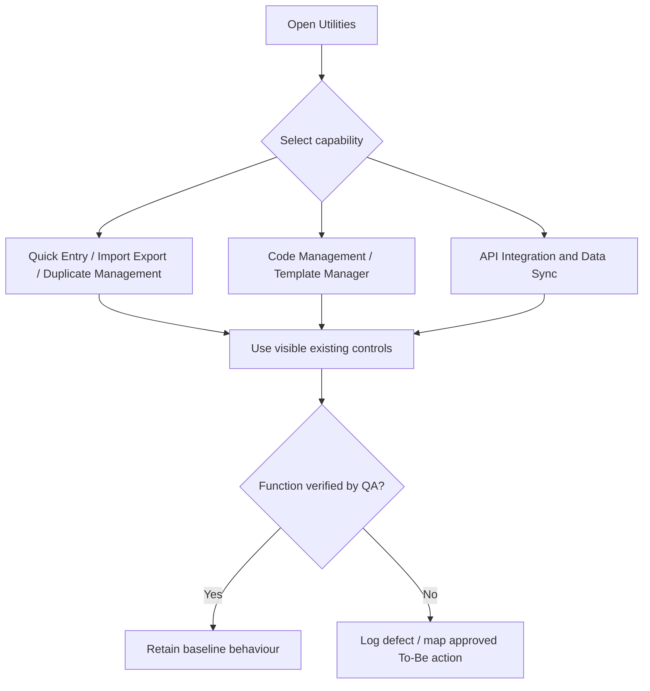
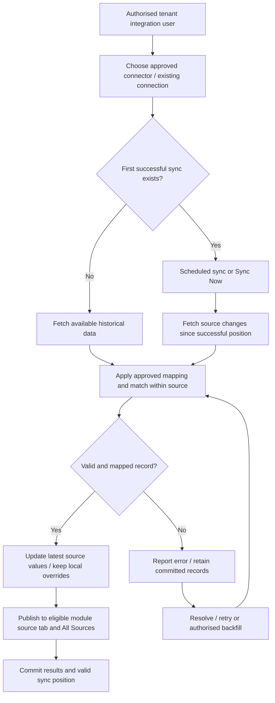
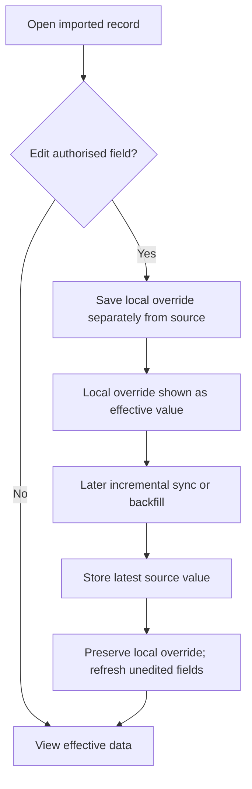
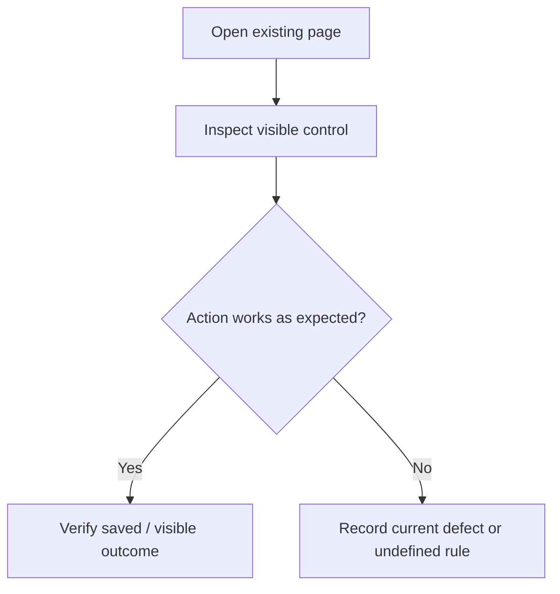
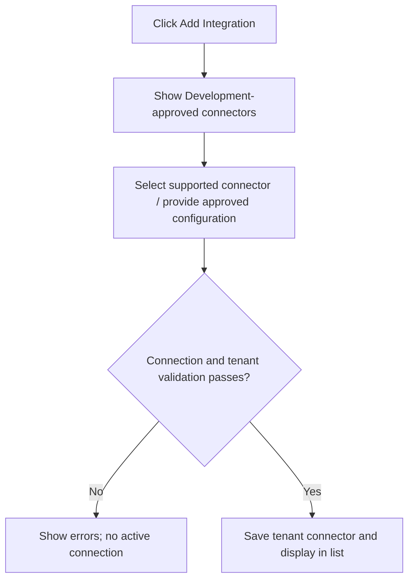
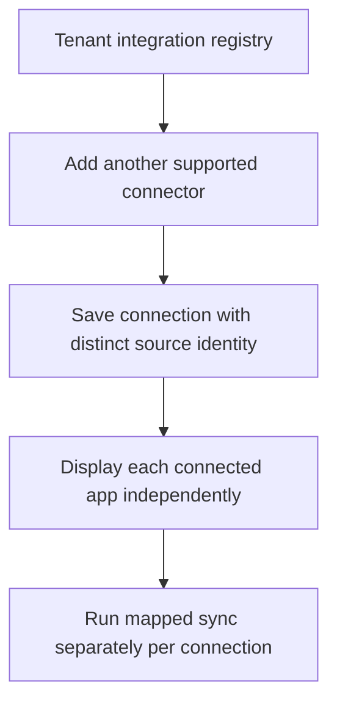
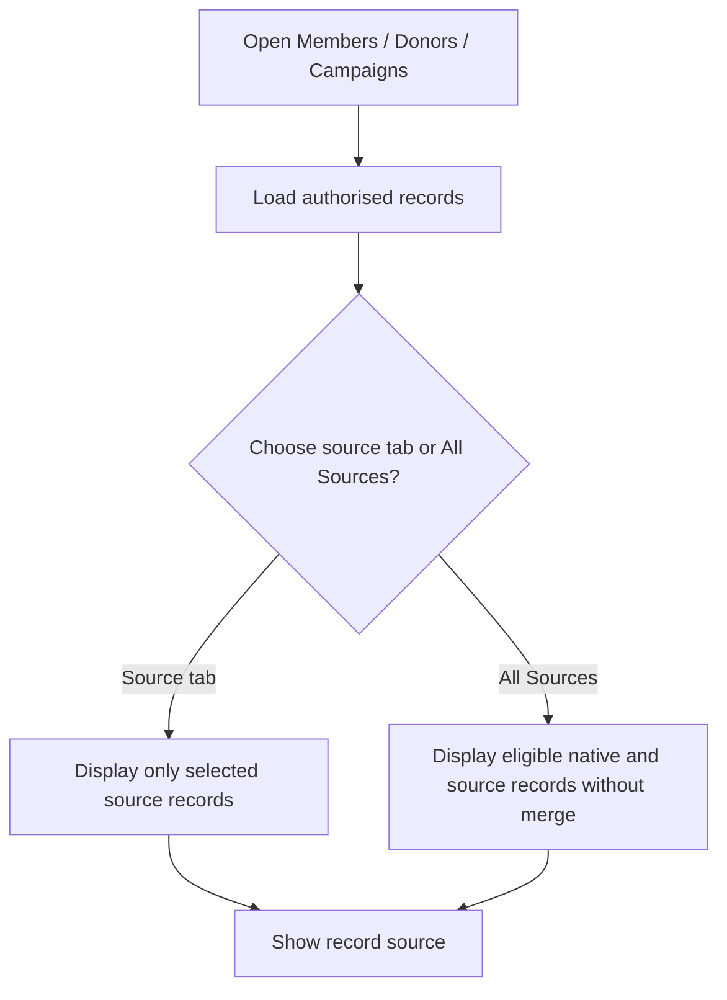

# AiXPurpose – Utilities – BRD Workflow

> **Status:** Draft for Product Owner, QA and Development review. **Classification:** As-Is, To-Be and Future candidates kept separate.

## Document Control

| Field | Value |
|---|---|
| Product | AiXPurpose Standalone, multi-tenant |
| Capability | Utilities: Quick Entry, Import/Export, Duplicate Management, Code Management, Template Manager, API Integration & Data Sync |
| Document | BRD Workflow |
| Version | 1.0 |
| Sources | `utlities module.docx` screenshots and narration; approved Q1–Q8, D1–D3 and incremental-sync decisions |
| Reference conventions | Members/Donors BRDs; Profile/Settings Jira-ready specification format |

**Evidence boundary:** A screen confirms a visible control, not functioning backend logic. No unapproved field mapping, connector contract, reconciliation algorithm or provider behaviour is assumed.

## Contents

1. Purpose and actors
2. End-to-end As-Is and To-Be
3. As-Is workflow inventory and steps
4. Detailed To-Be workflows
5. Future conceptual workflows
6. Exceptions, rules and traceability
7. Screenshot index and outstanding decisions

## 1. Actors and scope

- **Authorised Utilities user:** uses existing functions within permissions (actual role matrix requires verification).
- **Integration administrator:** authorised to configure connectors, trigger sync or backfill; precise permission names not supplied.
- **External source:** supplies mapped records to a tenant connector.
- **AiXPurpose:** preserves native records, source identities and local overrides.
- **QA / Development:** verifies non-functional actions, mapping specifics, failure/retry and field validation rules.

## 2. End-to-end workflow

### As-Is – screenshot-supported navigation


### To-Be – initial history, incremental sync, safe local edit and recovery


### Source data editing lifecycle


## 3. As-Is workflow inventory and QA steps

| Workflow | Feature | Name | Class |
|---|---|---|---|
| UTL-WF-A01 | UTL-A01 | Quick Entry donation grid | As-Is / verify |
| UTL-WF-A02 | UTL-A02 | Quick Entry row management | As-Is / verify |
| UTL-WF-A03 | UTL-A03 | Quick Entry Save All Donations | As-Is / verify |
| UTL-WF-A04 | UTL-A04 | Import data selection | As-Is / verify |
| UTL-WF-A05 | UTL-A05 | Export data actions | As-Is / verify |
| UTL-WF-A06 | UTL-A06 | Duplicate Management overview | As-Is / verify |
| UTL-WF-A07 | UTL-A07 | Code Management listing | As-Is / verify |
| UTL-WF-A08 | UTL-A08 | Add Code action | As-Is / verify |
| UTL-WF-A09 | UTL-A09 | Template Manager listing | As-Is / verify |
| UTL-WF-A10 | UTL-A10 | Create Template action | As-Is / verify |
| UTL-WF-A11 | UTL-A11 | Integration registry | As-Is / verify |
| UTL-WF-A12 | UTL-A12 | Sync Now control | As-Is / verify |
| UTL-WF-A13 | UTL-A13 | Add Integration control | As-Is / verify |
| UTL-WF-A14 | UTL-A14 | Existing connector mapping baseline | As-Is / verify |

### UTL-WF-A01 – Quick Entry donation grid

**Goal:** UTL-GO-001 · **Feature:** UTL-A01 · **State:** As-Is; QA verification.

**Observed:** Enter donor name, amount, date, campaign and payment method in a grid. **Rule:** The screenshot shows rows of donation inputs; it does not establish how member lookup, donation persistence or payment processing works.

**Steps:** (1) Open the named Utilities page. (2) Inspect/use the existing control. (3) Verify and record persisted/effective result or non-functional behaviour.

**QA checkpoint:** Confirm fields, selectable campaign/payment options and correct row display.




### UTL-WF-A02 – Quick Entry row management

**Goal:** UTL-GO-002 · **Feature:** UTL-A02 · **State:** As-Is; QA verification.

**Observed:** Add rows and use the visible per-row remove action. **Rule:** Additional rows show the same donation fields; do not infer bulk-save transactional guarantees.

**Steps:** (1) Open the named Utilities page. (2) Inspect/use the existing control. (3) Verify and record persisted/effective result or non-functional behaviour.

**QA checkpoint:** Add/remove rows and confirm retained field values and the empty-row behaviour.


### UTL-WF-A03 – Quick Entry Save All Donations

**Goal:** UTL-GO-003 · **Feature:** UTL-A03 · **State:** As-Is; QA verification.

**Observed:** Use Save All Donations to submit entered donation rows. **Rule:** User explicitly reports this action non-functional; functional implementation is UTL-P14.

**Steps:** (1) Open the named Utilities page. (2) Inspect/use the existing control. (3) Verify and record persisted/effective result or non-functional behaviour.

**QA checkpoint:** Record existing non-functional outcome, then validate future implementation against UTL-P14.


### UTL-WF-A04 – Import data selection

**Goal:** UTL-GO-004 · **Feature:** UTL-A04 · **State:** As-Is; QA verification.

**Observed:** Select Donors, Donations or Campaigns and choose CSV/Excel files. **Rule:** The screen shows import type and file selection; completion, validations and limits are unverified.

**Steps:** (1) Open the named Utilities page. (2) Inspect/use the existing control. (3) Verify and record persisted/effective result or non-functional behaviour.

**QA checkpoint:** Verify selectable types, file selection, import result and any supported constraints.


### UTL-WF-A05 – Export data actions

**Goal:** UTL-GO-005 · **Feature:** UTL-A05 · **State:** As-Is; QA verification.

**Observed:** Export donors, donations and campaigns using visible controls. **Rule:** Export cards indicate CSV downloads; the precise dataset/permissions remain for QA.

**Steps:** (1) Open the named Utilities page. (2) Inspect/use the existing control. (3) Verify and record persisted/effective result or non-functional behaviour.

**QA checkpoint:** Verify each download, accuracy, scope and permission filtering.


### UTL-WF-A06 – Duplicate Management overview

**Goal:** UTL-GO-006 · **Feature:** UTL-A06 · **State:** As-Is; QA verification.

**Observed:** Access the duplicate management page and its no-duplicates empty state. **Rule:** No matching criteria or merge flow are demonstrated; do not invent existing resolution functions.

**Steps:** (1) Open the named Utilities page. (2) Inspect/use the existing control. (3) Verify and record persisted/effective result or non-functional behaviour.

**QA checkpoint:** Verify empty state with no findings and investigate outcomes with test duplicates.


### UTL-WF-A07 – Code Management listing

**Goal:** UTL-GO-007 · **Feature:** UTL-A07 · **State:** As-Is; QA verification.

**Observed:** Use All Codes, GL Codes and Campaign Codes filters to inspect code, name, description, status and edit controls. **Rule:** Add Code appears but is non-functional. Record editing behaviour is not confirmed.

**Steps:** (1) Open the named Utilities page. (2) Inspect/use the existing control. (3) Verify and record persisted/effective result or non-functional behaviour.

**QA checkpoint:** Verify tab filtering, row content, status and existing edit control.


### UTL-WF-A08 – Add Code action

**Goal:** UTL-GO-008 · **Feature:** UTL-A08 · **State:** As-Is; QA verification.

**Observed:** Use the Add Code control. **Rule:** Existing button is non-functional; new creation is UTL-P15 with field rules open.

**Steps:** (1) Open the named Utilities page. (2) Inspect/use the existing control. (3) Verify and record persisted/effective result or non-functional behaviour.

**QA checkpoint:** Document current failure and test approved creation when implemented.


### UTL-WF-A09 – Template Manager listing

**Goal:** UTL-GO-009 · **Feature:** UTL-A09 · **State:** As-Is; QA verification.

**Observed:** View Email and SMS templates, categories and available Edit/Delete actions. **Rule:** Example templates are shown with names, content previews and tokens; editor behaviour is unverified.

**Steps:** (1) Open the named Utilities page. (2) Inspect/use the existing control. (3) Verify and record persisted/effective result or non-functional behaviour.

**QA checkpoint:** Verify filters, listing, preview and existing edit/delete outcomes.


### UTL-WF-A10 – Create Template action

**Goal:** UTL-GO-010 · **Feature:** UTL-A10 · **State:** As-Is; QA verification.

**Observed:** Use the existing Create Template control. **Rule:** Existing button is non-functional; UTL-P16 handles implementation; do not assume form fields.

**Steps:** (1) Open the named Utilities page. (2) Inspect/use the existing control. (3) Verify and record persisted/effective result or non-functional behaviour.

**QA checkpoint:** Document non-functional outcome and confirm intended input form before implementation.


### UTL-WF-A11 – Integration registry

**Goal:** UTL-GO-011 · **Feature:** UTL-A11 · **State:** As-Is; QA verification.

**Observed:** View configured integration names and displayed status, sync mode and last sync information. **Rule:** Screenshot names DonorPerfect connected and Kindsight disconnected; user separately confirms DonorPerfect and iWave mappings. These are distinct evidence statements.

**Steps:** (1) Open the named Utilities page. (2) Inspect/use the existing control. (3) Verify and record persisted/effective result or non-functional behaviour.

**QA checkpoint:** Verify connectors, status validity and tenant-specific information.


### UTL-WF-A12 – Sync Now control

**Goal:** UTL-GO-012 · **Feature:** UTL-A12 · **State:** As-Is; QA verification.

**Observed:** Use the existing Sync Now action for a connected integration. **Rule:** UI control exists; working incremental logic and sync outcomes are not proven.

**Steps:** (1) Open the named Utilities page. (2) Inspect/use the existing control. (3) Verify and record persisted/effective result or non-functional behaviour.

**QA checkpoint:** QA tests current trigger and observes source effects; UTL-P08 defines target processing.


### UTL-WF-A13 – Add Integration control

**Goal:** UTL-GO-013 · **Feature:** UTL-A13 · **State:** As-Is; QA verification.

**Observed:** Use Add Integration from the integration registry. **Rule:** Existing control non-functional; UTL-P01 is To-Be.

**Steps:** (1) Open the named Utilities page. (2) Inspect/use the existing control. (3) Verify and record persisted/effective result or non-functional behaviour.

**QA checkpoint:** Capture current failure; test onboarding only after approved connector contract.


### UTL-WF-A14 – Existing connector mapping baseline

**Goal:** UTL-GO-014 · **Feature:** UTL-A14 · **State:** As-Is; QA verification.

**Observed:** Use current approved integration mappings as reference. **Rule:** User confirms existing DonorPerfect and iWave integrations/mappings; screenshot presents DonorPerfect and Kindsight. QA/Development must reconcile actual deployed connector availability.

**Steps:** (1) Open the named Utilities page. (2) Inspect/use the existing control. (3) Verify and record persisted/effective result or non-functional behaviour.

**QA checkpoint:** Validate confirmed DonorPerfect/iWave mapping endpoints and target module fields without assuming unseen mapping sheets.


## 4. Approved To-Be workflow inventory

| Workflow | Feature | Name | Class |
|---|---|---|---|
| UTL-WF-P01 | UTL-P01 | Functional Add Integration | To-Be |
| UTL-WF-P02 | UTL-P02 | Multiple connections per tenant | To-Be |
| UTL-WF-P03 | UTL-P03 | Application-wise tabs and All Sources | To-Be |
| UTL-WF-P04 | UTL-P04 | Approved source-to-module mapping | To-Be |
| UTL-WF-P05 | UTL-P05 | Source provenance | To-Be |
| UTL-WF-P06 | UTL-P06 | Manual and integrated records coexist | To-Be |
| UTL-WF-P07 | UTL-P07 | Local overrides and source preservation | To-Be |
| UTL-WF-P08 | UTL-P08 | Initial import and incremental automatic/manual sync | To-Be |
| UTL-WF-P09 | UTL-P09 | Sync status and safe failure handling | To-Be |
| UTL-WF-P10 | UTL-P10 | Per-source record identity and non-merging | To-Be |
| UTL-WF-P11 | UTL-P11 | Tenant isolation | To-Be |
| UTL-WF-P12 | UTL-P12 | Disconnect with data retention | To-Be |
| UTL-WF-P13 | UTL-P13 | Existing mappings and new-connector approval | To-Be |
| UTL-WF-P14 | UTL-P14 | Save All Donations works | To-Be |
| UTL-WF-P15 | UTL-P15 | Functional Add Code | To-Be |
| UTL-WF-P16 | UTL-P16 | Functional Create Template | To-Be |
| UTL-WF-P17 | UTL-P18 | Authorised historical re-sync / backfill | To-Be |

### UTL-WF-P01 – Functional Add Integration

**Goal:** UTL-GO-015 · **Feature:** UTL-P01 · **State:** To-Be.

**Actor:** Authorised tenant user, integration administrator or system sync actor as applicable; permission matrix remains for verification.

**Business logic:** Only Development-approved connectors can be configured; no arbitrary connector wizard is assumed.

**Exception / decision:** Available approved connectors can be selected; invalid/unapproved connector cannot be activated; saved connection appears under tenant; actual connection method requires Development confirmation.




### UTL-WF-P02 – Multiple connections per tenant

**Goal:** UTL-GO-016 · **Feature:** UTL-P02 · **State:** To-Be.

**Actor:** Authorised tenant user, integration administrator or system sync actor as applicable; permission matrix remains for verification.

**Business logic:** A tenant may have multiple integrations; 15 is a scale example, not a delivery count or named connector commitment.

**Exception / decision:** Different supported connections coexist; configuration and data remain tenant-scoped; connection names/status remain identifiable.




### UTL-WF-P03 – Application-wise tabs and All Sources

**Goal:** UTL-GO-017 · **Feature:** UTL-P03 · **State:** To-Be.

**Actor:** Authorised tenant user, integration administrator or system sync actor as applicable; permission matrix remains for verification.

**Business logic:** Within eligible Members, Donors, Campaigns and other mapped modules, display separate application tabs and All Sources, plus native records where eligible; no cross-source merge.

**Exception / decision:** Each source tab contains its own supported records; All Sources can include repeated cross-source identities; user can distinguish origin; zero-data source shows empty state.




### UTL-WF-P04 – Approved source-to-module mapping

**Goal:** UTL-GO-018 · **Feature:** UTL-P04 · **State:** To-Be.

**Actor:** Authorised tenant user, integration administrator or system sync actor as applicable; permission matrix remains for verification.

**Business logic:** Keep verified DonorPerfect/iWave mappings; client supplies source fields for new connectors and Product/Development approve destination mapping; unsupported fields are not silently invented.

**Exception / decision:** Mapped entity lands in proper eligible module; unmapped information is not misfiled; mappings are reviewed per connector; tenant boundary respected.


```mermaid
flowchart TD
    A["Receive connector payload"] --> B["Lookup approved source-to-module mapping"]
    B --> C{"Entity and fields supported?"}
    C -->|No| D["Flag unmapped; no incorrect destination"]
    C -->|Yes| E["Map to approved target fields"]
    E --> F["Commit eligible module record"]
```

### UTL-WF-P05 – Source provenance

**Goal:** UTL-GO-019 · **Feature:** UTL-P05 · **State:** To-Be.

**Actor:** Authorised tenant user, integration administrator or system sync actor as applicable; permission matrix remains for verification.

**Business logic:** Preserve tenant, connector/source reference, source record identifier and current connection status at a logical business level; exact technical identifiers are Development-defined.

**Exception / decision:** Every imported record reports origin; repeat sync retains attribution; local edits do not erase source; disconnected sources remain identified.


```mermaid
flowchart TD
    A["Receive source record"] --> B["Capture tenant, connector and source identity"]
    B --> C["Store provenance with record"]
    C --> D["Expose source in source tab / record context"]
    D --> E["Keep source after local edits or disconnect"]
```

### UTL-WF-P06 – Manual and integrated records coexist

**Goal:** UTL-GO-020 · **Feature:** UTL-P06 · **State:** To-Be.

**Actor:** Authorised tenant user, integration administrator or system sync actor as applicable; permission matrix remains for verification.

**Business logic:** Manual Add Member and donation functions are not dependent on external connections; source records remain separately traceable.

**Exception / decision:** Manual records remain visible without integrations; integrated records do not remove native records; cross-source auto-merge does not occur.


```mermaid
flowchart TD
    A["User creates native record"] --> B["Store as AiXPurpose-origin"]
    C["External source sync"] --> D["Store source-specific record"]
    B --> E["Relevant module view"]
    D --> E
    E --> F["All Sources view; no automatic cross-source merge"]
```

### UTL-WF-P07 – Local overrides and source preservation

**Goal:** UTL-GO-021 · **Feature:** UTL-P07 · **State:** To-Be.

**Actor:** Authorised tenant user, integration administrator or system sync actor as applicable; permission matrix remains for verification.

**Business logic:** For an authorised local edit, store latest source value separately and show local value as effective; unedited fields may reflect new source updates; outbound source updates are excluded.

**Exception / decision:** Override survives incremental sync and historical backfill; latest source value available; non-overridden field updates from source; unauthorized edits denied; no source writeback implied.


```mermaid
flowchart TD
    A["Open integrated record"] --> B["Authorised user edits supported field"]
    B --> C["Save local override"]
    C --> D["Display local effective value"]
    D --> E["Subsequent source sync"]
    E --> F["Refresh latest source value separately"]
    F --> G["Keep local effective value; update unedited fields"]
```

### UTL-WF-P08 – Initial import and incremental automatic/manual sync

**Goal:** UTL-GO-022 · **Feature:** UTL-P08 · **State:** To-Be.

**Actor:** Authorised tenant user, integration administrator or system sync actor as applicable; permission matrix remains for verification.

**Business logic:** First connection imports available historical records; thereafter both triggers use per-connector last successful position and supported change retrieval; schedule frequency is open.

**Exception / decision:** Initial history imported; subsequent sync retrieves eligible changes not full history; manual and scheduled use same processing; matching prevents repeats; failed run does not skip unprocessed data.


```mermaid
flowchart TD
    A["Connected integration"] --> B{"Initial history imported?"}
    B -->|No| C["Import available historical records"]
    B -->|Yes| D["Scheduled trigger or Sync Now"]
    D --> E["Fetch supported changes since successful sync position"]
    C --> F["Map and match within source"]
    E --> F
    F --> G["Commit safe updates and valid checkpoint"]
```

### UTL-WF-P09 – Sync status and safe failure handling

**Goal:** UTL-GO-023 · **Feature:** UTL-P09 · **State:** To-Be.

**Actor:** Authorised tenant user, integration administrator or system sync actor as applicable; permission matrix remains for verification.

**Business logic:** Show connection and last successful sync status, errors; source-specific checkpoints advance only for successfully committed processing under defined partial-success policy.

**Exception / decision:** Failed connector shows failure; committed records remain; last-successful position cannot falsely advance past failures; statuses distinguish pending/running/completed/failure where supported.


```mermaid
flowchart TD
    A["Sync starts"] --> B["Show running status"]
    B --> C{"Processing outcome?"}
    C -->|Success| D["Commit and show last successful sync"]
    C -->|Failure / partial| E["Retain committed data; report error"]
    E --> F["Do not skip unsuccessful source changes"]
```

### UTL-WF-P10 – Per-source record identity and non-merging

**Goal:** UTL-GO-024 · **Feature:** UTL-P10 · **State:** To-Be.

**Actor:** Authorised tenant user, integration administrator or system sync actor as applicable; permission matrix remains for verification.

**Business logic:** Match repeats within the same source to the existing source record; never automatically merge SAP/Salesforce/iWave identities across apps; duplicate review and reporting unique counts remain separate issues.

**Exception / decision:** Repeat source record updates rather than duplicates; cross-source records remain separate; duplicate detection does not silently merge; Donors still need eligible Member linkage.


```mermaid
flowchart TD
    A["Receive mapped source record"] --> B["Check tenant + same-source identity"]
    B --> C{"Same source record exists?"}
    C -->|Yes| D["Update that source record safely"]
    C -->|No| E["Create new source record"]
    D --> F["Keep other applications separate"]
    E --> F
```

### UTL-WF-P11 – Tenant isolation

**Goal:** UTL-GO-025 · **Feature:** UTL-P11 · **State:** To-Be.

**Actor:** Authorised tenant user, integration administrator or system sync actor as applicable; permission matrix remains for verification.

**Business logic:** Every sync, source record, override, log and backfill belongs to an authorised tenant; platform architecture not prescribed.

**Exception / decision:** Tenant A cannot view/configure/sync Tenant B; tab and All Sources use only authorised tenant records; forbidden requests are rejected.


```mermaid
flowchart TD
    A["User or sync requests tenant data"] --> B["Resolve authorised tenant"]
    B --> C{"Matches requested connector/record tenant?"}
    C -->|No| D["Deny access / processing"]
    C -->|Yes| E["Permit authorised tenant operation"]
```

### UTL-WF-P12 – Disconnect with data retention

**Goal:** UTL-GO-026 · **Feature:** UTL-P12 · **State:** To-Be.

**Actor:** Authorised tenant user, integration administrator or system sync actor as applicable; permission matrix remains for verification.

**Business logic:** Mark connection Disconnected; keep historical data and provenance; whether records remain editable or in normal listings is open.

**Exception / decision:** Data is not silently deleted; source displays disconnected status; no new sync until restored; visibility/edit controls follow later-approved policy.


```mermaid
flowchart TD
    A["Disconnect connector"] --> B["Mark source disconnected"]
    B --> C["Retain committed historical records and source identity"]
    C --> D["Prevent further active sync"]
    D --> E["Apply future-approved edit/visibility policy"]
```

### UTL-WF-P13 – Existing mappings and new-connector approval

**Goal:** UTL-GO-027 · **Feature:** UTL-P13 · **State:** To-Be.

**Actor:** Authorised tenant user, integration administrator or system sync actor as applicable; permission matrix remains for verification.

**Business logic:** DonorPerfect and iWave are user-confirmed existing mapped integrations; client field specification is required for additional source; Development approves connector support.

**Exception / decision:** Existing verified mapping is not replaced; new mappings documented and approved before sync; unsupported entities are not sent to unrelated modules.


```mermaid
flowchart TD
    A["Source integration requirement"] --> B{"DonorPerfect/iWave mapping already approved?"}
    B -->|Yes| C["Retain and verify existing mapping"]
    B -->|No| D["Client supplies source fields"]
    D --> E["Development/Product approve connector and mapping"]
    C --> F["Apply supported module mapping"]
    E --> F
```

### UTL-WF-P14 – Save All Donations works

**Goal:** UTL-GO-028 · **Feature:** UTL-P14 · **State:** To-Be.

**Actor:** Authorised tenant user, integration administrator or system sync actor as applicable; permission matrix remains for verification.

**Business logic:** Implement the existing action and enforce the approved Donors/Members identity relationship and campaign reference requirements; per-row partial success is open.

**Exception / decision:** Authorized save submits rows; invalid data gets actionable outcome without unapproved transactions; committed donations link to eligible members and existing campaigns; repeated clicks do not create unapproved duplicates.


```mermaid
flowchart TD
    A["Add donation rows"] --> B["Click Save All Donations"]
    B --> C["Validate member linkage, campaign and approved fields"]
    C --> D{"Rows valid under approved policy?"}
    D -->|No| E["Show row outcomes; no unapproved record"]
    D -->|Yes| F["Save eligible donations and show result"]
```

### UTL-WF-P15 – Functional Add Code

**Goal:** UTL-GO-029 · **Feature:** UTL-P15 · **State:** To-Be.

**Actor:** Authorised tenant user, integration administrator or system sync actor as applicable; permission matrix remains for verification.

**Business logic:** Add Code should become operational for the applicable GL/Campaign categorisation; input fields, uniqueness and permissions are open decisions.

**Exception / decision:** Permitted user can access and submit approved form; accepted code appears in proper list/tab; invalid input rejected per approved rule; existing codes unchanged.


```mermaid
flowchart TD
    A["Open Code Management"] --> B["Click Add Code"]
    B --> C["Enter fields defined by approved code form"]
    C --> D{"Approved validation passes?"}
    D -->|No| E["Show validation errors"]
    D -->|Yes| F["Create code and update correct list"]
```

### UTL-WF-P16 – Functional Create Template

**Goal:** UTL-GO-030 · **Feature:** UTL-P16 · **State:** To-Be.

**Actor:** Authorised tenant user, integration administrator or system sync actor as applicable; permission matrix remains for verification.

**Business logic:** Enable existing button; fields and template tokens/validation require Product confirmation; do not infer a delivery or approval engine.

**Exception / decision:** Permitted user can create approved Email/SMS type; newly created template appears in proper filter; invalid form handled; existing templates remain.


```mermaid
flowchart TD
    A["Open Template Manager"] --> B["Click Create Template"]
    B --> C["Choose existing Email/SMS type and approved fields"]
    C --> D{"Validation passes?"}
    D -->|No| E["Show errors"]
    D -->|Yes| F["Save template and display in selected category"]
```

### UTL-WF-P17 – Authorised historical re-sync / backfill

**Goal:** UTL-GO-031 · **Feature:** UTL-P18 · **State:** To-Be.

**Actor:** Authorised tenant user, integration administrator or system sync actor as applicable; permission matrix remains for verification.

**Business logic:** Controlled backfill uses approved connector mappings and source identity matching; authorised action only; separate from future advanced sync history.

**Exception / decision:** Earlier missed record can be recovered; repeated backfill does not duplicate same source ID; local overrides survive; outcome/failure recorded; tenant access enforced.


```mermaid
flowchart TD
    A["Authorised backfill request"] --> B["Select approved historical range/source"]
    B --> C["Fetch eligible older records"]
    C --> D["Match existing source identity and apply mapping"]
    D --> E["Preserve local overrides / update source values"]
    E --> F["Commit results and report failures"]
```

## 5. Future conceptual workflow inventory (not authorised for delivery)

| Workflow | Feature | Concept |
|---|---|---|
| UTL-WF-F01 | UTL-F01 | Advanced scheduling controls |
| UTL-WF-F02 | UTL-F02 | Two-way source writeback |
| UTL-WF-F03 | UTL-F03 | Tenant-controlled advanced mappings |
| UTL-WF-F04 | UTL-F04 | Integration health dashboard |
| UTL-WF-F05 | UTL-F05 | Detailed sync history and reconciliation |
| UTL-WF-F06 | UTL-F06 | Configurable source priorities |
| UTL-WF-F07 | UTL-F07 | Integration-specific access controls |

### UTL-WF-F01 – Advanced scheduling controls

**Goal:** UTL-GO-032 · **Feature:** UTL-F01. Conceptual only, subject to independent approval. Future option beyond initial automatic incremental sync; no committed schedule settings.


```mermaid
flowchart TD
    A["Future capability proposal"] --> B["Confirm business need and ownership"]
    B --> C{"Separately approved?"}
    C -->|No| D["Remain in future backlog"]
    C -->|Yes| E["Define detailed rules / interfaces"]
    E --> F["Implement and validate proposed capability"]
```

### UTL-WF-F02 – Two-way source writeback

**Goal:** UTL-GO-033 · **Feature:** UTL-F02. Conceptual only, subject to independent approval. No writeback in To-Be; future requires source API support, authorisation, conflict and error rules.


```mermaid
flowchart TD
    A["Future capability proposal"] --> B["Confirm business need and ownership"]
    B --> C{"Separately approved?"}
    C -->|No| D["Remain in future backlog"]
    C -->|Yes| E["Define detailed rules / interfaces"]
    E --> F["Implement and validate proposed capability"]
```

### UTL-WF-F03 – Tenant-controlled advanced mappings

**Goal:** UTL-GO-034 · **Feature:** UTL-F03. Conceptual only, subject to independent approval. Baseline mappings remain client-supplied and Development-approved; interactive designer is optional.


```mermaid
flowchart TD
    A["Future capability proposal"] --> B["Confirm business need and ownership"]
    B --> C{"Separately approved?"}
    C -->|No| D["Remain in future backlog"]
    C -->|Yes| E["Define detailed rules / interfaces"]
    E --> F["Implement and validate proposed capability"]
```

### UTL-WF-F04 – Integration health dashboard

**Goal:** UTL-GO-035 · **Feature:** UTL-F04. Conceptual only, subject to independent approval. Not required for baseline per-connector status.


```mermaid
flowchart TD
    A["Future capability proposal"] --> B["Confirm business need and ownership"]
    B --> C{"Separately approved?"}
    C -->|No| D["Remain in future backlog"]
    C -->|Yes| E["Define detailed rules / interfaces"]
    E --> F["Implement and validate proposed capability"]
```

### UTL-WF-F05 – Detailed sync history and reconciliation

**Goal:** UTL-GO-036 · **Feature:** UTL-F05. Conceptual only, subject to independent approval. Baseline shows results needed for current sync and backfill; detailed investigative dashboard is optional.


```mermaid
flowchart TD
    A["Future capability proposal"] --> B["Confirm business need and ownership"]
    B --> C{"Separately approved?"}
    C -->|No| D["Remain in future backlog"]
    C -->|Yes| E["Define detailed rules / interfaces"]
    E --> F["Implement and validate proposed capability"]
```

### UTL-WF-F06 – Configurable source priorities

**Goal:** UTL-GO-037 · **Feature:** UTL-F06. Conceptual only, subject to independent approval. Currently separate source records and local overrides; no automatic cross-source winner.


```mermaid
flowchart TD
    A["Future capability proposal"] --> B["Confirm business need and ownership"]
    B --> C{"Separately approved?"}
    C -->|No| D["Remain in future backlog"]
    C -->|Yes| E["Define detailed rules / interfaces"]
    E --> F["Implement and validate proposed capability"]
```

### UTL-WF-F07 – Integration-specific access controls

**Goal:** UTL-GO-038 · **Feature:** UTL-F07. Conceptual only, subject to independent approval. Initial access is tenant- and role-scoped, not per-source granular permission model.


```mermaid
flowchart TD
    A["Future capability proposal"] --> B["Confirm business need and ownership"]
    B --> C{"Separately approved?"}
    C -->|No| D["Remain in future backlog"]
    C -->|Yes| E["Define detailed rules / interfaces"]
    E --> F["Implement and validate proposed capability"]
```

## 6. Shared validations, exceptions and traceability

| Business rule | Workflow principle |
|---|---|
| UTL-BR-001 | All pre-existing Utilities UI and behaviour remains a QA baseline; nonfunctional actions are labelled. |
| UTL-BR-002 | Tenant isolation applies to integrations, source records, local modifications and processing. |
| UTL-BR-003 | New connectors and their mappings need client data and Development approval. |
| UTL-BR-004 | Preserve source application and source record identity on sync. |
| UTL-BR-005 | Records from different applications remain separate; All Sources is not an automatic merge. |
| UTL-BR-006 | Native AiXPurpose records coexist with external-source records. |
| UTL-BR-007 | Locally overridden field is the effective value; preserve latest source value. |
| UTL-BR-008 | First sync imports available history, then supported incremental changes. |
| UTL-BR-009 | Scheduled sync and Sync Now share mapping/matching/override rules. |
| UTL-BR-010 | Retry/backfill must not duplicate source records or erase local edits. |
| UTL-BR-011 | Failed processing must not overwrite committed data or incorrectly advance a cursor. |
| UTL-BR-012 | Disconnect retains stored source data and marks source disconnected. |
| UTL-BR-013 | Donor records respect existing Member–Donor eligibility and donation rules. |
| UTL-BR-014 | No source writeback unless separately authorised in future scope. |
| UTL-BR-015 | KPI deduplication/counting and disconnected record editability remain open. |

### Decision boundaries

- Errors must not manufacture records or overwrite valid local changes.
- Backfill may be re-run but same-source matching must prevent duplicate committed identities.
- Unmapped/unsupported source fields must not flow into a guessed target module.
- Consolidated unique KPI formulas, granular disconnected-record permissions and partial-success policies remain open.
- Existing quick-entry/member/donor/campaign constraints apply; unspecified validations are not invented.

| Goal | Feature | Workflow | Capability |
|---|---|---|---|
| UTL-GO-001 | UTL-A01 | UTL-WF-A01 | Quick Entry donation grid |
| UTL-GO-002 | UTL-A02 | UTL-WF-A02 | Quick Entry row management |
| UTL-GO-003 | UTL-A03 | UTL-WF-A03 | Quick Entry Save All Donations |
| UTL-GO-004 | UTL-A04 | UTL-WF-A04 | Import data selection |
| UTL-GO-005 | UTL-A05 | UTL-WF-A05 | Export data actions |
| UTL-GO-006 | UTL-A06 | UTL-WF-A06 | Duplicate Management overview |
| UTL-GO-007 | UTL-A07 | UTL-WF-A07 | Code Management listing |
| UTL-GO-008 | UTL-A08 | UTL-WF-A08 | Add Code action |
| UTL-GO-009 | UTL-A09 | UTL-WF-A09 | Template Manager listing |
| UTL-GO-010 | UTL-A10 | UTL-WF-A10 | Create Template action |
| UTL-GO-011 | UTL-A11 | UTL-WF-A11 | Integration registry |
| UTL-GO-012 | UTL-A12 | UTL-WF-A12 | Sync Now control |
| UTL-GO-013 | UTL-A13 | UTL-WF-A13 | Add Integration control |
| UTL-GO-014 | UTL-A14 | UTL-WF-A14 | Existing connector mapping baseline |
| UTL-GO-015 | UTL-P01 | UTL-WF-P01 | Functional Add Integration |
| UTL-GO-016 | UTL-P02 | UTL-WF-P02 | Multiple connections per tenant |
| UTL-GO-017 | UTL-P03 | UTL-WF-P03 | Application-wise tabs and All Sources |
| UTL-GO-018 | UTL-P04 | UTL-WF-P04 | Approved source-to-module mapping |
| UTL-GO-019 | UTL-P05 | UTL-WF-P05 | Source provenance |
| UTL-GO-020 | UTL-P06 | UTL-WF-P06 | Manual and integrated records coexist |
| UTL-GO-021 | UTL-P07 | UTL-WF-P07 | Local overrides and source preservation |
| UTL-GO-022 | UTL-P08 | UTL-WF-P08 | Initial import and incremental automatic/manual sync |
| UTL-GO-023 | UTL-P09 | UTL-WF-P09 | Sync status and safe failure handling |
| UTL-GO-024 | UTL-P10 | UTL-WF-P10 | Per-source record identity and non-merging |
| UTL-GO-025 | UTL-P11 | UTL-WF-P11 | Tenant isolation |
| UTL-GO-026 | UTL-P12 | UTL-WF-P12 | Disconnect with data retention |
| UTL-GO-027 | UTL-P13 | UTL-WF-P13 | Existing mappings and new-connector approval |
| UTL-GO-028 | UTL-P14 | UTL-WF-P14 | Save All Donations works |
| UTL-GO-029 | UTL-P15 | UTL-WF-P15 | Functional Add Code |
| UTL-GO-030 | UTL-P16 | UTL-WF-P16 | Functional Create Template |
| UTL-GO-031 | UTL-P18 | UTL-WF-P17 | Authorised historical re-sync / backfill |
| UTL-GO-032 | UTL-F01 | UTL-WF-F01 | Advanced scheduling controls |
| UTL-GO-033 | UTL-F02 | UTL-WF-F02 | Two-way source writeback |
| UTL-GO-034 | UTL-F03 | UTL-WF-F03 | Tenant-controlled advanced mappings |
| UTL-GO-035 | UTL-F04 | UTL-WF-F04 | Integration health dashboard |
| UTL-GO-036 | UTL-F05 | UTL-WF-F05 | Detailed sync history and reconciliation |
| UTL-GO-037 | UTL-F06 | UTL-WF-F06 | Configurable source priorities |
| UTL-GO-038 | UTL-F07 | UTL-WF-F07 | Integration-specific access controls |

## 7. Screenshot index and open decisions

| Image | Screen | Relative path |
|---|---|---|
| 01 | quick_entry_single | screenshots/01_quick_entry_single.png |
| 02 | quick_entry_multiple | screenshots/02_quick_entry_multiple.png |
| 03 | import_export | screenshots/03_import_export.png |
| 04 | duplicate_management | screenshots/04_duplicate_management.png |
| 05 | code_management_all | screenshots/05_code_management_all.png |
| 06 | code_management_gl | screenshots/06_code_management_gl.png |
| 07 | template_manager | screenshots/07_template_manager.png |
| 08 | api_data_sync | screenshots/08_api_data_sync.png |

| ID | Decision | Owner |
|---|---|---|
| UTL-OD-001 | Cross-source KPI counting and unique-person reporting | Reporting/Product |
| UTL-OD-002 | Incomplete member identity for externally sourced donations | Members/Donors Product |
| UTL-OD-003 | Initial approved connector list beyond confirmed DonorPerfect and iWave | Development |
| UTL-OD-004 | Default sync schedule, sync source change-token/timestamp capabilities | Product/Development |
| UTL-OD-005 | Visibility, editing and reporting after disconnect | Product |
| UTL-OD-006 | Partial commit, retry and failed-row outcomes | Development/QA |
| UTL-OD-007 | Add Code fields, validation, uniqueness and access | Product/Development |
| UTL-OD-008 | Create Template fields, supported tokens and rules | Product/Development |
| UTL-OD-009 | Quick Entry invalid-row, all-or-nothing vs partial save, duplicate-safe outcomes | Product/Development |
| UTL-OD-010 | Same-source record identity matching and backfill boundaries | Development |
| UTL-OD-011 | Exact fields allowed for local source-record editing | Product/Module owners |
| UTL-OD-012 | Existing Kindsight screenshot vs confirmed iWave integration: environment/connector status | QA/Development |

**Related documents:** Goals: `Utilities_BRD_Goals.md` · Workflow: `Utilities_BRD_Workflow.md` · Feature Catalogue: `Utilities_BRD_Feature_Catalogue.md`.
